# Architecture Diagrams — Mermaid 원본과 검증 범위

그림은 현재 코드를 바탕으로 재구성한 설계도다. 실제 화면 캡처가 아니며, 모든 연결이 동일 시험에서 성공했다는 뜻이 아니다. 운영 호출의 기준은 [종합 보고서](Autonomous_SOC_Agent_Technical_Report.md)와 [Evidence Index](Evidence_Index.md)다.

## 그림 1. 전체 시스템

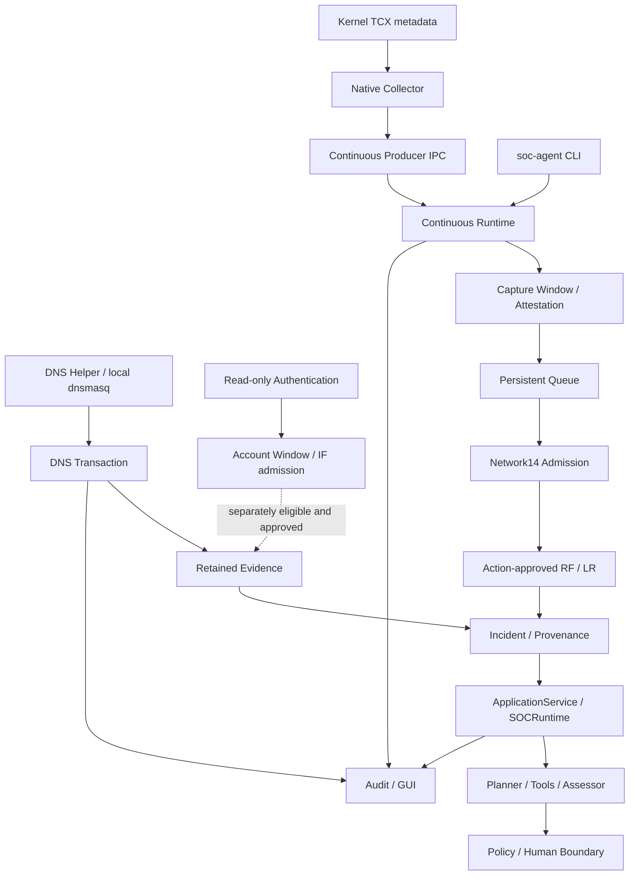

수집·추론·조사·집행을 분리한다. Native RF/LR·DNS Transaction은 제한 실환경 증거가 있지만 Host IF와 DNS9 Raw inference는 동일 범위로 검증되지 않았다. 점선은 별도 admission 경계다. E02–E09.

## 그림 2. Native Packet 처리

```mermaid
flowchart LR
 K[TCX Ingress] --> B[Ring / Counter / Epoch]
 B --> C[Collector READY]
 C --> I[Authenticated Producer IPC]
 I --> S[Sequence / namespace / monotonic clock]
 S --> A[Window aggregation]
 A --> SE[Seal + counter range]
 SE --> AT[Capture Attestation]
 AT --> N[Network14 eligible candidate]
 N --> Q[Queue / action wait]
 Q --> RF[RF and LR receipt]
```

TCX의 메타데이터와 Kernel monotonic ns를 UTC로 임의 변환하지 않는다. Producer 확인·수집량·Window 완결성·Action은 독립 조건이다. 마지막 부분 Window는 INCOMPLETE로 남는다. E02–E04/E11.

## 그림 3. DNS Transaction

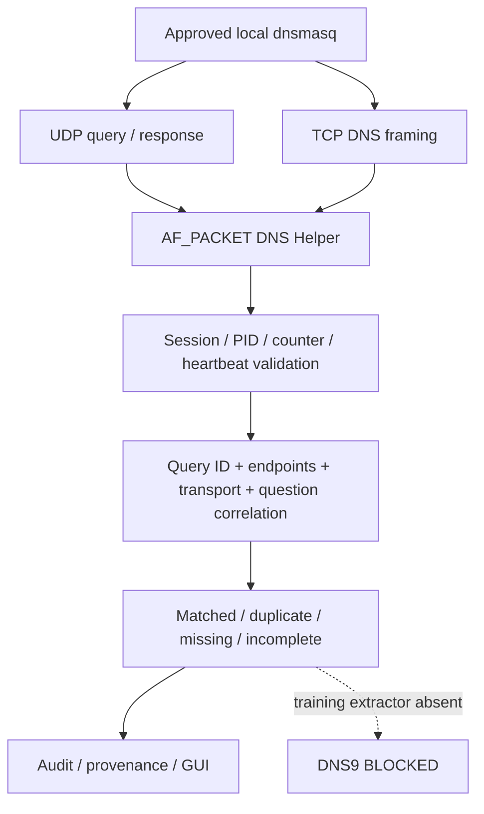

DNS Helper는 TCX packet metadata와 별도 raw 경로다. Raw/Transaction 성공과 DNS9 모델 성공을 구분한다. Stored TCP parser는 whole length-prefixed message만 허용하고 완전한 임의 stream reassembly로 과장하지 않는다. E06/E12/E16.

## 그림 4. Authentication

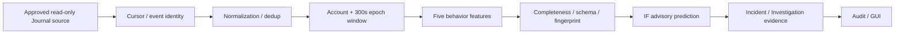

구현된 읽기 전용 Host 경로와 학습 pipeline 구조다. 실제 Host 수집·IF inference의 신규 성공 증거는 없으므로 전체 그림을 VERIFIED_NATIVE로 표기하지 않는다. E07.

## 그림 5. AI Orchestration

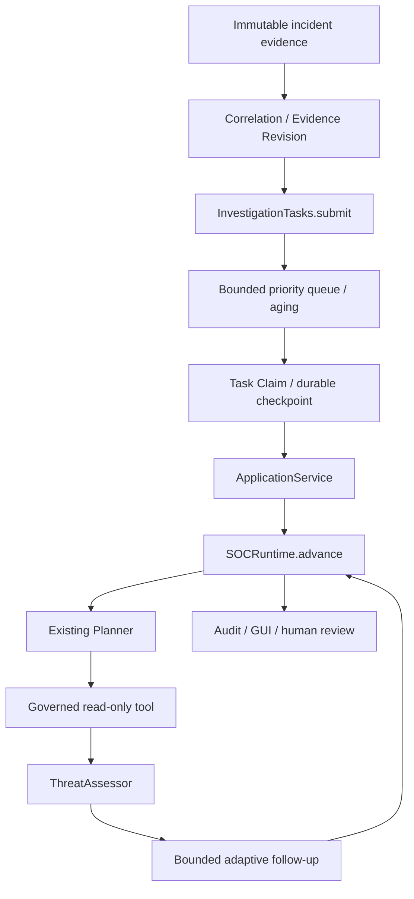

고정 Network/DNS/Auth/Investigation 역할이며 별도 범용 Agent Registry를 만들지 않았다. deterministic claim/lock과 AI 제안을 분리한다. 기본 Continuous client는 SCRIPTED이며 API 성공은 별도 기록이다. E08/E10.

## 그림 6. Model Admission

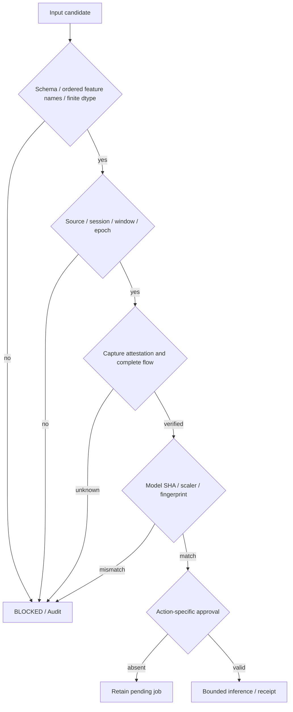

결측값·잘못된 방향/시계·다른 Session·미승인 모델 실행을 차단한다. 여러 실제 검증 계층을 요약한 그림이며 단일 만능 판정 함수가 아니다. Action이 없는 Prediction 0은 정상 차단이다.E02–E04/E15.

## 그림 7. Incident Investigation

```mermaid
sequenceDiagram
 participant Q as Investigation Queue
 participant S as SOCRuntime
 participant P as Planner
 participant T as Read-only Tool
 participant A as Assessor
 participant C as Checkpoint/Audit
 Q->>S: claim task + pinned revision
 S->>C: persist claim before external step
 S->>P: structured plan request
 P-->>S: validated proposal
 S->>T: schema + permission checked step
 T-->>S: source-bound evidence
 S->>A: observations + hypotheses separately
 A-->>S: assessment / uncertainty
 S->>C: checkpoint + trace
 Note over S,C: bounded follow-up or human review; no automatic uncertain-call replay
```

Collector는 이 조사 체인에서 LLM을 동기 대기하지 않는다. 외부 단계 중 Crash는 불확실성을 보존하며 무조건 재호출하지 않는다. 실제 Native에서 발생하지 않은 conflict/replan을 Fixture 결과로 대체하지 않는다.E08/E10.

## 그림 8. Control / Data Plane

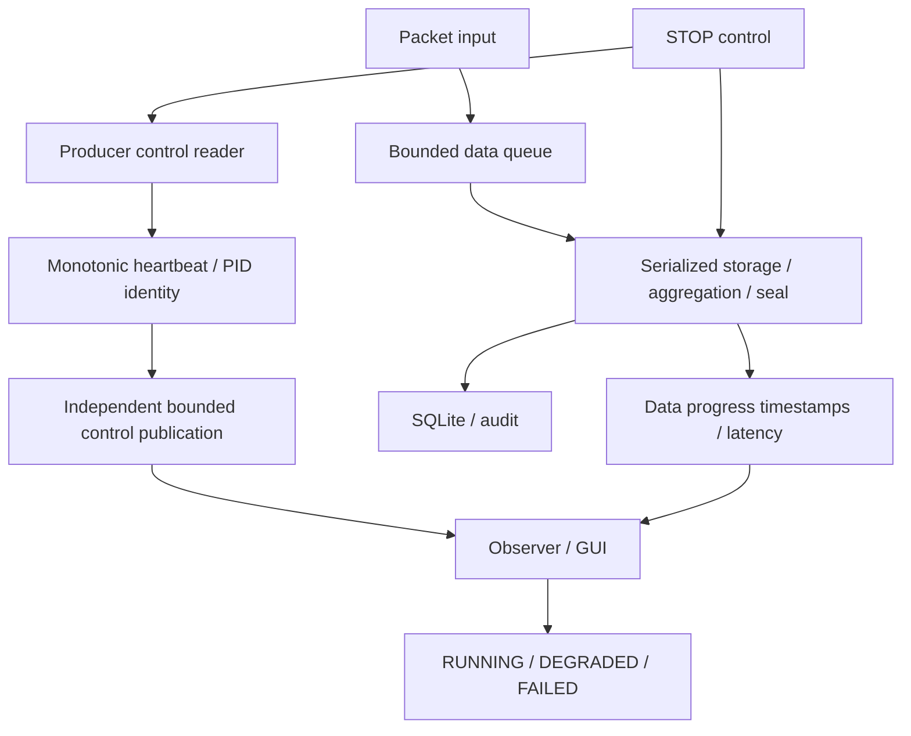

Control Heartbeat는 긴 SQLite 트랜잭션 완료를 기다리지 않는다. Heartbeat가 정상이어도 데이터가 정체되면 DEGRADED로 표시해야 하며, process exit는 PID/start 검증으로 구분한다. DNS 상태 관측도 durable write 뒤에 직렬 대기해서는 안 된다.E02/E14/E16.

## 그림 9. STOP / Cleanup

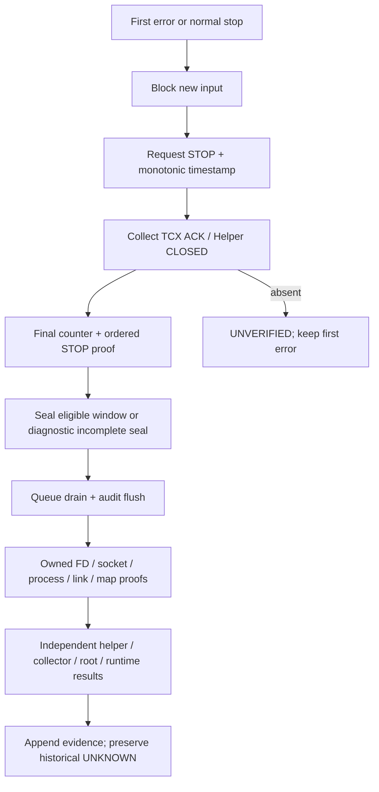

Exit0는 모든 Cleanup의 증명이 아니다. Pending model task 보존과 입력/감사 flush를 구분한다. 현재 소유 범위 verified를 과거 또는 GlobalKernel로 확대하지 않는다. E10–E14.

## 그림 10. Git·Artifact·Approval Binding

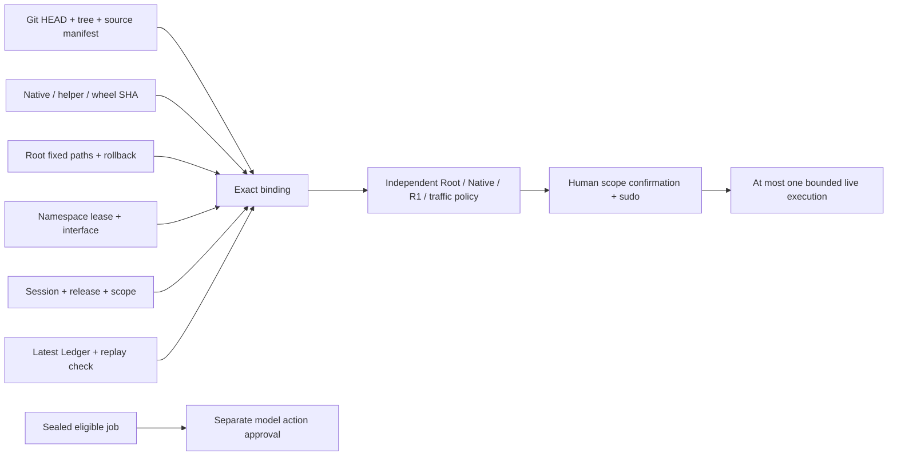

Source/Artifact 변경 후 기존 승인을 자동 승계하지 않는다. CLI가 SHA를 계산·검증하고 사용자는 Scope를 확인한다. 인간 결정·정책 Receipt·실제 실행은 별도 증거로 남긴다.E01/E15/E17.

## 실제 화면과 설계도의 구분

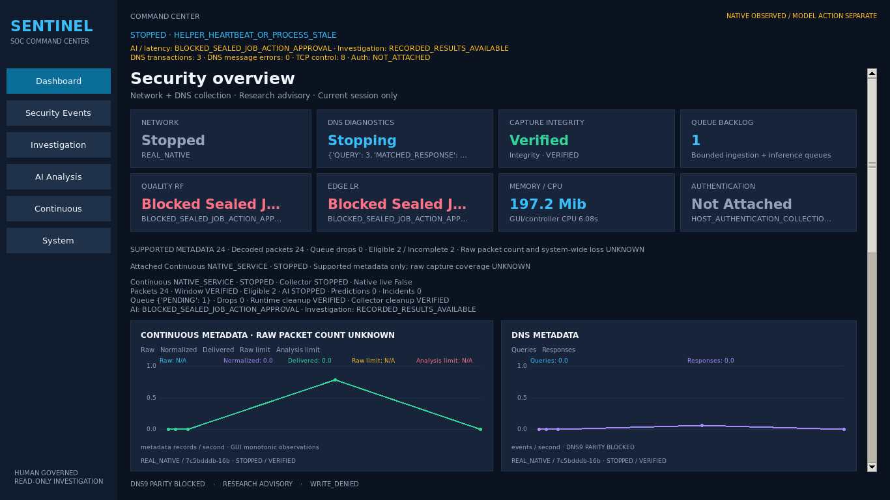

실제 보존 실패 Session E12/E18. Packet24·DNS3·모델 미실행·종료 오류를 보여준다. 실패 시점의 DNS STOPPING 표시도 원본 그대로이며 현재 코드 수정 후 Live 성공 화면이 아니다. Screenshot이 존재한다고 장시간 관제 성공을 판정하지 않는다.

## 보존된 제한 Native 성공의 조사 화면

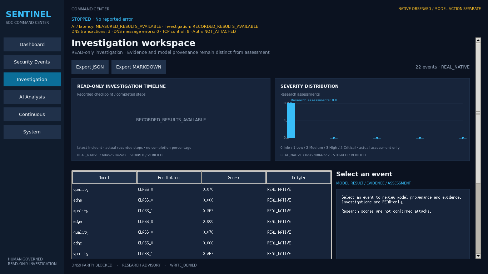

E11/E20의c542398실행·보존Backend를읽은실제Tk화면이다. RF/LR8개의실제receipt와SCRIPTED조사결과를사용한다. GUI의22events표시는모든투영event수이며Prediction22회로해석하지않는다. researchscore는공격확정이아니다.

## 별도 실제 API Assessment Timeout 화면

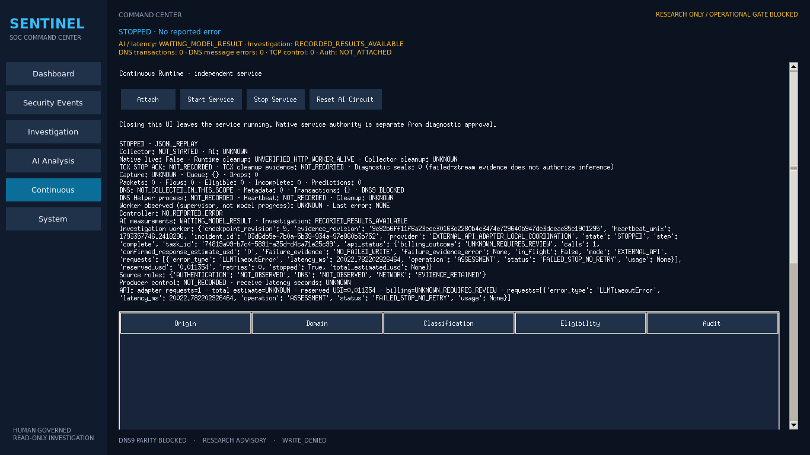

11월2일의별도1회API재검증이다. NativeLive=false/보존NativeEvidence를사용하는표시runtime이며1회AssessmentTimeout·Usage없음·billingUNKNOWN·HTTPworker alive/cleanupUNVERIFIED를보여준다. 이를새Native수집또는성공한LLMAssessment화면으로표시하지않는다. API Key·민감payload를추가하지않았다.
