# Authentication IF — 최종 연결 보완

상태: IF 연결·집중 검증 완료, 전체 회귀 일부 시간 경계 실패 유지. 실제 Host/Native/IF/API 실행 없음. 기준 `7efcf8f`의 기존
collector/parser/store/extractor/package/SOCRuntime/GUI를 재사용한다.

## 입력 계약과 보장 범위

Host 수집기는 기존 `LinuxJournalCollector`와 `native_authentication.project_journal`이다.
Journal selector는 `SYSLOG_FACILITY=4 SYSLOG_FACILITY=10 + _COMM=sshd`이며 정확한
systemd Unit allowlist가 아니다. 현재 UID의 읽기 권한만 사용한다. ACL·그룹·Root
권한을 추가하지 않는다. 기존 trusted sshd 최종 Accepted/Failed 및 선택된 sudo PAM failure parser가 수용하는 이벤트만
대상이다. SSH 성공과 실패는 모두 지원하지만, 모든 Host 인증 방식·PAM session을 포괄하는 감사 수집기로 확대 해석하지 않는다.

원문 MESSAGE, 사용자명, IP는 IF 작업에 복사하지 않는다. 기존 parser의 가명화된
account/source 식별자를 유지한다. 결정적 해시는 완전한 익명화 보장이 아니다.
Journal cursor/이벤트 identity로 기존 Store에서 중복 제거한다. 기존 Source Store의
해시·감사 무결성을 재검증한다.

기존 모델은 `tests/fixtures/security_ai_packages/authentication_anomaly`의 연구용
IsolationForest package다. 30개 정상 fixture 학습을 기반으로 한 frozen profile이며
실제 Host 분포에서의 탐지 성능을 입증하지 않는다. 새 학습이나 모델 교체는 없다.

- Model ID `authentication_anomaly_iforest`, version `1.1.0`.
- Model SHA `a1e42f399d3ddaaf876753e0a2e1f3a2a9ad1956e1ed82ce99e5abdb02becc7a`.
- Manifest SHA `aabeb76277534d9300f70699dfddb84214720add607ef1d17b4c0e34e084b5f6`.
- UTC epoch 정렬, 계정별 반개방 300초 Window.
- 순서: failed_login_count, successful_login_count, total_login_count,
  failure_rate, login_attempt_rate. 비율은 실패/전체, 빈도는 전체/300초다.
- 동일 `AuthenticationWindowExtractor`의 schema/name/version/value fingerprint를
  Source Store의 재계산 snapshot과 대조한다. frozen scaler/profile/model/selection
  해시를 기존 package loader로 검증한다.
- normalized threshold `0.95`와 원시 operating-point threshold는 점수 공간이
  다르다. 기존 Adapter와 Fusion 검증을 그대로 사용한다.
- 마지막 관측 이벤트가 Window 종료 + 기존 allowed lateness 60초에 도달해야
  봉인한다. 벽시계나 GUI 조회 시각을 완결성 증거로 사용하지 않는다.
- 원본 snapshot의 NOT_INFERABLE/DECLARED_UNATTESTED를 덮어쓰지 않는다.
  추가 adapter의 기술적 parity 검증과 정확한 사람 Model Action이 별도로 필요하다.
- Host에서 실제 후속 이벤트가 없으면 Window는 미완결이며 IF Prediction 0이 정상이다.

## 실제 연결

```mermaid
flowchart LR
  H[기존 승인된 Host child] --> P[기존 Parser / Queue / Source Store]
  P --> S[완결 Window / 해시 / 공유 Feature 계약 검증]
  S --> Q[기존 Continuous Persistent Queue]
  Q --> G[정확한 IF Action GUI 승인 대기]
  G --> W[기존 AnalysisService / OfflineWorkflow]
  W --> M[기존 Package Adapter / IF / Fusion]
  M --> I[Incident / Audit / 동일 Session Provenance]
  I --> R[기존 InvestigationTasks / SOCRuntime]
  R --> U[기존 LLM Planner / Tool / Assessment / GUI]
```

`continuous.host_authentication.sealed_jobs`는 inference 없이 retained sources를
재계산하고 새 Evidence Revision만 기존 handoff로 전달한다. Host polling은 TCX
수신 및 Control heartbeat 루프와 별도 task/thread 경계를 사용한다.
`ContinuousRuntime.start_analysis`는 승인 파일이 없으면 기존 승인 대기 상태를
유지한다. Collector는 모델·LLM 응답을 기다리지 않는다.

`authentication_action.analysis_action`은 Session, namespace, scope, configuration,
collection approval, source evidence revision, feature fingerprint, model manifest,
implementation, 정확한 결과 디렉터리를 묶는다. `GovernedExecutor`의 기존 Policy·
Approval를 사용하고 각 scoring 직전 재검증한다. 기존 AnalysisService가 Worker를
실행한다. 기존 한 번의 output directory 규칙과 queue identity로 중복 실행을 차단한다.

Incident ID는 정확한 Host job으로 결정한다. `from_analysis`가 AUTHENTICATION
역할로 기존 SOCRuntime에 연결한다. 서로 다른 clock/target의 Packet·DNS와 Host
사건을 근거 없이 하나로 병합하지 않는다.

## GUI와 독립 승인

기존 RF/LR 모델 검토 batch에 IF family를 추가했다. IF 허용 수는 별도
`authentication_model_action_review.max_model_invocations`이며 생략 시 0이다.
RF/LR 승인 범위에서 IF 권한을 추론하지 않는다. 모델·schema·threshold·연구용
assurance·실제 봉인 job·revision을 기존 확인 창에서 표시한다.

확인 창 취소/No는 승인 영수증을 만들지 않는다. 만료·거절·다른 입력의 영수증은
차단한다. 이미 발급된 영수증을 자동 갱신·삭제·재사용하지 않는다. 발급 후 영수증
철회 API는 기존 ApprovalManager에 없으며 이번 작업에서 범용 철회 시스템을
만들지 않았다. 실행 중단은 기존 Stop을 사용한다. 이미 완료된 추론을 취소했다고
표시하지 않는다.

승인 UI에는 SHA와 UUID가 자동 표시되며 수동 입력을 요구하지 않는다. Backend
projection은 Authentication prediction/incident를 해당 Session의 실제 검증 결과로
집계한다. 승인 대기는 Collector 오류와 구분한다.

## 안전 경계 / 남은 실환경 검증

이 문서의 검증은 saved journal command fixture, mock numeric scoring, scripted LLM을
사용한다. Native·실제 Host·IF Action·외부 API 성공을 의미하지 않는다.

기존 2초/5초 stale, 전체 600초, Admission, Ledger, Root8, namespace, API 한도를
변경하지 않는다. 과거 UNKNOWN/FAILED/UNVERIFIED를 소급 변경하지 않는다.
기존 정책 입장 만료 2026-11-04 09:06:57 KST 이후 실행은 새 상위 정책/정확한
Binding 승인이 필요하다. 제안된 새 유효기간은 정책 활성화나 사람 승인이 아니다.

새 Release/정책과 Root·Native·DNS·R1·Host 읽기를 독립 검토한 뒤 직접 Scope/sudo
확인을 거쳐야 한다. RF/LR과 IF는 실제 봉인 입력별 GUI 결정, API는 실제 Incident/
Evidence Revision 및 당시 Provider/모델/비용 검증 후 별도 GUI 결정이 필요하다.

## 검증 결과

최종 결과와 Commit/Artifact/Session은 함께 제공하는 검토서와 portable 증거를 따른다.
현재 실제 Live 결과: `NOT_EXECUTED`, `FULL_LIVE_E2E_VERIFIED` 부여하지 않음.

## 확인된 수정과 남은 원인

| 항목 | 판정 / 근거 |
|---|---|
| Host store→IF Worker 누락 | 수정. 기존 공유 extractor·queue·GovernedExecutor·AnalysisService 경로 사용 |
| STOP 도중 이전 상태 읽기의 STALE 판정 | 수정. 읽기 완료 후 STOP 재확인; 독립 ACK/exit/cleanup 검사는 유지. 실제 과거 Native 장애의 원인이라고 단정하지 않음 |
| IF 결과를 RF/LR 횟수에 포함 | 수정 전 회귀 assert 1 != 0으로 재현, 수정 후 domain별 집계·대기 이유 검증 |
| Host 입력 수 0 표시 | 봉인 job에 전달한 record 수를 별도 집계. 전체 Host 수와 witness/미봉인 입력은 구분 |
| SSH 성공 지원 여부 | 기존 parser는 Accepted/Failed를 모두 지원. 성공2/실패2의 5개 Feature 계약을 저장 Fixture로 확인 |
| 일반 디스크/Export 시간 경계 | UNKNOWN. 실패 기록 유지. Timeout/Assertion 변경 없음 |
| 실제 Host/Native/IF/API | NOT_EXECUTED. 다음 정확한 승인의 실환경 검증 사항 |

### 테스트 결과 — 고정 소스

| 구간 | 결과 |
|---|---|
| workspace-quiet-disk | 902 passed in 231.31s (0:03:51) |
| export-quiet-disk | 1 failed, 901 passed in 232.39s (0:03:52) |
| workspace-tmpfs | 2 failed, 900 passed in 202.95s (0:03:22) |
| export-tmpfs | 3 failed, 899 passed in 203.56s (0:03:23) |
| supplement-workspace | 1 failed, 109 passed in 161.59s (0:02:41) |
| supplement-export | 3 failed, 107 passed in 199.85s (0:03:19) |
| supplement-workspace-tmpfs | 110 passed in 102.04s (0:01:42) |
| supplement-export-tmpfs | 110 passed in 91.90s (0:01:31) |

일반 디스크 전체 회귀는 별도 대용량 작업 없이 source를 고정해 재검증한 결과다.
기존 전체 회귀의 시간 경계 실패를 성공 결과로 덮어쓰지 않았다. 첫 두 중간 실행은
개발 중 source 변경이 있어 최종 고정 소스 증거에서 제외하고 원본 디렉터리에 보존했다.
실제 모델을 실행하는 기존 테스트 세 파일은 이 작업의 실행 금지에 따라 제외했다.
대신 정확한 모델 권한 경계에서 numeric scoring을 Mock하고 실제 Adapter/Fusion/
Incident/기존 SOCRuntime/Structured SCRIPTED 조사/GUI projection을 검증했다.
새 same-parent-session 조합도 synthetic TCX shape·DNS wire·저장 Journal이며 실제
Native·API 성공이 아니다. 300초 Window/witness는 가상 이벤트 시간, CI 경과 시간과 별개다.

단독 Export CLI startup/STOP 계측은 disk/tmpfs 각각1 PASS였다. 전체 회귀의 남은
실패는 SQLite EXCLUSIVE lock을 걸기 전 8초 내 Control Identity 미게시였다. 따라서
실제 STOP 지연이나 SQLite lock이 직접 원인이라고 확정하지 않는다. 계측에서는
최대 kernel sync가 disk56.859ms/tmpfs0.226ms, own-process sample gap162.553ms/
115.512ms였다. CI cgroup은 /init.scope, cpu.max=max100000으로 Native Root quota와
다르다. 성공 계측 구간으로 과거 실패의 CPU·I/O 인과관계를 확정하지 않는다.

전체 시간 경계 실패가 남으므로 최종 전체 준비 판정은 PARTIALLY_READY다. IF 입력
수학·schema·package·정확한 Action 연결은 VERIFIED_OFFLINE 범위이며, 일반 디스크의
Lifecycle READY/heartbeat/cleanup 변동까지 해소됐다고 확대하지 않는다.

### 코드·증거

- 코드 커밋: c690a0b → 261fbbb → a481b98. 코드와 보고서를 분리했다.
- [Host 연결/입력 재검증](../../src/soc_agent/continuous/host_authentication.py),
  [정확한 IF Action](../../src/soc_agent/security_ai/authentication_action.py),
  [기존 Continuous Worker 연결](../../src/soc_agent/continuous/service.py).
- [기존 GUI 승인 재사용](../../src/soc_agent/agent_review.py),
  [모델 결과 GUI 분리](../../src/soc_agent/gui/continuous_projection.py).
- [Host/IF/동일 Session 조합 테스트](../../tests/integration/linux_runtime/test_host_if_integration.py),
  [Lifecycle/STOP 경합 테스트](../../tests/integration/linux_runtime/test_managed_authentication_lifecycle.py),
  [GUI 수량 회귀](../../tests/unit/continuous/test_dashboard_projection.py),
  [승인 창 No/확인 회귀](../../tests/unit/gui/test_operator_review_prompts.py).
- [기계 검증/모델 계약/Root8/보존 결과](evidence/authentication-if-final-20261104/verification.json),
  [단일 Live 검토서](evidence/authentication-if-final-20261104/approval-package-final.md),
  [startup 계측](evidence/authentication-if-final-20261104/startup-probe-summary.json).

Source/Artifact/정책 바인딩과 남은 승인 항목은
[최종 검토서](Authentication_IF_Full_Live_E2E_Review.md)를 따른다.

Native/Supervisor/Wheel은 3회 byte-identical이며 compile-only다. Wheel SHA `6a3551706d46455d11ff9c760e194851b8c4aae5189e524dff21db396e4d048f`.
Source 파일 682개는 Workspace/Export/frozen copy가 동일하다.
사용자 파일164개·과거 증거797개·Root8 SHA/inode/mtime·Ledger81행/SHA 보존을 재확인했다.
API 실제 호출0, 실제 모델 Action0, Root/Native/Host 실행0이다.
