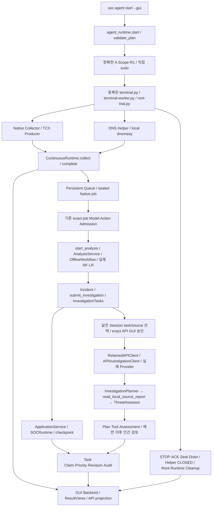

# Full E2E Operations 준비 및 반복 Release 전환 조건

## 현재 작업 범위와 판정

사용자 최신 지시에 따라 **전체 E2E 실환경 실행 없이 비권한 준비·점검만 수행**한다. Root·Native·DNS 트래픽·Native Model Action·실제 LLM API·Host 인증로그 수집은0회다. 승인 발급/소비·실행 예약0. TCX 원인은UNKNOWN이며 수정했다고 주장하지 않는다.

현재 실행 후보는 **PARTIALLY_READY / 실제 E2E 미검증**이다. 전체 소프트웨어 호출 경로·새 Artifact·CLI Preview를 확인했지만, 과거5초 TCX 수신 공백의 직접 원인은 실제 새 계측으로 아직 관측하지 못했다. 실제 LLM Assessment 성공도 아직 없으며 독립 실행 승인이 없다. 모든 단계가 새 동일 Native Session에서 성공했다는 증거가 생기기 전에는 FULL_E2E_OPERATIONS_VERIFIED를 부여하지 않는다.

## 1. 확인·수정한 항목

|항목|직접 확인한 결함/조치|한계|
|---|---|---|
|TCX 5.001초 수신 공백|62567c1의 송수신/Lock/Socket/CPU 진단 유지. 실제sender는 idle에도약1초 Control 전송을 요구함|송신중단/IPC/수신 지연 원인UNKNOWN; Timeout확대·추측수정 없음|
|API 원 Capture Session|기존run-retained-api.py에 과거UUID literal이 남음. 새 후보는 exact request의original_capture_session 사용 및 현재Native request/analysis경로와 비교|기존 성공·실패 실행 Artifact는 수정하지 않음|
|API proposal Source/Session|과거 준비 Script가 Source HEAD를 바꾸면서 API proposal.source_commit은 옛Commit에 남길 수 있었음. 새 후보에서 Git/Session/Source를 일치시키고 실제 prepared check 재검증|승인 새로 필요|
|API 비용 표시/검증|후속 Script의$1과request/proposal$0.05 혼재. 새 후보의 실제 제한·문구·assert를2회/$0.05로 일치|계정별 접근은 인증 호출 전UNKNOWN|
|Session 유효기간|기존draft는 검토서와 무관하게 now+24h 부여. agent_session.draft_expiry가 기존 만료와24h 중 빠른 시각을 사용하며 만료/naive timezone 차단|새 Session 자체는 실행권한이 아님. 유효기간 변경은 새Binding 검토|

Session 수정 코드 Commit: **74cbcb2**. 관련 테스트41PASS 중 신규 유효기간 테스트5개. 기존 Assertion·권한·2초/5초 계약은 변경하지 않았다. Source677개, SourceMap·Model Fingerprint·Root Manifest 자동 검증 유지.

## 2. 실제 운영 호출 경로



수집 task는 LLM 응답을 기다리지 않는다. 기본 Continuous 조사 Worker의SCRIPTED 경로는 별도로 표시된다. 실제 API 검증은 같은 Native Session의 성공한 RF/LR 분석과 Incident/Task/Revision을 선택한 뒤 기존 API Adapter를 사용한다. API 조사는 별도 Store에 보존되지만 원 Capture Session/Incident/Task/Revision을 연결하며 새 Capture로 위장하지 않는다. 새 Native에서 Incident가 없으면 과거 Incident를 끌어와 성공을 대체하지 않는다.

Network·DNS가 동일 Session에 존재한다는 사실만으로 서로 다른 clock/target의 Incident를 강제 병합하지 않는다. DNS9/Authentication은 이번 Native 전체 Scope에 포함되지 않는다. DNS Transaction은 Audit/GUI에 표시되며 DNS9 추론은 차단한다.

## 3. 최종 실행 후보 Binding

- 실행 frozen Git: `74cbcb2ae9cf120d29d406c6e0126d07d304be58`
- Git Tree: `ca12d4a54bf16fb75a72d2bd0e8789fe5c0c4534`
- Source canonical digest: `75b0069502a7b5518bad29c0adf3623973dc2b5da0c3af7e713a4bfd2956418c` / Source677개
- Runtime Session: `b94a7bd2-4a65-4072-bde4-5b2fc8434e86`
- DNS Session: `3743fc22-a959-4006-9907-4f22ffd55353`
- Release:0.6.3 + 정확한 code_identity/설치파일맵 Identity. 이름0.6.3만으로 다른 Artifact에 승인 승계 금지
- Root 변경4개/고정8경로. 나머지4개는 SHA/inode/mtime 검증
- Ledger81행, SHA `07b3aa67d19e2c020f57dba9eb7b3d44bb7c86783cd5b91547f5c353f14f80ae` / hash-chain VERIFIED
- 후보 정책 만료 `2026-11-04T01:21:57.665314+00:00`. 기존 상위 정책 내 초안이며 정책 활성화·승인이 아님
- 원 Native/API 실패·UNKNOWN·FAILED·UNVERIFIED, 설치·Rollback 보존. 과거 Cleanup을 소급 변경하지 않음

검토서: `/home/geonug/kdt-linux/autonomous-soc-agent/.git/full-e2e-operations-readiness-20261103T035500Z/candidate-final/native/approval-package-final.md`. 중간candidate는 Source수정 전 미실행 보존본이다. **candidate-final만 최종 검토 대상**이며 TCX-only 진단 검토서는 이번 전체 E2E 승인을 대신하지 않는다.

## 4. 하나의 검토 패키지 내 독립 권한

|영역|제안 Scope|승인 Gate|
|---|---|---|
|A Root·Native·DNS·R1|최대1회, 전체600초/순수목표360초, 전용NS lo/Ingress, TCP4/DNS UDP2TCP1, Root8경로중4변경|새 정확한 인간결정·상위유효기간75분 이상·TTY Scope·직접sudo|
|B RF/LR|최대2개 봉인작업/16invocations, ELIGIBLE·Attestation VERIFIED·Fingerprint일치|기존 GUI에서 현재 봉인된 작업들을한번에검토하되 각작업결정 독립 기록. 미래입력 자동권한 없음|
|C LLM|고정gpt-5-mini Plan1+Assessment1, 최대2회/$0.05/요청20초/출력4096/재시도0|같은 Native Session에서 만들어진 exact Incident/Revision·최소Evidence·비용예상 검증 후 기존GUI독립결정|
|AI 조율·GUI|기존 SOCRuntime/Read-only Tool/Task·Claim·Priority·Revision·Checkpoint·Audit|AI 제안이 Root/서비스/트래픽/모델 권한을 생성하지 않음|
|종료|TCX ACK·Helper CLOSED/Counter/ACK·Seal·Queue/Audit Drain·Root/Runtime Cleanup|영역별 실제 증거 필요. Exit0만으로 VERIFIED 금지|

전체600초는 설치·시작·수집·종료·Cleanup을 포함한다. 기존owner400/drain460/RootTERM530-KILL560/ordinaryTERM590-KILL595 및 service RuntimeMax420 계약 유지. 순수360초를 동시에 보장한다고 주장하지 않는다. 모델/API 승인 대기로 입력을 못 처리하면 미처리 수를 표시하고 전체 완료로 보고하지 않는다.

Collector128MiB/25%, Runtime512MiB/50%, DNS512MiB/10%, TCP·dnsmasq각64MiB/10%, Queue32. Runtime256MiB/RootAudit64MiB 저장량 점검(하드quota아님). 과거 PENDING2/POISON1은 삭제/재처리하지 않으며 새Session과 분리한다. 동시실행1, 실패시 자동Native/API재시도0.

## 5. Provider 확인과 비밀 보호

공식 문서에서 gpt-5-mini 입력$0.25/출력$2 per million, Structured Outputs지원 및2026-12-11 shutdown을 확인했다. 자동모델교체하지 않는다. [공식 모델 문서](https://developers.openai.com/api/docs/models/gpt-5-mini), [공식 Deprecations](https://developers.openai.com/api/docs/deprecations).

현재 계정의 접근가능성/잔액/실응답성은UNKNOWN이다. 실제승인전 API가용성probe를 호출하지 않는다. 승인된 첫요청 자체를 사용하며 거부/Timeout시 재시도0. 입력60000토큰 및출력4096 기준 2회 보수적 예약$0.046384를 기존Adapter에서 실제payload/남은예산과 재검사한다. 예약은확정비용이아니다. Usage미수신·Timeout은비용UNKNOWN을 유지한다. Key/비밀번호/원본payload·주소·domain·계정정보를 출력하지 않는다.

## 6. 비권한 E2E와 장애 검증

- 기존 조사/복구/API Adapter/TCX계측46PASS. API는 FAKE_HTTP, 권한은TEST Fixture로만 검사했다.
- 실제 과거 Native 분석8개 RF/LR Prediction의 영수증·Audit을 복사본에서 재검증하고, SOCRuntime→FAKE_HTTP Plan→Read-only Tool→Assessment→중복차단을 확인했다. 원본파일불변, 신규모델/Native/API실행0. 이는 신규동일Session 전체실환경 성공이 아니다.
- 최종 Artifact의 실제 select()/check()를 격리된보존Evidence 복사본에서 호출. 과거Session/다른analysis경로 차단을검증. 실제API/Key로더는 호출하지않음.
- 같은 frozenRelease에서2개서로다른새Runtime/DNS Session 준비, 같은Source/Release/기존만료상한 유지, Preview PASS. 승인·영수증·실행권한0. 실패Session자동재사용아님.
- 기존 Root verify_contract의 실제Source·설치파일·Git·Ledger 검증 PASS. 사람결정은메모리Fixture, Root서비스조회는Mock. 문서SHA/Session/Git/만료4개변조차단 PASS. Root main/install/namespace/system은 실행하지않음.
- 설치된 실제`/home/geonug/.local/bin/soc-agent`의 격리profile doctor/start--preview PASS. Model Registry quality/edge SHA PASS. Namespace내부검사는 미실행/BLOCKED로 표시.
- Workspace/Export 최종 직렬 회귀 및GUI·빌드 결과는 이 문서와 함께 제공되는 evidence JSON에 기록한다. 실제모델로드/Native/API가 필요한테스트는실행제외했으며삭제하거나기대값을약화하지않았다.
- 초기병렬회귀 Workspace878PASS/2FAIL, Export879PASS/1FAIL. DNSquarantine종료·6초storage정체표시·GUI5초snapshot만료의3개실패는단독직렬3PASS(12.72초). 원래실패로그보존. 원인은UNKNOWN이며Native TCX원인으로연결하지않음. 최종직렬전체결과도별도로기록한다.

## 7. 사용자가 현재 안전하게 실행 가능한 명령

현재 기본profile은 이전실패Session을가리키므로 무단교체하지않았다. 준비된새profile을선택하는최초설정만필요하며SHA/UUID수동입력은없다.

```bash
cd /home/geonug/kdt-linux/autonomous-soc-agent
export SOC_AGENT_HOME=/home/geonug/kdt-linux/autonomous-soc-agent/.git/full-e2e-operations-readiness-20261103T035500Z/full-e2e-final-profile
soc-agent doctor
soc-agent start --preview
soc-agent status
```

위명령은실행권한을부여하지않는다. 최신사용자지시로 **실제 `soc-agent start --gui`는 실행하지 않았다**. 승인후에도A의Scope/sudo와B/C의정확한입력별GUI승인은필요하다. CLI가권한을자동확대하지않는다. 과거Session결과는`status --sessions`/GUI선택으로보존조회한다.

실제전체성공후기본프로파일전환과관리CLI Wheel 명시적Update를진행한다. 현재전역관리CLI는이전고정Wheel을사용하고Preview호환성만확인했다. 최신Session만료수정이포함된새관리Wheel은재현빌드됐지만기본관리Release를무단활성화하지않았다.

## 8. 실제 전체 성공 이후에만 수행할 반복 Release 전환

현재는반복운영정책을발급/활성화하지않는다. 고정후보의동일성·Session factory 회귀만확인했다.

성공후순서: 실제9개성공증거검증 → 운영Source/Wheel/Model/Root/DependencyManifest고정 → 설치/rollbackreceipt보존 → 관리CLI명시적update → 반복정책초안 → 인간최종정책승인. 기존1회용영수증은재사용하지않는다.

초안에필요한인간결정: 횟수(제안3회)/기간(제안24시간,상위만료이내)/동시1개/회당전체600초/자동재시도0, 회당TCP4·DNS3·모델최대16·API2/$0.05, 총API6/$0.15. 이숫자는미승인제안이며현재권한이아니다. 작업별모델승인과정확한API입력승인은유지한다. Cleanup증거누락·새Artifact변경·정책만료·Ledger불일치시다음실행차단. 실패뒤에는명시적검토없이재실행하지않는다.

새Session생성·이전결과보관·중복Start차단·Cleanup Gate는기존agent_release/agent_session/Policy Gate를재사용한다. 새로운범용승인시스템을만들지않았다. 전체실환경성공전에는반복운영완료라고선언하지않는다.

## 9. 이번 새 Session의 독립 판정

|요구판정|현재결과|
|---|---|
|NATIVE_CAPTURE_VERIFIED|UNVERIFIED_NOT_RUN|
|DNS_TRANSACTION_VERIFIED|UNVERIFIED_NOT_RUN|
|RF_LR_MODEL_VERIFIED|UNVERIFIED_NOT_RUN; 보존8개영수증검증과구분|
|LLM_PLAN_VERIFIED|UNVERIFIED_NOT_RUN; FAKE_HTTP만검증|
|LLM_ASSESSMENT_VERIFIED|UNVERIFIED_NOT_RUN; 과거Timeout보존|
|ORCHESTRATION_VERIFIED|VERIFIED_OFFLINE_ONLY; 새Native실환경미검증|
|GUI_VERIFIED|VERIFIED_OFFLINE_ONLY; 새Native실시간미검증|
|CLEANUP_VERIFIED|UNVERIFIED_NOT_RUN; 과거owned성공과구분|
|FULL_E2E_OPERATIONS_VERIFIED|미충족; 실제실행없음|

남은필수조건: 정확한새A/B/C인간승인·Scope/sudo, 실제TCX계측으로공백원인분리, 새Session의실제RF/LR·LLM Plan/Assessment·GUI·Cleanup증거. 20분/1시간무중단·GlobalKernelCleanup·상용운영은이번완료범위가아니다.

## 10. 최종 비권한 결과 (최종 직렬 실행)

Workspace **880PASS/195.36초**, 독립Export **880PASS/197.46초**. 두Source 불변, no-live guard 위반0. Ruff/check PASS, format1589개 PASS, diffcheck PASS. Native6개·legacy·Supervisor·Wheel을Workspace2회+Export1회 비교해 SHA일치. 새WheelSHA `c35f3f49fd4e5413c68504f97f936b0f38d137b6842ccea471a55c818bf6000d`.

저장PCAP128개 record를 기존PCAP Reader와ContinuousRuntime.observe/Window/Queue 경로로 확인했다. Packet70개/제외58개, Flow36개, ELIGIBLE34/INCOMPLETE2, SourceGap0. 모델Consumer는 실행하지 않아32개Queue가차고4개QueueFull/drop이실제로기록됐다. 이는 의도적으로Consumer를제외한Backpressure검증이며 **전체처리완료·Drop0시험이아니다**. 신규Prediction0·모델호출0·API0. 독립Zeek-parity reference parser는 snaplen262144를기존65535범위밖으로거부했으며검증을완화하거나PCAP헤더를수정하지않았다. 별도점검Script의초기close reason/제외mapping 오류는기존Source_worker와SHUTDOWN계약에맞추었고초기격리Store를보존했다. 운영코드결함으로혼동하지않는다.

기존실행증거796파일, 설치8경로SHA/inode/mtime, Ledger81행보존 재확인. 실제Native/DNS/Model/API/Root실행·승인소비·예약0. GUI Fixture증거 PNG4개(실제Live아님). 이번준비결과만으로실환경9개판정을VERIFIED로바꾸지않는다.

근거는 [validation-final.json](evidence/full-e2e-preparation-20261103/validation-final.json), [final-binding.json](evidence/full-e2e-preparation-20261103/final-binding.json), [보존 Native 점검](evidence/full-e2e-preparation-20261103/stored-evidence-proof.json), [PCAP 점검](evidence/full-e2e-preparation-20261103/stored-pcap-proof.json)을참조한다.
