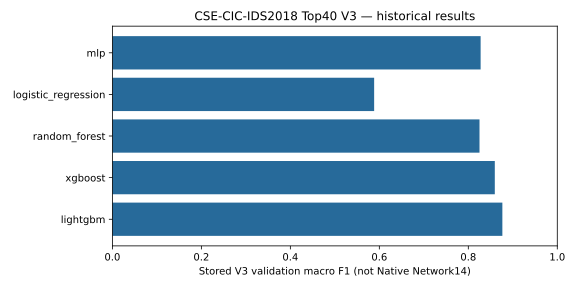
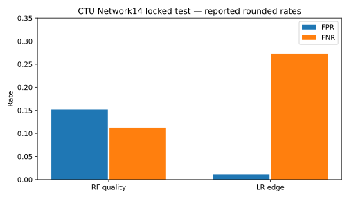

# ML/DL·데이터·실시간 입력 계약 분석

## 1. 분석 방법과 결론

학습 notebook은 JSON Cell 및 저장된 CSV/manifest를 읽었다. 모델 분석 단계에서는 notebook 재실행·재학습·직접 모델 호출·pickle 역직렬화를 수행하지 않았다. 뒤의 비권한 회귀는 기존 격리 OFFLINE/FIXTURE Worker를 포함하며, 그 로컬 모델 실행을 새 Native Model Action으로 세지 않는다. 실험 당시 결과가 현재 환경에서 재현됐다는 주장은 하지 않는다. 모델 파일은 크기와 SHA만 읽어 비교한다. 존재하는 Artifact, 학습 증명, Raw→Feature 증명, Native 운영 승인은 각각 독립 조건이다. [E04–E07](Evidence_Index.md#e04)

| 계열 | 입력 | 확인된 모델 | 검증 범위 | 운영 한계 |
|---|---|---|---|---|
| CTU/IoT23 연구 | float32 Network14 | RF128, scaled LR, HGB/RF 소형 후보 | 고정 연구 평가 + SOC 제한 Native RF/LR | label selection·시간 역전 validation·분포 이동 |
| CSE-CIC-IDS2018 V3/V4 | Top40, 원본78 비교 | XGB/LGBM/RF/LR/HGB/MLP, PyTorch DNN | 저장 validation/benchmark·독립 패키지 | 현재 Native14와 비호환; 새 holdout 필요 |
| Authentication | 계정별300초 5개 | StandardScaler+IsolationForest | 코드·offline 경로 | 실제 Host event IF EVIDENCE_REQUIRED |
| DNS | stateless9 | 공급 INT8 TFLite DNN | tensor/legacy parity·synthetic smoke | 원본 DNN 학습·Raw 추출 계약 UNVERIFIED |

Top40 DNN의 높은 Accuracy, DNS notebook의 트리 성능, Native RF/LR의 실환경 호출을 같은 모델 성과로 묶지 않는 것이 이 조사에서 가장 중요한 결과다.

## 2. 연구 데이터셋의 의미

Network14 연구는 CTU/IoT23의 검증된 PCAP Flow와 Zeek label 연결을 사용한다. Train8-1은4,218개(정상2,162/악성2,056), Validation3-1은76,320개(2,927/73,393), Diagnostic20-1은2,304개(2,300/4), Test34-1은4,295개(981/3,314)다. sample 단위는 패킷 수가 아니라 검증된 Producer Flow다. 여러 concordant label reference가 한 sample을 가리킬 수 있다. conflicting/ambiguous/unmatched label은 학습하지 않는다. [E04](Evidence_Index.md#e04)

분할은 session 단위로 구별했지만 physical device/campaign 독립은 입증하지 못했다. Validation3이 Train8보다 과거이므로 미래 예측 평가가 아니다. Train/validation의 동일 숫자 vector1개, Train/test80개, validation/test4개가 보고됐다. 서로 다른 Raw source의 같은 숫자를 곧바로 중복 유출로 단정하지 않았지만, 독립 표본으로서의 강한 보증도 아니다. 3,927개 test unseen-vector 보조 결과는 원래 단일 예측에서 계산한 하위 분석이지 새로운 holdout이 아니다.

CSE-CIC-IDS2018은 다른 다중 클래스 실험이다. committed notebook에는 preprocessing→V2 split→V3 unique pattern sampling→V4 frequency-aware sampling이 있다. V3 비교 일부의 validation sample은142,082개이고 DNN Full V4 validation은2,390,002개다. **sample 수·분포가 달라 V3/V4 점수의 직접 순위 비교는 부적절하다.** 원본78→Top40 projection은 클래스별 frequency 합을 보존하는지 별도 CSV로 점검했다. 동일 Top40에 SlowHTTP/FTP 등 다른 label이 충돌하면 어떤 분류기도 관측되지 않는 나머지 정보를 복원할 수 없다. 이 현상은 더 큰 DNN만으로 해결할 수 있다는 가설을 반박한다. [E05](Evidence_Index.md#e05)

DNS 문서가 가리키는 출처는 CIC-Bell-DNS-EXF-2021이다. 그러나 제공 DNN의 원본 train/validation/test 분할·loss·optimizer·성능표는 확보되지 않았다. StandardScaler에 `n_samples_seen=162880`이 저장되어 있다는 사실은 해당 행들이 train-only였다는 증명이 아니다. notebook RF/XGB/LGBM/IF 실험을 공급 DNN 성능으로 대체하지 않는다. [E06](Evidence_Index.md#e06)

## 3. 전처리·누수·불균형

Network14는 finite float32 14개를 정확한 순서로 요구한다. NaN/Inf/missing은 imputation하지 않고 거절한다. Train-only scaler fit은 LR에만 적용하며 fit count4,218을 기록한다. 트리에는 scaling을 적용하지 않는다. balancing은 train class weight이고 SMOTE/resampling/추가 feature selection을 하지 않는다. 고정 seed20261015·CPU1 thread로 candidate를 제한했다. label/IP/session/absolute epoch를 모델 feature에 넣지 않는 것은 source shortcut을 줄이는 설계이나, 트래픽 행동의 session bias까지 제거하지는 못한다.

Top40 package는 LightGBM과 DNN의 missing 처리가 다르다. 공통 canonical float32 order 이후 LightGBM은 nonfinite→NaN을 native missing으로 처리한다. DNN은 training scaler mean으로 대체 후 transform한다. runtime에서 scaler를 다시 fit하지 않는다. bool·container·overflow·unknown feature는 typed error다. 이 입력 허용 규칙을 Network14 producer로 그대로 복사하면 기존 fail-closed 계약을 손상시킨다. [E03–E05](Evidence_Index.md#e03)

불균형은 단순 accuracy로 숨겨진다. Network14 validation의 악성 비율은 약96%라 공격으로 많이 판단해도 전체 점수가 높아질 수 있다. Diagnostic20은 악성4개라 AP1.0도 robust 운영 성능의 근거가 아니다. CSE에서는 macro F1이 작은 클래스 실패를 더 드러내므로 DNN accuracy0.9842만으로 LightGBM보다 낫다고 결론 내리지 않았다.

## 4. Network14 정확한 계산

구현: `Window.add/finish`, `NativeWindows.add/process/close`. 첫 관측 `(source,source_port)`가 forward이며 서비스 서버/클라이언트 의미를 임의 부여하지 않는다. `n`은 해당 flow/window packet count, `L_i`는 IP total length(bytes), `t_i`는 동일 event-clock ns, `Δ_i=t_i−t_(i−1)`다. 각 결과는 IEEE754 float32로 양자화된다. [E03](Evidence_Index.md#e03)

| 순서 | Feature | 계산/단위 | 실시간 상태 |
|---:|---|---|---|
|1|duration_seconds|(t_n−t_1)/10^9, s|첫/마지막 event ns|
|2|forward_packet_count|ΣI(first direction), packets|정수 누적|
|3|backward_packet_count|n−forward, packets|정수 누적|
|4|forward_ip_bytes|Σforward L_i, bytes|정수 누적|
|5|backward_ip_bytes|Σbackward L_i, bytes|정수 누적|
|6|ip_length_min|min L_i, bytes|min 유지|
|7|ip_length_max|max L_i, bytes|max 유지|
|8|ip_length_mean|ΣL_i/n, bytes|sum/count|
|9|ip_length_population_std|sqrt((nΣL_i²−(ΣL_i)²)/n²), bytes|모집단 표준편차|
|10|tcp_syn_packet_count|ΣI(flags&2), packets|SYN 포함 packet|
|11|tcp_fin_packet_count|ΣI(flags&1), packets|FIN 포함 packet|
|12|tcp_rst_packet_count|ΣI(flags&4), packets|RST 포함 packet|
|13|iat_mean_seconds|ΣΔ_i/(n−1)/10^9, s; n=1이면0|인접 event 간격|
|14|iat_max_seconds|max Δ_i/10^9, s|최대 event 간격|

단일 패킷 IAT0은 코드상 정의이지 양방향 완결 Flow의 증명이 아니다. FIN/RST도 feature flag이며 자동 completion 권한이 아니다. 30초 idle/120초 active event-time timeout과 관측 witness, bounded reorder, namespace/generation, source sequence, Capture Window Attestation을 함께 검증해야 한다. 마지막 SHUTDOWN Flow는 미완결로 유지될 수 있다. **Feature가14개 모두 있다는 것과 ELIGIBLE은 다르다.** Zeek conn.log의 lifetime·originator·총량은 packet-window 정의와 달라 이름만 맞춰 대신 입력하지 않는다.

## 5. RF/LR 선정의 실험 근거

RF는128 trees/max_depth12/min_leaf3/balanced/seed20261015/n_jobs1이다. RF의 학습은 bootstrap 기반 분할·ensemble이며 neural loss/optimizer 개념을 억지로 붙이지 않는다. LR은 train StandardScaler+C1/max_iter2000/balanced이며 선형 logit의 확률을 출력한다. binary logistic loss와 regularization 계열의 목적을 설명할 수 있으나 solver의 실제 상세 설정은 source default/library version에 종속되므로 임의로 SGD라고 적지 않는다. [E04](Evidence_Index.md#e04)

Quality candidate는 validation AP→F1→recall→낮은FPR→Brier 규칙으로 선정했다. Edge는 recall≥0.8/FPR≤0.1 조건을 통과한 후보 중 단일 행 median latency로 선택한다. LR보다 validation score가 좋은 작은 RF도 있었지만 Edge 최종 목적은 latency다. threshold는 validation 고정 grid0.05…0.95에서 F1·recall·FPR·0.5근접 순서로 결정됐다. Test 결과를 보고 threshold를 다시 맞추지 않았다.

| 후보 | Val AP | Val F1 | Recall | FPR | threshold | model bytes | 단일행 p50 ms |
|---|---:|---:|---:|---:|---:|---:|---:|
|Quality RF|0.999984|0.999271|0.999796|0.031431|0.35|117241|4.1702|
|Quality HGB|0.997599|0.992871|0.987751|0.048514|0.50|58416|0.5648|
|Edge LR|0.999437|0.993332|0.987478|0.018449|0.80|1773|0.2195|
|Edge RF|0.999992|0.999619|0.999796|0.014008|0.45|50681|1.0635|
|Edge HGB|0.997979|0.992871|0.987751|0.048514|0.50|28544|0.2592|

| 최종 모델 | Test Precision | Recall | F1 | AP | ROC-AUC | FPR | FNR |
|---|---:|---:|---:|---:|---:|---:|---:|
|RF quality|0.951796|0.887749|0.918657|0.984635|0.952715|0.151886|0.112251|
|LR edge|0.995458|0.727520|0.840656|0.912923|0.720760|0.011213|0.272480|

RF Test TN/FP/FN/TP=832/149/372/2942, LR=970/11/903/2411. RF의 FP15.19%, LR의 악성 누락27.25%를 운영상 위험으로 명시해야 한다. 'Native에서 실제 예측됨'은 입력·호출 통합의 성공이며 보안 탐지 정확도가 인증됐다는 뜻이 아니다.

RSS 약653,xxxKiB는 dataset 로딩·train·validation 전체 자식 프로세스 peak다. RF binary117KB를 RAM117KB라 부르거나 이 RSS를 실제 Native Runtime의 모델 전용 메모리라 부르면 안 된다. batch throughput은 이미 RAM에 있는76,320개 validation 행을 측정했으며 capture/feature/queue/audit/GUI 비용이 빠져 있다. 실제 E2E latency와 별도 지표다.

## 6. Top40 ML 연구와 DNN

V3 저장 validation 결과: LightGBM macroF1 0.876563, XGB Top40 0.859573, HGB0.844567, RF0.825171, LR0.588358, MLP0.827712. 각 행은 원본 CSV에서 가져왔다. V4 frequency-aware의 LGBM A/B1/B2 macroF1은0.792164/0.802962/0.808655로, sample distribution이 바뀌었으므로 V3 대비 모델이 단순히 퇴보했다고 단정하지 않는다. B2는 quality profile에 연결됐고 DNN FP32 epoch13은 edge profile로 연결됐다. 이는 **ML 독립 패키지의 profile**이며 현재 Native Network14 profile이 아니다. [E05](Evidence_Index.md#e05)

### DNN 레이어·Tensor Shape

| 단계 | 연산 | Tensor shape |
|---|---|---|
|입력|canonical scaled Top40 float32|B×40|
|1|Linear40→128, BatchNorm128, ReLU, Dropout0.2|B×128|
|2|Linear128→128, BatchNorm128, ReLU, Dropout0.2|B×128|
|3|Linear128→64, ReLU|B×64|
|4|Linear64→15|B×15 logits|
|추론|softmax(dim1)|B×15 확률|

Notebook source는 AdamW lr0.001/weight_decay0.0001, `CrossEntropyLoss(reduction='none')`, MAX_EPOCHS15/PATIENCE3, best macroF1 checkpoint를 기록한다. reduction none 이후 sample weighting/aggregation이 실제 training loop에 있으므로 loss를 단순 unweighted 평균이었다고 단정하지 않는다. 실제 loader는 batch4096/shuffleTrue/num_workers0/pin_memoryFalse이며 sample별 loss를 weight로 곱해 합한 뒤 weight합으로 나눈다. scaler는 TRAIN_PATH를100,000행씩 partial_fit한다. batch·sampling의 정확한 구현은 [Notebook 발췌](Notebook_Extracts.md) 및 원본의 loader/loop가 근거다. checkpoint epoch13은 inference loader도 검증한다. 저장된 full validation2,390,002개에서 Accuracy0.984179, macroPrecision0.717727, macroRecall0.704297, macroF10.698647, weightedF10.981440, elapsed9.387769초다. 이 elapsed는 CSV의 full-validation 범위이며 single-flow warm latency가 아니다.

CrossEntropy는 logits와 target class를 학습에 사용하고 softmax는 추론 확률 변환에 둔다. BatchNorm은 학습/평가 모드를 구분하고 Dropout은 eval에서 비활성화한다. [PyTorch 정의](https://docs.pytorch.org/docs/stable/generated/torch.nn.CrossEntropyLoss.html). DNN은 compact dense연산·batch 처리 장점과 소수 클래스·분포 이동·전처리 의존성 비용을 함께 가진다. TorchAO INT8도 실험 결과가 있지만 package default/Native deployment로 등록하지 않았다. Autoencoder/CNN/LSTM은 조사한 committed 학습 notebook 및 현재 runtime에서 학습·배포 증거를 확인하지 못해 NOT_CONFIRMED다. 검색 부재가 다른 미공유 저장소까지 존재하지 않는다는 증명은 아니다.

## 7. DNS INT8 DNN과 원본 학습 계약

공급 Artifact는9→64→32→16→1 dense, hidden ReLU·final sigmoid. 입력/출력은INT8, input shape[1,9], scale0.0387900173664093/zero−40, output[1,1], scale0.00390625/zero−128이다. 전처리는 저장 scaler.transform→round(x/scale+zero)→clip[-128,127], 출력은반대양자화다. 9,288B model SHA28e089af363d…101e33; scaler1,135B SHA2735f7650a7d…0266a. 원본 DNN Loss/Optimizer/train metrics는 UNKNOWN이다. [E06](Evidence_Index.md#e06)

이름 순서는 FQDN_count/subdomain_length/numeric/entropy/special/labels/labels_max/labels_average/len이다. 문서 의미(문자수·subdomain길이·숫자수·base2entropy 등)와 정확한 extractor의 canonicalization·publicsuffix·특수문자집합·trailing dot 처리 동등성은 다른 문제다. 현재 `dns9_training_contract.json` status INCOMPLETE, golden raw pair빈배열이다. 독립 synthetic35행의 legacy parity는 새 구현이 예전 전처리와 같다는 검증이지 학습 extractor와 같다는 보증이 아니다. 따라서 DNS Transaction3건이 생성돼도 DNS9 inference는 차단한다.

## 8. Authentication IF

300초 epoch-aligned 계정 Window에 failed/success/total/failure_rate=failed/total/login_attempt_rate=total/300을 만든다. event ID·record ID·logical ID 중복을 검증하고 빈 Window를 합성하지 않는다. train normal baseline에만 StandardScaler를 fit한 뒤 IF64 trees/max_samples min(256,n)/contamination auto/seed42/n_jobs1을 적용하는 것이 기본값이다. 실제 profile이 다른 값을 고정했으면 그 profile을 우선한다. [E07](Evidence_Index.md#e07)

IF는 무작위 분할로 상대적으로 빨리 고립되는 점을 찾는 이상 탐지이며 특정 공격 label classifier가 아니다. [공식 설명](https://scikit-learn.org/stable/modules/generated/sklearn.ensemble.IsolationForest.html). anomaly score와 empirical reference/threshold0.95의 의미를 calibrated 공격확률과 혼동하지 않는다. 정상 train에 공격이 섞이거나 계정 역할별 분포가 다르면 오탐이 생길 수 있다. Host Cursor·읽기 권한·source scope·완결성·model identity가 먼저 검증돼야 한다. 이 보고서는 실제 Host IF 운영 성공을 새로 선언하지 않는다.

## 9. 지표와 평가의 기술적 의미

Precision=TP/(TP+FP)는 경보 조사 비용, Recall=TP/(TP+FN)는 놓친 공격, F1은 조화평균이다. ROC-AUC는 threshold 전반 순위 구별이고 PR-AUC는 불균형의 precision/recall 관계다. 이 연구는 AP=Σ(recall 증가×precision)를 사용하며 trapezoidal PR 면적과 같다고 가정하지 않는다. [AP 공식 문서](https://scikit-learn.org/stable/modules/generated/sklearn.metrics.average_precision_score.html). Confusion matrix를 함께 제시해야 FP/FN trade-off와 클래스별 실패가 드러난다.

FPR=FP/(FP+TN), FNR=FN/(TP+FN). latency는 cold import/load·preprocess·lock·model·pipeline 중 어디까지인지 명시한다. throughput은 batch 크기/동시성/시간 범위 없이는 의미가 없고, RSS는 전체 process vs model incremental memory를 구분한다. 운영에서는 수집부터 화면까지의 tail latency와 Queue/drop도 중요하지만 실제 전체 tail 분포는 EVIDENCE_REQUIRED다.

## 10. 선정 결론과 새로운 검증 요구

최종 RF/LR 선택에는 기록된 validation rule과 latency 근거가 있다. Top40/DNS의 패키지 성능은 독립 연구 자산으로 보존하되 즉시 Native 모델을 교체할 사유가 아니다. 새로운 데이터/feature계약·모델등록·승인·평가를 거쳐야 한다. 차기 평가의 최소 조건은 독립 시간/host/campaign holdout, 보관 정책에 맞는 label근거, capture품질, train-only전처리, calibrated score, base-rate별 FP비용, Native/offline parity다. 본 작업은 그 검증을 위한 기존 근거를 연결했으며 원본이 없는 값은 EVIDENCE_REQUIRED로 남긴다.

## 11. CIC 데이터 규모·분할의 상세 근거

`results/preprocessing/class_distribution_after_preprocessing.csv`에는 정상 Benign13,484,708개와 SQL Injection87개 등15개 클래스가 기록돼 있다. 원본 label의 `Infilteration` 철자를 유지한다. `train_v2_distribution.csv` 합은11,416,137, `valid_v2_distribution.csv`는2,390,002, `train_v3_distribution.csv`는702,217개다. 이 숫자는 각각 저장 결과의 population이며 다른 단계의 전처리 전 원본 전체 규모로 사용하지 않는다.

`preprocessing.ipynb`의 hash expression 기반 `hash(...) % 100`에서70미만train,85미만valid, 나머지test로 나누는 코드와 split 간 distinct hash overlap 점검 코드가 있다. label별 hash 정렬 sample cap100,000(train)/20,000(valid) 및 이후 unique/frequency protocol을 구분한다. hash group 분리는 동일 numeric pattern의 split 누수를 줄이지만 물리 host·capture day·공격 campaign의 독립 분할을 입증하지 않는다. V3에서 이미 Test V2를 소비했으므로 V4 validation 개발 결과를 새 blind test로 광고하지 않는다.

실제 V3 CSV 기반 차트다. V4/DNS/Native14 점수를 같은 축에 섞지 않았다.

고정 연구 보고의 반올림 FPR/FNR 값만 시각화했다. 높은 validation 성능과 운영 일반화의 차이를 강조하는 그림이며 새 평가를 수행한 것이 아니다.

## 12. DNS notebook의 실제 전통 ML 실험

원본 DNS notebook Cell2/3은 `stateless_features-benign_1.pcap.csv`와 `stateless_features-heavy_text.pcap.csv`에0/1 label을부여한다. Cell6의stratifiedrandomsplit은test20%/seed42, train162,880×9(정상105,999/악성56,881), test40,721×9(정상26,500/악성14,221)다. 이는 time/host/domain 독립 평가를 입증하지 않으며 원본 파일의 수집 조건·중복/누수 통제는 추가 근거가 필요하다.

| 저장된 모델/Cell | 명시 설정 | Test Accuracy | Precision | Recall | F1 |
|---|---|---:|---:|---:|---:|
|RF8/9|trees100/seed42/n_jobs−1|0.716264|0.551913|0.996906|0.710484|
|XGB11/12|trees100/depth6/lr0.1/logloss|0.716313|0.551940|0.997187|0.710578|
|LGBM14/15|trees100/lr0.1/seed42|0.716240|0.551892|0.996906|0.710466|
|IF17/18|trees100/contaminationauto/seed42|0.535399|0.208416|0.118065|0.150738|

이는 notebook에 저장된 출력이며 이번에 재평가하지 않았다. IF Cell17은 X_train 전체에fit하므로 Authentication의 normal-only fit과같은protocol이아니다. 매우높은recall과낮은precision은오탐부담을함께나타낸다. 이표는공급INT8DNN의점수표가아니며 DNS9 실시간입력동등성을입증하지않는다.

## 13. 추가 학습 구성과 재현 경계

Top40 V3 MLP는hidden(64,32)/ReLU/Adam/batch2048/learning_rate_init0.001/max_iter100/early_stoppingTrue/validation_fraction0.1/n_iter_no_change8/seed42이다. `learning_rate='adaptive'` 설정도 있지만 solver가Adam인구현에서의효과를SGD의adaptive schedule처럼과장하지않는다. 별도train/validmetric과내부early-stopvalidation을구분한다.

V4-B2 LightGBM은multiclass15/multi_logloss/learning_rate0.05/num_leaves63/max_depth−1/min_data_in_leaf50/feature_fraction0.9/bagging_fraction0.9/bagging_freq1/lambda_l1=0/lambda_l2=1/threads2/seed42,1000boostround다. B1/B2 sampleweight변경과모델구조변경을혼동하지않는다. 새로운 하이퍼파라미터 검색은 수행하지 않았다.

[Artifact SHA 검증 원장](Model_Artifact_Verification.json)은 Top40리소스2·LGBM·DNN·scaler·DNSmodel/scaler·Network14RF/LR의총9개항목을바이트로확인했다. 모두SHA_MATCH이며역직렬화하지않았다. SHA일치는해당모델의학습출처·정확도·운영적합성인증을대신하지않는다.

## 14. EDA·이상치·중복의 해석

`results/data_quality/dataset_profile.csv`는 원본 조사 population16,232,943행/81열(feature_columns79 포함),7.029GB,추정Pandas메모리10.937GB,NaN59,721/Inf131,799/중복422,815(2.6047%)/15class를기록한다.이는원본조사단계의정의이며후속78feature/Top40과같은열목록이라고가정하지않는다.분포/IQR통계는300,000표본을이용했다. `outlier_report.csv`의BwdIATMin outlier24.4147%는이표본의IQR기준이며그비율을실제공격비율로해석하지않는다.공격특성자체가극단값일수있어일괄제거하지않겠다는당시notebook기록이있다.

초기split코드의hash입력은`feature_columns + label_id`이며Timestamp/hour/day_of_week/source_file/Label/label_id를모델입력에서제외한다. label이splitassignment에쓰인것과모델에입력된것은다르지만,같은numericvector의다른label이cross-split될가능성은따로검토해야한다.그래서hashoverlap검사만으로모든feature/host/campaign누수를없앴다고쓰지않는다. V3/V4의label별unique/frequency와conflict분석이추가로필요했던이유다.

`full78_vs_top40_conflict.csv`는SlowHTTP/FTP의conflict10patterns/총228,836행/minority66,638행이Full78과Top40에서같았음을기록한다.이는해당집계표본의관측이며모든데이터에서의정보이론적최적오류율을구했다고과장하지않는다. 결측/Inf의원본수치와runtimeimputation규칙을동일시하지않고,소스단계별처리근거가없으면EVIDENCE_REQUIRED로남긴다.

## 15. 양자화 실험에서 확인한 반례

`dnn_torchao_int8_full_valid_metrics.csv`의같은2,390,002개validation결과는accuracy0.984110/macroF10.698836/weightedF10.981409/elapsed20.058957초다. FP32의macroF10.698647/elapsed9.387769초와함께보면,이저장실험에서INT8이자동으로더빨랐다는주장은성립하지않는다.측정환경·batch·runtime지원이달라지면결과도달라지므로실제ARM/NPU속도를이수치로예측하지않는다.기존MLpackage가TorchAOINT8을기본profile에서제외한사실과도구분해기록한다.

## 16. 학습·모델 코드 정적 탐색 범위

[Model_Source_Scan.json](Model_Source_Scan.json)은 ML의trackedPython/notebook코드113개에서Dense/MLP·CNN·RNN·Autoencoder·Keras학습구조패턴을검색한원장이다.4개파일에Dense/MLP패턴이있었으며보고서의Top40DNN/MLP와일치한다.정적검색은저장된출력·Artifact검증과함께해석한다.사용하지않은모델을검색결과만으로학습완료라고판정하지않고,untracked공급bundle의TFLite는기존review와SHA를별도로대조했다.

## 17. 연구 후보의 명시 Hyperparameter

Network14의선정되지않은후보도`training.estimator`에고정돼있다.QualityHGB는max_iter100/max_leaf_nodes15/max_depth6/learning_rate0.08/balanced/early_stoppingFalse이다.EdgeRF는trees24/depth6/min_leaf5/balanced/n_jobs1이고EdgeHGB는max_iter32/leaf7/depth3/lr0.1/balanced/early_stoppingFalse다.모두공통seed를사용한다.HGBearly_stoppingFalse는암묵적내부randomvalidation을피하는결정이었다. RF/LR과달리HGB를현재Native최종모델로선정했다고서술하지않는다.

연구코드의fit은각candidate별CPUchild/180초/3GiB주소공간제한하에서수행됐다. 전체peakRSS에는datasetload와validation이포함된다. Test34는사전에고정한단일최종predictionpass이며rawpacket재생성/export확인을새Test재추론으로세지않았다.성능개선을위해이미소비한Test에threshold를맞추면다음평가의독립성을잃으므로새holdout이필요하다.
