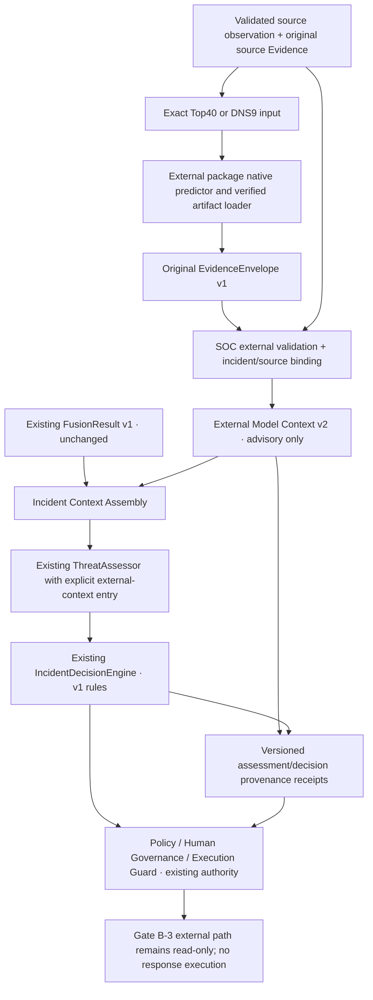

# Gate B-2 — External Security AI 통합 계약 설계

상태: **DESIGN COMPLETE / 구현 전 사용자 검토 대기**.
이 문서의 새 타입·함수·테이블·버전은 모두 제안이며 현재 구현된 API가 아니다.
추천 계약명: **SOC External Model Context v2**, 식별자 `soc-external-model-context:v2`.
이 v2는 기존 `FusionResult.fusion_version="1.0.0"`의 재정의가 아니다.
Gate B-3 및 Gate C~G 코드를 작성하거나 실행하지 않았다.

## 1. 확인한 현재 구현과 기준선

| 경계 | 실제 파일 / 타입 / 호출 |
|---|---|
| 공통 composition | `src/soc_agent/application.py`: `compose_application`, `ModelAnalysis = Callable[[IncidentState], Awaitable[FusionResult]]` |
| source ingestion | `ingestion/models.py`: `Event`는 Authentication/Network discriminated union; `ingestion/store.py`: `EventIngestor.ingest/load` |
| 기존 추론 | `security_ai/model_analysis.py`: `PackagedAnalysis.__call__`, 기존 세 package adapter, domain routing |
| 기존 input | `security_ai/network/schema.py`: `NetworkFlowInput`, 5개 필드와 exact schema |
| 모델·Fusion | `security_ai/packaging/package.py`: `Kind`, `PackageManifest`, `ModelPackage`; `fusion/validation.py`: `validate_binding/validated_signal`; `fusion/engine.py`: `MultiModelFusionEngine` |
| Assessment | `assessment/assessor.py`: `ThreatAssessor.assess(state, *, fusion_result=None)`; `assessment/fusion.py`: `FusionAssessmentResult`, incident/source Evidence 참조 검증 |
| context 제한 | `assessment/prompts.py`: Evidence raw 4096자, 전체 user prompt 64000자; `assessment/models.py`: summary 4000자, Evidence 참조 최대 128개 |
| Investigation | `planning/planner.py`: `create_plan(IncidentState)`; `investigation/runtime/service.py`: ROUTE에서 read-only collection, ANALYZE에서 모델 callback, DECIDE에서 기존 engine |
| Decision | `decision/engine.py`: `decide(..., fusion_assessment=None)`; `decision/models.py`: immutable `IncidentDecision` v1 및 fingerprint; `decision/rules.py`: advisory 규칙 |
| durable state | `review/persistence/session.py`: `GovernanceSession`; `investigation/runtime/persistence/store.py`: claim/publish CAS; checkpoint의 exact artifact 참조 검증 |
| Governance | `review/validation.py`, `review/service.py`, response planning/promotion/bridge, `execution` 및 `execution/durable`; 승인과 confirmation은 모델 metadata와 별도 |
| 읽기·학습 | `review/persistence/security_ai_monitor.py`는 checkpoint의 v1 Fusion을 읽음; `experience/capture.py`도 기존 lineage에 결합 |

현재 ANALYZE 단계는 `await model_analysis(state)` → `ThreatAssessor.assess` → exact result
type 재검증 → `append_assessment` → checkpoint publication이다. 모델 Context가 처음
Investigation 계획에 주입되는 구조는 아니다. 초기 planner는 state와 등록된 tool catalog만
받는다. 이 순서를 구현된 것과 다르게 그리지 않는다.
`SQLiteGovernanceStore.append_assessment`는 core AssessmentResult 자체를 ledger에 저장하는
함수가 아니다. 관측/가설 변화가 없으면 현재 StoredIncident를 그대로 반환하며 revision과
기존 `assessment_appended` event도 늘리지 않는다. core assessment의 현재 durable 보존은
checkpoint payload에서 이뤄진다. 외부 advisory 경로도 이 no-op state 의미를 유지해야 한다.

읽은 기준선: `AGENTS.md`, Gate A report/final evidence, Gate B-1 report/results/sync manifest.
Gate A의 WSL 2599/25 및 Windows 249, Decision Equivalence PASS와 Gate B-1의 WSL
2606/25, 외부 package tests 194, Windows 진단 7은 **과거 실행 증거 재사용**이다.
이번 설계 단계에서 pytest/native inference/Release 조회를 다시 실행하지 않았다.
기존 Windows 결과는 신규 외부 모델 native inference PASS가 아니다.

외부 ML의 README, 설치 가이드, SOC integration contract, Integration/Distribution Report,
실제 `contracts.py`, `schema.py`, `common/evidence.py` 및 관련 tests를 읽었다.
외부 정식 API:

- `network_security_ai.create_network_security_ai(NetworkSecurityAIConfig)` → typed prediction
  → `prediction_to_evidence(flow_reference=...)`.
- `dns_security_ai.DNSPredictor(DNSConfig).predict(named_features)` → typed prediction
  → `prediction_to_evidence(observation_ref=...)`.
- `security_ai.to_envelope` → `EvidenceEnvelope` (`security-ai-envelope-v1`).
- 외부 `verify_install`, Network `Top40Contract.verify_artifact`, DNS `verify_bundle` 및
  predictor load 검증을 그대로 사용한다. 모델 implementation을 SOC에 복사하지 않는다.

### 문서와 실제 계약의 차이

외부 문서의 “Release 게시 대기/URL 미정”은 과거 기록이다. Gate B-1의
`source-artifact-and-release-verification.json`에는 실제 게시 및 다운로드 검증이 있다.
이 문서에서는 그 증거를 재사용하며 원격 현재 상태를 새로 검증했다고 주장하지 않는다.
외부 문서의 “symlink containment”는 resolve 후 root 내부 여부 검사이므로 SOC의 모든
reparse/symlink/handle 기반 TOCTOU 거부와 동일하다고 해석하지 않는다.
Network `matrix`는 일부 numeric 문자열을 `float()`로 변환하지만 DNS는 numeric 문자열을
거부한다. SOC 신규 입력 경계는 strict numeric scalar만 허용하는 **더 좁은 계약**을 제안한다.
외부 모델의 계산 규칙을 변경하는 것은 아니다.

## 2. 실제 계약 충돌

| 충돌 | 유지해야 하는 차이 | 해결 방향 |
|---|---|---|
| 5-feature / Top40 | 현재 flow에서 Top40을 복원할 근거 없음 | 별도 precomputed feature observation; 자동 변환 금지 |
| 4-class / 15-class | BENIGN/BruteForce/DoS/PortScan과 외부 label mapping은 다름 | 외부 전체 원본 class mapping 보존; 임의 통합 label 금지 |
| DNS 도메인 | DNS stateless9는 Auth window/기존 Network flow가 아님 | 별도 observation type 및 source binding |
| SelectionReport 결합 | v1 Fusion binding은 기존 selected profile/config/calibration을 검증 | 외부 package/manifest/loader provenance 사용; 가짜 SelectionReport 금지 |
| 파일 크기 | 기존 loader는 파일 16 MiB / package 32 MiB; LightGBM txt는 48,637,456 bytes | 별도 외부 loader, catalog의 정확한 size/SHA 검증; 기존 제한 유지 |
| 참조·저장 | runtime exact types, checkpoint references, assessment/decision/review는 v1에 결합 | companion Context/receipt 및 explicit storage compatibility 필요 |

## 3. 대안 A/B/C 비교 및 선정

| 기준 | A: Fusion v1 확장 | B: Parallel External Context | C: Versioned Fusion v2 |
|---|---|---|---|
| 기존 기능 보존 | 기존 class/domain/binding 의미 변경 위험 큼 | v1 payload와 규칙 그대로 보존 | v1 유지 가능하나 두 Fusion 경로 관리 |
| 구현 복잡도 | enum 추가만으로 해결 안 됨; profile/score/source validator 전반 | 신규 context validator/assembler와 소비·저장 참조 경계 | 새 aggregation/coverage/compatibility engine 및 변환 계층 |
| 테스트 범위 | 기존 모든 v1 모델·historical hash 재검증 | 외부 계약 + 연결 경계 + 기존 v1 회귀 | v1/v2 각각 및 교차 변환/이중 보존 |
| 보안 위험 | calibration/label 의미 혼합, 기존 trust weakening | 데이터 출처 분리; 누락 lineage 방지 필수 | 잘못된 migration/종합 confidence 해석 위험 |
| 모델 추가 | existing profile/SelectionReport 제약이 남음 | explicit binding으로 추가; generic plugin 불필요 | 유연하지만 신규 fusion 정책 합의 필요 |
| 저장 호환 | 기존 JSON 해석 및 digest 변경 위험 | v1 그대로 + 별도 versioned receipt/table | 새 typed discriminator, 별도 v2 rows, dual reader 필요 |
| Windows/Linux | 추가 backend 검증 필요 | 동일 serializable context; OS별 storage 그대로 | backend + fusion engine 양쪽 이식성 검증 |
| Gate C 연결 | 기존 source domain 강제 변환 위험 | typed source observation 경계에 collector 연결 | 가능하나 ingestion과 fusion 동시 확대 부담 |

**추천: B**. 필요한 것은 모델별 결과의 안전한 조사 Context이지 새로운 공통 위험 점수나
ensemble이 아니다. B가 feature/label 의미를 보존하면서 기존 SelectionReport/Fusion v1
계약을 가장 적게 건드린다. A는 선택하지 않는다. C는 나중에 검증된 cross-domain correlation
및 실제 fusion 규칙이 필요할 때 별도 설계한다. B의 assembler를 Fusion v2로 홍보하지 않는다.

A를 적용하려면 Kind/profile/manifest inventory/feature preprocessing/class direction 및 기존
assessment/checkpoint reader를 동시에 확장해야 한다. 기존 v1 이름을 유지한 채 의미가 바뀌므로
역사적 binding/hash/검증 oracle의 호환 위험이 크다. label 축약이나 size-limit 완화로 해결하지 않는다.

C라면 신규 `FusionResultV2`와 독립 versioned 저장 타입, dual reader 및 explicit migration이
필요하다. Compatibility Adapter는 v1 원본 payload/digest를 lossless 참조하는 방식으로만
v1→v2 provenance를 옮긴다. v2→v1은 보존된 원래 v1 artifact를 되돌려주는 경우에 한정한다.
DNS/15-class/외부 provenance를 4-class v1로 압축 변환하는 것은 unsupported로 거부한다.
Adapter가 모델 점수/selection metadata를 새로 만들지 않는다. 이 추가 engine/adapter 테스트
범위는 현재 B-3 요구보다 커서 추천하지 않는다.

## 4. 추천 아키텍처와 책임

External package 담당: strict feature/preprocessing, native inference, original model-derived
receipt. SOC 담당: trusted setup, source/entity/time binding, validation, durable dedup,
investigation/assessment, policy/approval/execution/audit. 모델 점수는 severity나 승인 토큰이 아니다.
Desktop/Server/DEMO deployment profile은 이 계약의 권한 원천이 아니다.

## 5. 제안 데이터 계약

모든 새 타입은 immutable Pydantic v2, extra-forbid, nested instance 재검증을 전제로 한다.
아래 명칭은 신규 파일 후보이며 아직 코드에 존재하지 않는다. v2 입력은 generic dict로
알 수 없는 모델을 자동 등록하지 않고 trusted setup에서 등록한 세 identity만 허용한다.

### 5.1 TrustedExternalModelBinding — composition 소유

| 필드 | 정의 / 검증 |
|---|---|
| `binding_id`, `binding_digest` | versioned immutable 설정 identity 및 exact canonical SHA; 승인이 아님 |
| `source_package`, `package_version` | canonical distribution 이름과 0.1.0; upper re-export와 중복 model count 금지 |
| `package_code_identity` | 검토된 wheel/source digest, 공급 경로 및 설치 검증 참조; 버전 문자열만으로 신뢰하지 않음 |
| `model_id`, `model_version`, `profile` | 실제 predictor identity/version/profile과 exact match |
| `artifact_identity` | Release/catalog/loader-manifest digest, model/preprocessor/metadata 파일별 정확한 size/SHA |
| `feature_identity` | schema ID/version, ordered names digest, metadata-file SHA를 각각 구분 |
| `label_identity` | 전체 class ID/label mapping digest 및 score 계약; label 자동 변환 없음 |
| `runtime_contract_digest` | 명시적 backend/dependency requirements 및 실제 적용할 inference 설정; composition에서 검증, path/OS build를 model identity로 쓰지 않음 |
| `limitations` | calibration/training/extractor provenance의 VERIFIED/UNVERIFIED 사실; 임의 confidence 없음 |

모델 identity는 외부 코드가 정한 값을 그대로 pin한다:

| 모델 | ID / version | source package / profile |
|---|---|---|
| Quality | `network_cse2018_lightgbm_v4b2` / `v4-b2` | network-security-ai / detection_quality |
| Edge | `network_cse2018_dnn_fp32` / `v4-fp32-epoch13` | network-security-ai / edge |
| DNS | `dns_cicbell_dnn_int8` / `int8-sha256-28e089af363d` | dns-security-ai / litert 또는 별도 검증된 tensorflow |

Model ID/version만 pin하지 않고 실제 artifact/scaler/feature/label binding을 함께 확인한다.
Network envelope에 model/scaler SHA가 없으므로 wrapper에 **검증한 setup 참조**를 추가한다.
DNS payload SHA는 setup pin과 exact match해야 한다. 실제 training revision이 없는 DNS content
version을 학습 버전으로 위장하지 않는다. Binding 생성/변경은 모델 승격이나 운영 승인과 다르다.
실제 OS/Python/native build/CPU/runtime dependency 관측값은 별도 execution-environment record와
그 exact digest로 보존한다. binding digest에 OS path/PID/build 문자열을 섞어 교차 플랫폼
identity를 불가능하게 만들지 않는다. 대신 비교 시 두 environment가 동일한 명시적 runtime
contract를 충족하는지 검사한다. effective inference 설정이나 required versions 불일치는
환경 metadata라며 무시하지 않는다. Torch thread 수처럼 기존 API가 노출하지 않는 설정은
적용·관측 근거가 없으면 보장했다고 기록하지 않는다.

### 5.2 SourceFeatureObservation v2 — 모델 실행 전 source 경계

| 필드 | 정의 / 제약 |
|---|---|
| `contract_version` | `soc-external-observation:v2` |
| `source_event_id`, `source_namespace`, `source_observation_id` | caller 생성 opaque ID; namespace 안에서 유일, 원본 source content digest와 bind |
| `observation_type` | `network_flow_top40` 또는 `dns_stateless_feature_record`; DNS query/transaction라고 증명하지 않음 |
| `source_content_digest` | 원본 typed source record의 exact digest; 모델 Envelope hash와 별개 |
| `event_time_start`, `event_time_end` | aware UTC, start <= end; 단일 관측은 동일 시간; packet capture time 증거 없으면 null |
| `entity_references` | verified opaque device/host/flow/query 식별자와 namespace 및 검증 참조; 없는 값은 null |
| `feature_identity` | exact version/name ordering/digest; source derivation 계약 참조 |
| `feature_payload` | Top40 또는 DNS9 named strict numeric mapping; transport NaN/Inf 금지, Network missing은 explicit null |
| `feature_input_digest` | 실제 predictor input과 일치하는 canonical float32/ordered-input fingerprint |
| `derivation_provenance` | extractor ID/version/config/source digest, 또는 명시적 synthetic-precomputed fixture identity |
| `source_evidence_references` | 기존 incident의 원본 source Evidence ID와 각 exact content digest; 모델 receipt ID가 아님 |
| `association` | `UNLINKED` 또는 검증한 incident ID + StateAnchor + association basis 참조 |
| `synthetic`, `origin_assurance` | synthetic 여부와 로컬 관리 fixture/관측 출처 검증 범위; 성능/공격 사실 보증 아님 |

Top40은 `cse-cic-ids2018-top40-v1`, DNS9는 `cic-bell-dns-stateless9-v1`이다.
DNS의 raw-domain feature extractor와 정확한 upstream 단위/aggregation은 현재 UNVERIFIED.
Gate B-3에서는 검토된 **precomputed synthetic input**만 사용하며 collector를 만들지 않는다.
기존 5-feature Event는 그대로 유지한다. source가 없는 model receipt에서 Incident/Evidence를
새로 만들어 주지 않는다. 고립 fixture에서 원본 feature/source record를 반환하는 read-only
테스트 adapter는 가능하지만 모델 결과가 source tool output에 끼어들어서는 안 된다.

### 5.3 ExternalModelResult v2 — source와 원본 Envelope 결합

| 필드 | 정의 / 제약 |
|---|---|
| `contract_version` | `soc-external-model-result:v2` |
| `result_digest` | 모든 security-relevant wrapper content의 exact digest; 자기 digest만 제외 |
| `original_envelope` | 외부 EvidenceEnvelope v1 전체 canonical snapshot; nested payload 포함 |
| `original_envelope_digest` | 수신한 bounded UTF-8 bytes의 exact SHA; whitespace 변경도 별도 수신 bytes |
| `normalized_envelope_digest` | typed 재검증 후 canonical snapshot SHA; transport SHA와 구분 |
| `binding_id`, `binding_digest` | trusted setup 참조; 위 모델/feature/artifact 정보 중복값은 이 참조와 대조 |
| `observation_digest`, `feature_input_digest` | 호출 전 고정 source observation 및 실제 input과 bind |
| `event_time` / `inference_time` | source interval 참조 / Envelope timestamp; 절대 서로 대체하지 않음 |
| `inference_origin` | B-3는 `LOCAL_MANAGED_INFERENCE`만 advisory eligibility 허용; 수입 JSON shape/hash만으로 출처 인증 불가 |
| `execution_environment_digest` | 실제 플랫폼/backend build/versions/effective settings를 보존한 기록 참조; native 검증 범위를 함께 기록 |
| `score_semantics` | `network_uncalibrated_class_probabilities` 또는 `dns_uncalibrated_malicious_probability` |
| `validation` | `soc-external-validation:v2` 규칙, `PENDING / VALIDATED_FOR_ADVISORY / UNLINKED / INVALID` 상태, 완료한 검사, 고정 failure code, 제한 사항; producer의 VALID 표시를 신뢰하지 않음 |
| `semantic_key`, `semantic_output_digest` | 중복/동일 입력 충돌 탐지용; receipt UUID와 분리 |

Original Prediction을 별도 자유로운 `prediction/confidence` 필드로 다시 만들지 않는다.
Typed view가 payload에서 읽으며 중복된 model ID/version/timestamp는 원본과 exact match한다.
상태 문자열은 검증 결과의 기록이며 권한 증명서가 아니다. 소비 및 reopen 시 source/setup/hash
graph를 재검증하고 producer나 caller가 전달한 VALIDATED 상태를 그대로 신뢰하지 않는다.
Model-Derived Evidence는 외부 package의 명칭이다. SOC에서는 이 wrapper가 **model inference**이며
`IncidentState.evidence`, Observation, Hypothesis에 자동 추가되지 않는다.

### 5.4 ExternalModelContext v2 — read-only 사건 Context

| 필드 | 정의 |
|---|---|
| `contract_version`, `context_digest` | `soc-external-model-context:v2`, security content exact SHA |
| `incident_id`, `input_snapshot` | 기존 incident 및 immutable StateAnchor, 현재 state와 일치해야 소비 가능 |
| `observations`, `results` | validated source binding 참조 및 advisory-eligible 결과 참조, immutable 순서 |
| `coverage` | configured/expected model별 `AVAILABLE / NOT_CONFIGURED / NOT_RUN / NOT_APPLICABLE / UNAVAILABLE / INVALID`; 새 v2 vocabulary이며 기존 Fusion 상태 변경 아님 |
| `correlation_groups` | 동일 검증된 관측에 대한 결과 목록; Network Quality/Edge는 하나의 관측 그룹 |
| `cross_domain_links` | 증명한 association receipt만; 없으면 `UNVERIFIED`/unlinked 유지 |
| `source_evidence_references` | source fact에만 연결; state ID/content/time 검사 |
| `uncertainty` | `UNKNOWN`, calibration false 및 원래 limitations; agreement를 confidence로 바꾸지 않음 |
| `validation` | context assembly 결과와 immutable validation-rule identity |

Observed Fact는 기존 Evidence/Observation에, Model Inference는 v2 context에, Hypothesis는
기존 별도 타입에 남는다. invalid/unavailable record에는 prediction이나 neutral score를
생성하지 않는다. 미연결 결과는 context와 별도로 보존하고 incident 입력에서 제외한다.

### 5.5 Assessment / Decision / Audit companion receipts

`soc-context-assessment-receipt:v2`: input/output StateAnchor, core assessment UUID 및
exact content digest, context digest, 실제 provider로 전달한 deterministic context projection
digest, genuine v1 Fusion digest(optional), validation-rule version을 bind한다.
LLM이 그 내용을 실제 reasoning에 사용했음을 hash만으로 증명하지 않는다.
새 assessor method의 반환 후보 `ExternalAssessmentRunV2`는 기존 정확한 `core_result`와
별도 metadata `receipt`를 담는 wrapper다. core result의 JSON에 receipt 필드를 추가하지 않는다.
신규 assessment-run row에는 이 wrapper의 core_result snapshot 및 receipt를 같이 보존한다.
현재 존재하지 않는 legacy assessment table/발급 ledger를 있다고 가정하지 않는다.

`soc-context-decision-receipt:v2`: core `decision_id` **및** `content_digest(decision)`,
assessment receipt, context digest, input/output anchor, read-only disposition을 bind한다.
v1 `IncidentDecision` payload/fingerprint/rule_version/outcome은 변경하지 않는다.
외부 context를 기존 `model_derived_context` 필드에 넣지 않는다.
동일 core decision에 다른 context receipt를 덧붙이거나 기존 unbound decision을 사후 재분류하면
binding conflict로 거부한다. 정확한 same-content replay만 idempotent하게 처리한다.

## 6. 검증·직렬화·무결성 규칙

1. Transport admission은 duplicate JSON key, nonfinite JSON, unknown fields/version을 거부한다.
   기존 loader/serialization/hash 계약은 변경하지 않는다. 성공·실패 모두 bounded 진단만 남긴다.
2. Original envelope를 외부 actual class로 round-trip 재검증하고 model_copy/model_construct도
   다시 검증한다. 필수 provenance가 빠졌으면 trusted inference 입력으로 사용하지 않는다.
3. Trusted setup의 package/model/version/profile/feature/label/scaler/catalog SHA를 검사한다.
   producer metadata 또는 호출자가 보낸 임의 manifest/path를 trust source로 사용하지 않는다.
4. artifact 설치/검증은 외부 public loader에 맡기되 SOC가 통제한 dedicated local root와 pin을
   요구한다. symlink/reparse ancestor는 SOC 쪽에서 거부한다. root는 실행 중 불변, 설치 완료 후
   predictor 생성, hot-swap 금지. 설치·load 사이 TOCTOU를 완전히 입증하지 못하면 해당 플랫폼
   validation은 INCONCLUSIVE이고 operational trust를 부여하지 않는다.
5. Feature 이름/수/schema/order/dtype를 확인한다. named mapping의 삽입 순서 변화는 정상이다.
   ordered metadata 또는 positional vector 순서 변화는 거부한다. 부족한 feature는 채우지 않는다.
6. Network는 외부 matrix의 float32 변환 및 explicit null missing semantics를 사용한다.
   LightGBM missing과 Edge mean-imputation/scaler는 외부 code 그대로. DNS는 finite nonnegative
   float32 9개, scaler 이름/순서/model INT8 shape·quantization 일치, transform만 사용한다.
7. Network 15 probability finite [0,1], class/argmax/confidence/sum/threat score는 외부 existing
   validator 의미를 유지하고 pinned 15-column ID/label mapping도 확인한다. 기존 external
   numerical tolerance를 넓히지 않는다. `Infilteration` 철자/대소문자도 보존한다.
8. DNS probability/label/class_id/threshold(0.5)/model/scaler SHA는 external validators 그대로다.
   probability는 uncalibrated이며 anomaly/attack confidence/severity로 재명명하지 않는다.
9. aware UTC, source start/end, inference/receive time, 참조 source Evidence의 observed_at 및
   StateAnchor를 검사한다. missing event time은 null로 보존하며 incident association은 거부한다.
   inference가 source interval보다 이르면 거부한다. future/skew 허용은 operator가 명시적으로
   고정한 policy만 적용하며 기본은 skew 0; replay는 고정 replay receive time으로 검증한다.
   clock/freshness 정책은 별도 version/digest로 추적하며 아무 wall clock도 임의 제외하지 않는다.
10. 검증된 entity/source association만 허용한다. source Evidence ID의 존재만이 아니라
    같은 사건, exact content hash, typed source record와 실제 feature derivation을 검증한다.
    임의 Evidence ID를 붙이는 것으로 arbitrary feature input을 정당화할 수 없다.
11. SHA는 변조 탐지이며 source 서명/semantic truth의 증명이 아니다. training/calibration
    provenance UNVERIFIED와 artifact/source-binding validation 성공을 별도 보존한다.

새 계약의 canonical serialization은 기존 `_json.canonical_json_object` 방식(UTF-8로 인코딩한
sorted keys, compact separators, ensure_ascii, finite JSON)을 재사용한다. 새 typed timestamp는
UTC 및 고정 microsecond precision으로 정규화한다. 배열은 계약상 순서를 유지하고 reference
집합만 명시적 ID 정렬한다. 문자열/식별자 Unicode normalization을 임의 적용하지 않는다.
feature input fingerprint는 dtype/shape/ordered names/missing mask와 실제 float32 값의
big-endian bit hex를 포함해 -0, subnormal 및 missing을 구분한다. 원본 source digest와 별개다.
이 규칙은 **신규 v2 hash에만** 적용하며 역사적 digest를 재계산하지 않는다.

Raw exact envelope SHA에는 UUID/inference time/latency를 포함한다. semantic-output digest는
prediction/score/label semantics만 포함하고 receipt UUID/inference latency는 제외한다.
exact result/context digest에는 source/security time 및 전체 lineage를 포함한다.
재현성 비교용 normalized trace와 저장 integrity hash를 혼동하지 않는다.

제안 resource bounds(성능 수치 아님): source record 64 KiB, external envelope 32 KiB,
context 최대 16 observations/16 results 및 canonical 총 128 KiB, prompt용 projection 16 KiB.
총 Assessment user prompt **64000자** 및 기존 raw 4096자/summary 4000자/ref 128 제한은
별도로 그대로 적용한다. 초과하면 context를 조용히 drop/truncate하지 않고 provider 호출 전
실패한다. B-3에서 세 모델 결과로 bound가 충분한지 측정하되 허용되지 않은 확대는 하지 않는다.

## 7. Observation Identity와 incident correlation

Observation key는 `(source_namespace, source_event_id, source_observation_id,
observation_type, source_content_digest)`의 versioned SHA이다. producer envelope UUID가 아니다.
동일 source ID에 다른 content가 들어오면 충돌로 거부한다. 시간·entity만 같다는 이유로
다른 record를 dedup하지 않는다. event 입력 순서가 달라도 logical key는 같아야 한다.

Inference semantic key는 observation key + actual feature fingerprint + binding digest +
preprocessing/runtime inference-config digest다. 같은 key/같은 semantic output의 재포장은
하나의 모델 contribution으로 취급하고 receipt aliases를 bounded하게 기록한다. 같은 key에
다른 semantic output은 overwrite하지 않고 `OUTPUT_CONFLICT`로 quarantine한다. 설정을 바꾼
명시적 재평가만 별도 run/config identity로 표현한다. quality/edge는 다른 binding이므로
각 결과를 보존하되 관측 수는 1이다. agreement/score 평균/독립 corroboration을 계산하지 않는다.

Network/DNS 관계를 incident에 연결하려면 source system이 준 동일 device identity의
검증 가능한 mapping, 명시적 event interval 및 source association receipt가 필요하다.
같은 IP/host 문자열, 비슷한 시간, 같은 모델 label은 연결 근거가 아니다. query/flow가 다른
관측이면 개별 observation key를 유지한다. B-3 기본 cross-domain correlation은 **disabled**다.
명시적으로 검증한 fixture association만 같은 기존 incident에 병렬 표시할 수 있으며
causality/동일 공격 주체를 주장하지 않는다. 근거가 부족하면 UNLINKED를 유지한다.

자동 Incident 생성/병합, IP 기반 heuristics, window 추측, arbitrary risk 가중치는 없다.
source window 범위와 approved incident observation window가 안 맞으면 거부한다.
새 source Evidence/StateAnchor 변경은 기존 assessment/review와 v2 assembly를 모두 stale로 만든다.
기존 raw result를 지우지 않고 새 snapshot에 대해 명시적으로 다시 bind/검증한다.

## 8. 기존 SOC 최소 소비 인터페이스 (제안)

| 대상 | 추가 경계와 보존 조건 |
|---|---|
| composition | 기존 `model_analysis` 그대로 + 별도 `external_model_analysis(state, source_binding) -> ExternalModelContextV2` callback; opt-in, profile-independent |
| Investigation input | 원본 source Evidence만 기존 state에; 모델 지시는 tool schema/permission으로 전달하지 않음. 최초 planner signature는 B-3에서 유지 |
| Investigation timing | 기존 ANALYZE에서 외부 callback 호출. 후속 read-only 재조사도 existing Planner/Orchestrator/loop guard 사용; 모델이 새 steps/권한을 직접 발급하지 않음 |
| ThreatAssessor | 새 명시적 `assess_with_external_context(...) -> ExternalAssessmentRunV2(core_result, receipt)` 후보; 기존 `assess` 그대로. core result는 기존 AssessmentResult/FusionAssessmentResult 정확한 타입 |
| LLM context | 원본 Evidence/v1 Fusion/v2 context를 별도 section으로 구조화. external mode는 observations/hypotheses 빈 배열을 강제하는 draft. no evidence면 기존 NoEvidenceError 유지 |
| Incident Decision input | 같은 core ThreatAssessment + genuine v1 fusion만 `IncidentDecisionEngine.decide`에 전달. v2 provenance는 companion receipt로 결합 |
| Policy input | 기존 registered tool/action/input/risk/exact binding만 사용. 모델의 probability/label은 권한 입력이 아님 |
| Approval requirement | 기존 Policy/Approval/RBAC/confirmation 유지. B-3 v2-bound 결과는 response planning/promotion/execution **read-only ceiling** 아래; 모델 점수로 ticket 생성 없음 |
| Audit/read model | context/assessment/decision receipt hashes 및 실제 stage/validation/coverage 기록. 기존 v1 읽기 API 보존, v2 read endpoint/view 후보는 명시적 separate version |

새 assessor 경계는 같은 LLMClient/validation을 공유하고 기존 method를 다른 의미로 바꾸지 않는다.
외부 context가 있고 v1 fusion이 없더라도 advisory-only draft가 필요하다. base method의
`SecurityAnalysisDraft`를 그대로 써 model-derived 사실을 만들면 안 된다.
core result와 companion receipt를 함께 재검증하고 실제 request projection과 bind한다.
Evidence나 Context가 변하면 cached assessment 재사용을 거부한다.

v1 engine은 v2 label을 직접 해석하지 않는다. ThreatAssessment를 통해 advisory 판단에 영향을
줄 수 있지만 그 영향은 독립 oracle로 검사한다. supplemental context를 읽었다는 이유로
core outcome을 자동 override하지 않는다. 모델 우려와 core assessment가 다르면 receipt에
차이를 보존하고 read-only review 필요를 표시한다. 기존 incident human review/GOVERN의 actionable
contract가 없는 요청을 UI 승인 버튼으로 위장하지 않는다.

**B-3 read-only ceiling은 모든 backend 진입점에서 검사**해야 한다. v2-bound decision digest에
대한 response promotion/state authorization/tool approval/execution 호출은 유효한 legacy
review를 전달해도 거부한다. CLI가 `execute=False`라는 사실만으로 이 조건을 만족하지 않는다.
이는 권한 추가가 아니라 외부 integration 검증 범위 제한이다. PolicyEngine/ApprovalManager의
기존 승인·거부 조건은 변경하지 않는다. v2 context를 반영한 privileged human review 계약은
향후 별도 승인 대상이며 B-3에서 구현하지 않는다.

Context 없는 직접 ActionProposal도 차단하려면 decision tag lookup만으로 부족하다.
B-3 dedicated validation DB에는 immutable `external_validation_read_only=true` capability를
저장하고 모든 application backend의 privileged action/state-authorization 진입점에서 확인한다.
등록 tool도 read-only로 한정하고 실제 response handler는 등록하지 않는다. decision/context
필드가 없어도 이 store-wide 제한은 적용된다. 같은 validation DB의 v1 workflow도 이 추가
제한을 받으며, 합법적인 legacy privileged 경로 회귀는 별도의 기존 v14 store에서 검사한다.
이 metadata를 request/profile/model이 바꿀 수 없고 reopen 때 필수값을 검사한다. persistence용
SQLite write와 SOC 보안 response WRITE는 다르며 전자는 기존 atomic persistence를 사용한다.
capability 검사 없이 independently 구성한 executor를 public application endpoint로 노출하면
B-3 완료 조건을 충족하지 못한다. metadata는 새로운 실행 권한을 부여하지 않는다.

## 9. 저장·호환·resume 전략

기존 Evidence/IncidentState/FusionResult/AssessmentResult/IncidentDecision/v1 checkpoint JSON과
fingerprint는 그대로 유지한다. 기존 payload에 null field를 추가하여 hash가 달라지는 것도
피한다. 새 Context 및 receipt는 **같은 SQLite의 별도 versioned companion tables**에 보존한다.
JSON만 사용하며 model object, pickle, raw model weights는 DB에 저장하지 않는다.

Gate B-3에는 **명시적 additive migration이 필요**하다. 제안 주 schema v15(예약 여부를 구현 전
재확인) + external extension contract v2. 현재 v14는 그대로 둔다. v15는 새로운 opt-in DB 또는
사용자가 승인한 v14→v15 migration에서만 생성한다. v14를 자동 relabel하지 않는다.
기존 ingestion의 optional extension 패턴만 재사용해 v14에 숨겨진 외부 Context를 넣는 안은
거부한다: 구버전은 companion tables를 모르고 계속 열 수 있기 때문이다.
v15를 기존 binary가 열면 현재 `_metadata` allowlist가 거부하므로 silent resume을 막을 수 있다.
새 binary는 v14/v15를 구분하고 외부 기능이 꺼져 있거나 필수 companion이 없는 v2 run은
무조건 resume/decision registration/authorization을 거부해야 한다.

후보 tables: trusted binding snapshots, source observations, immutable external results,
contexts, assessment receipts, decision receipts, checkpoint companion links, bounded reject events.
link는 `(run_id, revision, exact checkpoint digest, assessment digest, context digest)`를 bind한다.
v1 checkpoint reference 목록에 임의 새 kind를 넣지 않는다. 새 read view가 core checkpoint와
companion을 결합하고 둘 모두 검증한다.

기존 `append_assessment`의 domain transaction과 checkpoint `publish` transaction은 현재
별개다. 다음 두 경계를 각각 atomic하게 확장하는 안을 추천한다:

1. 기존 append_assessment의 validation/no-op state 의미를 유지하며 신규 assessment-run snapshot
   + source/result/context receipt를 같은 GovernanceDatabase transaction에서 보존한다.
   기존 early-return 경로에서도 companion을 먼저 보존하고, input/output StateAnchor가 같은
   경우 그대로 기록한다. Context 저장을 위해 IncidentState revision을 억지로 증가시키지 않는다.
2. 기존 checkpoint CAS publish + companion link + append-only audit를 같은 connection에서 commit한다.

모델/LLM 호출 동안 SQLite write transaction을 잡고 있지 않는다. 두 transaction 사이에
중단되면 기존 durable claim과 `WorkflowInFlight` semantics를 유지하고 자동 retry/claim 탈취를
하지 않는다. 이 설계는 전체 파이프라인 exactly-once 또는 외부 실행 atomicity를 주장하지 않는다.
checkpoint publication 이전의 신규 assessment-run row는 issued approval나 published workflow가
아니다. 공개 조회는 uncommitted-workflow-link 상태를 구분하고 resume은 durable claim을 검사한다.
같은 state/context cache 재사용은 exact binding에 한정하며, stale 자료는 조용히 skip하지 않는다.

v1 과거 rows는 rewrite하지 않는다. decoder는 각 explicit version을 exact 모델로 검증한다.
새 v2 decision receipt의 hash 검증을 legacy `decision_id` 하나로 대체하지 않는다.
v15 파일은 old binary로 downgrade/open하지 않는다. Rollback은 기존의 untouched v14 저장소와
old composition으로 돌아가는 방식이며 migration 후 v15 이력을 삭제/복원으로 숨기지 않는다.

## 10. 오류 및 fail-closed 의미

| 오류 | 처리 / 영향 |
|---|---|
| unknown schema/model/version, malformed input | 고정 error code로 reject; inference/LLM/decision 소비 없음 |
| model/scaler/catalog SHA 또는 size 불일치 | 선택 모델 load 전 실패; 자동 다운로드 교체/benign fallback 없음 |
| source/evidence/entity/time binding 불명확 | UNLINKED/INVALID 보존; 해당 incident assembly에서 제외 |
| 동등 key의 상이한 결과, ID 충돌 | OUTPUT_CONFLICT, overwrite 금지; 해당 result 신뢰 입력 제외 |
| runtime dependency 없음/추론 오류 | UNAVAILABLE, prediction null; 독립 성공 결과는 보존 |
| 기대 모델 unavailable | coverage 명시. B-3 요구 모델 누락 시 workflow 분석 완료로 진행하지 않고 existing analysis failure 경계 사용 |
| 원래부터 다른 도메인 | NOT_APPLICABLE; network를 DNS/auth로 coercion하지 않음 |
| context/hash/ref tamper, context overflow | LLM 호출 전 실패. restart 시에도 똑같이 거부 |
| stale snapshot/CAS/commit uncertain | 기존 오류 propagate, 자동 retry/approval/claim 해제 없음 |

안전한 source Evidence만으로 분석을 계속하는 degraded 운영은 별도 설정·검증 대상이다.
B-3 기본은 **필수 외부 모델 실패 시 전체 외부 analysis fail-closed**이며, 성공 result의
별도 보존과 incident workflow 진행 허용은 다르다. optional/required 설정 자체를 immutable
configuration digest로 기록하고 런타임 실패를 자동 optional로 바꾸지 않는다.

## 11. Windows/Linux 고려사항

지원 설계 대상은 Windows 11 Desktop / Linux Desktop / Linux Headless Server다.
Windows Server는 제외한다. 이번 문서는 플랫폼 지원 완료 증거가 아니다.
UTF-8, `importlib.resources` metadata, Path 기반 configured artifact root와 namespace IDs를 사용한다.
absolute path, OS/tempdir/PID는 portability identity로 쓰지 않지만 원본 audit에는 별도 보존한다.
NTFS ACL/TrustedInstaller/OWNER RIGHTS/reparse/TOCTOU/DB sidecar 검사를 그대로 유지한다.
POSIX 0700/0600/owner/inode 검사, runtime lock, SQLite CAS도 그대로 유지한다.

Windows에 외부 3 packages/backends가 없다는 Gate B-1 조회 결과는 과거 상태다.
dependency/wheel 지원은 native Windows에서 검증하고 임의 업그레이드를 하지 않는다.
LiteRT와 TensorFlow를 silently 교체하지 않는다. configured backend 불가면 fail-closed다.
DNS native TensorFlow는 기존 UNVERIFIED. trusted joblib을 checksum만으로 safe pickle이라고
주장하지 않는다. same-artifact native inference/threshold/decision 차이는 별도 측정한다.
WSL 검증은 Linux GUI/Headless 운영 검증을 대신하지 않는다.

## 12. Gate C 연결 지점 (설계만)

미래 collector는 validated typed `SourceFeatureObservationV2`를 공급할 수 있다.
SOC source normalization/association → precomputed feature boundary → existing external package다.
OS event log, HTTP, DNS feature extractor, PCAP, streaming broker, UI를 B-3에서 만들지 않는다.
source authenticity, event-time clock, late/out-of-order input, backpressure를 Gate C에서 검증한다.
여기서는 future adapter 이름만 계약 설명에 남기며 placeholder class를 만들지 않는다.

## 13. Gate B-3 승인 후 구현 범위

추천 순서/영향은 [change impact](integration-change-impact.md), 검증 oracle는
[test plan](integration-test-plan.md)에 상세히 명시한다. 세 현재 외부 모델, fixed synthetic
precomputed input, isolated private DB, scripted LLM, read-only tools가 범위다.
기존 v1 synthetic 모델도 공존하며 replacement/재학습/새 detector는 없다.
성공 판정에는 실제 세 native 모델, invalid-case fail-closed, checkpoint/receipt binding,
기존 governance 회귀 및 실제 Windows 비교가 필요하다. 이 설계 완료와 구현 PASS는 별개다.

## 14. 구현 전 결정할 질문

| 결정 | 추천 기본 / 미해결 영향 |
|---|---|
| B architecture 승인 | Parallel External Context; 승인 전 구현하지 않음 |
| 저장 migration | dedicated v15 validation DB 우선, 기존 사용자 v14 in-place migration은 별도 승인 |
| source feature 계약 | B-3 synthetic precomputed only; 실제 Top40/DNS 추출 lineage/단위는 공급자 및 Gate C 확인 필요 |
| Network mode | 실제 배포는 quality 또는 edge explicit 선택; 검증 시 둘 다 실행해 같은 관측에 그룹화 |
| 시간·correlation policy | B-3 explicit fixture window / skew 0 / auto correlation disabled; 운영 TTL/window는 근거 확보 전 미설정 |
| DNS 신뢰 한계 | bytes/schema 검증된 advisory synthetic 검증만 허용; 미검증 training/scaler pairing/accuracy로 운영 판단 신뢰 부여하지 않음 |
| privileged review | B-3 external path read-only ceiling; context-bound human authorization의 후속 계약 별도 검토 |
| Windows backends | wheel/native dependency 및 실제 inference 미검증, fallback 없이 검증 환경 준비 필요 |
| bounds | 위 제안 bounds로 합성 3-model prompt를 측정; 기존 ThreatAssessor limits는 확대하지 않음 |

설계 산출물 완성으로 Gate B-2를 마무리한다. 기존 Gate A/B-1 상태를 변경하지 않는다.
Gate B-3 또는 Gate C 시작 권한을 이 문서로 부여하지 않는다.

### 이번 Gate B-2에서 실행한 설계 검증

요구한 문서와 실제 계약/validator/테스트를 읽고 위의 no-op assessment 저장 의미까지
대조했다. 신규 integration 기능 테스트, 모델 추론, Windows 실행은 재실행하지 않았다.
`git diff --check` PASS, `git status --short` 확인, 신규 세 문서의 trailing whitespace/fence/상대
문서 link 검사 PASS. 기존 source/test 및 기존 Gate B 문서를 포함한 567개 파일의 SHA와
tracked diff가 시작 상태와 일치한다. 이 결과는 문서/변경 범위 검증이며 통합 동작 PASS가 아니다.
