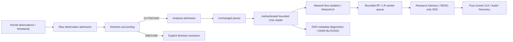

# Capture Policy v3: direction-aware accounting

Status: **FIXTURE_VERIFIED / NATIVE_V3_CALIBRATION_PENDING**. This work did not
run sudo, setpriv, pkexec, AF_PACKET capture, DNS traffic or OS security WRITE.
The previous v2 helper, manifest and policy bytes are unchanged. Physical duplicate
identity and the historical instantaneous burst remain UNKNOWN.

## 1. Native baseline

SOC baseline `961970383d9a5eb34d3062096de14904af1c3b52`; ML baseline
`e1a01260f0463a38d4d778859bc2a86f8e9cfbde`. Existing 132 user file hashes,
214 protected evidence/model files and 58 dataset stat records are checked separately.
The index was empty at admission. Native source evidence is read-only; no receipt
was inserted or capture rerun.

Historical Balanced v2 session directory suffix `bcaed1d4f27144139c1fc59b4543ea8c`:
1,217 received raw frames, 608 sent/delivered metadata packets, 2.7918953740154393s,
zero measured kernel drops, 1,218 kernel observations at final counter sequence
1,218. READY is verified; rejected CLOSED exists and verified CLOSED is MISSING.
The seven SQLite files pass read-only integrity checks, and the original 13-entry
audit chain verifies. Durable packet sources, actual model receipts and investigations
remain zero. Capture prefix, completed persistence and AI success are different claims.

The raw-frame average is about 435.9/s. The v2 aggregate bucket ceiling is
`512 + 256 × 2.791895374 = 1226.725`, exceeding 1,217. Aggregate totals therefore
do not prove a particular burst. Packet-by-packet direction/pair/token trajectories
were not retained. `1217 = 2 × 608 + 1` does not prove physical duplication.

## 2. Observation versus analysis

New fixed contract: `soc-total-direction-aware-policy:v3`, selection `direction-v3`.
Default CLI policy remains legacy. Nothing automatically increases a running limit.

| Budget | Rate | Burst | Session maximum | Unit / admission point |
|---|---:|---:|---:|---|
| Observation | 512/s | 1,024 | 154,624 | Every userspace raw receive, before filtering |
| Analysis | 256/s | 512 | 77,312 | Every direction-eligible OUTBOUND frame, before parsing |
| Session | — | — | 300s | Monotonic deadline plus watchdog |

Kernel-observed frames are separately measured through reset-on-read
PACKET_STATISTICS and cumulatively summed. They include undrained socket frames,
so they need not equal recv count. Kernel total >154,624 also aborts v3. The token
bucket measures userspace receive timing, not unknowable kernel arrival timing.
An average receive rate is explicitly labelled an average and never proof of burst.

Why this candidate: analysis retains the already Fixture-calibrated Balanced v2
256/s /512 envelope; observation uses a separate finite 512/s /1,024 envelope.
This provides raw observation headroom without doubling analysis admission.
Existing calibrated performance tests exercised 512 raw/s; current identical synthetic
admission/parsing measurements are over 100k raw operations/s. Neither proves native
capacity. The 2:1 *budget allowance* is a policy choice, not a duplicate claim.
Approval and new Native calibration are required; no guarantee is made that background
lo traffic will fit either bucket.

Resources: transport queue512, inference queue8, single inference consumer,
active flows128, finalized/key records1,024, metadata8MiB, controller RSS768MiB,
disk64MiB, model invocations64, graceful drain30s. Helper AS512MiB, CPU35s,
core dumps disabled, NOFILE64. Preparation requires MemAvailable≥2GiB and affinity≥2.
DNS total observation allowance follows the explicit 77,312 analysis limit; legacy
DNS default38,656 and existing per-connection DNS limits remain. A connection hitting
its stricter limit fails closed; v3 does not promise every 77,312-packet trace is eligible.

## 3. Direction selection and kernel filtering

`capture.py` maps kernel packet type4 to OUTBOUND and types0/1/2 to INBOUND.
The separate v3 helper counts every receive, OUTBOUND, INBOUND and unknown direction;
unknown directions abort. After successful observation admission, INBOUND is explicitly
counted as direction-filtered. OUTBOUND must independently pass analysis admission.
Only then does the unchanged TCP/UDP parser run. Unsupported analysis protocols
abort rather than silently narrow scope. No timestamp is clamped or reordered.

This reproduces v2's OUTBOUND analysis scope with explicit counters. It is **not
physical deduplication**. No packet-pair cache, guessed half-count rule or port-only
filter is enabled. Identical OUTBOUND packets are not suppressed. Kernel drops and
direction exclusions are separate, and unknown counters never become zero.

Option A (userspace early direction selection) is implemented. Option B is reviewed
only: PACKET_IGNORE_OUTGOING would remove the currently selected outgoing view and
is not a drop-in optimization. BPF/eBPF would change socket visibility and counter
semantics and needs a separate contract/approval and Native verification. No kernel
filter was installed or probed using an AF_PACKET socket.

Primary references: [Linux packet socket statistics](https://www.kernel.org/pub/linux/docs/man-pages/book/man-pages-6.13.pdf)
(reset-on-read) and [Linux AF_PACKET implementation](https://linux.googlesource.com/linux/kernel/git/torvalds/linux/+/1304643a1c20badbb91b86a5084dd76cb7620c05/net/packet/af_packet.c)
(PACKET_IGNORE_OUTGOING). These references do not establish this WSL kernel's Native behavior.

## 4. Token buckets and failure evidence

Two monotonic fractional-token buckets begin at their separate burst capacities.
Every receive increments raw and direction counts even if admission fails; successful
admission and filtering have their own counters. Parsed normalized and sent counts
are distinct from transport-delivered and persisted Network/DNS inputs.

READY/HEARTBEAT/PACKET/CLOSED carry the v3 accounting contract, cumulative counters
and both token balances. A rate failure CLOSED adds budget type, failed frame sequence,
token balance before failed consumption, monotonic timestamp, time since last attempt,
consumed count, elapsed duration, average observed rate (N/A at zero elapsed), current
kernel total/counter sequence and CAPTURE_WIDE scope. Controller separately publishes parsed normalized and successfully sent counts;
the GUI does not conflate a parsed-but-not-yet-sent packet with delivery.
Controller checks schema, monotonic
counter progress, algebra, packet sequence, final equality and diagnostic binding.
Unknown/drop/reset/sequence validation remains the original strict contract.

Observation/analysis exceed, unknown direction and invalid accounting fail both shared
domains closed. Rejected CLOSED and v3 rejection diagnostics are separate from verified
CLOSED. Queue overflow, send timeout and missing CLOSED cannot become success receipts.
No silent drop, unbounded queue, retry, automatic rate change or capture restart exists.

## 5. Integration and security



New `direction_policy`, `direction_session`, `direction_helper`, `direction_peer` and
`direction_transport` modules form a distinct version; existing collector/runtime/model
implementations are reused. v2's immutable peer allowlist cannot accept a v3 executable,
so v3 retains the full peer/PID/starttime/command/interpreter/UID/GID/capability/interface/
socket-inode attestation under its own allowlist. Reader, counter checks, bounded queue,
packet seals, DNS transport handling, Stop/drain and receipt stores are reused.
New bundle hashes bind code, policy and unique session identity; session directories
remain0700 and files0600. No root GUI, persistent capabilities or password collection.
The helper opens lo using temporary CAP_NET_RAW and drops effective/permitted/inheritable/
ambient capabilities before READY; OS attestation remains mandatory outside mocks.

## 6. Network14, DNS, AI and SOC

Golden comparisons include IPv4/IPv6 and TCP/UDP, bidirectional endpoints, exact
kernel ns timestamps and independently parsed offline PCAP plus hand-calculated float32
features. Selecting the same OUTBOUND sequence produces identical Network14 feature
values/digests with Producer1.1.0. Idle30s/active120s event-time lifecycle, quarantine,
SHUTDOWN/PACKET_LIMIT exclusion and Feature Order are unchanged.

DNS UDP and complete single-message TCP metadata parsing/matching are reused. TCP
reassembly and encrypted DNS contents are unsupported; WSL DNS tunneling visibility is
not established. No FQDN or raw payload is newly retained. DNS9 parity/inference stays
BLOCKED. Network and DNS share capture failures; local fault isolation is unchanged.

Actual RF/LR Artifact SHA checks and Fixture inference are verified separately from
Native capture. The seven-packet mixed fixture generates four actual receipts and four
READ-only investigations, one matched DNS response, zero final backlog and verified
audit/finalization. Recovery preserves receipt digests and the original audit prefix,
appends recovery events, reports zero new inference and leaves collection stopped.
Quality SHA `53c1029cc70b9d038bf46278818905c969dc3ddfb086c673466298ebdfa56603`;
Edge SHA `661322193df782f958e88eb9da23f0dc4d17be328cfa63635865ce63e0fd2882`.
Research scores remain uncalibrated; no operational finding/model promotion or WRITE.

## 7. GUI

Dashboard / Security Events / Investigation / System remain the four default screens.
Canvas charts, event timelines, detail panes, lazy initialization and active-screen
refresh are retained. Raw and analysis rate limits have separate chart labels; System
shows both token balances, filtered count and bounded rate-error detail. v2's unmeasured
fields stay UNKNOWN. Native fields require attested v3 metadata; Fixture model inference
does not invent raw/kernel counters. Session/origin-separated bounded history and stale
poll rejection continue to apply; stopped/error states do not extend live history.

Actual WSLg tests cover 1920×1080,1366×768,1280×720, empty/error/session-reset states,
navigation, READ-only export and worker cleanup. The two new 1366×768 screenshots show
actual-model **FIXTURE** receipts and investigation; they are not Native evidence:
[Dashboard](capture-policy-v3-screenshots/dashboard-actual-model-fixture-1366.png),
[Investigation](capture-policy-v3-screenshots/investigation-actual-model-fixture-1366.png).

## 8. Performance

WSL kernel `6.18.33.2-microsoft-standard-WSL2`, Python `3.12.14`,
12 affinity CPUs, approximately7.6GiB RAM; pre-model MemAvailable was2.35GiB, swap
nearly full, PSI avg10=0.01. Tests/profiles run serially; no other processes were killed.

Identical raw fixture:128 warm-up +4,000 measured frames, alternating directions,
128 simulated raw/s, five repetitions. Median admission+parsing throughput:
v2 118,905 raw/s,
v3 121,415 raw/s. Both parse2,000 measured packets
per run. Token-accounting overhead, CPU, peak RSS and p50/p95/p99 are recorded in the
JSON evidence. This microstage excludes kernel receive, persistence, model and GUI;
the small difference does not establish a performance gain or native throughput.

| Identical-condition GUI harness | v2 before | v3 after |
|---|---:|---:|
| Startup median, s | 2.729 | 2.478 |
| Idle RSS median, MiB | 175.188 | 176.758 |
| Tk callback p95 median, ms | 0.036 | 0.066 |
| Idle one-core CPU median, % | 0.250 | 0.265 |
| Four-packet actual-model subtree peak, MiB (n=1) | 423.625 | 425.602 |
| Active elapsed, s (n=1) | 7.232 | 5.888 |

Idle runs n=3 per side, active runs n=1 per side, same interpreter/input/harness,
three-second idle window. Both sides retain zero idle child processes, zero controller
SQL queries while idle, two actual model receipts in the active fixture, queue final0,
one child maximum, valid audit/finalization and clean shutdown. No reduction in resource
usage is claimed. Raw/native throughput, native DNS visibility and native loss-free
continuous operation remain UNKNOWN. Original 30-minute/5-minute soak results are retained
as historical evidence, not re-counted as v3 soak. No new long soak was run.

## 9. Validation and reproducibility

Machine-readable evidence: [capture-policy-v3-evidence.json](capture-policy-v3-evidence.json).
Native evidence is rechecked read-only. Old immutable performance/source evidence is
resolved against explicitly frozen historical source fixtures, not restamped. New-source,
manifest, screenshot and model identity checks are independent.

Workspace: initial Mock run21 pass/1 fail (insufficient scripted clock values), next
28 pass/1 fail (duplicate test keyword); both are test harness errors, not native failures.
First broad run469 pass/2 fail identified stale historical-source proof references.
Frozen references were corrected without rewriting old evidence. Targeted run60 pass;
subsequent v3 run45 pass. Final suites and independent export results are recorded below. The final independent
export main suites total618 passed; the19 final evidence checks overlap and are not
added again. Final v2/v3 seven-packet feature values, predictions and scores match
for all four model invocations. Capture/session provenance remains distinct.
Existing SIGILL root cause remains UNKNOWN; no recurrence claim is made from a passing run.

- models: 1 passed in 13.71s; exit 0
- unit: 486 passed in 79.35s (0:01:19); exit 0
- gui: 6 passed in 30.91s; exit 0
- governance-recovery: 125 passed in 18.47s; exit 0
- final-proof: 19 passed in 0.40s; exit 0

## 10. Approval scope and next manual validation

New helper SHA256: `aca215a347dfff3ada09e8605d0d490e4fcaa51c83c4f40318f5d916a45020a9`

New bundle digest: `b072ab20ba3e08e74a3ba7e392ad5515ca65b60e8f6a094ec5c8d0b4f909cd96`

Preserved calibrated-v2 SHA256:
`375c06dbeb4e14c881fa496459182677b4efaa293845ecfac0dab0da663c4703`;
preserved v2 bundle:
`56ec48caac56a248fc0eeb5bb09c4fae4176482ed19ea8c48526f7638ae8bb31`.

**Separate user approval is required** for lo-only,300s, raw512/s burst1,024,
max154,624 raw/kernel observations; analysis256/s burst512,max77,312 analysis packets;
temporary CAP_NET_RAW, metadata-only transport, no kernel filters, no automatic restart.
Existing v2 approval does not authorize v3. After reviewing and approving this scope,
the user may run from the repository in a terminal:

```bash
.venv/bin/soc-agent start --gui --monitor total --rate-policy direction-v3 \
  --approve-direction-sha aca215a347dfff3ada09e8605d0d490e4fcaa51c83c4f40318f5d916a45020a9
```

This command checks bundle, headroom and model environment, requires scope confirmation,
then hands authentication to terminal sudo and launches the normal-user GUI. Credentials
never enter the agent. Start prepares a unique authenticated listener; a stopped/failed
session cannot be reused. GUI Stop drains within30s, Ctrl+C/disconnect/watchdog ends the
bounded helper, and valid CLOSED plus counters/persistence are still required. A new
capture after error needs explicit user action and a new session, never an automatic retry.

The user should verify READY→HEARTBEAT→CLOSED, both raw/analysis counters, kernel drops/gaps,
flow eligibility, actual RF/LR receipts, READ-only investigation, queue drain, audit and
restart. Natural lo traffic can exceed either budget; exceeding it remains a safe abort.
Do not generate additional test traffic or change interface/limits under this approval.

Final boundaries: NATIVE_V3_CALIBRATION_PENDING, DNS9_PARITY_BLOCKED,
OPERATIONAL_PROMOTION_BLOCKED, RESEARCH_ONLY, WRITE_DENIED. Native continuous
monitoring success is **not** declared.
