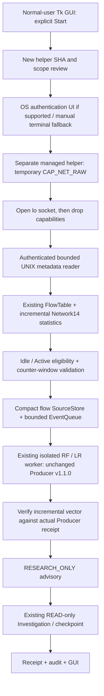
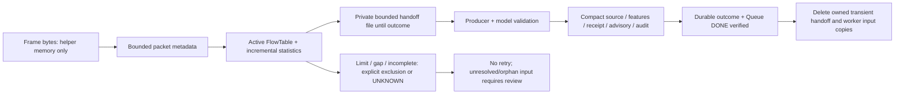

# Continuous Network AI monitoring — managed research mode

Validation: 2026-10-16. **PARTIAL / IMPLEMENTED_BUT_NOT_NATIVE_CONTINUOUS_VERIFIED.**
Network14 streaming arithmetic, actual RF/LR Fixture inference and READ-only
investigation are verified independently of privileged capture. No sudo, pkexec,
setpriv execution, AF_PACKET capture or network test traffic was performed by Codex.
OS authentication and native continuous capture require a new user approval.

Base SOC HEAD: `b56f6b8afcceb32812510d1ef693e016c4d0ceab`; this includes the completed
frame-budget assessment after the requested starting revision `9477b0…`.
ML HEAD: `e1a01260f0463a38d4d778859bc2a86f8e9cfbde`. ML code/artifacts are unchanged.

## 1. Existing architecture and gaps

The earlier helper remains a bounded 60-second/512-frame verification tool. Its
last assessed native run received 512 frames in 9.2758 seconds with zero kernel
drops; its four flows closed as SHUTDOWN. These are historical capture facts,
not evidence of continuous inference. See [budget assessment](native-idle-flow-budget-assessment.md).

| Existing component | Managed-mode use / change |
| --- | --- |
| PacketCapture, parser, capability drop, reset-counter tracker | Reused; unchanged approved source files |
| HelperCapture authenticated UNIX reader | Reused with an explicit bounded queue and allowlisted managed module |
| FlowTable | Reused for bidirectional identity, idle/active timeout and packet limit |
| Packet-level SourceStore/Queue pipeline | Preserved for legacy evidence; managed handoff stores completed flows instead |
| Producer v1.1.0 / Network14 | Unchanged; isolated worker computes its actual vector |
| ResearchAdapter / worker | Reused; optional transient worker-input cleanup |
| ResearchDemo / LiveResearch | Reused; compact attempt hook and incremental parity check |
| RuntimeStore, EventQueue, OperationalSourceStore | Reused for flow commits, provenance, outcomes and recovery |
| Orchestrator / investigation / checkpoint | Existing scripted READ-only path; no provider calls or response execution |
| Tk Backend / LiveView / charts | Existing worker event loop and presentation reused; separate Streaming Network page |

The legacy workflow persistently stores individual packets and infers after a
verified full CLOSED. Managed mode aggregates first and permits research inference
on a verified counter window while collection continues. This is a **separate
source-assurance contract**, not a relaxation of the old full-session gate. There
is no new Agent, framework, service daemon, infrastructure dependency or model.



## 2. Capture and authorization lifecycle

`stream_helper.py` is a new helper. The old `live_helper.py` is untouched:

- Old approved SHA256: `a8a0cafe7494922a0296a250129ab5695b681dbbec6febf512509b023ef44856`.
- New managed-helper SHA256: `1cc1c1f39007d1e8f53207dcd5f79f2128b12ea8077d5d09fcb6a72c5d037c84`.
- Session JSON pins the interpreter, interface/netns identity, policy and relevant
  helper/module source hashes. `load()` rejects changed identity/configuration.
- The old approval does **not** authorize the new helper.
- The displayed command also pins `--session-digest`. A modified policy/session is
  rejected by the GUI and helper before opening capture, even when the helper SHA is unchanged.

The GUI entrypoint rejects root. A helper session keeps the user's real/effective
UID/GID, clears supplementary groups, limits bounding/inheritable/ambient rights
to CAP_NET_RAW, and sets NoNewPrivs. The existing helper privilege check refuses
root or an inappropriate capability set before opening AF_PACKET. Immediately
following socket creation, permitted/effective/inheritable/ambient capabilities
are cleared. The normal-user receiver validates the peer PID/start identity,
UID/GID, command/interpreter, capability masks and actual lo socket binding.
These new-helper OS checks are statically reviewed and mocked, **not newly
verified under actual privileges**.

Installed `setpriv --help` and util-linux 2.39.3 support the displayed UID/GID,
clear-groups, bounding/inheritable/ambient and no-new-privs options. Only help and
version were executed; no privilege-changing invocation was run.

### OS authentication preflight

Actual WSL observation: normal user UID/EUID, display configured, system D-Bus
socket present, **pkexec absent and no recognized authentication agent found**.
Therefore `OS_AUTH_UI_UNAVAILABLE`: native one-click OS authentication is BLOCKED
in this environment. No package/service/polkit-policy installation was attempted.

On a candidate supported system, Start first prepares a normal-user listener,
then asks the user to review the new SHA and finite scope. Only explicit approval
can invoke the fixed pkexec → setpriv → helper argument vector. No shell or
password API is involved. Standard streams are discarded, and only a small
allowlist of GUI/locale environment variables is passed. The preflight is a
support heuristic (`AVAILABLE_UNTESTED`), not proof of successful authentication.
The authentication process is supervised, cancellation/denial/early exit are
classified, and no retry is automatic. A stale session cannot authenticate.

The [official pkexec manual](https://polkit.pages.freedesktop.org/polkit/pkexec.1.html)
describes session authentication agents and exit 126 for dismissed authentication,
127 for authorization/error failure. Those outcomes were tested with injected
process mocks; real pkexec was not executed.

The manual fallback displays a reviewed command for the current listener. The
user authenticates directly in their terminal; the GUI never runs sudo or reads
a password. Manual preparation expires after 120 seconds without READY. The OS
prompt has a separate 60-second supervision deadline. Stop closes the listener
before cancelling a pending authentication process so late approval cannot
activate the old session.

## 3. Finite resource policy

Default GUI policy (configurable only within the validated schema):

| Resource | Default | Hard schema bound |
| --- | ---: | ---: |
| Interface | lo | lo only |
| Capture session | 300 s | 1–1800 s |
| Raw frame rate token bucket | 128/s | ≤128/s |
| Burst | 256 frames | ≤256 |
| Overall raw-frame guard | 38,656 | seconds × rate + burst |
| Metadata transport queue | 512 packets | ≤512 |
| Pending/claimed flow handoffs | 8 | ≤8 |
| Active flows | 128 | ≤128 |
| Encoded active packet metadata | 8 MiB | ≤16 MiB |
| Model invocation attempts | 64/session | ≤256 |
| Durable flow records | 1024/session | ≤1024 |
| Controller RSS | 768 MiB | ≤1 GiB |
| Session disk | 64 MiB | ≤128 MiB |
| Graceful drain | 30 s | ≤60 s |
| Session directories | 8 | human archival required beyond bound |

Helper limits: 512 MiB address space, 64 file descriptors, no core dump, CPU
`ceil(5 + duration × 0.1)` seconds (35 seconds at the default duration).
Controller CPU budget is `10 + duration × 0.5` seconds, checked alongside RSS and
storage during publication. Existing per-model worker limits remain a finite
30-second parent timeout, 15 CPU seconds and 3 GiB address space, one model
invocation at a time. Address-space ceilings are not measured RSS commitments.

These are conservative **Fixture-qualified candidate bounds**, informed by the
prior lo mean (~55 raw frames/s) and helper peak RSS (~187 MiB), with substantial
headroom. They are not native capacity certification. A rate burst, queue, active
flow, metadata, CPU, RSS or disk violation explicitly stops/blocks the session
with an error/gap; no unbounded queue or silent-drop optimization was introduced.
No same-input baseline/candidate throughput improvement is claimed.

## 4. Streaming flow and Producer parity

The existing first-observed bidirectional key and packet-time FlowTable are used.
TCP flags, IP lengths, directional counts/bytes, min/max/mean/population standard
deviation, duration and inter-arrival statistics produce the same 14 float32
values. Integer moments avoid an ever-growing list of arithmetic intermediates.
Ethernet frame bytes in diagnostic FlowSummary remain distinct from **IP bytes**
in Network14. Feature names/order/configuration and Producer code did not change.

- Idle timeout: 30 seconds; active timeout: 120 seconds.
- Only IDLE_TIMEOUT / ACTIVE_TIMEOUT are eligible research candidates.
- SHUTDOWN, PACKET_LIMIT (128 packets/flow) and RESTART_GAP remain diagnostic.
- Timeouts advance on delivered packet event time, never on processor wall time.
- Without another packet watermark, a quiet flow is not silently made eligible;
  termination marks it SHUTDOWN. A 300-second session does not guarantee that a
  suitable flow will occur naturally.
- Duration remains last packet minus first packet, not elapsed timeout duration.
- Source origin is explicitly FIXTURE or NATIVE_AF_PACKET. OFFLINE_PCAP remains
  an independent Producer origin; it is not relabelled as native capture.

The hand reference is 40/60/80 IP bytes at 0/0.5/1 seconds, directions F/B/F,
flags SYN/ACK/FIN; the packet at 31 seconds expires the original flow. Expected
vector:
`[1,2,1,120,60,40,80,60,sqrt(800/3),1,1,0,0.5,0.5]`, rounded to float32.
Twelve seeded sequences also compare incremental values with the unchanged batch
Producer. Every actual model receipt must match its retained incremental vector
before advisory/investigation; mismatch fails closed.

Contract digest: `84ba0916f0ce4e9e12bb70712db2cd1eaea84ba4173acd57b647faf38efb1c6e`.
Configuration digest: `7999723911ce3d2e9cd3b3b6e0d45e11f44b1316cdf9c7f4883d7e2a69ca21a7`.
This verifies arithmetic/metadata parity, not physical NIC offload/completeness or
operational model suitability.

## 5. Counter window and fail-closed inference

The shared reset-counter tracker validates each interval exactly once. READY,
HEARTBEAT and final CLOSED preserve sequence and cumulative totals. Managed
PACKET records name the validated interval they follow, and the FIFO reader keeps
that seal with the packet. UNKNOWN, actual drop, counter discontinuity, reader
failure, forged source, timestamp reversal or audit/feature mismatch blocks
native model authorization. UNKNOWN is never converted to zero.

Flow handoff records bind SourceStore provenance, input digest, session, source
event and counter window. Native authorization additionally requires the actual
peer-verified managed receiver and the controller's current in-memory handoff
registration. An arbitrary Pydantic native-shaped object cannot authorize it.

A completed window can be researched before the future session ends. A later
failure blocks further work and records a gap; earlier advisory receipts do not
certify the future or the entire session. `capture_quality=UNKNOWN` remains in
the Producer/model contract. The assurance is local window verification, not
remote attestation. The legacy full-CLOSED source validation is unchanged.

Capture and model execution are separate: the existing reader thread keeps
reading while the bounded consumer awaits a model. A model failure opens a
no-retry circuit for the session. Other models are not credited with that
model's success. Helper/runtime failure closes input, cancels work as UNKNOWN,
and prevents stale replay. Graceful Stop drains already accepted eligible flows;
Abort denies new inference immediately. Open flows are never promoted on stop.

## 6. Retention and recovery



| Data | Policy |
| --- | --- |
| Raw payload | Never persist; ephemeral parser buffer only |
| DNS names / individual name digests | Stripped before transport; never persisted by managed mode |
| Active packet metadata | Bounded and held until Producer parity can be checked |
| Pending flow packet references | Private transient handoff; at most bounded pending work |
| Completed feature / flow summary | Durable bounded source/audit/receipt metadata |
| Worker request/result copies | Optional cleanup in managed adapter only; old adapter default unchanged |
| Receipt / advisory / checkpoint | Kept for integrity and no-retry recovery within session/disk limits |
| Legacy sessions / raw dataset / artifacts | Never pruned or rewritten |

Transient deletion requires the correct input digest, matching durable outcome
in an intact audit and verified Queue DONE. Failure/orphan input is preserved for
review rather than silently removed. Completed transient packets cannot be
replayed after deletion: historical assurance is **SEALED_RECEIPTS_NO_PACKET_REPLAY**,
not full raw-packet reproducibility.

Explicit Recover retained acquires the session writer lock, validates audit and
receipts/checkpoints, marks interrupted queue work UNKNOWN without model retry,
and restores retained results. It creates no listener/helper and shows
RETAINED_STREAM_NOT_LIVE. Current inference count is zero; historical receipts
and retained counts are separate. External exactly-once effects are not claimed.

## 7. Actual model Fixture evidence

The earlier intermediate Fixture run `2ae563f6-6e19-4383-bb9c-07eceb8b8817` is
preserved in `continuous-network-ai-fixture-evidence.json`. It did not execute a
helper. Its counts are not added to the following canonical run.

Canonical scope-bound run: `cc854219-2a29-4b1d-8819-6980396b3c56`.
[Sanitized evidence](continuous-network-ai-scope-bound-fixture-evidence.json) contains actual
receipts, feature/input/source/provenance digests and investigation/checkpoint
references. These are **synthetic packet Fixture inputs, not captured traffic**.

- 4 input packets, 1 eligible idle flow, 1 excluded SHUTDOWN marker flow.
- 1 compact source commit; Queue DONE 1; SQLite integrity verified.
- 2 actual model receipts and 2 READ-only investigations; no provider calls or WRITE.
- Finalization VERIFIED within this Fixture run; no remaining transient input,
  active packet metadata or owned model process.
- Restore reproduces the same receipts/checkpoints with zero new inference.
- Runtime audit head: `e48a5161f262b852ca3b09512ace39a57351b918638210fe7c7d45d5eec04715`.

| Actual artifact | SHA256 | Score / threshold | Measured predict latency | Worker peak RSS |
| --- | --- | --- | ---: | ---: |
| Quality RF | `53c1029cc70b9d038bf46278818905c969dc3ddfb086c673466298ebdfa56603` | 0.140625 / 0.35 (CLASS_0) | 10.607 ms | 233,447,424 B |
| Edge scaler + LR | `661322193df782f958e88eb9da23f0dc4d17be328cfa63635865ce63e0fd2882` | 0.0876603 / 0.8 (CLASS_0) | 6.520 ms | 233,279,488 B |

Scores are uncalibrated, not verified attack probabilities. These single-Fixture
latencies exclude worker startup, Producer and investigation overhead; worker CPU
was 1.382518 s / 1.523269 s. They are not throughput or detection-quality estimates.
Models remain at their existing `<ML>/models/network-research-v1-final/` paths.

## 8. GUI and DNS boundary

Launch stays unchanged:

```bash
cd ~/kdt-linux/autonomous-soc-agent
.venv/bin/python -m soc_agent.gui
```

Open **Streaming Network**, choose Quality / Edge / both, select whether plaintext
DNS header aggregates are requested, then Start Monitoring. An available OS UI
requires the explicit new-helper scope review before authentication. This WSL
uses the manual fallback; no password input is offered. Stop (drain), Abort now,
Restart (new identity) and Recover retained are distinct operations.

Dashboard shows a separate managed-session summary. The Streaming page displays
actual origin, collector states, uptime, average packet/flow/inference rates,
queue, parent CPU/RSS, helper metrics where measured, drop/gap, model status,
processing latency, advisory/investigation and audit/error state. Graphs use
measured values only and reset history on session change. Unmeasured kernel/DNS
values stay UNKNOWN. Retained inference results are labelled as historical.

Network and DNS collection states are separate. DNS uses the same RAW socket,
no additional capability, and only aggregates accepted plaintext query/response/
parse-failure counts. FQDNs are not transported. DNS9 parity is UNVERIFIED and
DNS9 inference is BLOCKED. DoH/DoT content is not observable and cannot be treated
as zero DNS activity. No DNS operational Producer was introduced.

Actual WSLg tests cover the page, no-capture preparation, duplicate clicks,
manual-auth fallback, real Fixture-model receipts, resizing and close/reopen.
This does not validate native OS authentication or capture.

## 9. Validation results

Final test counts, long-run metrics and independent Export evidence are recorded
in `continuous-network-ai-validation.json` when validation completes. Runs are
reported separately, not summed as unique tests. Intermediate Fixture clock tests
initially failed because float epoch conversion disagreed with nanoseconds; the
Fixture uses exact seconds/microseconds now. Transport FIFO testing then passed
600 records through a real ordinary-user UNIX socket, beyond the old 512 limit.
No AF_PACKET socket was opened.

The long-running simulation uses real wall time and changing synthetic flows,
with a mock UNKNOWN model result and no fake receipt/score. Actual RF/LR inference
is tested separately as above. It is not a native capture or a sustained real-
model load test. Source hashes and sampled CPU/RSS/queue values identify the
simulated implementation. Later authentication/recovery/presentation changes
are covered by focused regression and independent Export; they are not claimed
as native or long-running OS-auth validation.

### Completed run results

| Run | Actual result |
| --- | --- |
| Workspace streaming subset (intermediate) | 77 passed |
| Independent Export capture/flow/streaming suite | 320 passed, 1 retained-session opt-in skipped |
| Independent Export Runtime/policy/approval/improvement suite | 293 passed; diagnostic wrapper only logs/rethrows exceptions |
| Latest Export streaming + actual WSLg views | 82 passed |
| Latest Export GUI/backend/research-adapter regression | 116 passed |
| Existing ML Producer/research unit regression | 101 passed |
| SOC Ruff / format / diff | PASS; 984 Python files formatted |
| ML Ruff | PASS using existing SOC Ruff driver |
| ML repository-wide format | 24 pre-existing files fail; unchanged |

Counts overlap and are not summed. ML's own environment has no pytest; the
successful ML run used its existing scientific libraries with the existing SOC
pytest package on the test path, without installing anything. Its synthetic unit
estimator exercises are not dataset retraining or artifact replacement.

The 1800-second wall-clock soak completed in **1800.978905 seconds**: 3,679
metadata packets, 79 completed flows, 50 eligible / 29 excluded, Queue DONE 50,
zero pending work, zero active/transient packet metadata after stop. CPU was
50.198375 process seconds; maximum sampled RSS was 180,125,696 bytes (~171.8 MiB),
maximum sampled pending queue 1, and encoded active metadata peaked at 76,505
bytes. Disk ended at 1,939,797 bytes. The mock was called once, returned UNKNOWN,
and opened the no-retry circuit. All later outcomes remained UNKNOWN without
fake inference. Therefore application state STOPPED and resource cleanup passed,
while finalization is **PARTIAL by deliberate mock failure**. Kernel drop is
UNKNOWN, not zero. See the JSON trend and source identities. An earlier 30-minute
prototype soak is retained privately and is not counted as additional coverage.

An actual-model test also keeps a Fixture source open while both RF and LR
receipts/investigations complete, proving asynchronous collection independence
with real artifacts. It is still not a native capture test.

### Failures and unresolved environment issue

The first parallel Export had one capture-suite investigation failure and one
1.5-second Runtime fixture that left a job pending. The latter and the former
passed isolated replay. Two later Runtime runs also produced an UNKNOWN
investigation; the latest complete run passed 293. Diagnostics identified
`ValidationError: Invalid checkpoint progress metadata`. A separate **read-only
10-second clock observation** sampled 9,181 times and observed one UTC backward
step of **0.470687 seconds**. Failed checkpoint field values were not captured,
so clock rollback is a plausible mechanism, not proven direct causality for each
failure. Neither the checkpoint timestamp validator nor the system clock was
changed. Repeated validation cannot establish that the environment is stable;
this issue remains a blocker for native qualification.

The latest GUI test found a different, confirmed defect: an old polling result
could arrive after Stop and overwrite its display. Backend snapshots now carry
a monotonic observation-start timestamp; both command and status views reject
older replies. The delayed-poll regression and actual WSLg stop/reopen tests pass
in the final 82-test run. No security condition was relaxed.

## 10. Security and remaining approval

Maintained: RESEARCH_ONLY, NOT_INFERABLE, OPERATIONAL_INFERENCE_BLOCKED,
WRITE_DENIED, no automatic finding/model promotion, no root GUI, no password
retention, no permanent capability/sudoers/firewall/DNS/NIC changes. Existing user
changes, Reliability Replay, native-session evidence and model hashes are checked
against the private baseline. No real security response was executed.

Remaining blockers:

1. pkexec/authentication UI is absent on this WSL; supported-system route is
   mock-tested only. Installation/configuration needs its own operator decision.
2. New helper has **no native continuous execution approval or evidence**.
3. CPU/rate/RSS candidates need actual authorized lo qualification and a physical
   Linux follow-up. High-rate traffic may fail closed or hit PACKET_LIMIT.
4. Idle expiry needs a later event-time watermark; without it, a quiet flow remains
   diagnostic on shutdown. No wall-clock shortcut was added.
5. Actual native Quality/Edge streaming receipts and continuous GUI/source audit
   are pending. Mathematical parity is not operational detection validation.
6. DNS9, calibration, physical-NIC semantics and operational promotion remain blocked.
7. Observed system UTC rollback and intermittent checkpoint progress rejection
   require environmental investigation before native qualification; no time guard
   was weakened.
8. The earlier SIGILL known issue is not declared resolved by these successful tests.

### Proposed separate user approval and manual qualification

Review the new helper SHA above plus the session's bundle/policy digest. Proposed
first qualification: **one new session, lo only, at most 300 seconds, raw rate
128/s with burst 256, 38,656-frame overall guard, no payload/FQDN retention,
Quality + Edge research only, temporary CAP_NET_RAW, unchanged UID/GID, no OS WRITE**.
This exceeds the old one-shot time/frame scope and must not use its approval.

After clock stability is established and separate approval is granted, the user starts a fresh GUI session, reviews the command,
verifies the helper SHA and performs their own terminal authentication, then runs
only the current copied command. Do not reuse an expired session command. Stop
(drain), Abort now, Ctrl+C, disconnect or the finite helper deadline terminates it.
A supported polkit system instead performs the same explicit review and OS UI
flow; actual support must first be qualified by the user.

If natural traffic supplies no eligible flow, a separately approved **user-owned
loopback socket exchange followed by a later packet after >30 seconds** can test
Idle eligibility. No such traffic was generated or implicitly authorized here.
Preserve READY/HEARTBEAT/CLOSED, counter totals, flow outcomes, receipts, queue and
audit for read-only verification. Any drop, UNKNOWN, gap, parity or integrity
failure keeps native inference blocked. No automatic retry/capture restart follows.

Final readiness: implementation/Fixture research verified; **NATIVE_CONTINUOUS_CAPTURE_PENDING**
and **OPERATIONAL_PROMOTION_BLOCKED**. This is not an operational E2E approval.
