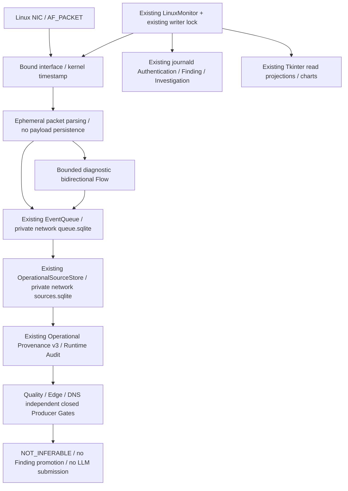

# Continuous Linux Network / DNS Monitoring

검증일: 2026-10-15, WSL2 Ubuntu / WSLg.
기준 HEAD: `a40a61c0958787f1d349abeeb0c06580ca1201e4`.

**최종 판정: PARTIAL.** 수집·정규화·영속 저장·진단 Flow·GUI·복구 구현과 Fixture 검증을
완료했다. 실제 AF_PACKET 수집은 **PERMISSION_DENIED로 BLOCKED**이며, 세 모델의 학습
Producer/Golden Pair 미확보로 운영 추론·Finding 승격은 계속 **NOT_INFERABLE / BLOCKED**다.
실제 Network/DNS → 운영 AI → LLM E2E를 완료했다고 주장하지 않는다.

## 1. Architecture / 기존 기능 재사용



기존 Queue/Source Store 구현의 **별도 인스턴스**를 `runtime/network/`에서 사용한다.
새 Queue·Source Store·Agent·Policy 엔진을 만들지 않았다. Authentication Queue에 Network
레코드를 섞어 기존 Authentication Worker가 잘못 claim하지 않도록 저장소를 분리했다.
기존 SourceStore 스키마나 운영 DB를 migration하지 않는다. Network 설정은 정지 상태에서
기존 writer lock을 획득한 명시적 관리 작업으로만 새 디렉터리에 생성한다.

## 2. Capture Architecture / 권한과 가시성

표준 라이브러리 AF_PACKET을 선택했다. 현재 환경에 tcpdump/tshark 명령은 없고, 별도
패키지를 설치하지 않았다. Promiscuous mode, interface 설정, Firewall, DNS 설정은 변경하지 않는다.
Linux packet socket 생성에는 해당 namespace의 `CAP_NET_RAW`가 필요하다.
[Linux packet(7)](https://man7.org/linux/man-pages/man7/packet.7.html).

실제 프로세스 `CapEff=0000000000000000`, AF_PACKET 생성 결과 **PERMISSION_DENIED**를 확인했다.
인터페이스는 `lo`, `eth0`(UP), `docker0`(DOWN)다. 주소·MAC·원문 Query는 보고서에 싣지 않는다.
권한 상승·sudo·setcap·네트워크 설정 변경·공격 트래픽 생성은 수행하지 않았다.

- NIC 이름은 제한된 문자·길이를 검증한다. net namespace, boot, ifindex, MAC의 digest로
  인터페이스 identity를 결합한다. symlink/비공개 디렉터리·설정 Digest 위반은 거부한다.
- `recvmsg`의 `SO_TIMESTAMPNS`를 사용한다. UTC datetime은 microsecond 단위이며 원본
  nanosecond 정수도 별도 보존한다. Clock 불일치·시간 역행은 Fail-Closed다.
- PACKET_OUTGOING과 HOST/BROADCAST/MULTICAST를 구분한다. 나머지는 UNKNOWN이다.
- Ethernet/VLAN, IPv4/IPv6, TCP/UDP 헤더와 제한된 IPv6 extension chain을 파싱한다.
- Fragment 재조립, ESP, jumbogram, 과도한 extension은 명시적으로 제외한다.
- Payload는 일시적으로 파싱한 뒤 버린다. 영속 레코드에는 필요한 헤더·길이·flag·digest만 남긴다.
- `PACKET_STATISTICS`는 이 소켓의 packet/drop counter이며 읽을 때 초기화되므로 delta를 누적한다.
  조회 실패는 UNKNOWN이다. NIC 전역 drop counter를 이 Collector의 Drop으로 대체하지 않는다.
- IP/TCP checksum 검증, GRO/GSO/TSO·물리 wire size 정합성은 미검증이다.
  Frame length는 **소켓이 전달한 Ethernet frame byte 수**로, preamble/FCS까지 포함한 wire 길이가 아니다.

WSL의 eth0는 가상 NIC와 Windows 측 네트워크 경계 안에서만 관측할 수 있다. Windows 전체
트래픽·다른 VM/namespace·물리 NIC 전체를 볼 수 있다고 가정하지 않는다. 물리 Linux의 NIC,
offload, namespace, 권한, throughput은 별도 검증이 필요하다.

## 3. Lifecycle / 실행 방법

기존 CLI로 새 전용 Runtime을 준비한다. 아래 경로와 임계값은 명시적 운영자 설정 예시다.
기존 데이터 디렉터리를 덮어쓰거나 자동 채택하지 않는다.

```bash
.venv/bin/python -m soc_agent.linux_runtime --directory /private/new-runtime init \
  --repeated-failures 5 --multiple-accounts 3 --assessment-mode READ_ONLY
.venv/bin/python -m soc_agent.linux_runtime.network_cli diagnose --interface eth0
.venv/bin/python -m soc_agent.linux_runtime.network_cli configure \
  --directory /private/new-runtime --interface eth0
.venv/bin/python -m soc_agent.linux_runtime --directory /private/new-runtime start
# 다른 터미널에서 읽기 전용 상태 조회 / 명시적 종료:
.venv/bin/python -m soc_agent.linux_runtime --directory /private/new-runtime status
.venv/bin/python -m soc_agent.linux_runtime --directory /private/new-runtime stop
.venv/bin/python -m soc_agent.gui --runtime /private/new-runtime
```

Query 원문 보존은 기본 비활성이다. 반드시 필요하고 보존 범위가 정해진 경우에만 configure의
`--retain-query-names`를 명시한다. 기존 설정의 자동 변경·삭제·재구성은 지원하지 않는다.

기존 Runtime lifetime writer lock 아래에서 선택적 async Network 작업을 시작한다. Network 권한
실패는 Authentication 경로를 모델 성공으로 대체하지 않고 Network를 DEGRADED/NOT_READY로
남긴다. Runtime readiness에도 반영한다. LLM 대기 중에는 async 수집 작업이 진행될 수 있지만,
기존 동기 journal/SQLite 작업이 event loop를 지연할 수 있어 고부하 무손실 수집은 보장하지 않는다.

기존 GUI의 명시적 Start는 file-backed log와 독립 process session을 사용한다. **GUI 종료는 Runtime을
종료하지 않는다.** 현재 GUI가 소유한 Runtime은 Stop 버튼으로, 재연결한 외부 Runtime은 기존 CLI로
명시적으로 종료한다. GUI 재실행 때 임의 경로의 Runtime을 자동 소유하지 않는다.
프로세스 종료와 systemd 서비스 설치는 별개이며 이번에 systemd를 배포하지 않았다.

## 4. Diagnostic Flow

- 5-tuple의 역방향을 같은 진단 Flow로 결합한다. Forward는 **최초 관측 방향**이며
  학습 CICFlowMeter 방향이라는 주장을 하지 않는다.
- Packet/byte의 Fwd/Bwd 집계, frame length min/max/mean, TCP flag 횟수, UTC duration(seconds),
  시작/종료 시각, 원본 Event ID를 보존한다. Raw 프레임 자체는 보존하지 않는다.
- 기본 idle timeout 30초, active timeout 120초는 **이번 진단 설정**이다. 학습 설정이 아니다.
- 최대 동시 Flow 128, Flow당 최대 packet reference 128이다. 초과 시 분할/불완전 종료 또는
  Backpressure다. 모든 Flow는 `incomplete=true`, `DIAGNOSTIC_ONLY`다. 완전한 handshake나
  capture coverage를 입증하지 않았으므로 CIC Feature처럼 표시하지 않는다.
- Flow 통계는 Queue의 packet metadata와 SourceStore 원본을 다시 읽어 재계산한다.
  집계 수·5-tuple·Incident·capture generation·참조 불일치는 거부한다.
- Timestamp 역행·용량 부족은 무리하게 합치지 않고 수집을 중단하고 Gap/오류를 남긴다.

## 5. DNS Extraction / Privacy

UDP DNS와 **한 TCP segment 안에 길이 prefix까지 완전히 들어온 DNS message**를 지원한다.
질문 1개, bounded message/name/pointer, query/response·type/class·rcode·transaction ID를 검증한다.
TCP segmentation/reassembly, 여러 framed message의 병합, 여러 질문은 미지원이며 명시적 상태로
제외한다. 이를 실제 DNS 분석 성공으로 세지 않는다.

`DNSNativeEvent`는 부모 packet의 SourceIdentity, Event ID, 시각·endpoint·transport와 결합된
별도 Event ID/Digest를 제공한다. 기본 query name은 None이며, 대소문자를 보존한 uncompressed
wire label의 digest만 남긴다. 명시적 원문 보존 시 binary 문자는 escape하고 IDNA/suffix/case
변환을 하지 않는다. 이 표현 정책을 학습 DNS9 normalization이라고 주장하지 않는다.

Port 443/853은 내용 관측 불가/불명 상태로 표시한다. 포트만으로 실제 DoH/DoT 사용이나 DNS
질의 내용을 확정하지 않는다. TLS 복호화·MITM·암호화 DNS 우회는 구현하지 않았다.
동일 wire bytes의 정상 재전송을 임의 제거하지 않는다. 중복 제거 단위는 capture generation /
source record identity / Event ID이며 동일 ID의 digest 충돌은 거부한다.

## 6. Training Producer Provenance / Golden Pair

ML HEAD `1800bd013edefd448671c97a8b7114409f639481`를 읽기 전용으로 조사했다.
11개 Notebook source와 scripts/packages를 검토하고, .git/.venv/cache를 제외한 ML 트리에서
PCAP/PCAPNG를 검색한 결과 둘 다 **0개**였다. 다른 미조사 시스템에 자료가 없다는 의미는 아니다.
Notebook은 실행하지 않았고 외부 데이터·패키지는 다운로드하지 않았다.

| 항목 | Quality / Edge Top40 | DNS9 |
|---|---|---|
| Dataset | CSE-CIC-IDS2018라는 자료·학습 경로 확인 | CIC-Bell-DNS-EXF-2021이라는 자료·학습 경로 확인 |
| 공식 Feature 이름·순서 | 배포 Binding 40열 VERIFIED | 배포 Binding 9열 VERIFIED |
| 배포 dtype / 전처리 | float32; Quality 별도 scaler 없음, Edge saved mean/scaler | finite float32 → named StandardScaler → round/clip INT8 |
| 학습 Producer | CICFlowMeter-V3 계열 REPORTED_ONLY | 자체 dataset extractor REPORTED_ONLY |
| 정확한 revision/config | MISSING | MISSING |
| Flow direction/timeout/units | 학습 정합성 MISSING | 해당 없음 / DNS 문자열 처리 MISSING |
| Raw↔Feature Golden Pair | MISSING / BLOCKED | MISSING / BLOCKED |
| 학습 정합성 판정 | BLOCKED | BLOCKED |
| 운영 추론·Finding 승격 | NOT_INFERABLE / BLOCKED | NOT_INFERABLE / BLOCKED |

[UNB IDS2018 공식 설명](https://www.unb.ca/cic/datasets/ids-2018.html)은 CICFlowMeter-V3를
사용했다고 설명한다. 정확한 생성 commit·설정·Raw/CSV 행 연결을 확인하는 자료는 아니다.
[UNB DNS-EXF 공식 설명](https://www.unb.ca/cic/datasets/dns-exf-2021.html)은 자체 extractor와
Feature 의미를 설명하지만, 현재 학습 행과 동일한 구현 revision/normalization을 확인하지 못했다.

직접 확인한 ML 자료:

- `notebooks/data.ipynb`: 기존 CSV 읽기/정제. 원본 PCAP Producer가 아니다.
- `notebooks/preprocessing.ipynb`, `model_sample_v4.ipynb`: 기존 CSV/Parquet와 Top40 선정·순서.
- `notebooks/dnn_top40_v4.ipynb`: float32, scaler.partial_fit/transform. Flow 추출 코드가 아니다.
- `reports/CIC-Bell-DNS-EXF-2021_DNS_Security_{EDA,ML}.ipynb`: 이미 계산된
  `stateless_features-*.pcap.csv`를 읽는다. 파일명의 pcap을 Raw parsing 증거로 보지 않는다.
- `packages/network-security-ai/src/network_security_ai/{contracts,preprocessing,predictors}.py`.
- `packages/dns-security-ai/src/dns_security_ai/{contracts,preprocessing,predictor}.py`.
- 공식 Artifact/Feature Manifest, `reports/Security_AI_Integration_Report.md`의 DNS DNN 학습/export 제한.

DNS9 순서는 `FQDN_count, subdomain_length, numeric, entropy, special, labels, labels_max,
labels_average, len`이다. 공식 문서에 Shannon entropy(log₂) 등 설명은 있지만, 입력 문자열·case·
trailing dot·IDNA·label/suffix 경계·특수문자 집합·결측 규칙까지 학습 코드와 검증되지 않았다.
**9개 모두 운영 계산 정합성은 UNVERIFIED**다. Network 40개도 원본 계산 정합성이 미확보다.
Feature 이름에서 공식을 추정하지 않았다.

기존 `operational/compare_exports.py::{parse_export,compare_exports}` 및
`dns_records.py::{validate_reported_dns,compare_dns_rows}`를 재사용해 strict numeric/float32·
Source/Incident/digest·오류 처리를 검증했다. 정확한 Decimal과 float32 bit 비교를 하며 임의 tolerance를
추가하지 않았다. 동일한 synthetic export의 PASS는 Golden Pair나 Producer Parity PASS가 아니다.
현재 비교 도구도 inference NOT_INFERABLE을 유지한다.

## 7. Gate / Native AI / Agent 연결 상태

Quality, Edge, DNS를 독립적인 Gate entry로 관리하되, 검증 자료가 없으므로 세 모델 모두 닫혀 있다.
Config나 GUI에 `verified=true` 같은 우회 옵션은 없다.

```text
Collection: code available; current WSL PERMISSION_DENIED
Feature / Flow candidate: DIAGNOSTIC_ONLY
Native operational inference: BLOCKED
Finding promotion: BLOCKED
Operational input: NOT_INFERABLE
Response: WRITE_DENIED
```

이벤트가 없으면 추론도 없다. 현재는 이벤트가 있어도 Gate가 닫혀 있어 운영 모델 호출은 **0**이다.
같은 Fixture를 반복하는 모델 polling loop는 추가하지 않았다. 기존 명시적 GUI Native Fixture
버튼과 Native 환경은 유지하고 별도로 회귀 검증했다. 그 성공을 실제 Network 입력의 성공으로
사용하지 않는다. Quality/Edge를 평균하거나 DNS와 동일 사건으로 자동 상관하지 않는다.

운영 추론 budget/retry/circuit/result/context의 새 경로는 이번에 활성화하지 않았다. 기존 Native
Service/Adapter/Context/Runtime Guard의 한계와 합성 전용 v2 계약을 그대로 유지한다.
운영 Feature/Model Result → Context → Finding/LLM 연결은 Producer 및 별도 운영 결과 계약을
검증한 뒤 후속 개발해야 한다. 출처 검증만으로 v2에 운영 데이터를 synthetic으로 넣지 않는다.

## 8. Persistence / Recovery / Audit

- CommonEvent에 Network의 명시적인 log Fixture origin을 추가했다. 기존 synthetic model v2는
  변경하지 않았다. Native와 Fixture의 collector/namespace/timestamp origin을 교차 검증한다.
- Packet/Flow의 최소 NetworkFlowSource를 기존 SourceStore에 저장하고, 상세 packet/Flow/DNS
  진단 레코드는 동일 SourceIdentity로 Queue에 보존한다. Packet payload는 저장하지 않는다.
- Queue Commit과 마지막 영속 Event checkpoint는 기존 한 transaction을 사용한다.
  이 checkpoint는 **커널 packet replay cursor가 아니다**.
- Queue claim → SourceStore commit → v3 receipt → Runtime Audit → Queue ack 순서다.
  여러 SQLite DB의 commit을 원자적이라고 가정하지 않는다. 재처리는 Source ID/digest와
  idempotent audit key로 수렴하며, 완료 Source·감사 기록을 다시 합산하지 않는다.
- 시작/재시작마다 packet replay가 불가능한 Gap을 기록한다. 중단 중 패킷은 복구할 수 없다.
  미완료 Flow는 원본 metadata에서 재구성하고 RESTART_GAP/incomplete로 종료한다.
- Drop 발견, Drop 측정 실패, Queue overflow, 저장 실패는 DEGRADED/NOT_READY다.
  손실 가능성을 숨기거나 최신 패킷으로 조용히 복구 성공 처리하지 않는다.
- 미처리 Queue 용량 256, retry limit 3, 전체 Queue tombstone 상한 100,000, SourceStore 상한
  10,000이다. 자동 삭제·retention 해제는 없다. 보존 한계에 도달하면 명시적인 정리 정책이 필요하다.
- 전달 의미는 **영속 Queue 이후 at-least-once + idempotent source/audit**다.
  모든 NIC 트래픽의 무손실 수집, exactly-once packet delivery/외부 모델 호출을 주장하지 않는다.
- Source·Receipt는 DECLARED_UNATTESTED이며 공격 사실이나 실행 권한이 아니다.
  Policy, Human Approval, Restricted Executor, WRITE_DENIED 경계는 변경하지 않았다.

## 9. GUI / Observability

기존 Dashboard·차트·비동기 조회를 확장했다. Network/DNS 상태, Authentication collector,
Capture Drops(UNKNOWN 포함), backlog, rate, 운영 inference count/gate를 확인할 수 있다.
Network traffic(packets/s), DNS queries/min, operational AI invocation timeline 및 기존 Queue trend를
표시한다. 운영 model result가 없으면 NO_DATA다. Collector Health는 상태 텍스트로 표시한다.

Rate는 이번 capture session의 최대 60초 rolling window와 실제 monotonic 경과 시간을 사용한다.
새 capture generation/Runtime 경로가 바뀌면 history를 초기화한다. GUI polling이 추론을 호출하지 않는다.
Native Fixture 환경 READY는 `AI Fixture env`로 표시해 운영 AI 준비 상태와 구분한다.
상세 JSON의 inference timestamp/token 같은 미측정 값은 null/UNKNOWN이다.

Fixture Collector의 실제 Queue/SourceStore 값에 packet 4개를 추가해 UI counter 증가와 그래프
반영을 검증했다. 이는 실제 WSLg 창을 사용한 **Fixture 데이터 검증**이다. Runtime 전체를
RUNNING으로 위장하지 않았다. 하위 테스트 수집기만 실행된 화면의 상단은 STOPPED다.

- [1920×1080 Fixture 화면](network-monitor-screenshots/network-fixture-monitoring-1920.png)
- [1366×768 Fixture 화면](network-monitor-screenshots/network-fixture-monitoring-1366.png)

## 10. 실제 WSL 검증과 Fixture 구분

| 항목 | 실제 WSL | Fixture |
|---|---|---|
| NIC/권한 진단 | eth0/lo 확인, CAP_NET_RAW 없음, PERMISSION_DENIED | socket 오류·Timestamp·drop 모사 |
| 실제 packet/Flow/DNS 확보 | BLOCKED, 0건 | IPv4/IPv6·TCP/UDP·DNS·양방향 Flow 검증 |
| 지속 Runtime | 새 전용 Runtime 3초 제한 실행 2회 | 반복 수집/저장/종료 검증 |
| Queue / Source / v3 | Network 원천 없음 | 저장·재조회·집계 재계산·v3 검증 |
| 재시작 | Network 권한 실패 유지, Gap 1→2 | claim/source/audit/ack 복구 |
| Audit / DB | Audit 검증, 세 DB integrity_check=ok | 변조·중복·5개 강제 종료 지점 |
| 운영 AI / LLM | Gate 차단, 호출 0 | Gate 차단, 별도 기존 Native synthetic 회귀 |
| GUI 종료 후 Runtime | 독립 프로세스 생존·명시적 Stop 검증 | presentation 회귀 |
| GUI Network 그래프 | WSLg 창 검증, 실제 NIC 데이터 없음 | 저장소 기반 변동 검증 |

최종 실제 두 실행의 CLI 시작→종료→상태 조회 경과는 **7.063초 / 7.070초**다.
각 Runtime에는 `--duration-seconds 3`을 사용했으며, 위 경과에는 Python 시작·상태 조회도 포함된다.
30분/장시간 Soak로 표시하지 않는다. 실제 packet/DNS/Flow는 확보하지 못했다.
Runtime process peak RSS는 **166,797,312 / 166,952,960 bytes**였다. import와 Authentication을 포함한
전체 process peak이며 capture 전용 메모리나 누수 증거가 아니다.
재현 evidence는 [검증 JSON](continuous-network-dns-evidence.json)에 보존했다. 원본 로그·주소·Query는 없다.

## 11. Tests / 결과

검증 명령과 최종 실행별 수치는 아래 최종 기록을 따른다. 실행 사이의 중복은 합산하지 않는다.
Fixture 테스트는 실제 Producer Golden Pair·실제 NIC 검증을 대체하지 않는다.
테스트 강제 종료는 PID handshake를 확인한 자체 multiprocessing 자식 5개에만 수행했다.
운영 서비스·외부 프로세스를 종료하지 않았다.

## 12. 남은 제한 / 다음 단계

1. **운영 Producer/Golden Pair가 없고 WSL Capture 권한도 없어 실제 운영 E2E는 BLOCKED.**
2. 정확한 Network Producer revision/config, 원본 PCAP+동일 Flow CSV+행 연결+digest가 필요하다.
3. DNS Producer source/config, normalization 규칙, 원본 query↔학습 행, 공급 DNN/scaler pairing이 필요하다.
4. 운영 모델 결과용 계약/검증된 Source Binding을 별도 설계하고 기존 v2를 우회하지 않아야 한다.
5. DNS TCP stream reassembly·fragment·offload·고부하·drop 회복·장시간 보존/부하는 미검증이다.
6. Capture identity에 boot와 NIC identity가 결합돼 있어 재부팅/NIC 교체는 자동 신뢰하지 않는다.
   현재는 새 환경의 명시적 재구성 검토가 필요하다. 무조건 resume 성공 처리하지 않는다.
7. 물리 Linux에서 관리자가 최소 권한 방식과 제한 NIC를 별도 승인·준비한 뒤 native packet/
   DNS/Drop/부하/재시작을 검증해야 한다. 일반 Python 전체에 capture 권한을 자동 부여하지 않는다.
8. Windows/AWS/systemd 설치·실제 Firewall/계정/프로세스 대응·운영 모델/코드 자동 변경은 하지 않았다.

실제 수집 권한 검증 → Producer/Golden Pair 확보 → 사전 고정한 Feature별 tolerance로 parity 검증 →
운영 Source/Model Result 계약 검증 → event-driven Native/Context/Finding/LLM 검증 순으로 진행한다.

## 13. 검증 결과 상세 / 변경 파일

| 실행 | 실제 결과 | 증거 로그 |
|---|---|---|
| 최초 binary parser/Flow unit | 26 passed, 0.06초 | `/tmp/soc-netdns-unit.log` |
| 저장/중복/5개 강제 종료 recovery | 19 passed, 14.79초 | `/tmp/soc-netdns-integration.log` |
| 초기 관련 회귀 | **503 passed, 1 failed**, 392.90초 | `/tmp/soc-netdns-regression.log` |
| 시작 동기화 테스트 수정 후 재검증 | 1 passed, 5.46초 | `/tmp/soc-netdns-start-sync.log` |
| 비교 도구·새 Pipeline·GUI 집중 | 182 passed, 32.99초 | `/tmp/soc-netdns-final-focus.log` |
| 최종 소스 / 전체 신규 / GUI unit | **102 passed, 28.89초** | `/tmp/soc-netdns-release-all.log` |
| 독립 Git Export / Runtime·Native·비교·GUI | **226 passed, 116.67초** | `/tmp/soc-netdns-export-tests.log` |
| Export 실제 WSLg + GUI unit | 45 passed, 5.66초 | `/tmp/soc-netdns-export-gui.log` |
| Export stale rate 수정 후 상태/GUI | 49 passed, 10.28초 | `/tmp/soc-netdns-export-status-release.log` |
| Export 최종 전체 신규 수집·복구 | **58 passed, 24.00초** | `/tmp/soc-netdns-export-final-network.log` |
| 실제 WSLg / 기존 GUI / 실제 Authentication 종료·재시작 | 6 passed, 99.53초 | `/tmp/soc-netdns-wslg.log` |
| 별도 최종 Network Fixture GUI | 1 passed, 6.75초 | `/tmp/soc-netdns-gui-release.log` |
| Ruff / Format / Diff | PASS, 866 Python 파일 format 통과 | `/tmp/soc-netdns-ruff-final2.log`, `/tmp/soc-netdns-format-final2.log` |

수치는 실행별이며 중복 합산하지 않는다. 최종 실행에는 미해결 실패·skip·xfail이 없다.
초기 1개 실패는 프로세스 시작 1초 후 RUNNING이라고 가정한 **신규 테스트의 시작 동기화 문제**였다.
실제 RUNNING handshake를 기다린 뒤 GUI 부모를 종료하도록 수정했다. 기존 테스트를 삭제하거나
성공 조건을 약화하지 않았다. Runtime.start는 START_REQUESTED이며 RUNNING 보장이 아니라는
실제 계약을 반영했다.

추가로 stale heartbeat 이후에도 과거 rate=99를 반환하는 문제를 새 실패 테스트로 재현했다
(`/tmp/soc-netdns-stale-before.log`, 1 failed). 상태가 RUNNING이 아니면 live rate를 None으로
반환하도록 수정하고 최종 102개 및 Export 58개 테스트에서 확인했다. 기록 자체를 지우지는 않는다.
전체 CommonEvent Source Digest를 비교하므로 metadata channel/platform/provenance의 변조도
거부한다. 최신 rate가 없는 상태를 0 traffic으로 위장하지 않는다.

독립 Export는 기준 HEAD의 git archive에 이번 변경만 적용했다. 사용자 수정이 섞인
`linux_runtime/service.py`, `__main__.py`는 **이번 hook/status 추가분만** HEAD에 적용했다.
추가분을 제거하면 작업 시작 시 사용자 파일 SHA가 정확히 복원됨을 확인했다. 미커밋 Replay는
Export에 포함하지 않았다. 외부 Native 환경과 모델은 기존 검증 환경을 읽기 전용으로 재사용했으며
독립 의존성 설치 시험은 아니다. Export의 실제 src를 import했고 Stage SHA와 비교했다.

재현 명령:

```bash
RUN_LIVE_LLM_TESTS=0 .venv/bin/python -m pytest --import-mode=importlib -q \
  tests/unit/network_capture tests/integration/network_monitor tests/unit/gui

# 기존 Source / Validator / Native Fixture / Runtime / Governance 회귀 범위:
RUN_LIVE_LLM_TESTS=0 \
SOC_EXTERNAL_ARTIFACT_ROOT="$PWD/.security-ai-demo/artifacts" \
SOC_EXTERNAL_INFERENCE_PYTHON="$PWD/.security-ai-demo/inference/bin/python" \
.venv/bin/python -m pytest --import-mode=importlib -q \
  tests/unit/operational_features/test_compare_exports.py \
  tests/unit/operational_features/test_reported_network.py \
  tests/unit/operational_features/test_reported_dns.py \
  tests/unit/operational_features/test_raw_sources.py \
  tests/unit/operational_features/test_auth_source_store.py \
  tests/unit/operational_features/test_operational_provenance.py \
  tests/unit/operational_features/test_adapter_boundary.py \
  tests/unit/security_ai/external tests/unit/external_context \
  tests/unit/package_status tests/integration/package_status tests/native_package_status_checks.py \
  tests/integration/gui tests/integration/scenario tests/integration/linux_runtime \
  tests/integration/restricted_response tests/integration/feedback_loop

# 실제 WSLg 실행과 Fixture 데이터의 구분은 파일 docstring/테스트명에도 기록:
RUN_LIVE_LLM_TESTS=0 .venv/bin/python -m pytest --import-mode=importlib -q \
  tests/network_gui_checks.py tests/gui_wslg_checks.py \
  tests/gui_environment_checks.py::test_actual_wsl_owned_runtime_start_collect_restart_and_gui_close
```

소스 (15개):

- `security_ai/operational/network_capture/{__init__,models,capture,parsing,flows,pipeline}.py`
- `linux_runtime/{network_monitor,network_cli}.py`
- `linux_runtime/service.py` — 선택적 수집 작업 시작/정상 종료 hook만.
- `linux_runtime/__main__.py` — read-only 상태와 readiness 결합만.
- `realtime/models.py` — 기존 CommonEvent의 명시적 Network log Fixture scope.
- `gui/{app,backend,charts,runtime_process}.py` — 기존 GUI 조회·차트·독립 Runtime 수명주기.

위 소스 경로의 접두사는 `src/soc_agent/`다. 테스트 (6개):

- `tests/unit/network_capture/{test_packets,test_capture}.py`
- `tests/integration/network_monitor/{test_pipeline,test_lifecycle}.py`
- `tests/network_gui_checks.py`
- `tests/gui_environment_checks.py` — GUI 종료 후 Runtime 생존을 확인하고 테스트가 명시적으로 Stop.

문서/증거 4개: 이 보고서, `continuous-network-dns-evidence.json`, 실제 Fixture WSLg PNG 2장.
기존 사용자 변경 8개, 미커밋 Replay, 이전 문서·미추적 파일, 모델 Artifact는 이번 Stage에서 제외한다.
운영 DB migration·자동 cleanup·실제 OS 보안 설정 변경·Live LLM 호출·모델 학습/승격은 0이다.

DNS 이름 digest도 강한 익명화 증명이 아니므로 최소한의 민감 metadata로 취급하고 private 저장소
접근 통제와 보존 정책을 적용해야 한다. 원문 보존 opt-in이 운영 모델 추론 허가를 의미하지 않는다.

이번 범위 밖 기존 파일 **979개**의 SHA가 작업 시작 시점과 일치했다. 사용자 변경이 섞인 두
Runtime 파일도 이번 추가분을 제거하면 원래 SHA가 복원된다. 보호 파일
`tests/fusion_support.py`의 SHA는
`e5f9d10f706f71b82e80261f7633a1504e27ba24499be948d04adb6eeb3a21c9`로 유지됐다.
