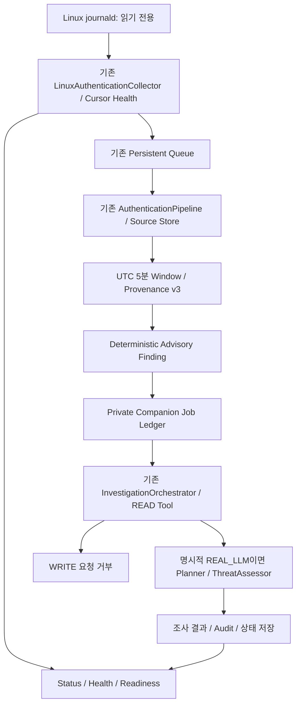

# Linux Continuous Security Monitoring Runtime

검증일: 2026-10-14. main HEAD `873835360b0b3c5e27c01b2bd7776da3ff82fdc9`.
기존 사용자 수정과 미커밋 Scenario 작업을 보존했다. 현재 실제 실행 환경은 **WSL2 Ubuntu**다.

**판정: WSL2 READ_ONLY 감시 범위 VERIFIED / 전체 운영 준비 PARTIAL.**
Native Collector→Queue→Source/Window→Finding→READ-only Investigation을 지속 실행·재시작·정상 종료했다.
실제 공급자의 LLM을 이 새 Runtime에서 호출한 검증, 물리 서버 배포, 장시간 안정성 및 운영 규칙 효능은 미검증이다.
이전 Scenario 실제 OpenAI gpt-5-mini 2회 PASS를 Runtime의 신규 실제 LLM PASS로 전용하지 않는다.

## 1. Architecture와 재사용



Worker를 불필요하게 여러 프로세스로 나누지 않았다. 하나의 직렬 event loop가 Collector,
Authentication/Detection, Investigation을 순서대로 처리한다. 동시에 진행되는 조사는 최대 1개다.
동일 directory의 전체 실행 기간에는 기존 `exclusive_runtime_lock`을 보유한다.
CLI 상태 조회와 stop은 같은 private SQLite의 local control row만 사용하며 외부 API/IPC 서버가 아니다.

재사용: Native Collector, `collect_with_health`, `MaintenanceLog`, `EventQueue`,
AuthenticationPipeline, OperationalSourceStore, Authentication Window, Provenance v3,
`read_authentication_view`, InvestigationOrchestrator, ThreatAssessor, InvestigationPlanner,
PolicyEngine/ApprovalManager/GovernedExecutor, 실제 READ Tool Guard, 기존 Crash Harness.

## 2. 설정 및 실행

```bash
cd ~/kdt-linux/autonomous-soc-agent

# 새로운 private directory만 초기화한다. 기존 운영/사용자 DB는 채택하지 않는다.
.venv/bin/python -m soc_agent.linux_runtime --directory /tmp/soc-monitor-example init \
  --repeated-failures 5 --multiple-accounts 3 --poll-seconds 2

.venv/bin/python -m soc_agent.linux_runtime --directory /tmp/soc-monitor-example start
.venv/bin/python -m soc_agent.linux_runtime --directory /tmp/soc-monitor-example status
.venv/bin/python -m soc_agent.linux_runtime --directory /tmp/soc-monitor-example health
.venv/bin/python -m soc_agent.linux_runtime --directory /tmp/soc-monitor-example readiness
.venv/bin/python -m soc_agent.linux_runtime --directory /tmp/soc-monitor-example stop

# 제한된 시간 실행
.venv/bin/python -m soc_agent.linux_runtime --directory /tmp/soc-monitor-example start \
  --duration-seconds 60
```

5/3은 명령 예시다. config의 반복 실패/다중 계정 임계값은 **필수 operator 입력**이며
`OPERATOR_SUPPLIED_UNVALIDATED`로 기록한다. Scenario 기본값을 조용히 운영 기본값으로 채택하지 않는다.
새 directory에만 queue/source/maintenance/monitor DB를 생성하며 운영 DB migration은 하지 않는다.
초기화 도중 실패한 directory는 자동 재생성/삭제/수리하지 않고 명시적으로 거부한다.

기본 evaluation은 **READ_ONLY**다. 실제 READ Tool을 호출하지만 LLM 및 ThreatAssessor를 실행했다고 표시하지 않는다.
실제 LLM은 별도 초기화에서만 Opt-in한다:

```bash
.venv/bin/python -m soc_agent.linux_runtime --directory /tmp/soc-monitor-llm-example init \
  --repeated-failures 5 --multiple-accounts 3 --assessment-mode REAL_LLM --env-file .env

SOC_LLM_BASE_URL=https://api.openai.com/v1 SOC_LLM_MODEL=gpt-5-mini \
  .venv/bin/python -m soc_agent.linux_runtime --directory /tmp/soc-monitor-llm-example start
```

.env는 명시한 경우에만 읽는다. 키 값을 출력/저장하거나 config에 복사하지 않는다.
API 설정 부재 시 실제 LLM 작업은 PENDING/NOT_CONFIGURED로 남으며 READ_ONLY/Mock 성공으로 대체하지 않는다.
설정은 `RuntimeConfig` API로 검증되고 JSON+digest가 private 원장에 보존된다.
CLI에는 최소 설정만 노출했다. 미구성 정교한 운영 배포 설정/가격 정책을 제공했다고 주장하지 않는다.

| 설정 | 기본/한계 | 의미 |
|---|---|---|
| poll_seconds | 2, 0.2~300초 | 실제 수집 간격, 실패 시 최대 16배 backoff |
| batch_size | 16, 최대 16 | journal poll 단위 |
| worker_batch | 32, 최대 256 | tick별 Queue 처리 상한 |
| pending_limit | 128, 최대 1024 | 미완료 Investigation backlog 상한 |
| collector_retry_limit | 3, 최대 10 | 일시적 source unavailable의 제한 retry |
| investigation_retry_limit | 0, 최대 3 | 기본 provider/조사 자동 재시도 없음 |
| investigation_seconds | 120, 최대 300초 | 조사 deadline |
| shutdown_seconds | 5, 0.1~30초 | 진행 중 async 조사 완료 대기 후 취소·PENDING 보존 |
| max_llm_calls | 2 | Planner 1 + Assessment 1, 초과 거부 |
| max_tool_calls | 2, 1~8 | 생성된 계획의 Tool 수 검증, 실행 전 초과 거부 |
| circuit_failures | 3 | 실패 격리 Circuit, 재시작 후에도 보존 |

## 3. Collector / Detection

기존 exact Cursor probe 및 Queue commit→Cursor publication 순서를 유지한다.
SourceUnavailable은 제한 retry/backoff, QueueFull은 Cursor를 임의 진행하지 않고 backlog 처리,
GAP_DETECTED/CURSOR_INVALID/PERMISSION_DENIED/STORE_FAILURE는 FAILED로 종료한다.
이벤트 원문으로부터 지원되지 않는 인증 성공/실패를 추정하지 않는다.
PAM 실패는 `pam_unix(sudo:auth)` module outcome이며 최종 로그인/전체 sudo 실패와 다르다.

`linux_runtime/findings.py::correlate`는 기존 모든 queue/source/receipt 무결성 조회 후
ACCEPTED 이벤트만 사용한다. UTC 5분 bucket 및 실제 source/account pseudonymous identity로 분리한다.
지연 격리 이벤트는 제외한다. 같은 Timestamp에는 실패 후 성공이라고 판단하지 않는다.

규칙:
- 동일 출처 반복 실패
- 동일 source 내 동일 account 반복 실패
- 같은 source의 다중 account 실패
- 같은 source/account에서 엄밀히 더 늦은 성공
- 개별 sudo PAM module failure

Finding에는 rule/source/window stable ID, Incident, Event ID, Source Evidence digest,
first/last seen, reason, source Provenance receipt, 입력 origin 및 initial PENDING 상태가 있다.
Severity info/low는 advisory triage 표시이며 Core Incident severity를 변경하지 않는다.
정확한 현재 processing status는 별도 작업 원장에 있다.
동일 rule/source/window의 최초 triggering snapshot을 보존하며 동일 Finding은 다시 조사하지 않는다.
추가 이벤트가 생겨도 해당 Finding을 덮어쓰거나 자동 재조사하지 않는다.
이 정책은 모든 후속 확대/악화의 자동 대응 탐지가 완료됐다는 의미가 아니다.

Finding rule은 실제 효능 검증/학습 결과가 아니며 모델 Prediction/공격 사실/실행 권한으로 승격되지 않는다.
Network Top40 / DNS9는 계속 NOT_INFERABLE이다.

## 4. Investigation 및 보안

Finding의 Incident/source/digest/v3 Provenance를 다시 검증한 뒤 claim한다.
READ_ONLY는 기존 실제 InvestigationOrchestrator와 governed READ Tool을 실행한다.
REAL_LLM은 기존 Client/Planner/Orchestrator/Assessor를 재사용하고,
Finding을 `DETERMINISTIC_FINDING_ADVISORY` 자료로 구분하여 컨텍스트에 제공한다.
기존 prompt/컨텍스트/Plan schema 제한을 완화하지 않았다.
Tool 이름/Incident가 잘못되거나 WRITE를 계획하면 기존 allowlist/Guard가 거부한다.

조사 결과 전체의 validated investigation/assessment snapshot과 digest를 private 원장에 저장한다.
공급자 응답/요청은 감사에 digest만 저장하고 상태 CLI에 원문을 노출하지 않는다.
성공/실패 결과와 Finding 연결·상태·Audit는 **동일 monitor SQLite transaction**으로 기록한다.
Evidence 수집 결과가 Response/Approval 발급으로 이어지지 않는다.
WRITE probe는 실제 Guard를 통과하려 시도하고 handler 호출 전에 거부됨을 확인한다.
Response Tool/Executor는 운영용으로 등록하지 않는다. 기존 Policy/Approval 경계는 유지한다.

LLM token 사용은 provider가 정상적인 usage를 제공할 때만 저장한다.
응답 없거나 usage 없는 경우 UNKNOWN/null이며 0으로 채우지 않는다.
가격 설정이 없으므로 cost_estimate는 UNKNOWN/null이다. 금액을 추정·생성하지 않았다.
READ_ONLY 실제 호출 수는 0이다.

LLM timeout 후 default executor의 300초 shutdown 대기를 피하도록 기존 Client에
single daemon transport를 추가했다. pending transport가 있는 같은 Client의 다음 호출은 거부한다.
동기 DNS/urllib 작업 자체를 강제 취소하거나 외부 프로세스를 종료하지 않는다.
늦게 온 응답은 canceled future에 게시하지 않는다. 실패 시 Circuit/Retry로 확산을 제한한다.
이 변경은 악성 Python을 격리하는 sandbox나 provider billing 취소 보장이 아니다.

## 5. Lifecycle / Recovery / 처리 의미

Start는 private DB/config/audit/binding 검증 후 exclusive lock을 획득한다.
그 이후에만 Queue CLAIMED 복구 및 RUNNING investigation 복구를 수행한다.
이미 완료된 Finding은 claim하지 않으며 순수 READ 재처리는 idempotent source aggregation을 유지한다.
조사 도중 crash 시 API/READ 호출이 다시 발생할 수 있고 provider billing도 반복될 수 있다.
정확히 한 번의 LLM 요청을 보장하지 않는다.
일반 retry + 한정 crash recovery budget을 초과한 작업은 FAILED로 남긴다.

Stop은 신규 수집/claim을 중단하고 진행 중 async 조사를 bounded wait한다.
남은 조사는 취소하면서 PENDING 및 audit를 기록한다. SIGINT/SIGTERM도 이 경로를 사용한다.
상태가 손상됐거나 완료 receipt가 없으면 정상 완료로 표시하지 않는다.
감사·상태·job stamp는 무결성 검사를 거치며 감사 쓰기 실패는 성공으로 처리하지 않는다.
Hash chain은 로컬 손상 검증이고 privileged writer가 재해싱하는 공격에 대한 진위 증명은 아니다.

Queue/source/monitor/collection audit DB는 여러 저장소다.
전체 흐름의 cross-DB atomic commit을 주장하지 않는다.
Queue 전달은 **at-least-once + Source dedup/idempotent processing**이다.
독립 commit 후 crash는 재처리/보존된 Cursor/Source 참조로 복구한다.
기존 Incident/Audit/Decision Payload/ID를 변경하거나 운영 DB를 migration하지 않는다.

동기 journalctl/SQLite/전체 이력 검증 중에는 event loop 응답이 지연될 수 있다.
shutdown_seconds는 async 조사 대기 상한이며 전체 OS command/CPU 구간의 hard deadline이 아니다.
실제 5초 재시작 probe의 Runtime uptime은 13.77초였다. 관측된 지연을 5초 보장으로 보고하지 않는다.

## 6. Health / Readiness

CLI status/health/readiness는 다음을 노출한다:
Runtime state/uptime/heartbeat age, collector state, last collection, Cursor health,
Queue backlog, pending/running/failed/completed jobs, last investigation,
LLM availability, last error, audit store health, NOT_INFERABLE/WRITE_DENIED.
실제 원문·계정·IP·호스트 ID·Credential/Key는 상태에 표시하지 않는다.

RUNNING만으로 READY라고 판단하지 않는다. heartbeat와 성공한 collection,
READ_ONLY 오류 상태 또는 REAL_LLM의 실제 AVAILABLE 상태가 있어야 READY다.
STOPPED는 NOT_READY, 실패는 FAILED/NOT_READY, 미구성 LLM/Circuit/Backpressure는 DEGRADED다.
오래된 heartbeat와 job receipt/state stamp 이상은 정상으로 위장하지 않는다.

## 7. 실제 WSL 실행 증거

### Native 연속 실행

임시 root `/tmp/soc-monitor-native-5zxz90ok`, READ_ONLY, 실제 Collector, 실제 LLM 0회.
사용자 로그를 생성하거나 audit policy/권한을 바꾸지 않았다.

- Runtime uptime **60.29초**, 전체 관측 **63.84초**, exit 0.
- 실제 journal / Queue **352개**.
- 검증 AuthenticationEvent **1개**, unsupported **351개**, Window **1개**.
- Native sudo PAM module failure Finding **1개**, 완료 READ 조사 **1개**.
- Event/Window/Provenance/READ Guard 검증 및 WRITE 요청 거부 PASS.
- 재시작 exit 0, Runtime uptime **13.77초**; Queue **368개**, 인증 이벤트 **1개**, 완료 조사 **1개**.
- source/window/job 중복 효과 없음, Cursor RESUMED_EXACT, stderr 0 bytes.

로그 `/tmp/soc-monitor-native-evidence.json`, `/tmp/soc-monitor-native-summary.log` 및 root의
smoke/restart stdout/stderr. 운영 OS 설정·Firewall·계정·프로세스를 변경하지 않았다.

### 상태·정상 종료

같은 격리 root로 Start→READY 조회→별도 CLI stop→STOPPED/NOT_READY 검증.
READY 실제 관측, stop command exit 0, Runtime exit 0, 총 **4.78초**.
로그 `/tmp/soc-monitor-stop-evidence.json`. SIGINT/SIGTERM 지원은 코드/Fixture 검증이며
실제 OS service를 종료했다는 의미가 아니다.

### 제한된 자원 관측

23개 Native sample: RSS **9.00~162.25 MiB**, 관측 Queue backlog 최대 **16**,
SQLite 파일 합계 **638,976→1,417,216 bytes**.
startup import 증가와 실제 retained queue/audit 증가가 포함된다.
이 결과만으로 메모리 누수·장시간 안정성·부하 상한을 판정하지 않는다.
WAL/RSS를 측정하지 않은 구간·성능 수치를 만들어 넣지 않았다.
별도 Linux 물리 서버의 결과로 표현하지 않는다.

## 8. 자동화 테스트

```bash
RUN_LIVE_LLM_TESTS=0 .venv/bin/python -m pytest -q \
  tests/integration/linux_runtime tests/unit/llm tests/integration/scenario \
  tests/unit/approval tests/unit/execution tests/unit/planning tests/unit/assessment \
  tests/unit/realtime \
  tests/unit/operational_features/test_authentication_investigation.py \
  tests/unit/operational_features/test_native_authentication.py \
  tests/unit/operational_features/test_operational_provenance.py \
  tests/integration/authentication_stability/test_crash_recovery.py \
  tests/integration/authentication_retention/test_retention_rotation.py \
  tests/integration/external_read_only_backend/test_guard.py
# 478 passed, 0 failed, 120.63초 /tmp/soc-monitor-regression.log

RUN_LIVE_LLM_TESTS=0 .venv/bin/python -m pytest -q \
  tests/integration/linux_runtime/test_process_recovery.py
# 이후 추가한 owned-child Runtime crash 2 passed, 3.60초
# /tmp/soc-monitor-process-tests.log

.venv/bin/python -m ruff check src tests
.venv/bin/python -m ruff format --check .
git diff --check
```

Ruff PASS / Format **765 files PASS** / Diff PASS.
S01~S12 기존 기준을 유지하며 모두 실제 테스트 실행에 포함했다.
Fixture 기반: Collector 오류/Gap/Backpressure, job 중복/복구·transaction rollback,
LLM timeout/failure/성공 core 경로, call/tool budget, graceful shutdown,
state/audit tamper, exclusive lock, 미완료 작업 보존, daemon transport timeout.
실제 provider 성공으로 테스트 client의 성공을 포장하지 않았다.

새 Runtime 실제 owned-child Crash 2개: detection commit 및 investigation claim 직후 종료.
기존 PID/nonce/lock 소유 검증 Harness만 사용했다.
복구 후 PENDING 재처리 가능, SQLite integrity/foreign key 및 audit 확인.
기존 Source/Queue Crash와 Scenario Crash도 회귀에 포함했다. 실행 수치를 중복 합산하지 않는다.
초기 tuple JSON key 및 Evidence raw_data 타입 문제를 재현·수정했다.
고정 0.6초 Fixture test에서 모든 job이 끝나기를 가정한 문제는 유효한 제한 실행 시간으로 보완했다.
최종 실패 0이며 테스트를 skip/xfail하거나 Guard를 완화하지 않았다.
전체 프로젝트 회귀와 새로운 실제 Runtime LLM provider 호출은 미실행이다.

## 9. 변경 파일

신규 Runtime:
- `src/soc_agent/linux_runtime/__init__.py`
- `src/soc_agent/linux_runtime/models.py`
- `src/soc_agent/linux_runtime/findings.py`
- `src/soc_agent/linux_runtime/store.py`
- `src/soc_agent/linux_runtime/service.py`
- `src/soc_agent/linux_runtime/__main__.py`

신규 테스트:
- `tests/integration/linux_runtime/test_monitor.py`
- `tests/integration/linux_runtime/test_transport_shutdown.py`
- `tests/integration/linux_runtime/test_process_recovery.py`

최소 변경:
- 기존 미커밋 `src/soc_agent/demo/scenario_analysis.py`: Finding advisory 컨텍스트 재사용.
- `src/soc_agent/llm/openai_compatible.py`: bounded daemon transport/active transport 거부/실제 usage 보존.
- 이 신규 문서.

기존 사용자 수정 및 미추적 파일 보존, Synthetic v2/Provenance v3/protected fixture SHA 불변.
Commit/Stage/Push, 상위 agent 위임/IPC/외부 API, Windows 신규 개발, AWS 배포 없음.

## 10. 운영 제한과 다음 단계

- 단일 Incident/session 기반 staging monitoring이며 자동 운영 Incident 생성/분리/닫기는 미연결.
- 최초 rule/source/window Finding snapshot 정책은 이후 확대 이벤트의 자동 재조사 기능과 다르다.
- 전체 Queue/Source/Audit 이력 검증 비용은 누적 데이터에 비례한다. 장시간 부하/메모리 프로파일 필요.
- 실제 Runtime REAL_LLM 성공/가격 추정, circuit 운영 해제/인증된 승인 UI, whole-core Decision publication은 후속.
- Provider token/cost 정보가 없으면 UNKNOWN이며 정확한 비용 예측 기능을 완성했다고 주장하지 않는다.
- 동기 Collector/SQLite의 종료 지연, crash 후 LLM 재요청/중복 billing 가능성이 있다.
- 보존 데이터 자동 정리/삭제 없음. Queue retention/공간 상한 도달 시 fail-closed이며 capacity/retention 운영 계획 필요.
- 60초 Native 검증은 30분/2시간/장시간 Soak를 대체하지 않는다.
- 최종 물리 Ubuntu 서버: 최소 journald 권한, 실제 sshd 로그, 재부팅/Cursor rotation, systemd lifecycle,
  네트워크 단절·디스크/메모리/Queue 부하·장시간 Soak를 별도 통제 환경에서 검증해야 한다.
- Windows/AWS/상위 agent 인터페이스는 향후 로드맵으로만 남긴다.
- 실제 Firewall/계정/프로세스 대응 Executor 또는 rollback은 이번 단계에 구현·활성화하지 않았다.

운영 배포 준비를 완료로 선언하지 않는다. 현재 완료 증거는 WSL2의 독립 READ-only 연속 감시 범위다.
