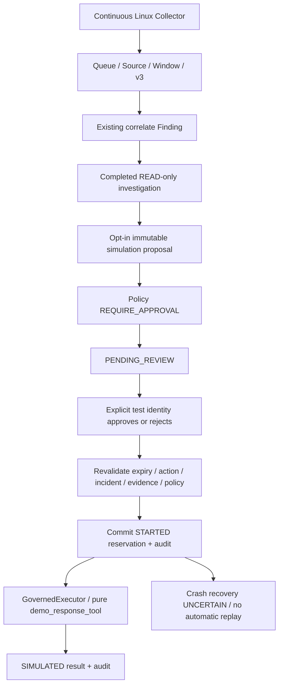

# Authentication Detection Evaluation & Governed Response Simulation

## 판정 및 범위

**VERIFIED — WSL2 Ubuntu의 재현 가능한 Fixture advisory 평가와 Continuous Runtime Finding 기반 순수 대응 시뮬레이션 범위.** 실행일: 2026-10-14.

운영 탐지 정확도는 **INCONCLUSIVE**다. 실제 보안 이벤트 1건을 대표 코퍼스로 간주하지 않는다. 실제 OS 대응, 인증된 운영 승인자, 물리 Linux 서버, Windows/AWS는 검증하지 않았다.

Baseline HEAD는 `b93fac8fc21b09b27e09bc8f23747cff5bc7167c` (`main`). 이전 Real LLM 통합은 HEAD에 포함되어 있다. 기존 README.md, docs/soc-command-center.md, pyproject.toml 수정 및 미추적 파일은 보존했다. Commit/Stage/Push 및 운영 DB Migration은 수행하지 않았다.

## Evaluation Dataset / Ground Truth

- Dataset: `authentication-advisory-fixtures:1.0.0`.
- **11개 독립 Fixture Incident, 12개 UTC 5분 Window, 5개 Rule, 총 60개 판단 단위.** Event 수나 Finding 수와 혼합하지 않는다.
- Label 분포: positive **9**, negative **51**.
- Ground Truth Digest: `5eec9c8a198596e954d0f5bece72d99121c0311808435b30d4ed6a73d6437ce4`.
- 라벨은 `developer-authored-independent-advisory-spec:1.0.0`의 사전 정의다. 탐지 실행 결과, 모델/LLM 출력, Scenario.expected_detection을 정답으로 사용하지 않는다.
- 라벨 의미는 **EXPECTED_ADVISORY / NO_ADVISORY_EXPECTED**다. 악성 공격 확정 라벨이 아니다. 정상 목적의 테스트 실패 역시 공격으로 확정하지 않는다.

GroundTruth 필드: Dataset ID, Scenario ID, Incident ID, Event IDs, ground_truth_label, expected_rule_id, Event UTC Timestamp, 반개방 Observation Window `[start,end)`, Source Origin, Source Digest 기반 Evidence References, Label Provenance. 원본 이벤트/Incident/Origin/시간·Digest 연결, 모든 평가 Rule의 Window 커버리지, 중복 라벨 및 Dataset Digest를 검증한다. 계약은 FIXTURE/NATIVE_OS를 구분하지만 이번 Runner의 실행 코퍼스는 명시적인 Fixture다. Native 독립 라벨 코퍼스는 확보하지 않았다.

| Case | 입력·독립 의도 | 기대 advisory |
|---|---|---|
| normal | 정상 인증 Fixture | 없음 |
| single | 단일 테스트 SSH 실패 | 없음 |
| repeated | 동일 출처/계정 실패 5회, 후보 패턴 | 출처 반복 / 계정 반복 |
| multiple | 동일 출처에서 3개 계정 실패 | 다중 계정 |
| transition | 같은 계정 실패 후 성공 | 실패 후 성공 |
| sudo | 명시적인 sudo PAM 모듈 실패 | PAM 모듈 실패 |
| boundary | 두 Window에 각각 실패 2회 | 없음 |
| late | 원본 반복 패턴이지만 성공 이후 60초 이상 늦게 도착 | 원본 의도상 반복 advisory; 실제 격리로 FN 발생 |
| duplicate | 반복 패턴 5건을 동일 ID로 재전달 | 고유 이벤트 기준 반복 advisory |
| unsupported | 지원되지 않는 session 로그 | 없음 |
| benign-burst | Fixture 명세상 승인된 정상 목적 실패 테스트 | advisory 불필요; 엔진에 의도 정보가 없어 FP 발생 |

S01/S03/S04/S05의 입력 생성기와 기존 PAM Fixture를 재사용했다. S02는 기존 구현상 PAM 모듈 실패이며 SSH 단일 실패와 구분한다. 승인·만료·변조·Network/DNS 차단 시나리오 S07~S10/S12의 기대 승인 결과를 탐지 Ground Truth에 편입하지 않았다. 중복 및 Window/지연 사례는 독립 입력으로 추가했다.

실제 탐지는 `src/soc_agent/linux_runtime/findings.py::correlate()`를 그대로 호출한다. Scenario의 요약 `authentication_detection.py::detect()`는 별도 기존 경로이며, Runtime의 추가 계정 Rule까지 평가하려고 Runtime 엔진을 선택했다. 새 탐지 엔진이나 ML 모델을 만들지 않았다.

### Rule 범위와 설정

| Rule | 현재 구현 |
|---|---|
| REPEATED_AUTH_FAILURE | 동일 출처·UTC Window의 실패 수 ≥ 5 |
| REPEATED_ACCOUNT_FAILURE | 동일 출처·계정·UTC Window의 실패 수 ≥ 5 |
| MULTI_ACCOUNT_FAILURE | 동일 출처·UTC Window의 실패 계정 수 ≥ 3 |
| FAILURE_THEN_SUCCESS | 동일 출처·계정·Window에서 실패보다 뒤의 성공 |
| SUDO_PAM_MODULE_FAILURE | 지원되는 명시 PAM 모듈 실패, 최종 sudo/로그인 거부와 구분 |

5/3은 **EXAMPLE_UNVALIDATED** 평가 설정이며 운영 최적 임계값이 아니다. 계정 반복은 현재 동일 출처 안에서 계산하며 출처 전체를 합친 계정 상관으로 표현하지 않는다. 지연 격리된 Source는 탐지에 사용하지 않는다. Finding을 공격 사실이나 자동 대응 권한으로 승격하지 않는다.

## Confusion Matrix / Metrics

단위: **Incident × UTC 5분 Window × Rule**. 동일 단위에 여러 Source/Account Finding이 있으면 OR 한 번으로 평가한다. 서로 다른 Rule은 서로 다른 판단 단위다. 평가 범위 밖 Finding은 조용히 무시하지 않고 커버리지 오류로 거부한다. 별도 테스트에서 같은 Window의 Finding 5개가 Rule 단위 3개로 축약되는 것을 실제 엔진으로 확인했다.

| 실제 독립 라벨 / 탐지 | advisory 있음 | advisory 없음 |
|---|---:|---:|
| advisory 기대 | TP **7** | FN **2** |
| advisory 불필요 | FP **2** | TN **49** |

| 지표 | Fixture 결과 |
|---|---:|
| Precision | 7/9 = **77.78%** |
| Recall | 7/9 = **77.78%** |
| F1 | 14/18 = **77.78%** |
| False Positive Rate | 2/51 = **3.92%** |
| False Negative Rate | 2/9 = **22.22%** |

분모가 0이면 None/Undefined로 출력하며 임의의 0/1로 대체하지 않는다. F1은 `2TP/(2TP+FP+FN)`의 분모 기준으로 처리한다. 작은 수작업 코퍼스·Rule별 상관된 판단 단위에서 나온 값이며 운영 공격 탐지율·일반화 성능·확률로 해석하지 않는다.

| Rule | TP | FP | FN |
|---|---:|---:|---:|
| REPEATED_AUTH_FAILURE | 2 | 1 | 1 |
| REPEATED_ACCOUNT_FAILURE | 2 | 1 | 1 |
| MULTI_ACCOUNT_FAILURE | 1 | 0 | 0 |
| FAILURE_THEN_SUCCESS | 1 | 0 | 0 |
| SUDO_PAM_MODULE_FAILURE | 1 | 0 | 0 |

### FP / FN 해석

- **FP 2개:** benign-burst에서 출처 반복과 계정 반복 Rule이 advisory를 냈다. Fixture 명세는 정상 목적 테스트라고 독립적으로 정의했다. 엔진 입력에는 승인된 테스트 의도가 없으므로 경보가 발생한다. 이 결과를 제거하거나 정상 실패 로그를 악성으로 재라벨링하지 않았다.
- **FN 2개:** late의 원본 5회 실패 패턴이 지연 격리되어 출처·계정 반복 Rule이 출력되지 않았다. 안전한 지연 처리 정책의 가시성 한계이며 Guard를 완화해 탐지율을 올리지 않았다. 별도 지연 검토 경로는 후속 과제다.

## Detection Latency / 재현성

Fixture 처리 시각은 `해당 Case의 최신 Event Time + 10초`로 사전 고정했다. latency는 처리 시각에서 각 Finding의 마지막 참조 Event Time을 뺀 값이다. **실제로 측정한 운영 탐지 지연이 아니다.** 본 코퍼스는 Rule 단위와 Finding 단위가 일치하는 출력 9개이며 모두 10초다. 추가 다중 scope 테스트는 지표를 Rule/Window 단위 OR로 계산한다.

별도 실제 Replay wall time 합계는 **3.871초**다. Event Time과 실측 Processing Duration을 혼합하지 않는다. 원격/운영/장시간 지연 분포는 미검증이다.

동일 데이터·설정·코드에서 Ground Truth 및 Evaluation Digest를 재현했다. Git HEAD와 관련 소스 SHA-256을 Summary에 포함한다. 가변 measured_replay_seconds는 핵심 Evaluation Digest에서 제외한다. Ground Truth Digest는 이벤트·라벨·출처·도착 순서 전체를 포함한다. Fixture Timestamp는 원본 Journal Fixture 입력에 적용한 뒤 기존 Parser로 정규화하며 실제 OS Timestamp를 수정하지 않는다.

- Summary: [detection-evaluation-fixture-summary.json](detection-evaluation-fixture-summary.json)
- 독립 입력/라벨: [detection-evaluation-ground-truth.json](detection-evaluation-ground-truth.json)
- Evaluation Digest: `43474039d917781d2c99fd6dea49b11cf185859a3fcb8f8a93bd573e23042539`.

```bash
.venv/bin/python -m soc_agent.evaluation.authentication \
  --output /tmp/authentication-evaluation.json
# Summary JSON, 독립 .ground-truth.json, 간단한 .md Report 생성
```

## Governed Response Simulation 구조



새 계약 `soc-runtime-response-simulation:v1`은 Finding ID/Digest, Investigation Result Digest, 실제 READ Tool이 반환한 선택 Window Evidence Digest, 기존 ActionProposal/ApprovalRequest를 연결한다. Source/Window/Provenance는 실행 직전에 재검증한다. 다른 Incident, 변조된 Source, 변경된 Window, 과거 조사에 포함되지 않은 새 증거는 실행을 허용하지 않는다. 관련 없는 새 OS 메타데이터가 추가되는 것만으로 승인 대상 Window를 변경하지 않는다.

기존 `demo_response_tool()`/`simulate_disable()`, PolicyEngine, ApprovalManager, `validate_binding()`, GovernedExecutor를 재사용했다. Response Planner/LLM 출력에서 임의의 명령을 가져오지 않는다. 목표는 고정된 `demo-alice`에 대한 순수 DTO 시뮬레이션이며 실제 OS 계정을 겨냥하지 않는다. 별도 Simulator Registry에는 이 순수 Tool만 존재한다. Investigation의 READ-only Registry/Capability를 대응 권한으로 재사용하거나 변경하지 않는다.

기본값은 Response Simulation/Actual Response/Automatic Human Approval 모두 **DISABLED**다. 명시 enable 후 Worker는 완료 조사에만 PENDING_REVIEW를 자동 준비한다. **승인 또는 실행은 Worker가 자동 수행하지 않는다.** 사용자 CLI의 명시 승인/execute가 각각 필요하다. 이미 존재하는 후보는 Worker가 재발급하거나 자동 재승인하지 않는다. Window가 변하면 실행을 거부하고, 과거 시뮬레이션 후보 때문에 정상 수집을 멈추지는 않는다.

현재 승인자는 `test:<alias>`만 지원하며 **EXPLICIT_TEST_IDENTITY**로 저장된다. 이는 운영 사용자 인증이 아니다. 운영 신원·HumanAuthority·실제 대응은 이 경로에서 활성화하지 않는다. 실제 대응용 DurableExecutor/Promotion은 Core authoritative 계약이 필요하므로 여기서는 호출하지 않았다. 별도 Incident 저장소나 Approval 판단 엔진을 만들지 않았다.

## CLI / Runtime 연결

```bash
# 기존 Runtime의 비어 있는 격리 데이터 디렉터리에 init한다.
.venv/bin/python -m soc_agent.linux_runtime --directory /tmp/soc-evaluation-runtime init \
  --repeated-failures 5 --multiple-accounts 3 --assessment-mode SCRIPTED

# 실제 대응은 활성화할 수 없다. Simulator만 opt-in한다.
.venv/bin/python -m soc_agent.linux_runtime --directory /tmp/soc-evaluation-runtime simulation enable
.venv/bin/python -m soc_agent.linux_runtime --directory /tmp/soc-evaluation-runtime start \
  --duration-seconds 60
.venv/bin/python -m soc_agent.linux_runtime --directory /tmp/soc-evaluation-runtime simulation list

# list에 나온 candidate_id를 사용. 최초 execute는 ApprovalRequiredError다.
.venv/bin/python -m soc_agent.linux_runtime --directory /tmp/soc-evaluation-runtime simulation approve \
  CANDIDATE_ID --test-reviewer test:operator
.venv/bin/python -m soc_agent.linux_runtime --directory /tmp/soc-evaluation-runtime simulation execute \
  CANDIDATE_ID

# 거부는 simulation reject CANDIDATE_ID --test-reviewer test:operator
# 수동 요청은 simulation request FINDING_ID --ttl-seconds 300
# 비활성화는 simulation disable
```

변경 CLI는 Runtime writer lock을 먼저 확보한 후 Pipeline을 연다. **현재 승인·시뮬레이션 실행은 monitor를 정상 종료한 상태에서 수행한다.** 계속 실행 중인 다른 writer를 우회하지 않는다. READ status/list는 별도 조회다. 중복 Runtime/CLI 경합은 거부된다. 실시간 동시 승인 UI/API는 이번에 개발하지 않았다.

## 실제 WSL과 Fixture 구분

| 항목 | 실제 WSL | Fixture |
|---|---|---|
| 수집 | 기존 journald auth/authpriv/sshd 필터로 읽기 | 명시된 Parser 입력/Monkeypatched Collector transport |
| 영속 Queue | 784개 고유 기록 | 사례별 격리 SQLite |
| 지원 인증 | 1개 실제 과거 sudo PAM 모듈 실패 | SSH/PAM/지연/중복/경계/unsupported |
| 지원 밖 기록 | 783개 | unsupported 1 case |
| Window / 완료 조사 | 1 / 1 READ_ONLY | 실제 Core READ Tool + SCRIPTED Assessment |
| Runtime Finding | 1 정보성 PAM advisory | 기존 correlate Rules |
| 운영 탐지 정확도 | **INCONCLUSIVE** | 소규모 advisory utility 평가 |
| 승인 전 실행 | ApprovalRequiredError | 모든 Pending 실행 거부 |
| 승인자 | 명시 `test:wsl-reviewer`, 운영 인증 아님 | EXPLICIT_TEST_IDENTITY / Fake Clock |
| 승인 후 시뮬레이션 | 순수 Handler **1회** | 승인/거부/만료/경합/변조 |
| 실제 OS 보안 Handler | **0회** | Spy/구성상 **0회** |
| 실제 LLM 호출 | **0회**, READ_ONLY 설정 | Mock/Scripted, Transport Fixture |
| 재시작 | 결과·승인·감사 복원 | owned process Crash / replay 거부 |

실제 로그는 기존 journald에 남아 있는 기록을 다시 수집한 것이며 새로운 실패를 생성하지 않았다. PAM 모듈 실패를 최종 로그인/sudo 실패로 해석하지 않는다. Source Assurance는 기존 DECLARED_UNATTESTED로 유지하며 Digest를 원본 진위 또는 모델 학습 정합성 증명으로 취급하지 않는다.

실제 실행 시간은 수집 Runtime **60.361초**, 재시작 **4.295초**다. 장시간 Soak나 물리 Linux 검증으로 표시하지 않는다. 정상 종료 때 Queue backlog 0, 승인 전 pending review 1/시뮬레이션 0을 확인했다. 명시적인 테스트 승인 후 SIMULATED, simulated_handler_calls=1, real_os_handler_calls=0을 확인했다. 재시작 후 저장된 Record 전체가 일치하고 세 SQLite integrity_check가 모두 ok다.

실제 데이터 기반 운영 정확도/새로운 공격·SSH 실패/실제 LLM 조사와 시뮬레이션을 합친 실행은 **미검증**이다. 이전 Real LLM 경로는 코드/회귀로 유지했으며 이번에는 실제 API를 호출하지 않았다.

## Approval / Audit / Persistence / Recovery

Runtime의 기존 `monitor_audit`를 재사용한다. 모드, 불변 Request, Approval Snapshot, STARTED 예약, 결과 Snapshot, 거부 및 복구를 기존 Hash Chain에 append한다. 새 테이블/운영 DB Migration은 없다. 기존 Config JSON/Digest와 Incident/Decision Payload/ID를 변경하지 않았다.

- 완료된 조사, Source/Provenance, READ Evidence Snapshot, Incident를 먼저 검증한다.
- Human Approval Request/Decision을 기존 Manager에서 만들고 같은 Transaction에 Audit Snapshot으로 저장한다. Audit 실패 시 승인 상태는 Pending 그대로다.
- 정확한 Action ID/Input/Tool/Risk/Incident 및 Approval 유효기간을 기존 Governance 경로가 재검증한다. Simulator는 항상 REQUIRE_APPROVAL 정책을 요구한다.
- STARTED 예약과 Audit가 성공적으로 Commit되어야 순수 Handler를 호출한다. Audit 실패 시 Handler Spy는 0이다.
- 완료 Snapshot과 Audit는 같은 monitor.sqlite Transaction이다. 다른 Source/Queue SQLite와 하나의 원자적 Commit이라고 주장하지 않는다.
- 동일 Candidate/Action의 두 동시 실행은 하나만 성공한다. 재시작도 기존 SIMULATED 예약을 재실행하지 않는다.
- STARTED 상태에서 중단되면 UNCERTAIN으로 복원한다. simulated_handler_calls는 **UNKNOWN(None)**이며 0을 가장하지 않는다. 실제 보안 Handler는 존재하지 않는다. 자동 재시도는 없다.
- 승인 만료 직전 preflight와 만료 시점/직후 실행, 승인 후 대상/Incident/Action 변경, Policy 변경, Window/Evidence 변경, 미확인 Source, Approval Replay를 거부했다.
- 승인 예약과 Dispatch 사이 만료 경합은 Handler Spy 0을 확인했다.
- 거부 Audit에는 원문/자격 증명 대신 오류 분류와 후보의 해시 참조만 기록한다. 잘못된 후보 입력에 민감 문자열을 넣어도 Audit에 복사되지 않는 것을 검증했다.

### Owned Crash 3개

| 지점 | 복구 결과 |
|---|---|
| STARTED 예약 Commit 직후, Handler 전 | UNCERTAIN / 호출 수 UNKNOWN / 재실행 거부 |
| 순수 Handler 반환 직후, Receipt 저장 전 | UNCERTAIN / 재실행 거부 |
| 완료 Receipt Commit 직후 | SIMULATED / 호출 1회 / 재실행 거부 |

Nonce/PID/Runtime lock으로 소유권을 검증한 테스트 자식만 종료했다. 실제 OS 서비스/사용자 프로세스를 종료하지 않았다. Queue/Source/Window/v3 재조회, READ-only 조사, WRITE Spy 0, SQLite 무결성, Audit Head를 복구 후 검증했다. Exactly-once 외부 대응을 주장하지 않는다.

## 테스트 및 품질

자동 테스트는 모두 `RUN_LIVE_LLM_TESTS=0`이며 실제 API 성공으로 표현하지 않는다. 실행별 수치는 겹치므로 합산하지 않는다.

| 실행 | 결과 | 로컬 로그 |
|---|---|---|
| 최초 개발 집중 테스트 | 11 passed / 10 failed(JSON tuple 직렬화) | `/tmp/soc-response-focused.log` |
| 직렬화 수정 후 response 집중 | 11 passed | `/tmp/soc-response-fixed.log` |
| 개발 중 평가/경합/Crash | 27 passed | `/tmp/soc-response-new.log` |
| Scenario S01~S12/Runtime/Transport/Policy/Approval/Execution/Operational/신규 | **448 passed, 0 failed** | `/tmp/soc-response-regression.log` |
| 신규 scope 축약 테스트 포함 집중 | 28 passed | `/tmp/soc-response-final-new.log` |
| CLI lock 테스트 추가 중 | 30 passed / 1 failed(테스트 json import 누락) | `/tmp/soc-response-last-tests.log` |
| 해당 import 수정/보안 Audit 집중 | 3 passed | `/tmp/soc-response-last-delta.log` |
| 최종 신규 전체 | **31 passed, 0 failed** | `/tmp/soc-response-verified-final.log` |

실패를 skip/xfail하거나 Guard를 완화하지 않았다. JSON tuple은 기존 엄격한 JSON 계약을 유지하며 명시적 list로 변환했다. 테스트 import 누락은 수정 후 재검증했다. 기존 S01~S12는 실제 Pipeline·승인 시뮬레이션의 결정적 Fixture 검증이며 전체 PASS다. 기존 REAL_LLM Worker Budget/Failure/Recovery와 Transport 테스트는 Mock으로 재실행했다.

최종 Ruff PASS, Format PASS(775개 파일), `git diff --check` PASS, 보호 SHA PASS. 프로젝트 전체 회귀를 새로 실행한 것으로 주장하지 않는다.

## 변경 파일

소스 5개:
- 신규 `src/soc_agent/evaluation/authentication.py`: 독립 GT 계약, Dataset, 실제 Runtime 엔진 평가, 지표/JSON/Report Runner.
- 신규 `src/soc_agent/linux_runtime/response_simulation.py`: Snapshot Binding, 명시 Test Review, 순수 Simulator 예약/감사/복구.
- 수정 `src/soc_agent/linux_runtime/service.py`: Opt-in Proposal 준비 및 복구 연결.
- 수정 `src/soc_agent/linux_runtime/__main__.py`: CLI/상태/동시 실행 Guard.
- 수정 `src/soc_agent/demo/scenario_pipeline.py`: Fixture 원본 Timestamp 선택 인자, 기존 기본 동작 유지.

테스트 3개:
- `tests/unit/detection_evaluation/test_authentication.py`
- `tests/integration/response_simulation/test_runtime_simulation.py`
- `tests/integration/response_simulation/test_crash.py`

산출물 3개:
- 이 보고서
- `docs/linux-soc-v1/detection-evaluation-fixture-summary.json`
- `docs/linux-soc-v1/detection-evaluation-ground-truth.json`

기존 evaluation package 초기화는 원본 그대로 유지했다. Synthetic v2 모델, Operational Provenance v3, `tests/fusion_support.py`가 HEAD와 바이트/SHA 동일함을 확인했다. 보호 fixture SHA `e5f9d10f706f71b82e80261f7633a1504e27ba24499be948d04adb6eeb3a21c9` 유지. 모델, Policy/Approval/Execution 엔진 및 기존 사용자 문서는 수정하지 않았다.

## 남은 위험 / 다음 단계

1. **운영 정확도 INCONCLUSIVE:** 별도 독립 라벨링된 실제 인증 Corpus, 정상·운영 테스트·공격 후보의 의도 근거, representative negative 데이터가 필요하다. Fixture 77.78%를 운영 성능으로 사용하지 않는다.
2. Rule의 account scope/고정 UTC Window/늦은 이벤트 격리는 현재 계약이다. 실제 자료로 임계값·누락·FP 비용을 평가하고 필요 시 별도 검토 경로를 설계해야 한다. 이번에 Guard를 낮추지 않았다.
3. 승인·실행 CLI는 현재 Runtime을 정상 종료한 뒤 사용한다. 지속 감시와 동시 운영 승인 UI/API는 미구현이다. 외부 API/IPC/Sub-Agent를 추가하지 않았다.
4. 운영 사용자 인증 및 실제 Target/Response Planner/Executor는 비활성이다. Test namespace 승인은 운영 권한이 아니며 실제 계정/Firewall/프로세스를 변경하지 않는다.
5. 만료/변경된 후보의 재발급, 재조사, UNCERTAIN 수동 조정은 후속 운영 Workflow다. 현재 자동 재승인·재실행을 하지 않는다.
6. Python 객체나 로컬 Hash만으로 악성 동일 프로세스 코드/동일 OS 계정의 완전 격리를 보장하지 않는다. 물리 서버는 최소 권한·파일 접근·신원 경계 후속 검증이 필요하다.
7. 실제 LLM+Response Simulation 합성 E2E, 물리 Ubuntu/systemd/장시간 부하·가용성, Windows/AWS는 미검증이다. Network Top40/DNS9는 Producer Parity 없이 NOT_INFERABLE을 유지한다.

후속 순서: 독립 실제 Authentication Ground Truth 확보 → 운영 임계값/지연 검토 → 신뢰된 운영 승인자 및 연속 감시 중 검토 절차 → 물리 Linux 서버 최소 권한 검증. 실제 OS 대응 활성화는 별도 승인·검증 전까지 제외한다.

실제 WSL Audit Head: `de62ab744bdcde00881f246841516fe985da5486635432499f15a1eb0b8cffd0`. 원본 데이터는 private `/tmp/soc-response-native-*` SQLite에만 보관했고 보고서에는 개인 식별 원문을 복사하지 않았다. `/tmp/soc-response-native-evidence.json`에 비식별 실행 Receipt를 남겼으며 `/tmp`는 영구 증거 저장소가 아니다.
