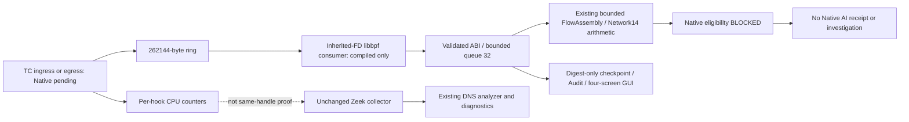

# TC/eBPF collector foundation

Status: **Foundation implemented; Native hook, verifier, integrity and AI remain PENDING/BLOCKED.**
No BPF program/map was loaded, no TC hook/qdisc was created, no capability/authentication
was requested and no test network traffic was generated. Compile and host-parser fixtures
are not Kernel Verifier or Native evidence.

## Baseline and architecture

SOC baseline `f020f718f9b950927aded17fb6f16eeeff24ed3f`, ML
`e1a01260f0463a38d4d778859bc2a86f8e9cfbde`, main. Original indexes empty. Preserve the
132 dirty SOC/ML files, Native sessions/archives, prior evidence, helpers, artifacts and
raw datasets. The private baseline inventory records SHA256 for original dirty/protected
files and stat tuples for large raw datasets; no dataset/model migration occurs.

Existing Zeek collectors, packet producer, 30s/120s FlowAssembly, Feature Gate, RF/LR
workers, governed READ-only investigation, GUI Worker and RuntimeStore Audit were reviewed.
New code belongs to `security_ai/ebpf/`; it does not replace Zeek or alter its CLI/approval.
The existing collector Protocol is satisfied by EBPFCollector. Native `start()` always
rejects with EBPF_NATIVE_HOOK_APPROVAL_REQUIRED. Only a labelled file-fixture path can
enter FIXTURE_ACTIVE. No model worker or investigation is created by this collector.



The dotted link is an explicit prohibition: eBPF observations cannot attest Zeek's pcap
handle. Cross-collector correlation is UNKNOWN without a reviewed shared packet identity.
No event totals are combined and no packet is silently deduplicated by count/direction.

## Kernel environment

Read-only observations: WSL2 kernel `6.18.33.2-microsoft-standard-WSL2`; clang18.1.3;
libbpf-dev1.3.0; supplied bpftool7.4.0 reports its own libbpf1.4; tc/iproute2-6.1.0
reports libbpf1.3.0. These are different tool linkages, not one inferred runtime version.
BTF exists at `/sys/kernel/btf/vmlinux`; config BPF/BPF_SYSCALL/BPF_JIT/BPF_EVENTS and
XDP_SOCKETS=y, NET_CLS_BPF=m. No module was loaded. bpffs is **not mounted**; this does
not itself prove FD-based loading impossible, since no pinning is implemented. Effective
capabilities are zero, unprivileged_bpf_disabled=2. TC attachment compatibility is UNKNOWN.
Affinity12, possible CPUs0–11, approximately7.6GiB guest RAM. Exact resource samples appear
in the evidence JSON. No WSL setting, interface or mount was changed.

## Kernel program and packet parser

`tc.bpf.c` exports `tc/ingress` and `tc/egress`; every exit returns TC_ACT_OK. No DROP,
REDIRECT, packet write helper, firewall change, socket capture, loader or attachment API
is present. Compilation uses fixed clang bpfel commands and system Linux/libbpf headers.
Debug paths are normalized for repeatable object identity. Object SHA and build commands
are evidence, not verifier acceptance; target is this x86_64 little-endian environment.

`parser.h` is shared verbatim with a nonprivileged host-C fixture harness. It validates
Ethernet, up to two inline VLAN tags, IPv4 IHL/length/fragment fields, IPv6 base header,
TCP data offset/reserved bits and UDP length. Bounds are checked before each header access.
The BPF path reads at most128 header bytes with bpf_skb_load_bytes and stores only the
80-byte event. There is no packet payload/FQDN output or persistence. Stack-local header
bytes are transient; the parser is not a DNS analyzer or checksum validator.

Explicitly unsupported: third VLAN tag, IPv4 fragments, IPv6 extension/fragment headers,
IPv6 jumbograms, non-TCP/UDP, oversized frames, hardware-stripped VLAN metadata and GSO
with multiple segments. Truncated/invalid headers increment malformed counters. Supported
inline VLAN metadata remains distinct from hardware offload semantics. Native GRO/offload,
loopback link format and skb length semantics are **not validated** by the host fixtures.
Any mismatch/unsupported interval blocks inference rather than imputing packet fields.

## Maps and accounting

| Map | Type / bound | Meaning |
|---|---|---|
| events | RINGBUF,262144 bytes | Metadata delivery, no packet data |
| config | ARRAY,1 | ifindex, generation, enabled, monotonic start/deadline |
| counters | PERCPU_ARRAY,2 | Separate ingress/egress cumulative map-generation counters |

Config is disabled by default. A future reviewed supervisor must bind program/map IDs,
namespace/interface, session and generation before enabling. Kernel code rejects an invalid
or >300s configured interval and stops emitting after4096 observed attempts **per CPU per
hook**. This is not a global packet limit: on12 possible CPUs and two hooks, the structural
maximum is98304 attempts eligible for parsing. Subsequent packets still return OK and
increment budget observations. Userspace delivery is independently capped at4096 events.
Observation counters continue for the attached program lifetime; detachment is a future
supervisor responsibility. Native continuous monitoring is not implemented or claimed.

Counters: observed, emitted, ring_lost, unsupported, malformed, disabled, budget. A stable
snapshot must satisfy their accounting equality. Counter reset requires a new generation;
decrease/wrap/saturation is not silently repaired. A live map read could race between
increments; therefore only a future quiesced interval/start/end protocol could attest it.
Python Counters validation currently consumes **fixture declarations**, not real map proof.

Ring reservation failure is **metadata observation loss**, not Kernel Packet Drop. Kernel
Packet Drop remains UNKNOWN. Ring records have generation, per-CPU observed sequence,
CPU, hook, ifindex, monotonic timestamp, addresses/ports, protocol/flags/lengths. Namespace,
session and program SHA are bound by the userspace Plan, not measured inside each skb.
Native binding of those declarations to actual loaded program/maps is still unverified.

A ring preserves reservation order, not a promise that pre-reservation timestamp reads
across CPUs are globally sorted. No reordering/clamping is applied. The foundation rejects
sequence gaps/reuse and same-flow regression conservatively; filtered/unsupported attempts
can explain a gap only after a reviewed counter protocol, which is not yet Native-admitted.
[Kernel ring-buffer semantics](https://www.kernel.org/doc/html/latest/bpf/ringbuf.html).

## Userspace consumer and lifecycle

`consumer.c` links actual libbpf and implements ring_buffer__new/poll on an inherited ring FD.
It validates ring map type/size, refuses root execution, has300s/4096-event bounds and
nonblocking stdout; short writes/backpressure fail explicitly. It cannot load/attach/pin
programs, open a pinned map or elevate privileges. FD type/size alone is not program/session
attestation. No FD consumer was run against a real BPF map; only compilation/linking occurred.
[libbpf1.3 API](https://github.com/libbpf/libbpf/blob/v1.3.0/src/libbpf.h).

Python `ring.py` checks exact80-byte ABI, enums, IPv4 padding and metadata schemas. The
callback is exercised with actual shared C parser bytes. EBPFCollector owns bounded queue32,
high/low watermarks24/8,128 CPU identities,128 active flows,128 packets/window and4096 total
packet references. Overflow is explicit ERROR/capture gap, never a successful sample or
silent drop. Ring loss and counter/accounting faults block the whole eBPF input window;
there is no evidence to narrow shared loss to one healthy flow.

The Native FD/Plan admission, map polling/snapshots, supervised TC load/detach, OS CPU/RSS
limits and post-stop quiescence proof remain **not implemented/admitted**. Thus prepare is
safe and selectable, but start is blocked even with a forged caller-supplied Plan. The C
consumer is a compiled building block, not an authorized Native collector executable.

Fixture processing uses a separate explicit begin_fixture call with an independent monotonic
deadline; NaN/negative/reversed processing clocks fail. Drain is bounded32 each pass; Stop
is idempotent, drains only valid fixture input and finalizes remaining flows as SHUTDOWN.
Error queues remain bounded and are counted as pending, not retroactively processed. Packet
lists are released after successful final checkpoint. No retry or privilege restart exists.

## Network14 integration and AI eligibility

Existing FlowAssembly provides first-seen bidirectionality, event-time 30s Idle/120s Active
windows, packet/byte/length statistics, flags and IAT. FIN/RST remain features; no new
completion authority is invented. SHUTDOWN/PACKET_LIMIT remain incomplete. Each hook and
session uses a distinct assembly; ingress/egress observations are never merged or described
as duplicate-confirmed packets.

All14 arithmetic fields/order/float32/numeric digests are compared with independent PCAP
metadata and the ML Producer1.1.0 using identical offline Golden fixtures. The full ML
fixture feature digest has OFFLINE_PCAP provenance, not EBPF_TC_NATIVE provenance; it is
not reused as a Native receipt. The current Native clock is KERNEL_MONOTONIC_NS; there is
**no UTC conversion or automatic Packet/ML admission**. Fixture normalization accepts exact
microsecond PCAP times only, never rounds1ns regressions away. Relative-time arithmetic
matching on fixtures cannot prove Native clock/TC offload/flow-window/training parity.

Hook identity, loaded program identity, delivery, counter/stream integrity, complete flow,
feature parity, artifact SHA and source identity must be independently verified before any
future admission proposal. Native AI remains a hard BLOCKED policy, including recovery.
No eBPF Quality/Edge receipt or investigation is fabricated. Existing actual Zeek offline
RF/LR, advisory, READ-only investigation/export and recovery regressions are retained as
**Zeek offline** evidence; they do not prove eBPF inference. DNS9/operational promotion remain
BLOCKED. No security WRITE tool is invoked.

## DNS and Zeek separation

eBPF emits only UDP/TCP53 candidates with its own timestamp/direction/flow identity. It cannot
claim DNS header validity, query/response matching or DNS9 features. The existing independent
Zeek analyzer remains responsible for DNS_ANALYZER_OBSERVED / DNS_TRANSACTION_OBSERVED /
DNS_ADAPTER_REJECTED diagnostics. Those states cannot be assigned to a specific eBPF packet
without correlation proof; its state stays PORT53_CANDIDATE or DNS_VISIBILITY_UNKNOWN.

The historical Native session still has68 UDP53 metadata records, zero DNS events and an
UNKNOWN cause. No original session was modified and no cross-collector evidence was inserted.
DoH/DoT/query caching/interface visibility remain separate limits, not parser failure proof.

## GUI and collector selection

Existing four screens/cards/Canvas graphs/timelines remain. `operator_view.py` adds only a
conditional System projection for eBPF hook/interface/program SHA, Kernel events, ring loss,
queue, counter provenance, feature gate and DNS/correlation. Unknown counters render UNKNOWN,
not zero. No new poll timer, visualization dependency, model initialization or hidden worker
is added to the default GUI or Zeek one-command path.

The separate preparation CLI can display the existing Desktop using one existing Worker
with a preparation-only backend. Start/copy/auth are disabled; Stop and close record safe
preparation cancellation without loading/attaching. No default GUI collector is changed and
no Zeek CLI/Plan/approved bundle file is edited. The old Zeek Bundle digest remains
`e665e7629a2b945ab84ccf26f78b1a492e5acd2d00f6197da5517be67ab2c7ef`.

## Audit, recovery and retention

Reuse RuntimeStore hash-chain Audit and SQLite transactions in a **new private session**.
EBPF_PREPARED binds Plan/program/source/hook/interface/namespace; EBPF_CHECKPOINT binds the
summary, metadata-chain digest, feature-decision digest, loss and Native BLOCKED decision.
No raw addresses/ports/packet list/FQDN/payload are persisted. Only bounded aggregate numeric
feature tails/digests and session/source metadata remain; earlier packet-level evidence
cannot be reconstructed and is not claimed available.

One checkpoint row is atomically replaced with an append-only Audit binding every64 accepted
fixtures and at stop/error. Empty repeated drains do not add duplicate records. Checkpoint
≤16KiB; session storage guard8MiB;4096-event bound limits ordinary checkpoint count. Disk-full
or corruption raises explicitly, never deletes old evidence or approves recovery. Snapshot
and audit writes do not constitute kernel attestation.

Recovery verifies existing Audit, initial Plan and last checkpoint digest/identity. It returns
RESTORED_NO_REATTACH with old evidence explicitly separated; no old queue/packets/flows are
restored as fresh input and no model or hook restarts. A new session/generation is required.
Existing operational databases and Audit chains are untouched.

## Compile and preparation commands

These are nonprivileged, do not load or attach:

```bash
.venv/bin/python -m soc_agent.security_ai.ebpf compile --output /tmp/soc-ebpf-build
.venv/bin/python -m soc_agent.security_ai.ebpf prepare --collector ebpf-tc \
  --interface lo --hook INGRESS --program /tmp/soc-ebpf-build/tc.bpf.o \
  --data-directory /tmp/soc-ebpf-preparation --gui
```

Compilation alone verifies ELF BPF machine identity; preparation hashes the object and
binds a new session. Neither operation confers Native approval or model eligibility.

## Native approval requirements and remaining blockers

Before Native validation, review a separate bounded loader/supervisor contract and its SHA,
program/object/consumer digests, actual interface namespace and one selected hook. Establish
which minimal capabilities the exact WSL kernel needs (typically CAP_BPF plus CAP_NET_ADMIN;
older/fallback paths may differ). Do not grant broad permanent sudoers/root-GUI authority.
No capability was exercised here. TC state changes/load/attachment require **new explicit
user approval** and are not part of this preparation command.

User-driven validation must subsequently: verify compiled object and loader identities;
obtain Verifier result without treating compilation as success; bind actual program/map IDs
and interface/namespace/generation; confirm existing TC ownership and avoid replacing other
filters; enforce300s/resources; collect start/end stable hook/CPU counters and ring delivery;
stop producers, drain, verify owned-hook detach/map/process cleanup; verify Audit and record
unsupported/GSO/VLAN/clock gaps. Do not claim Kernel Packet Drop from ring loss, or Zeek
same-handle integrity from TC counters. Do not auto-restart or reattach on recovery.

No runnable privileged load/attach command is supplied as an approved production procedure:
that supervisor/admission/cleanup contract remains a material blocker. Native AI requires
independent Native feature parity plus a separate policy approval even after hook validation.


## Validation and performance results

Clean independent Export uses SOC baseline plus only this task's files and clean ML HEAD.
Existing user changes/Replay, Native databases/archives, artifacts and raw datasets are not
included. Actual model artifacts are read only under the existing regression identity.

| Validation | Result / scope |
|---|---|
| Main unit regression | 652 passed |
| eBPF strengthened guard/contract regression | 45 passed, overlaps main unit cases |
| Offline integration / Golden / lifecycle | 52 passed |
| Existing actual Zeek RF/LR + READ-only investigation/recovery | 1 passed, two offline receipts |
| Existing WSLg GUI regression | 15 passed in the initial GUI run |
| New eBPF prepared-only WSLg test | 1 passed after correcting Tcl state comparison |
| Governance/Audit/recovery/transport | 125 passed |
| Final clean Export eBPF/unit/Golden/CLI/GUI/evidence | 54 passed |

Failures were retained: one historical GUI-hash assertion (original report unchanged,
historical presentation SHA pinned); one new test's Tcl state-object/string comparison;
one guard false positive against the compiler output filename. Each cause was corrected
and its affected tests rerun. A benchmark warm-up initially used a plain interface name
where the existing schema requires a digest; only the harness input was corrected. No
flaky/SIGILL/OOM failure is relabelled fixed. SIGILL root cause remains UNKNOWN.

New final source was exported again; workspace/Export/index SHA equality is required
before commit. Ruff check src/tests, format and diff checks pass. Clean offline wheel build
passes; all488 packaged Python/Zeek/JSON/C/header source files match Export bytes, including
the BPF sources and libbpf bridge. The original soc-agent CLI entry point is unchanged.
Export and workspace compilation produce identical BPF object and consumer SHA256.

Three fresh default WSLg GUI processes per side, same profiler/config, no capture or model:

| Metric, median | Before | After |
|---|---:|---:|
| Startup | 2.460s | 2.715s |
| Idle RSS | 175.11MiB | 174.94MiB |
| Idle CPU, one core | 0.288% | 0.311% |
| Callback p95 | 0.044ms | 0.128ms |
| Threads / background async tasks | 2 / 0 | 2 / 0 |

Startup is about10.4% slower in these three samples; there is no demonstrated overall
performance improvement. Shared WSL scheduling, startup jitter and tiny sample size prevent
isolating causality. The conditional eBPF GUI projection adds no default backend/model worker.
No repeat-until-fastest result was selected. Native active RSS/CPU/Kernel ring throughput,
TC parser and Verifier cost remain UNKNOWN.

Same synthetic TCP frame,100 warm-up/3000 calls each, sequential host process:

| Path | p50 / p95 / p99, μs | Calls/s |
|---|---|---:|
| Existing Python packet parser + domain model | 9.846 / 16.443 / 31.094 | 87,913 |
| Shared C parser through ctypes | 1.155 / 2.147 / 3.014 | 638,817 |
| eBPF ABI + typed normalization | 16.327 / 33.272 / 53.677 | 45,411 |

The output contracts differ; these are stage costs, not an equivalent end-to-end speedup.
C parser excludes domain model/provenance work; normalization includes it. Process peak RSS
163.9MiB includes interpreter/imports, not incremental kernel or collector memory. Native
ring polling latency/throughput, global packet-loss coverage and steady-state kernel CPU
were not measured. No long Native/soak test was performed. Existing Zeek fixtures are not
relabeled as a new eBPF soak.

Screenshots are preparation-plan **fixtures**, with unknown Native counters and no hook:
[1366×768](ebpf-collector-foundation-screenshots/system-prepared-1366.png),
[1920×1080](ebpf-collector-foundation-screenshots/system-prepared-1920.png).

## Final verdict

| Item | Verdict |
|---|---|
| EBPF_COMPILE_VERIFIED | Actual BPF target compile and libbpf consumer link |
| EBPF_VERIFIER_PENDING | No program/map load |
| TC_HOOK_NATIVE_PENDING | No qdisc/hook attachment |
| RING_BUFFER_FIXTURE_VERIFIED | Fixed ABI/callback queue only; real ring FD polling pending |
| EVENT_NORMALIZATION_VERIFIED | Bounded typed fixture metadata, explicit clock/source |
| ZEEK_COLLECTOR_PRESERVED | Original code/image/helper/bundle/CLI unchanged |
| NETWORK14_PARITY_VERIFIED | All14 numeric/order/float32 Golden fixtures; Native parity BLOCKED |
| DNS_CANDIDATE_VERIFIED | Port53 only; analyzer correlation UNKNOWN |
| GUI_PRESERVED | Four screens/cards/graphs/timelines and prepared-only state |
| AUDIT_RECOVERY_VERIFIED | Fixture checkpoint/Audit binding, no reattach/reinference |
| NATIVE_CAPTURE_INTEGRITY_UNVERIFIED | No actual hook/delivery/counter attestation |
| NATIVE_AI_BLOCKED | No new eBPF model receipt/investigation |
| DNS9_BLOCKED | No DNS9 parity/admission change |
| OPERATIONAL_PROMOTION_BLOCKED | Research-only / WRITE_DENIED |

This is a foundation deliverable, **not Native eBPF collection success**. Missing Native
loader/supervisor, capability admission, quiesced same-map counter proof, TC/clock/offload
validation and resource enforcement require a separate reviewed increment and user approval.

## Build identities

Actual BPF object SHA256 (no object binary is committed):

`69de609ea8ee90ecf90d091ec361e46e61ed0638b3175390c77305145e19d5f4`

Compiled inherited-ring consumer SHA256 (never run on a BPF FD):

`8e4f69ffde75d6e728b72ba9c1bb13ff59e1fdb042bc6f6dbecd1af2a11ce072`

C/header source digest:

`8c8b9c92231348293299eeaa1c430661156d9049a92d532cf0dc27aa1bbd8e32`

Foundation source/presentation bundle digest:

`165c749e83e5f7d6b74e1b54f0bc2d4d846505ad7c36a59825be55932aab8a58`

These identities do not reuse Zeek/v2/v3 approvals. The commands above are compile/prepare
only; actual Native validation requires the future supervisor review described above.
