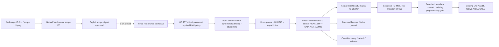

# Native eBPF bootstrap and TC implementation — Phase B-2A

**Implementation/compile/fixture scope only. Native authentication, Kernel Verifier Load,
TC Attach/Detach and network configuration changes were not executed.** The new C code
contains the real libbpf and OS/PAM operations, independently closed by a non-overridable
B-2A admission Gate before privileged work. This is not a Native deployment approval.
Native AI, DNS9 and operational promotion remain BLOCKED.

## Baseline and reuse

SOC baseline `ebdae69f7da5c44f1c1086a28d359d93e4f0bda9`, ML
`e1a01260f0463a38d4d778859bc2a86f8e9cfbde`, main, original Stage empty. Original 132 dirty
files are SHA-inventoried, 388 protected files are SHA-inventoried and 58 raw-dataset files
retain size/mtime/inode inventories. No existing user change, Replay, Native session, archive,
Audit/checkpoint, model or dataset is altered. Existing Zeek approval bundle and B-1/Phase A
source are unchanged. New code is isolated in `security_ai/ebpf_tc/`.

Reuse: unchanged TC_ACT_OK BPF program/event ABI; Phase A compile-only inspector; B-1 frozen
application/run/command models, sealed-object admission, process supervisor, Mock auth,
RuntimeStore, journal recovery and GUI. Existing normalization, Network14, DNS, models and
SOC investigation are regression-tested, not reimplemented. B-2A adds a C privilege boundary
and actual kernel API implementation; independent validation in privileged C is deliberate,
since user-space Python validation alone is not a Root trust boundary.

## Architecture



In this phase, actual runs stop at prepare/inspection or use **B-1 ordinary-UID fixtures**.
Production transaction C is also executed against a fake API table; those events explicitly
say C_TRANSACTION_CORE_FAKE_OPS_ONLY. No fixture opens the Native Gate or calls real PAM/BPF/TC.
Compiled Native identities are displayed separately from the actual B-1 fixture process's
identity, SHA and state. A fixture ATTACH_PENDING never becomes Native ACTIVE.

## Startup authentication and privileged bootstrap

Policy: one new password at app startup; in-scope manual Start/Stop/Restart uses the same
live Broker and performs no repeated password challenge. New app requires a fresh identity,
explicit approval and authentication. No persistent password, sudo ticket, bearer token or
restored authorization exists. Root-owned sealed authority is inherited only by the Broker
and is destroyed on exit; it is never written to application storage or returned to the GUI.

The implemented provider uses **system PAM directly**, not sudo's timestamp cache. The proposed
future installation is an audited fixed root-owned setuid bootstrap, not a root GUI, generic
root Python process or sudoers NOPASSWD exemption. No setuid/file-capability installation is
performed in B-2A. Real UID must be an ordinary user, effective UID root, caller GID nonzero,
TTY owner matching caller UID, controlling session matching and foreground process group
matching. A root-real-UID invocation, including a typical sudo-root invocation, is rejected.
A cache-only/NOPASSWD sudo result cannot substitute for the independent PAM challenge.

The bootstrap accepts only inherited descriptor numbers for socket, scope and append-only
journal. No user path, shell or command can be supplied. It verifies scope seals/hash,
UID/GID, Controller PID/start ticks, namespace inode, lo index, hook and fixed budgets. It
reads a fixed root-owned manifest and verifies fixed Bootstrap/Broker/Loader/object FDs by SHA,
checks all path components through openat/O_NOFOLLOW/root ownership/no group-other writes,
and displays scope and all component hashes on the OS terminal. It then requires the exact
scope digest and performs a fresh PAM conversation. It rechecks identity/scope after auth.

PAM service must have exactly:

```text
auth required pam_unix.so
account required pam_unix.so
```

No include/NOPASSWD/authenticate exemption/nullok/unknown stack is silently accepted. The
system conversation is bound to /dev/tty, must complete exactly one ECHO_OFF challenge and
successful auth/account checks; null authtokens are disallowed. A 60-second deadline and
cancellation/failure terminate before any Kernel work. No Python/GUI password dialog, sudo-S,
askpass, password environment variable, file or log exists. PAM-managed ephemeral buffers
are not application credentials. The environment is cleared before PAM. No PAM session is
opened just to start Capture.

The host has libpam.so.0/libpam_misc.so.0 runtime libraries but lacks development headers.
A minimal stable public ABI declaration header is included, linked to the installed system
libraries; no external PAM binary/implementation is downloaded. Runtime ABI/policy behavior
still needs B-2B validation. The [Linux-PAM public API](https://github.com/linux-pam/linux-pam/blob/master/libpam/include/security/pam_appl.h)
separates authentication from account management. Successful generic PAM status alone does
not prove a password challenge, hence the fixed stack and observed conversation requirement.
The [sudo manual](https://github.com/sudo-project/sudo/blob/main/docs/sudo.man.in) distinguishes
cached timestamp validation from prompting; B-2A does not modify any sudo timestamp.

## Fixed trust boundary and privilege separation

Proposed installation root is `/usr/libexec/soc-agent-ebpf/`: bootstrap, broker,
libnative-tc.so, tc.bpf.o and manifest.bin. Local development builds are **not trusted Root
installations**. The external manifest binds complete component SHA256 and source Bundle
Digest without binary self-hash cycles. Bootstrap uses the already verified Broker FD with
fexecve, never re-resolves a user path. A fixed RPATH requires the same root-owned library
directory; a reviewed installation must keep all files immutable to ordinary users.

After PAM succeeds, root copies the sealed plan into a new root-owned sealed authority FD
and copies the trusted object into a root-owned sealed memfd. Broker requires these Root
ownership/seal properties; an ordinary user-created sealed plan is not authentication proof.
Authority stays private: dumpability is disabled, supplementary groups cleared, real/effective/
saved UID and GID set to the user, bounding/inheritable/permitted/effective/ambient capability
sets reduced and no-new-privileges enabled. Intended Broker capabilities are CAP_BPF and
CAP_NET_ADMIN only. CAP_PERFMON is not requested for this non-tracing SCHED_CLS program.
Exact WSL/LSM/memlock permissions remain pending actual validation against the
[kernel BPF implementation](https://github.com/torvalds/linux/blob/v6.18/kernel/bpf/syscall.c).
GUI/SOC never inherit these capabilities. Bootstrap normalizes only required FDs into fixed
slots and close_range removes all unrelated descriptors before verified execution.

Python includes a fixed-path handoff implementation behind a closed admission function;
C binaries independently deny execution. There is no environment switch or CLI enable flag.
B-2B needs a reviewed code/release change and new hashes, not merely a remembered approval
or fixture flag. Current CLI exposes only compile/prepare/explicit fixture modes.

## IPC and scope ABI

The fixed little-endian scope is 272 bytes; C static assertions and Python struct tests agree.
It binds Controller PID/start ticks, UID/GID, namespace, lo index/hook, app UUID, budgets,
Program/Loader/Bootstrap/Broker/Bundle SHA and SHA256 approval over the zeroed approval field.
Changing scope or any artifact invalidates approval. The six B-1 command names are retained,
encoded into a 112-byte request with sequence and scope digest. Extra arguments and paths
cannot cross the boundary. DETACH requires a complete Native owner identity; a B-1 fixture
Ownership object is rejected by the Native encoder.

Unix seqpacket/socket credentials bind the creation-time Controller PID/UID/GID. The actual
Broker PID/start ticks and Root authority must be verified separately; creation-time socketpair
credentials do not magically attest the child's identity. Message lengths, truncation,
sequence, app digest, run generations and handles are bounded/checked. Stale session, wrong
namespace, reused run generation/handle or invalid scope fails closed. No auto reconnect,
reauthentication, reattach or inference replay exists.

## Native Loader and Kernel APIs

The new libnative-tc.so contains actual bpf_object__open_mem/load, map info, ring buffer and
TC API paths. It independently verifies the approved sealed object's SHA and checks exactly
2 sched_cls programs and 3 bounded maps against the unchanged event/config/counter ABI.
Only the approved hook is auto-loaded. libbpf creates maps during object load; actual map
IDs/type/key/value/entry limits and program ID/type/tag are checked afterwards. Ring buffer
preparation uses the object's own map FD. Object/program/map FDs are never pinned globally.

Observation remains disabled until attach readback and owner evidence commit succeed. Config
updates retain the unchanged generation/start/deadline/ifindex/enabled layout. Ring callbacks
validate event size, generation, interface, hook and 4096-event budget and send bounded
metadata nonblocking. Backpressure/overflow is an explicit error, not silent success. Raw
payload and FQDN are not retained. Kernel monotonic timestamps are not relabelled as UTC.
Native AI remains blocked regardless of compilation, ring preparation or a successful fixture.

The B-2A Gate is checked at entry and every real operation before bpf, Netlink, PAM or capset.
The linked APIs are present in the artifact, not replaced by stubs. A separate fixture
executable connects production transaction logic to fake callbacks; the real API table stays
closed. Compilation does not prove Kernel Verifier acceptance, WSL permissions or live ABI.

## TC transactions and ownership

A bounded read-only Netlink snapshot implementation reads qdisc and ingress/egress filter
identities, rejecting partial/interrupted/truncated/over-budget dumps. It requires an existing
clsact; no qdisc create/delete/flush fallback exists. Maximum 128 filters and 32 receive batches,
with an absolute per-dump deadline, avoid unbounded snapshots. Missing clsact is a blocker
requiring a separately approved deployment decision, not permission for silent network changes.

ATTACH: validate scope/identity/object/budgets, snapshot existing filters, reject collision,
record load intent, load, verify program/maps, persist ownership, snapshot again, exclusive
bpf_tc_attach (no replace), query actual program ID/tag, compare foreign state, commit evidence,
then enable observation. Failed/ambiguous attach retains unresolved ownership and never retries.
DETACH: disable observation, verify owner app/generation/namespace/interface/hook/slot and actual
program ID/tag, compare snapshot, persist intent, call bpf_tc_detach only for that slot,
verify foreign/qdisc state unchanged and persist completion. Failure after deletion remains
UNVERIFIED; missing completion evidence is not fabricated. Cleanup frees ring/object resources
only after owned detach is verified. Foreign/mismatched filters are left untouched.

The [libbpf TC implementation](https://github.com/libbpf/libbpf/blob/v1.3.0/src/netlink.c)
uses exclusive insertion when replacement is absent. Its hook-destroy operation may flush
or delete shared state, so this implementation never calls it. Legacy TC query/delete is
not an atomic compare-and-delete against another CAP_NET_ADMIN writer. That concurrent-writer
race is an explicit B-2B blocker: prove exclusive management of the approved slot/namespace
or review an atomic link-ownership alternative before Native admission. Fixture equality
checks do not establish arbitrary concurrent kernel-writer safety.

## Supervisor, cleanup and recovery

Native Broker loop implements one-hour app lifetime, 300s/run, 16 manual runs, 2048 commands,
15s heartbeat, 4096-event budget, bounded metadata transport, 256MiB process address space,
20 CPU-seconds hard limit (19s soft signal), 32 open files and no core dumps. Root bootstrap
auth has its own 60s deadline. Stop reasons/signals do not create new authentication or attach.
Controller identity is needed for new work; cleanup checks its existing lease/namespace/object
even after Controller exit. Unknown ownership never triggers a broad delete or qdisc teardown.

A private caller-opened 0600 regular O_APPEND journal FD is ownership/type/size/lock checked
and inherited by the ordinary-UID Native Broker; no Root log path is supplied. Broker commits
fixed 192-byte records with app digest, owner, ordinal, command sequence and hash links, with
fsync **before mutation/enable**. Maximum 1024 records bounds disk use. The journal allows
cleanup evidence to survive Controller EOF without requiring GUI acknowledgement. Failure
to persist intent/completion stops unsafe progress. Native journal bytes contain no password,
authority token, raw payload or FQDN.

SIGINT/SIGTERM/SIGXCPU, timeout, peer loss, ring backpressure and resource failures enter
bounded cleanup. If the process dies before cleanup, classic TC may retain a Hook; recovery
must report ORPHANED/CLEANUP_UNVERIFIED and require user review. No automatic Native orphan
deletion is implemented. Journal hash validity is only structural evidence, not independent
Native attestation; recovery reports process exit UNKNOWN and never restores authentication,
reattaches, or reruns inference. Hard kill/uninterruptible kernel operations cannot guarantee
successful cleanup; B-2B must validate watchdog/exit/orphan behavior before admission.

## GUI and existing SOC

The existing Dashboard, Security Events, Investigation and System cards/charts/timelines are
preserved. System distinguishes actual B-1 fixture supervisor identity from **compiled Native**
Bootstrap/Broker/Loader/Bundle SHA, interface/namespace, closed Gate and pending authentication.
No Native Live graph is invented. Native ACTIVE is unreachable in B-2A. Existing Network14
quality gates, artifact checks, READ-only investigation, DNS9 and operational promotion policy
are unchanged. Existing Audit chains are appended to for preparation/fixture events and are
not edited. Native LOAD_VERIFIED events are never synthesized from Mock success.

## Recovered verification and source binding

Recovery verified all 24 files of the final 52-test Export against workspace SHA256 before
changing this report. Machine evidence retains that historical source manifest and private
log digests. Final documentation/evidence are added to a new independent Export; product
source is unchanged from the final fixture run. Original interrupted logs are retained in
`.git/ebpf-b2a-audit/`. Provider capacity interruption is not evidence of a code defect.

| Verification | Result | Scope |
| --- | --- | --- |
| Final B-2A | 52 passed, 39.94s | C compile/link, fake operations, auth contracts, gate, GUI |
| B-1 Broker | 63 passed | Unchanged code, independent Export |
| Existing unit regressions | 693 passed | Zeek, Network14, DNS, preprocessing, GUI, gates |
| Existing integration regressions | 58 passed | Unchanged integrations |
| Actual offline Zeek / RF / LR / SOC | 1 passed, 9.46s | Two real artifact receipts, OFFLINE_PCAP only |
| Existing GUI | 17 passed | Four screens/charts and shutdown |
| Policy / Audit / Recovery | 125 passed | Append-only chain and no restored inference |

These are separate runs, not a combined unique-test count. The broad run preceded final
new-source hardening; it is reused only for unchanged components. Final 52 tests covered
all final B-2A product files, including Bootstrap linking only system PAM/crypto (no custom
loader DSO before authentication), exact sealed-plan length and bounded socket buffers.
The gate trace shows no BPF, privilege-change or TC work. Compile success is not Verifier
success. Mock password facts are not an actual PAM authentication result.

Retained failures: an omitted reserved reason field in the DETACH wire encoder was fixed;
a test helper that prepared an already-prepared controller was corrected without weakening
session reuse rejection; a missing hashlib import was added. Their earlier logs remain;
passing reruns alone are not claimed as a fix. SIGILL root cause remains UNKNOWN.

The offline RF/LR run produced two RESEARCH_ONLY receipts, READ-only assessments and matching
original/recovered audit digests; final inference/source queues were zero and recovery created
zero new inferences. Artifact/feature digests and latency are recorded in the companion JSON.
No eBPF Native packet was inferred. Native AI, DNS9 and operational promotion remain BLOCKED.

## Performance

Five serial fixture runs (same source/BPF object; WSL2, ordinary UID) measured medians:
preparation including compilation/reference inspection 2.6222s; Mock authentication plus
B-1 child startup 1.1843s; C transaction with fake operations 16.39ms; B-1 attach/detach
fixtures 28.61/30.14ms; cleanup and process exit 254.69ms; fixture supervisor RSS 144.35MiB.
These include process/IPC overhead and are not Native loader/authentication timings.

Three fresh WSLg production GUI runs per group, baseline HEAD versus final Export, without
capture/model loading: startup median 2.3269s before / 2.2552s after; idle RSS 174.832MiB /
175.027MiB; idle CPU 0.2552% / 0.2522% of one core; median per-run response p95 0.0745ms /
0.0374ms. Both had two threads, zero idle children, zero background tasks, zero controller
SQL statements, no model service, and clean worker shutdown. Small samples and unchanged
production GUI do not establish a performance improvement. Focused warm B-2A GUI fixture
startup was 1.0677s with 209.79MiB test-process RSS; it is a different workload, not a baseline
comparison. Native RSS/load/attach/PAM/cleanup performance remains UNKNOWN.

## Artifact identities and packaging

These are compiled unprivileged artifacts, not installed or approved privileged executables.
Rebuilds require identical source/toolchain and an independent identity check.

| Identity | SHA256 |
| --- | --- |
| Bootstrap | `5d5d5144af37775e5ba5941eaa9beeef60fa48347627404078cd656fc972a818` |
| Native Broker | `a491cbe317790291282f70a1727989a7d28b367254417e824a75c4423c9cda6f` |
| Native Loader DSO | `7fce809b4e1d4ee8bcf0836fe6b11d80e8a330e65f3c9cd7c68dfacd19f1128a` |
| BPF object | `69de609ea8ee90ecf90d091ec361e46e61ed0638b3175390c77305145e19d5f4` |
| Source Bundle | `5e1e0f1835d93f389fd9bcef89258690655bc456e9f32d4f29ac62f35f4b3cdc` |

The companion [machine evidence](ebpf-native-bootstrap-tc-evidence.json) binds each source
file, compiled artifact, historical verification result and scope. Final independent Export,
wheel inclusion, Ruff/Format/Diff and index hashes are checked before selective commit.
No compiled binary, model, Native session or original user change is included in the commit.

## Verdict and Phase B-2B approval requirements

BOOTSTRAP_CONTRACT_VERIFIED, STARTUP_AUTH_CONTRACT_VERIFIED,
PRIVILEGED_BROKER_FIXTURE_VERIFIED, TC_ATTACH_DETACH_FIXTURE_VERIFIED,
TC_OWNERSHIP_VERIFIED (fixture transaction scope), CLEANUP_FIXTURE_VERIFIED,
GUI_PRESERVED and AUDIT_RECOVERY_VERIFIED apply to compilation/static/fixture scope.
NATIVE_AUTH_PENDING, NATIVE_VERIFIER_PENDING, NATIVE_TC_ATTACH_PENDING,
NATIVE_AI_BLOCKED, DNS9_BLOCKED and OPERATIONAL_PROMOTION_BLOCKED remain in force.

B-2A exposes no admitted Native execution command. The current binary always rejects Native
handoff; it cannot be enabled by CLI/environment. Do not run the GUI as Root or invoke this
bootstrap through sudo (Root real UID is rejected). Safe preparation-only entry points are:

```bash
.venv/bin/python -m soc_agent.security_ai.ebpf_tc compile --output /tmp/soc-ebpf-b2a-build
.venv/bin/python -m soc_agent.security_ai.ebpf_tc --help
```

Before a user-driven B-2B test, review a distinct admission release and root-owned installation
of the fixed Bootstrap/Broker/Loader/object/manifest plus exact PAM policy. Recompute all
SHA/Bundle values if code changes. Explicit approval must bind a fresh app/session, hashes,
UID/GID, controller identity, namespace, lo interface, a single ingress or egress Hook,
handle/priority/generation, 300s run, 4096 events, queue 32, 256MiB, 20 CPU seconds, one-hour
app lifetime and 16 manual runs. Resolve concurrent TC writer ownership, existing clsact,
capability/TTY/PAM and watchdog/orphan handling first. Actual authentication occurs once per
app session, not once per run; no cache or persisted credential admits a new app. No automatic
restart, broad qdisc deletion or unknown-owner cleanup is authorized. Native AI remains a
separate blocked policy even after a future successful Hook test.

## Final independent Export quality

Ruff `check src tests`: PASS; Format: 1,213 files already formatted in the clean Export;
Diff check: PASS; offline wheel build: PASS. Additional final contract/journal checks:
9 passed (a subset of the 52, not added to their count). All packaged Python/C/header/Zeek/JSON/
PAM-conf source files were byte-compared with the wheel. Bootstrap/Broker/Loader/fixture were
rebuilt from Export and all artifact SHA values matched. Workspace/Export manifest SHA matched.
The older 1,257-file format count included workspace-only user files; it is not the clean
Export count. Only final report/evidence changed after these checks; implementation/test
source is frozen. The final index is compared with the final Export before commit.
