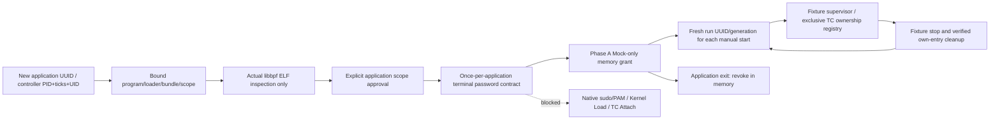

# eBPF native loader and supervisor — Phase A

Status: **Phase A contract/inspection/fixture implementation; Native authentication,
Kernel BPF Load and TC Attach remain disabled.** The revised policy is **one fresh OS
terminal password authentication per application session**, not per Collector restart.
No sudo/PAM invocation, capability assignment, BPF map/program load, TC operation,
network traffic or security response WRITE was performed.

## Baseline and preservation

SOC `882273f0d1bc12bda2565686ce0ea57d7e158eab`, ML
`e1a01260f0463a38d4d778859bc2a86f8e9cfbde`, main, original indexes empty. Preserved 132
original dirty files, Native sessions/archives/Audit/checkpoints, raw datasets and models.
The new `security_ai/ebpf_native/` package is separate from the existing eBPF foundation
and Zeek. Original eBPF C/header/program and Zeek collectors/CLI/approved bundle are
unchanged. Existing 4-screen GUI, Canvas charts, timelines, RuntimeStore and single Worker
are reused rather than replaced. No dependency manifest or model artifact is modified.

## Architecture and application authority



ApplicationPlan binds application UUID, PID/start ticks/UID and immutable initial Scope.
Scope contains lo/index/namespace, one selected hook, program SHA, loader SHA, bundle digest,
300s/run, 4096 events, queue 32, 128MiB, CPU 1, up to 16 manual runs and a 3600s application grant.
Those limits are part of approval. RunIdentity creates a new capture UUID and generation
for each Start; restarting a run never reuses its identity or consumes another password
challenge. There is no automatic retry/restart path.

The app grant is process-local `_authenticated` plus its approved application digest and
monotonic grant lifetime. These are not returned in snapshots or serialized/checkpointed.
Public identity/approval decisions can appear in Audit, but are not bearer credentials.
No stored digest or AUTHENTICATION_VERIFIED audit event can restore the memory grant.
Application close revokes authority even when cleanup raises. The monotonic application
grant deadline also stops an active owned fixture run and revokes authority; a late run
cannot extend the grant. New application invocation
creates a new UUID and requires new explicit approval and new password-contract completion.

Same-scope Start/Stop/Restart revalidates controller, namespace, interface, files and bundle
without another authentication attempt. A changed hook/scope first raises
EBPF_SCOPE_CHANGE_REQUIRES_APPROVAL. `scope_approval_digest` binds the application, previous
scope, scope revision and requested scope; explicit `approve_scope` revises scope without another password
in the same valid app session. Old scope-approval digests cannot be replayed, including after returning to a previous hook.
No-op approvals are rejected. Scope revisions are bounded at 16 and app Audit events at 256. Scope expansion
is limited by this implementation's allowlist/types; eth0/additional capabilities are not
silently enabled. The frozen original plan remains the Audit root; revisions are appended.

## Authentication contract and fresh sudo policy

The former per-start password requirement is superseded. Freshness is required only when
creating an **application** authority session. A long-lived, narrowly scoped privileged
supervisor would retain necessary authority for manual in-scope operations after startup;
repeated `sudo -n` or cached sudo tickets are not the session authority mechanism.

Sudo's own documentation states that `-v` updates a cached credential; it does not prove a
new password was entered. `-k` without a command invalidates the current timestamp context,
and password prompting is still conditional on policy. `-K` removes all of the user's cached
credentials and can affect other terminals/projects; this design does not use it. `-n`
forbids prompting, so successful noninteractive execution cannot prove fresh password use.
A future reviewed invocation could ignore cached credentials for its **single fixed broker
command**, with no global timestamp deletion/update, subject to installed sudo support.
No sudo option is executed by Phase A.
[Sudo official manual](https://raw.githubusercontent.com/sudo-project/sudo/main/docs/sudo.man.in).

Sudoers supports tty/parent/global timestamp policies, NOPASSWD, authenticate exemptions and
policy-specific validation/listing behavior. Neither parsing `sudo -l` text nor counting a
prompt guarantees a password challenge. PASSWD can also have policy exceptions. A trusted
Native provider must validate the effective command/PAM policy and refuse NOPASSWD, unknown
password guarantees, cache-only success or alternate passwordless authentication. It must
not create a permanent sudoers exemption or modify shared authentication state to make a
demo work.
[Sudoers official manual](https://raw.githubusercontent.com/sudo-project/sudo/main/docs/sudoers.man.in).

PAM_SUCCESS means authentication succeeded under that PAM service; it is not by itself
proof that a password conversation occurred. A future reviewed root-owned broker/service
must bind a fresh permitted terminal conversation and effective password-required policy
to this application/controller/scope. No PAM conversation callback in Python/GUI, getpass,
sudo-S, askpass, credential environment variable, authentication token file or GUI password
dialog is introduced.
[Linux-PAM authenticate contract](https://raw.githubusercontent.com/linux-pam/linux-pam/master/doc/man/pam_authenticate.3.xml).

Implemented `FixtureAuthentication` is explicitly MOCK_OS_TERMINAL_NOT_NATIVE. It has no
password/token field, rejects missing TTY, cache-only results, missing challenge, NOPASSWD,
unknown policy, cancellation, timeout and denial. One attempt per app, fail-closed/no retry.
A second authentication call in the same app is rejected; valid restarts do not call it.
The Native adapter always raises EBPF_PHASE_A_NATIVE_AUTHENTICATION_DISABLED. Mock evidence
cannot be admitted in PHASE_A_NATIVE_BLOCKED mode. Thus actual fresh-password enforcement,
PAM/sudo compatibility and startup privilege handoff are **Native PENDING**, not verified.

## Actual loader preparation and privilege separation

`loader.c` is a newly compiled libbpf/OpenSSL inspector, not a privileged active loader.
It opens a regular non-symlink ≤1MiB object, reads bounded bytes, verifies SHA256 on those
same bytes and passes them to bpf_object__open_mem. It checks sched_cls program sections
and the existing three map declarations: ring 262144 bytes, config ARRAY 1/value 32, counters
PERCPU_ARRAY 2/value 56. Objects are closed without kernel loading. Map identity is explicitly
ELF_DECLARATIONS_NOT_KERNEL_IDS. No Kernel Verifier claim follows from inspection.

All load/attach/detach/native flags are rejected at the C entry point. No bpf_object__load,
bpf_tc_attach, bpf_tc_detach, map-update or qdisc-destroy call exists. The executable refuses
root/setuid execution in Phase A. It bounds itself to CPU 5s/address space 128MiB/files 32;
Python reproduces the fixed inspector from this package once per application and rejects
untrusted supplied binaries before execution. SUID/SGID and file-capability executables
are refused. Python adds a 10s timeout, fixed environment, digest checks before/after and
reviewed errors. This development-time reference build requires the installed C toolchain;
a production root-owned, reviewed artifact/admission mechanism remains a Native blocker.
Arbitrary libbpf/ELF error text is not relayed to GUI or Audit. Compilation and inspection
are unprivileged; the existing BPF program SHA is unchanged.

Capability preflight reads current CapEff only; it never grants privileges. Candidate TC
requirements are CAP_BPF and CAP_NET_ADMIN on modern kernels; CAP_PERFMON is not requested
for this non-tracing contract. Exact WSL kernel authorization/fallbacks need Native testing.
No all-capabilities grant, root GUI, root SOC Worker or permanent root service is introduced.
The controller must have ordinary matching UID/EUID and zero effective/permitted/ambient
capabilities, so a same-UID process with inherited privilege is also rejected.
The real privileged supervisor/bootstrap, peer-authenticated IPC and post-auth capability
reduction are **not implemented/admitted in Phase A**. An application boolean is not a
Native privilege proof, and no Native start path consumes it.
[Kernel BPF permission implementation](https://github.com/torvalds/linux/blob/v6.18/kernel/bpf/syscall.c).

## Supervisor and TC ownership

Application supervision checks real controller PID/start ticks/UID, namespace/index and
program/loader/bundle before approval, after mock authentication and at each Start/observe.
PID alone is not trusted. Phase A loader-process observations have a deliberately synthetic
PID/start-tick identity labelled FIXTURE_IDENTITY_NOT_AN_OS_LOADER_PROCESS; no privileged
resident loader is claimed running. Crash observations, stale identity, timeout, queue >32,
RSS >128MiB or invalid CPU/time samples fail closed. They do not retry or attach another hook.

Only the fixture registry is mutated. It begins with a foreign qdisc/filter and allocates
an exclusive priority/handle with application/run/attach UUID, scope digest and program SHA.
No replacement operation or qdisc creation/deletion exists. Detach requires exact equality
of the complete lease; if an entry changed ownership, it is left intact and cleanup fails.
Foreign filters/qdisc remain. An attach conflict fails without finding another slot/retrying.
A future Native provider must instead prove actual kernel program/map/filter IDs and query
its owned slot before detach; a fixture UUID is insufficient for real TC ownership.

States follow NOT_PREPARED → PREPARING → APPROVAL_REQUIRED → AUTHENTICATING → AUTHENTICATED
→ LOADER_READY → ATTACH_PENDING. ATTACH_PENDING may have FIXTURE_RUNNING supervisor status;
it is never ACTIVE Kernel capture. Stop → STOPPING → CLOSED or ERROR. All snapshots have
collection_live=false. Kernel counters/ring loss remain UNKNOWN and Native AI is BLOCKED.
Controller/loader crash leaves error and pending cleanup until an explicit ownership check;
it never performs an unverified Native detach. App exit revokes authority in a finally block.

## GUI and CLI

`PhaseDesktop` extends the existing Desktop only for System authentication/bundle/hook/
supervisor/cleanup details and fixture Start. It uses one existing Worker with a dedicated
phase-A backend. Dashboard/Security Events/Investigation/System/cards/graphs/timelines are
unchanged. No default GUI, Zeek CLI, eBPF foundation or approved Zeek bundle is modified.
Copy/auth commands are disabled; Start is enabled only for an authenticated explicit fixture.
Stop/restart keep the same in-memory app authentication and create fresh run identities.
The title/source make MOCK_AUTH / NO_KERNEL_HOOK explicit. No real Live graph is invented.

Compile and inspect/prepare (nonprivileged, no authentication or load):

```bash
.venv/bin/python -m soc_agent.security_ai.ebpf compile --output /tmp/soc-ebpf-build
.venv/bin/python -m soc_agent.security_ai.ebpf_native compile --output /tmp/soc-ebpf-phase-a
.venv/bin/python -m soc_agent.security_ai.ebpf_native prepare \
  --program /tmp/soc-ebpf-build/tc.bpf.o \
  --loader /tmp/soc-ebpf-phase-a/phase-a-loader \
  --data-directory /tmp/soc-ebpf-phase-a-sessions --gui
```

The first command compiles the existing foundation program; it does not load it.
Explicit simulation uses `fixture` instead of `prepare`. The terminal prints complete scope
and a new application approval digest and requires that digest as plain approval input.
It prints MOCK PASSWORD AUTHENTICATION ONLY and reads **no OS password**. This is not the
production startup authentication UX. Native authorization remains disabled even if a
caller supplies an approval digest or manually starts the C binary with a native flag.

## Audit and recovery

Reuse RuntimeStore append-only hash-chain events in a fresh private app directory:
SESSION_PREPARED, APPROVAL_REQUESTED/ACCEPTED, AUTHENTICATION_STARTED/VERIFIED/FAILED,
LOADER_READY, ATTACH_PENDING, STOP_REQUESTED, CLEANUP_VERIFIED and reviewed failures. Every
record carries app/plan identity and mode; authentication/final cleanup scope is explicitly
MOCK/FIXTURE, native_authentication=false. No password, PAM value, sudo ticket or in-memory
authority field is recorded. Public digests identify decisions and artifacts, not credentials.

Recovery validates Audit and the one initial ApplicationPlan binding and returns old evidence
only, REQUIRED_NEW_APPLICATION, authentication_restored=false, approval_restored=false,
automatic_attach=false. It neither constructs an authenticated Application nor starts a
loader/hook/model. An unclosed or failed run recovers as ERROR with
UNVERIFIED_RECOVERY_PENDING cleanup. Recovery never invents CLOSED/cleanup success.
Original Native sessions/Audit and previous approvals remain untouched.
Native AI, DNS9 and operational promotion stay BLOCKED throughout.

## Native approval requirements

Actual startup still needs a separately reviewed root-owned broker, password-required TTY/PAM
policy attestation, authenticated app-bound IPC, minimal capabilities, owned-TC attach/detach,
resource supervision and crash-safe teardown. It must authenticate once at app startup and
keep authority only until app exit; in-scope Start/Stop/Restart must not ask again. New scope
requires explicit approval. New app invocation cannot use a sudo cache or restored Audit as
a substitute for a password. Unknown/NOPASSWD policy must block execution.

Before enabling Native execution: review new Loader/Program/Bundle identities and exact lo/
namespace/one-hook/budget scope; perform user-driven fresh password/cancel/timeout/NOPASSWD/
cache checks; prove GUI/SOC UID remains ordinary; verify owned program/map/TC identities,
foreign filter preservation, bounded runtime, graceful cleanup and loss accounting. Do not
reuse Zeek/v2/v3 approvals. Do not run a privileged command from these preparation examples.
Phase A has no approved runnable Native attach command; that admission increment remains
blocked pending its own review/approval. Native AI requires additional independent parity
and integrity evidence and a separate policy decision.


## Verification and independent Export

[Machine-readable evidence](ebpf-native-loader-supervisor-evidence.json) binds the nine new
product files, inspector/unchanged BPF identities, environment, screenshots and results.
A clean Git-archive SOC/ML Export contains only this task's files over the baseline. All
original dirty files, Replay, Native databases, model binaries and raw datasets are excluded.
The current C inspector was reproduced from clean Export source with the same binary SHA.
An offline wheel builds successfully: 497 packaged source/assets match Export bytes and the
existing `soc-agent = soc_agent.cli:main` entry point is unchanged. No default Zeek startup
or existing authentication contract is replaced.

| Verification scope | Result |
|---|---|
| Broad unit regression: eBPF, Zeek, preprocessing, integrity, GUI, streaming | 684 passed |
| Integration regression: preparation, eBPF/Zeek stream/flow/finalization | 56 passed |
| WSLg GUI regression: four screens, charts, existing collectors | 17 passed |
| Policy/approval, Investigation, Audit/recovery/transport | 125 passed |
| Final source: Phase A unit + integration + actual WSLg | 42 passed in 36.67s |
| Public source/evidence binding | 2 passed in final clean Export |
| Ruff src/tests, format, diff, offline wheel | PASS |

These groups overlap; they are not a unique test total. The final 42 checks cover the final
application deadline and recovery changes; unchanged broad paths reuse prior regression.
Fixtures reject cache-only/NOPASSWD/unknown policy, missing TTY, cancelled/denied/timeout auth,
stale PID/ticks, mutated source/object/loader/namespace, old scope approvals, foreign TC
ownership, queue/RSS/runtime limits, Audit failure/overflow, loader crash and cleanup failure.
Neither application close nor recovery can restore approval or authentication. The verification
guard disallows privileged commands, capture sockets, Native Docker and TC/BPF executables.

Failures were retained and corrected specifically: an identity check initially returned the
wrong denial category (1 failed/28 passed); capability preflight emitted a tuple rejected by
existing strict JSON Audit validation (24 failed/660 passed, fixed to a list); a negative CLI
test containing the forbidden `sudo` literal was intercepted by the guard (1 failed/4 passed,
removed that harness invocation). C prohibited-flag tests remain. No actual sudo ran, no
integrity checks were relaxed, and no failure was classified as passing solely on retry.
SIGILL root cause remains UNKNOWN; no SIGILL/OOM occurred in these final checks.

Actual model loading was not repeated: producer/model inputs and artifacts were not changed.
Existing Zeek RF/LR/READ-only fixture evidence is prior evidence only; this implementation
creates no eBPF inference receipt and makes no new Native model/Investigation success claim.

## Performance and GUI evidence

Environment: WSL2 kernel 6.18.33.2, libbpf 1.3.0, OpenSSL 3.0.13, 12 CPUs in affinity,
about 4.04GiB available at final observation, swap about 0.97GiB used/2GiB, PSI avg10/60/300
0.00 at final observation. Broad test GUI observation briefly reached PSI avg10 0.85; no
heavy model tests ran concurrently. All timings below are local measurements without Native
capture/authentication and do not establish Native performance.

| Measurement | Before | After | Method |
|---|---:|---:|---|
| Default GUI startup median | 2.631s | 2.439s | 3 fresh WSLg processes each |
| Default GUI idle RSS median | 174.95MiB | 175.07MiB | Same idle/no model condition |
| Default GUI idle CPU, one core | 0.254% | 0.249% | Median 3-second observations |
| Default GUI callback p95 median | 0.044ms | 0.045ms | Local event-loop callback |
| Default GUI threads / widgets | 2 / 69 | 2 / 69 | No additional idle child process |

Default GUI source is unchanged. Timing variation is observational, not an attributed
optimization. SQL controller statements at idle: 0; isolated worker SQL not instrumented.
The Phase A WSLg sample was warm/preauthenticated Mock, 1.389s to UI and 205.46MiB idle RSS,
one sample including pytest/import heap, excluding earlier compilation/prepare/authentication.
It is not directly comparable to the default cold GUI. Actual screenshots are labelled
MOCK AUTHENTICATION / NO NATIVE HOOK at
[1366px](ebpf-native-loader-supervisor-screenshots/system-mock-1366.png) and
[1920px](ebpf-native-loader-supervisor-screenshots/system-mock-1920.png).

Five fresh CLI help processes: median 1.435s. Five controller/inspector fixture repetitions:
prepare 207.1ms, explicit fixture approval 10.7ms, Mock authentication 16.7ms, fixture Start
19.9ms, owned fixture cleanup 16.6ms; all medians. Controller idle RSS ~146.95MiB and CPU
0.000246s over 1.000s observation. Native privileged supervisor RSS, actual authentication
latency, Native attachment/cleanup latency and Native throughput are UNKNOWN. The 128MiB
inspector limit is for its separate short-lived executable, not the Python controller RSS.
No performance number is a privileged Collector measurement.

## Artifact identities and final verdict

```text
Loader inspector SHA256:
23f0c50720db8f2eaa39f7867188efdf01caedda5b41d8f1faae626ec3e81310
Existing BPF program SHA256 (unchanged):
69de609ea8ee90ecf90d091ec361e46e61ed0638b3175390c77305145e19d5f4
New Phase A bundle digest:
096853e7dc0b2b4a9f9a7e019e2d87111f664be99b40accf3d3197777a5ddfca
```

Loader binary identity is tied to this compiler/libbpf/OpenSSL build; rebuilding on a different
toolchain may change it and requires revalidation. The bundle does not include documents,
screenshots or test files, avoiding evidence/digest self-reference.

| Required verdict | Scope/result |
|---|---|
| FRESH_TERMINAL_AUTH_CONTRACT_VERIFIED | Mock, once at app startup; in-scope manual restart needs no second challenge |
| FRESH_TERMINAL_AUTH_NATIVE_PENDING | Actual password-required policy/provider still disabled |
| SESSION_APPROVAL_VERIFIED | Application identity, scope revision, fresh run identity fixtures |
| LOADER_PREPARATION_VERIFIED | Actual unprivileged libbpf ELF inspection, no Kernel Load |
| SUPERVISOR_FIXTURE_VERIFIED | Fixture identity/budgets/crash/stop checks |
| TC_HOOK_NATIVE_PENDING | No Verifier Load or Hook Attach performed/admitted |
| CLEANUP_FIXTURE_VERIFIED | Exact fixture ownership; foreign entries preserved |
| GUI_PRESERVED | Four screens and charts; explicit Phase A source/state |
| AUDIT_RECOVERY_VERIFIED | Fixture append-only chain, bounded events, no authority restore |
| NATIVE_AI_BLOCKED / DNS9_BLOCKED / OPERATIONAL_PROMOTION_BLOCKED | Maintained |

User validation currently supports only the nonprivileged compile/prepare/explicit-fixture
commands above. There is no runnable approved Native Loader command in Phase A. Actual
password authentication and TC ownership testing must wait for the separately reviewed
Native broker/provider increment and its new approval scope; existing Zeek approvals cannot
be reused to bypass this boundary.
