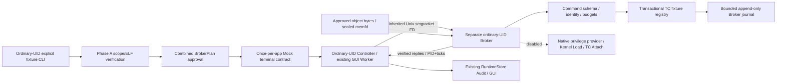

# eBPF Broker and TC ownership safety — Phase B-1

**Status: separate ordinary-UID Broker process and transactional TC ownership fixtures.
Native authentication, elevation, Kernel Load and TC Attach remain disabled.** This is
not an installed privileged service. No sudo/PAM, BPF syscall, TC operation, network
configuration change, Capture or test traffic was executed. Native AI, DNS9 and operational
promotion remain BLOCKED.

## Baseline and existing architecture

SOC baseline `70e01be9eff36e3f47d498210a3856d8514ee305`; ML
`e1a01260f0463a38d4d778859bc2a86f8e9cfbde`. Both original indexes empty. Preserve the 132
original dirty files by SHA, 371 protected files unchanged by SHA, one reviewed Launcher change,
and 58 raw-dataset file stat records.
Native sessions, archives, old Audit/checkpoints, models and Replay remain unchanged.
No dependency manifest, BPF C/map ABI, consumer, Network14 producer, Quality/Edge artifact
or Phase A source is modified. One existing Zeek Launcher file has a minimal evidence-order
fix explained below; its previous approval SHA/Bundle is not reusable for the changed code.

The new `security_ai/ebpf_broker/` package composes Phase A Application/Scope/identity,
Mock authentication and the actual read-only libbpf inspector. It does not duplicate
packet normalization, flow assembly, feature engineering or protocol analysis. Its new
responsibility is application-bound process transport and TC transaction ownership.

## Architecture



The separate child is a real OS process with its real PID/start ticks/UID, but **no privileged
process is created**. Its TC program IDs/tags/filter state are explicitly fixture values.
`ATTACH_PENDING` and `collection_live=false` remain visible; no path enters Kernel ACTIVE.
The fixed child environment caps BLAS/OMP/MKL threads to one. It does not start a model.

## Startup authentication and approval

One fresh OS-terminal password at **application startup** is the target policy. The current
Mock verifier tests this contract without reading any password. One authenticated app may
manually Start/Stop/Restart inside its immutable approved BrokerPlan; each run gets a new
capture UUID and generation. No second authentication occurs. New app UUID, controller,
namespace, hook, object, scope or bundle invalidates the prior approval. An out-of-scope
request is denied; B-1 does not implement an authority-expansion command. A new separately
approved scope/session is needed. No automatic retry or restart exists.

The combined BrokerPlan binds the Phase A plan, UID/GID, broker entry SHA, complete source
bundle, heartbeat and Broker-specific budgets. CLI prints it and requires the exact new
approval digest. A base Phase A approval is not the combined Broker approval. The digest
is public scope identity, not a password, authentication token or reusable bearer grant.
The Phase A in-memory authentication flag is never persisted/restored. Close revokes it even
when cleanup cannot be verified. Cached/NOPASSWD/unknown-policy/missing-TTY/cancel/timeout
results fail the Mock contract; no Native password success is claimed.

The [official sudo manual](https://raw.githubusercontent.com/sudo-project/sudo/main/docs/sudo.man.in)
distinguishes timestamp validation from prompting. `sudo -v` or cached command success does
not prove a fresh password. Invalidating one timestamp does not override NOPASSWD/PAM policy.
Global timestamp deletion can affect unrelated projects, so B-1 performs no timestamp
operation. No `sudo -S`, askpass, getpass, credential environment variable or password field
exists. A future audited, root-owned bootstrap must prove an effective password-required
TTY/PAM policy once per app, refuse bypass/unknown policies, create the scoped privileged
Broker and then start the GUI with ordinary UID/capabilities. Repeated sudo-cache checks are
not the application authority mechanism. That Native provider remains a blocker.

## Broker security and fixed command protocol

Only PREPARE, ATTACH, STATUS, DETACH, STOP and CLEANUP are allowed. Frozen Pydantic models
forbid extra fields, unknown operations and inappropriate arguments. ATTACH requires a
session-bound RunIdentity; DETACH requires the full Ownership object; STOP accepts a fixed
reason enumeration. No operation accepts a command string, shell, path, raw object or arbitrary
Loader arguments. Native/root Broker entry is explicitly refused, not conditionally enabled
by an environment variable or a fixture authentication result.

An inherited AF_UNIX SOCK_SEQPACKET socketpair has no public listener/path. Bootstrap checks
SO_PEERCRED's creator PID/UID/GID, getppid and the bound Controller identity. On Linux a
socketpair's creation-time peer credentials do not attest the later child PID: the parent
instead binds its Popen child PID and /proc start ticks/UID to the child reply. This fixture
bootstrap is not a substitute for authenticated root bootstrap or privileged IPC review.
Each request/reply binds the plan digest, monotonic command sequence and real child identity.
Old sequence, wrong session and reused run UUID/generation fail closed. Only one request is
in flight. Messages are at most 16KiB; MSG_TRUNC, malformed JSON and EOF are explicit failures.
No infinite JSON buffer or command queue exists. Socket buffers are requested at 32KiB;
Linux may round/double the actual allocation, so this is not advertised as an exact event count.

Approved object bytes are opened O_NOFOLLOW/nonblocking, checked as a regular <=1MiB file,
SHA-verified, copied into memfd and sealed against write/grow/shrink/resealing. The child
receives only that descriptor, checks seals/SHA/ELF identity and rechecks source identity and
environment on commands/heartbeats. Object paths never cross the command protocol. The
Phase A fixed-source inspector validates libbpf declarations before approval; no arbitrary
object is Kernel-loaded. Python source hashes and a user-built binary do not constitute a
root-owned trust anchor. A future Native bootstrap must pin installed code/interpreter and
approved object FD; it must not elevate this user-writable fixture package.

The child has no capabilities. It refuses root/setuid/capability-bearing entry and blocks
process execution and AF_PACKET/INET/INET6/NETLINK sockets through its fixture audit guard.
The guard is a regression fence, not a malicious-code kernel sandbox. B-1 admits no Native
provider, qdisc writer or privileged command runner.

## Capability requirements

For the planned non-tracing SCHED_CLS path on modern Linux, CAP_BPF and CAP_NET_ADMIN are
candidate requirements; CAP_PERFMON is not requested for this TC contract. Exact WSL kernel,
LSM, namespace, token, memlock and deployment requirements remain Native PENDING. No capability
is granted here. The [kernel permission code](https://github.com/torvalds/linux/blob/v6.18/kernel/bpf/syscall.c)
separates network administration and tracing program classes. A future provider must validate
the actual installed kernel's behavior, reject insufficient authority, drop unnecessary
capabilities/groups and never elevate GUI/SOC. Ordinary user group membership is not Native
Capture authorization.

## TC ownership and transactions

Ownership binds owner application, capture session, attach generation, namespace, ifindex,
hook, clsact type, chain, priority, filter handle, program ID, program tag and Program SHA.
Every field must match again at DETACH. Fixture program IDs increment per run and fixture
tags use the Program SHA prefix; **these are not observed kernel IDs or actual kernel tags**.
A future kernel adapter must query actual program info and TC state and attach them to
ownership evidence. It cannot reuse these fixture numbers as proof.

The registry begins with shared clsact and foreign ingress/egress filters. It preserves
both. Missing/unsupported qdisc is denied; no qdisc creation/deletion fallback exists.
Collisions never overwrite or choose a second slot. ATTACH records a full before snapshot,
checks the exclusive slot, inserts only its candidate, reads back exact identity and records
an after snapshot. If persistence/readback fails, rollback removes only the identical owned
candidate. Concurrent foreign replacement is left untouched and the pending owner remains
available as unresolved evidence. Failure does not become a clean successful attach.

DETACH first checks exact owner and current slot/qdisc identity, persists intent, removes only
that filter, verifies qdisc/foreign filters unchanged and persists completion. If final
persistence fails after deletion, the lease remains unresolved and cleanup is UNVERIFIED;
absence of a filter alone cannot fabricate finalization. No flush/all-filter deletion or
qdisc destruction exists. Stop is idempotent for the owned filter; duplicate Stop does not
produce a second DETACH_VERIFIED event.

[libbpf 1.3.0 TC implementation](https://github.com/libbpf/libbpf/blob/v1.3.0/src/netlink.c)
uses exclusive creation unless replace is requested. Its hook-destroy operation may flush
filters or delete a qdisc, so it is unsuitable as unconditional shared-clsact cleanup. Even
query-then-detach can race with another privileged writer; the future Native adapter needs
exclusive owner serialization or a suitable atomic ownership mechanism and must not claim
that this fixture proves arbitrary concurrent kernel-writer safety.

## Supervisor, budgets and crash recovery

| Bound | Phase B-1 contract |
|---|---|
| Interface / hook | lo; one approved INGRESS/EGRESS scope |
| Application / run lifetime | 3600s / 300s, monotonic |
| Manual runs | 16; no automatic retry |
| Broker commands / message | 2048 / 16KiB; one in-flight request |
| Heartbeat | 15s; checked on a 0.5s receive interval |
| Broker memory | 256MiB measured RSS; 512MiB process address-space rlimit |
| Broker CPU | 20 CPU-seconds lifetime rlimit; one BLAS/OMP thread |
| Broker open files / core | 32 / disabled |
| Broker journal | 1MiB, 1024 records, <=16KiB each |
| Existing app Audit | Phase A 256-event budget |
| Existing packet contract | 4096 event budget, queue 32; no Kernel event consumption in B-1 |
| IPC / exit deadlines | 5s request/bootstrap; 6s close, then bounded own-child reap |

The Broker's Python RSS budget is separate from the unchanged 128MiB Phase A ELF inspector
budget. Initial imports exceeded that inspector RSS budget; ordinary Broker RSS is ~145MiB.
Initial default BLAS threads also produced ~1.27GiB virtual memory and a MemoryError under
512MiB AS. Limiting numerical-library threads to one reduced virtual size to ~387MiB without
raising the address-space bound. Measured Broker resources, not Native kernel performance,
motivated these fixture-specific limits. Capture queue/events/ring loss remain unobserved;
no actual packet-delivery budget enforcement is claimed by this control-plane increment.

Controller and Broker identities are PID/start-ticks/UID-bound. Child checks Controller
identity, namespace, lo index, sealed object, bundle, memory, lifetime and heartbeat.
Controller verifies Broker reply identity/liveness/RSS and requests bounded cleanup on
failure. Expected manual Stop permits in-app restart; errors revoke authority and do not
restart. SIGINT/SIGTERM use a deferred handler, exact-owned cleanup and journal exit.
GUI close/Controller EOF requests cleanup. Unexpected Broker death or timeout never appears
ACTIVE/healthy. A hung owned child can be killed/reaped, but cleanup remains UNVERIFIED.
No unrelated process is terminated. Only B-1 fixture child processes are signalled in tests.

A crashed Broker can leave incomplete journal intent and an unresolved last ownership;
recovery reports ERROR / ORPHANED_OR_CLEANUP_UNVERIFIED, retains evidence and asks for user
review. It never deletes an unknown filter, reattaches a Hook, restores authentication or
reruns inference. The fixture registry dies with its process; a true kernel orphan is not
claimed observed. Native orphan discovery/detach remains a separate user-approved phase.

## GUI and audit

A dedicated BrokerDesktop/Worker extends the existing four screens, cards, Canvas charts,
timelines and detail panel. System adds authentication, Broker/hook/ownership/cleanup state,
Program/Broker SHA and Bundle Digest. Copy/auth commands are disabled; fixture Start requires
an authenticated app in BROKER_READY/CLOSED. No raw payload, FQDN, password or authentication
secret is shown. No Native Live graph is manufactured. Default Zeek CLI/GUI design and Capture scope remain unchanged. The Launcher evidence-order
fix changes its source SHA/Bundle and requires new approval before any Native reuse. Explicit entrypoint: `python -m soc_agent.security_ai.ebpf_broker`.

Controller reuses RuntimeStore's existing append-only hash chain. The child is the sole writer
of a new private O_EXCL/O_NOFOLLOW 0600 Broker journal, hash-linked, sequence/plan/source-bound
and fsynced. It records Broker readiness, before/after attach/detach, stop, cleanup and exit.
Controller records observed decisions with the combined BrokerPlan digest; Phase A records
retain their original binding. Reviewable errors are bounded codes, not exception paths or
request bodies. Journal hash checks provide tamper evidence, not privileged attestation
against a malicious same-UID owner. Recovery verifies both chains and cross-binds the stored
BrokerPlan, marks failed histories ERROR even if final fixture cleanup was physically verified,
and restores no authority. Startup authentication/approval decisions remain Mock-labelled.

## Native approval requirements and user procedure

Nonprivileged compilation/explicit simulation only:

```bash
.venv/bin/python -m soc_agent.security_ai.ebpf compile --output /tmp/soc-ebpf-build
.venv/bin/python -m soc_agent.security_ai.ebpf_native compile --output /tmp/soc-ebpf-phase-a
.venv/bin/python -m soc_agent.security_ai.ebpf_broker fixture \
  --program /tmp/soc-ebpf-build/tc.bpf.o \
  --loader /tmp/soc-ebpf-phase-a/phase-a-loader \
  --data-directory /tmp/soc-ebpf-broker-sessions --gui
```

This asks for a printed **fixture approval digest**, not an OS password. No Native command
is admitted in B-1. Before Native execution, separately review root-owned bootstrap and
password-required TTY/PAM proof, exact binary/interpreter/object/bundle identities, minimal
capabilities, authenticated privileged IPC, actual kernel program/map/TC identity, shared
qdisc preservation, concurrent-writer safety, resource bounds and crash/orphan teardown.
Approve one named lo/index/namespace/hook scope and finite budgets explicitly; one new password
per app, no reauthentication for in-scope manual restarts. Do not reuse Zeek/v2/v3 approvals
or root-run this fixture entrypoint. Native AI admission additionally requires independent
Capture integrity/feature completeness/parity evidence and its own policy approval.


## Existing Zeek failure-evidence race

The first broad unit regression returned **1 failed, 692 passed**. The failing unchanged
Zeek test mocked Docker spawn failure; actual Docker/authentication was not attempted.
`exit.json` preserved ZEEK_DOCKER_START_FAILED and the Controller correctly entered ERROR,
but `launch-failure.json` was missing. Launcher rejection publication checked stop.request,
then attempted atomic creation; the Controller could create the same stop file between
that check and creation. FileExistsError interrupted the rejection routine before writing
the launch-failure certificate.

A deterministic concurrent-stop fixture reproduces the missing certificate on untouched
baseline 70e01be (expected failure). The sole existing-code fix moves the complete failure
certificate before stop publication. Concurrent stop remains non-overwriting and its error
remains explicit; it can no longer suppress the prior reviewed failure certificate. No stop
file is deleted, no failed session is reused, no authentication/capture/cleanup check is
weakened. The deterministic fixture passes on the changed Export. The original broad failure
is retained in evidence; later pass is not the sole basis for calling this defect fixed.
Old Native session evidence is unchanged. Updated Launcher SHA and Zeek Bundle are listed
alongside new Broker identities; Native re-execution needs review of the new values.


## Verification scope and identity migration

The existing exact-digest eBPF boundary and historical attestation checks intentionally
rejected the new Launcher after the race fix (2 failed, 691 passed). Their admission checks
now require the exact reviewed current Digest and a one-file delta from the immutable
historical bundle. Historical Native/offline evidence JSON is not rewritten or presented
as execution of new code. Any other bundle/source change still fails. The new amendment
records previous and current maps, requires new Native approval, and is checked independently
against the current sources. This is explicit artifact versioning, not deletion of a SHA gate.

The final model regression uses the existing pinned official Zeek image and generated offline
PCAP. Quality RF and Edge LR artifacts, float32 Network14 feature order/digest, one eligible
and one incomplete flow, two research receipts, READ-only assessments, empty final queues,
Audit-chain recovery and duplicate suppression are verified together. This proves the
unchanged offline Zeek/model/SOC path; no eBPF or Native AI inference is claimed. The Native
Capture attestation remains UNVERIFIED and its gate remains BLOCKED.


## Final test results and independent Export

A clean Git-archive SOC/ML Export excludes all original dirty files, Replay, Native sessions,
archives, raw datasets and model binaries. Only reviewed task files are overlaid. Artifact
fixtures reference the preserved original model source; no model is changed or copied into
Git. The previous failing runs and deterministic baseline reproduction remain in the
[machine-readable evidence](ebpf-privileged-broker-tc-ownership-evidence.json).

| Final verification | Result |
|---|---|
| New Broker protocol/process/ownership/WSLg tests | 61 passed |
| Existing eBPF/Phase A/Zeek/Network14/DNS/GUI/streaming units | 693 passed |
| Existing integration regression | 58 passed |
| Actual pinned Zeek offline + RF/LR artifacts + READ-only SOC | 1 passed; 2 receipts |
| Existing WSLg GUI regression | 17 passed |
| Policy/approval/Investigation/Audit/recovery | 125 passed |
| Final evidence/admission checks | 8 passed (includes 2 new evidence checks) |

Groups cover different scopes and can reuse underlying scenarios; no unique combined total
is claimed. The final evidence checks are run after documentation generation. Ruff src/tests,
format, diff and an offline wheel are checked in clean Export. All 509 packaged source/asset files match Export bytes and the existing
`soc-agent` entry point is unchanged. The offline wheel builds successfully. Workspace,
Export and Git index SHA must match before selective commit. Original user Stage was empty.

The model preflight sampled >4GiB MemAvailable and PSI avg10=0.00 three times; actual RF/LR
ran serially, not concurrently with another own model test. Earlier non-model observation
briefly showed PSI avg10 ~3.3 and was recorded; heavy model work did not start then. No OOM or
SIGILL occurred in final tests. SIGILL root cause remains UNKNOWN. Controlled startup
MemoryError/seal-constant failures and the initial Zeek evidence/identity failures are retained
with their specific fixes; later passes alone are not treated as proof of resolution.

## Performance

Environment: WSL2 6.18.33.2, 12 CPUs in affinity, libbpf 1.3.0, ~8GiB RAM, other user processes
preserved. Measurements are fixtures/offline WSLg, not Native Capture or privileged execution.
Five serial pairs use the same compiled BPF object, same empty shared-clsact fixture and
one Start/Stop. The topology changes from an in-process Phase A fixture to a real ordinary-UID
child; the startup cost buys process separation, not faster native packet processing.

| Median control-plane measurement | Phase A | Phase B-1 |
|---|---:|---:|
| Mock authentication (B-1 includes child startup) | 16.3ms | 1128.2ms |
| Attach preparation/fixture ownership | 21.0ms | 26.0ms |
| Owned fixture Stop/cleanup | 16.4ms | 27.9ms |
| Child exit and journal verification | No separate child | 297.6ms |
| Child RSS | No separate child | 144.28MiB |

The real privileged supervisor RSS, Native authentication/attach/cleanup latency and Native
Capture throughput remain UNKNOWN. B-1 adds ~144MiB for the optional fixture Broker, not to
the default Zeek GUI path. Controller CPU was ~0.00587s over a ~0.898s idle-plus-close
observation; this is not a pure Broker CPU measurement.

| Default GUI median, three fresh processes each | Before | After |
|---|---:|---:|
| Startup | 2.447s | 2.351s |
| Idle RSS | 175.59MiB | 175.02MiB |
| Idle CPU, one core | 0.266% | 0.251% |
| Local callback p95 | 0.084ms | 0.019ms |

Default GUI comparisons use three fresh processes before and after, same no-Capture/no-model
fixture. Startup and RSS medians are recorded in evidence; the default GUI source is unchanged,
so variation is not attributed to an optimization. Both groups retain two threads, 69 widgets,
zero idle child processes, no created model service and zero measured controller SQLite
statements (worker SQL is not instrumented). The separate warm B-1 WSLg sample starts in
1.252s after Mock authentication, with ~207.93MiB test-process RSS and ~144.33MiB Broker RSS;
it includes test/import heap and excludes authentication/compilation, so it is not directly
comparable with a cold default GUI process. No chart is fed synthetic Native values.

## Artifact identities and final verdict

```text
Broker entry source SHA256 (server.py, not a privileged binary):
70f71e346713564aee18267b8396a25a52c9202ae6b365c53be72ffeecb9e380
Loader inspector SHA256 — unchanged Phase A:
23f0c50720db8f2eaa39f7867188efdf01caedda5b41d8f1faae626ec3e81310
BPF Program SHA256 — unchanged:
69de609ea8ee90ecf90d091ec361e46e61ed0638b3175390c77305145e19d5f4
Broker + Phase A source Bundle Digest:
943eec7d750381e76972371d9a526cc79519b8b40b3039581e7e68a8868bc1f4
Reviewed Zeek Launcher SHA256 — failure-evidence ordering fix:
d47439e384c301265e32daee906a927b668c4f7d8961f834bc55abf90b748dda
New Zeek Bundle Digest — prior approval invalid for changed code:
2b005190106f94d0ee3d28adab3a18af1601b7bc2b5ebbabebc75ada803f2045
```

The Broker entry is Python source bound to the full bundle and real child identity, not an
installed root-owned executable. A new Native trust anchor, interpreter/binary manifest and
privilege provider need separate implementation/review/admission. Merely approving the
source digest cannot enable a Native operation in B-1.

| Required verdict | Result/scope |
|---|---|
| STARTUP_AUTH_CONTRACT_VERIFIED | Mock once-per-app contract; no password read |
| PRIVILEGED_BROKER_FIXTURE_VERIFIED | Real ordinary-UID child, no privileges granted |
| TC_OWNERSHIP_FIXTURE_VERIFIED | Exact identity, shared/foreign state preservation |
| ATTACH_DETACH_FIXTURE_VERIFIED | Before/after evidence and partial-failure behavior |
| SUPERVISOR_FIXTURE_VERIFIED | Real process identity, heartbeat/deadline, crash/resource checks |
| CLEANUP_FIXTURE_VERIFIED | Owned fixture only; uncertain ownership remains unresolved |
| GUI_PRESERVED | Four screens/cards/charts/timelines and B-1 System details |
| AUDIT_RECOVERY_VERIFIED | Hash chains; no restored authority/restart/inference |
| NATIVE_AUTH_PENDING | No real sudo/PAM provider admitted |
| NATIVE_TC_ATTACH_PENDING | No Kernel Load or TC operation performed/admitted |
| NATIVE_AI_BLOCKED | Maintained |
| DNS9_BLOCKED | Maintained |
| OPERATIONAL_PROMOTION_BLOCKED | Maintained |
