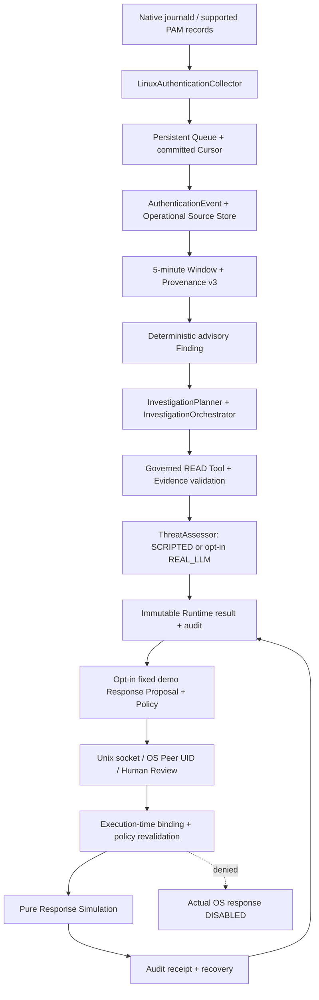

# Linux SOC v1 Final Integration Audit

## 판정과 범위

**PARTIAL** — WSL2 Ubuntu의 Fixture 통합과 실제 journald 기록 → SCRIPTED 조사 → 인증된 로컬 테스트 운영자 검토 → 순수 Response Simulation → 재시작을 검증했다. 이번 실행에서 실제 LLM API는 호출하지 않았다. 실제 Provider 연결은 이전 실행 증거와 구분하며, 물리 Linux 서버 및 실제 OS 대응 준비 완료를 주장하지 않는다.

실행일: 2026-10-14. 기준 브랜치 `main`, 기준 HEAD `718dde682991c22a90551c1b913ef88ed64637f8`. 커널 `6.18.33.2-microsoft-standard-WSL2`, Python 3.12. 기존 사용자 수정 3개와 Replay 수정 5개 및 모든 기존 미추적 파일을 보존했다. 제품 소스·기존 테스트·기존 보고서는 수정하지 않았다.

## 최종 아키텍처



Finding는 관측에서 파생된 규칙 advisory다. LLM 판단을 관측 사실로 승격하지 않는다. Runtime의 대응 제안은 `disable_demo_account`와 고정된 **demo identity**를 사용하는 시뮬레이션 계약이다. 실제 로그 계정에 대응하는 운영 Response Planner/Executor로 해석하지 않는다. 조사 READ capability와 승인된 시뮬레이션의 SYSTEM_WRITE 표시를 가진 순수 Tool registry는 별도이며, 승인으로 조사 권한이 확장되지 않는다.

## 단계별 계약·저장·실패 경계

| 단계 | 실제 코드 / 입력 → 출력 | 저장 및 검증 |
|---|---|---|
| Native Collection | `security_ai/operational/native_authentication.py`: `LinuxAuthenticationCollector.poll`, `project_journal` / journal fields → CommonEvent | 읽기 전용 predefined journalctl; Cursor와 retained record digest 확인. 지원 밖 기록은 NOT_INFERABLE. 원문을 불필요하게 보존하지 않으며 계정·출처는 pseudonym reference |
| Queue / Cursor | `security_ai/operational/authentication_pipeline.py`: `collect`; `realtime/queue.py`: `enqueue`, `claim`, `finish`, `recover` | `queue.sqlite`. 이벤트 영속화와 해당 Cursor 갱신은 Queue transaction. 중복 digest 충돌 거부, bounded backlog, retry/poison 보존 |
| Authentication / Source | `AuthenticationPipeline.step`, `native_authentication.authentication_source`, `source_store.OperationalSourceStore` | `sources.sqlite`. Native receipt, Source/Incident/digest 검증 후 저장; 성공 후 Queue Ack. 여러 DB를 단일 원자적 transaction이라고 주장하지 않음 |
| Window / Provenance | `source_store._derive`, `_snapshot`, `windows`; `provenance.build_receipt`, `verify_receipt` | 5분 Window 및 source reference 재검증; 늦은 이벤트 별도 취급. v3는 처리 출처 설명이며 모델 Producer parity나 원본 암호학적 진위 증명이 아님 |
| Detection | `linux_runtime/findings.py`: `correlate`, `validate_finding` | `monitor.sqlite`의 `monitor_findings`; Finding ID로 dedup. source/account 규칙의 별도 hypothesis를 원본 시도 수로 합산하지 않음 |
| Investigation | `linux_runtime/service.py`: `investigate_one`, `BudgetClient`; `demo/scenario_analysis.py`: `analyze` | 기존 Planner/Orchestrator/GovernedExecutor/ThreatAssessor. READ 결과·계획·Assessment의 Incident 및 Evidence ID 검증. 완료 result와 completion audit는 같은 monitor DB transaction |
| Policy / Proposal | `linux_runtime/response_simulation.py`: `_context`, `request`, `_verify`, `_executor` | 완료 조사, 현재 Finding, READ Window, Source 및 Evidence digest와 결합. 기본 simulation DISABLED; 준비 완료는 승인 아님 |
| Operator Approval | `linux_runtime/operator.py`: `OperatorServer`, `operator_request`; `approval/manager.py`; `execution/executor.py`: `preflight` | Runtime lifetime writer lock 유지. 로컬 socket 0600/private directory, SO_PEERCRED 현재 UID allowlist, challenge/nonce/timeout/size limit. 본문의 actor로 인증하지 않음 |
| Simulation | `RuntimeResponseSimulation.execute`; `demo/tools.py`: `simulate_disable` | 현재 policy와 approval/action binding 재검증. STARTED reservation 후 순수 typed output 생성. 실제 계정·Firewall·프로세스·파일 조작 handler 없음 |
| Audit / Recovery | `linux_runtime/store.py`: `verify_audit`, `recover`, `finish`; simulation `recover` | hash chain / 상태 digest 검증. SIMULATED 재실행 거부. 불완전 STARTED는 UNCERTAIN으로 남겨 자동 재실행 금지 |

위 경로는 모두 `src/soc_agent/` 아래다. Source store assurance `DECLARED_UNATTESTED`를 유지한다. Hash chain은 저장 내용의 연속성 검증이며 같은 UID/root에 의한 전체 재작성에 대한 외부 attestation을 제공하지 않는다.

## Fixture E2E

신규 `tests/integration/linux_runtime/test_final_integration_audit.py`의 2개 parametrized 실행은 기존 `test_monitor.setup` journal-shaped Fixture와 기존 `FixtureClient`를 재사용한다. 실제 Native OS 이벤트로 표시하지 않는다.

- Fixture 3개 → Queue DONE 3개 → 검증 인증 이벤트 3개 / Window total 3개.
- 두 규칙의 Finding 2개 → 기존 READ Investigation / Assessment → 두 완료 결과의 digest 검증.
- SCRIPTED 경로는 provider 요청 0개. REAL_LLM 설정 경로는 **injected FixtureClient**의 구조화 요청 4개(두 조사 × 2), 실제 API 요청 0개.
- 실제 Linux Unix socket에서 OS Peer UID 확인 → 승인 전 실행 거부 → 승인 → 재승인 거부 → 순수 simulation 1회.
- 재시작 후 Source/Window/Provenance, Finding 전체 row/result, 승인·simulation receipt 유지. 재수집의 Queue 수와 조사 요청 수 증가 없음.
- SQLite integrity_check, audit 검증 및 완료 simulation 재실행 거부.

Scenario S01~S12는 기존 `tests/integration/scenario/test_linux_scenario.py`의 parametrized 기대 결과 검증을 그대로 실행했다. S09의 정확한 만료 경계 및 복원은 `test_completion.py`와 Response Simulation의 expiry 테스트에서 확인했다. 신규 탐지 엔진이나 성공 판정 전용 Orchestrator를 만들지 않았다.

## 실제 WSL E2E

**REAL_OS_VERIFIED / SCRIPTED / RESPONSE_SIMULATION**. 커밋된 HEAD만 export한 별도 소스에서 기존 `LinuxMonitor.run`과 Native Collector를 실행했다. 임시 private DB만 사용하고 기존 Journal을 읽었으며, 새로운 인증 이벤트를 생성하지 않았다.

| 단계 | 이번 실제 관측 |
|---|---:|
| 재시작 후 고유 Queue 기록 / DONE | 112 / 112 |
| 검증된 지원 인증 이벤트 | 1 |
| 지원 밖 / 입력 부적합 기록 | 111 |
| 거부된 인증 이벤트 | 0 |
| Authentication Window | 1 |
| 완료 SCRIPTED Finding | 1 |
| 순수 Response Simulation | 1 |
| 실제 API 요청 / 실제 OS 대응 handler | 0 / 0 |

지원 이벤트는 보존된 sudo PAM 모듈 실패다. 최종 로그인 실패, 최종 sudo 거부 또는 공격 확정으로 해석하지 않는다. 관측된 112개 journal metadata를 112개 인증 시도로 계산하지 않는다.

진단 전용 로컬 클라이언트가 실제 socket Peer UID로 인증되어 승인 요청을 제출했다. **실제 운영자가 수동 검토한 결과나 자동 운영 승인으로 표시하지 않는다.** Runtime의 automatic_human_approval은 DISABLED다. 실행 중 RUNNING/HEALTHY/READY, backlog 0을 확인했다. 정상 종료 후 STOPPED, 재시작 Cursor RESUMED_EXACT, 기존 결과 digest 유지, simulation SIMULATED 유지, audit 재검증 및 세 SQLite integrity_check `ok`를 확인했다.

이번 성공 진단 전체 경과시간은 **8.019초**이며 장시간 Soak가 아니다. 진단 스크립트 초기 2회는 Runtime 종료 후 socket에 접근하여 FileNotFoundError로 실패했다. 진단의 생명주기 경합을 확인하고 socket/runtime 유효 시점에서 요청하도록 보완했다. 제품 결함으로 분류하거나 실패를 숨기지 않는다. Queue의 첫 종료 시점 수는 별도로 캡처하지 않았으므로 표의 수치는 **재시작 후 최종 수치만** 사용한다.

로컬 증거: `/tmp/soc-final-native-check.py`, `/tmp/soc-final-native-result.json`. 성공 audit digest: `ce2eb03e3212e16b7d295090236c0ad748d7526ad63b816d6fd6b5c1c8eacb95`. 임시 실행 자료는 커밋하지 않으며 보존된 인증 원문·UID·계정·IP·호스트 식별자는 보고하지 않는다.

## 실제 LLM 범위와 제한

이번 실행: **NOT_RUN**, 명시적인 신규 API opt-in 없이 실제 호출하지 않았다. 실제 응답을 Fixture 성공으로 대체하지 않는다.

과거 실행 근거는 `docs/linux-soc-v1/real-llm-continuous-e2e.md`(SHA-256 `4f82e80e5564da8b703dc3dda40fc8beefe1daf5c1b4b9f7828f0b76416b65d6`)다. 기록된 정상 조사에서 OpenAI-Compatible `gpt-5-mini` Planner + ThreatAssessor 2회, READ 1회, supporting evidence 3개, 별도 실패 실험 포함 API 3회, 재시작 복원을 검증했다. 이 수치는 **이번 실행 횟수가 아니다**. 해당 보고서를 변경하거나 현재 Provider 가용성 증거로 사용하지 않았다.

현재 계약은 조사당 LLM 최대 2회, READ Tool 기본 최대 2회, 조사 기본 120초, 직렬 조사 1개, 일반 Retry 기본 0회, bounded retry/backoff 및 Circuit Breaker다. Provider timeout과 서버 측 cancellation은 다르다. Timeout/Network/Cancel로 호출 결과를 확정할 수 없으면 UNKNOWN으로 기록하고 자동 재호출을 제한한다. REAL_LLM RUNNING 작업의 중단 복원은 BLOCKED/UNKNOWN이다. Token usage가 없으면 UNKNOWN/None, 검증된 가격 계약이 없으므로 비용도 UNKNOWN이다.

## Policy / Approval / Simulation / 복구 근거

| 검증 | 이번 실행된 기존 테스트 근거 |
|---|---|
| 승인 전/거부/정확한 만료/복원된 만료/재사용 거부 | `tests/integration/response_simulation/test_runtime_simulation.py`, `tests/integration/scenario/test_completion.py` |
| Action ID / Target / Incident 변경, 실행 직전 policy 변경 | `test_runtime_simulation.py`: `test_bound_action_changes_denied`, `test_policy_change_after_approval_denied` |
| Source/Evidence digest 및 audit 변조 / 감사 저장 실패 | `test_runtime_simulation.py`, `tests/unit/operational_features/test_authentication_investigation.py` |
| Peer UID, actor 위조, unauthorized UID, replay, socket/path 공격 | `tests/integration/live_operator/test_operator.py` |
| 실제 독립 CLI 프로세스 및 승인/시뮬레이션 crash | `tests/integration/live_operator/test_process.py` |
| 예산, timeout, 구조화 응답, forged Evidence, WRITE 요청 | `tests/integration/linux_runtime/test_monitor.py`, `test_invocation_recovery.py`, `test_transport_shutdown.py`; `tests/unit/llm/test_transport_usage.py` |
| 결과 commit/감사 실패, Finding 중복, 중단된 호출 복원 | `test_invocation_recovery.py`: 실제 소유 자식 프로세스 crash 5개 |
| 시뮬레이션 중단, uncertain 처리, 이중 실행 차단 | `tests/integration/response_simulation/test_crash.py`: crash 3개; live operator crash 4개 |
| Queue/Cursor/Source/Window/Provenance 연속 복구 | `tests/integration/authentication_stability/test_crash_recovery.py`: CP-01~CP-10 및 손상/재시도 검사 |

강제 종료는 기존 Harness가 생성하고 PID/nonce/lock 소유권을 확인한 테스트 자식에만 적용했다. 시스템 서비스·실제 사용자 프로세스는 종료하지 않았다. At-Least-Once Queue 전달 + idempotent Source/window 처리를 유지한다. 여러 DB 및 외부 LLM 호출 사이의 exactly-once/원자적 commit은 보장하지 않는다.

SOURCE와 Queue가 commit된 뒤 다른 저장소 처리 또는 감사가 실패할 수 있다. 이후 재처리는 retained event/idempotency와 audit 재검증으로 복구하며 불완전 증거는 fail-closed다. 실제 LLM 제출 후 result commit 전 종료는 Provider 실행 여부를 확정할 수 없고 자동 반복하지 않는다.

## 테스트 및 품질 결과

실행별로 표기하며 중복 결과를 합산하지 않는다. 실제 LLM API 호출은 모든 자동 테스트에서 비활성이다.

| 실행 | 결과 | 로그 |
|---|---|---|
| 지정 통합 5개 디렉터리, 현재 작업 트리 | 145 passed, 0 failed / 297.29초 | `/tmp/soc-final-audit-required.log` |
| 신규 연속 통합 테스트 | 2 passed, 0 failed / 7.83초 | `/tmp/soc-final-audit-new.log` |
| LLM / Approval / Execution / Operational Features / Detection Evaluation / Holdout | 325 passed, 0 failed / 25.52초 | `/tmp/soc-final-audit-security.log` |
| Authentication Crash CP-01~10 + 손상/재시도 | 14 passed, 0 failed / 25.06초 | `/tmp/soc-final-audit-auth-crash.log` |
| 커밋 대상만 포함한 별도 export 통합 회귀 | 147 passed, 0 failed / 277.18초 | `/tmp/soc-final-audit-export.log` |
| Ruff `check src tests` | PASS | `/tmp/soc-final-audit-ruff.log` |
| Ruff `format --check .` | PASS, 최종 808 files already formatted | `/tmp/soc-final-audit-format.log` |
| `git diff --check` | PASS | `/tmp/soc-final-audit-diff.log` |

추가 보안 회귀의 최초 수집 명령은 존재하지 않는 `tests/unit/holdout_feedback` 경로로 인해 no-tests/exit 4였다. 실제 경로 `tests/unit/holdout`로 수정한 뒤 325개를 실행·통과했다. 이 최초 명령을 테스트 통과로 계산하지 않는다.

실행 명령:

```bash
RUN_LIVE_LLM_TESTS=0 .venv/bin/python -m pytest --import-mode=importlib -q \
  tests/integration/scenario tests/integration/linux_runtime \
  tests/integration/live_operator tests/integration/response_simulation \
  tests/integration/feedback_loop

RUN_LIVE_LLM_TESTS=0 .venv/bin/python -m pytest --import-mode=importlib -q \
  tests/unit/llm tests/unit/approval tests/unit/execution \
  tests/unit/operational_features tests/unit/detection_evaluation tests/unit/holdout

RUN_LIVE_LLM_TESTS=0 .venv/bin/python -m pytest --import-mode=importlib -q \
  tests/integration/authentication_stability/test_crash_recovery.py

.venv/bin/python -m ruff check src tests
.venv/bin/python -m ruff format --check .
git diff --check
```

기존 CLI를 통한 별도 통제 환경 재현 예시(새 테스트 디렉터리만 사용):

```bash
python -m soc_agent.linux_runtime --directory /tmp/soc-v1-audit-new init \
  --repeated-failures 5 --multiple-accounts 3 --assessment-mode SCRIPTED
python -m soc_agent.linux_runtime --directory /tmp/soc-v1-audit-new simulation enable
python -m soc_agent.linux_runtime --directory /tmp/soc-v1-audit-new start \
  --duration-seconds 30 --operator-uid "$(id -u)"
# 다른 터미널에서 실행 중 socket에 조회: operator pending / operator detail
# 승인 및 execute는 현재 record digest를 검토하여 명시적으로 제출한다.
python -m soc_agent.linux_runtime --directory /tmp/soc-v1-audit-new status
```

위 임계값은 통제 검증 예시이며 운영 탐지 성능을 입증하지 않는다. 실제 지원 기록이 없으면 위 예시로 Finding/조사 성공을 보장하지 않는다. REAL_LLM은 별도 명시적 설정과 opt-in이 필요하다.

## 결함·변경·커밋 재현성

이번 감사에서 재현 가능한 제품 계약 결함 또는 보안 경계 위반은 발견하지 않았다. 수정 파일은 다음 **2개 신규 파일만**이다.

1. `tests/integration/linux_runtime/test_final_integration_audit.py`
2. `docs/linux-soc-v1/final-integration-audit.md`

Git archive로 커밋된 HEAD를 별도 디렉터리에 export하고 신규 감사 테스트만 overlay했다. `PYTHONPATH` 및 작업 디렉터리를 export로 고정하고 `soc_agent.__file__`이 export/src를 가리키는지 확인했다. **147 passed**로 기존 작업 트리의 editable source 및 미커밋 Replay 모듈 없이 지정 통합 145개와 신규 2개를 검증했다. 실제 WSL 성공 진단도 같은 export 소스로 실행했다. 개발 가상환경의 의존성은 재사용했으며 클린 설치 재검증으로 표현하지 않는다.

커밋/Push는 위 2개 파일의 Stage 검증, export 회귀 통과 및 원격 fast-forward 상태 확인 이후만 수행한다. 다음 기존 변경은 포함하지 않는다: README.md, docs/soc-command-center.md, pyproject.toml; scenario_analysis.py, linux_runtime/{__main__,feedback_loop,service}.py, tools/errors.py의 Replay 변경; reliability_* 모듈/테스트/보고서 및 모든 다른 기존 미추적 산출물. `/tmp` 로그·스크립트·DB·Manifest는 포함하지 않는다.

감사 시작의 tracked/untracked 기존 파일 901개의 SHA snapshot으로 보존 여부를 확인했다. 보호 파일 `tests/fusion_support.py` SHA-256는 `e5f9d10f706f71b82e80261f7633a1504e27ba24499be948d04adb6eeb3a21c9`로 유지한다. Synthetic v2와 Operational Provenance v3의 의미를 변경하지 않았다.

## 남은 BLOCKER / 실제 OS 대응 준비 상태

- 이번 실제 Provider API 검증 NOT_RUN. 과거 성공은 현재 네트워크/자격 증명/Provider 가용성 보장이 아니다.
- 실제 WSL 지원 이벤트는 retained sudo PAM failure 1개뿐이다. SSH 성공·최종 로그인 실패·장시간 운영·실제 공격 탐지 정확도는 이번 증거로 입증하지 않는다.
- 실제 OS 대응 **NOT_READY / DISABLED**. 고정 demo identity simulation을 운영 Response Adapter로 승격하지 않는다. 실제 대상 선정/정책/운영자 승인/최소 권한/rollback/verification/실환경 failure 검증이 별도 필요하다.
- Network Top40 / DNS9 학습 Producer parity 미확보: 운영 inference **NOT_INFERABLE** 유지. v3 출처 검증으로 해제하지 않는다.
- 물리 Linux 서버, systemd 배포, Windows, AWS, 독립 운영 인증·다중 사용자 운영은 미검증/이번 범위 밖이다. 현재 socket은 same-UID 경계이며 동일 UID의 신뢰된 Python 코드를 sandbox하지 않는다.
- Audit의 외부 고정/서명 및 Provider exactly-once는 제공하지 않는다. 불확실한 조사/시뮬레이션은 운영자 reconciliation이 필요하다.

다음 단계는 물리 Linux 통제 환경의 수집 권한·서비스 lifecycle 검증과 실제 READ-only 조사 재검증이다. 실제 대응은 별도 명시적 승인과 제한된 Adapter/rollback 설계를 확보한 뒤 진행한다. 기존 Agent Core, Approval, Policy, Queue, Audit를 재구현할 필요는 발견하지 않았다.
