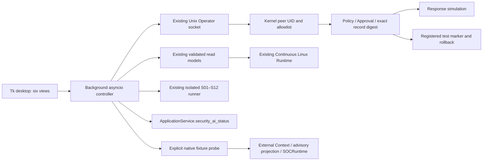

# Linux SOC v1 Desktop GUI integration

## Scope and architecture

WSL2 Ubuntu / WSLg, Python 3.12.14, Tk 9.0.4. Baseline:
`e7ffeb957b1ec4baf9ef7d42f1130278f6a4245b`. Existing uncommitted Reliability Replay
and user changes are excluded. This implementation adds a presentation package;
it does not replace SOC engines or introduce an HTTP server.



`demo/command_center.py` and `demo/local_server.py` already provide a read-only
HTML observer of synthetic fixtures. `desktop.py` is the shared-backend file CLI,
not a window. Reusing them as a live approval GUI would require a new authenticated
web layer. Tkinter was already installed and displayed a real WSLg window, so no
GUI framework, package installation, or dependency-file change was needed.

## Launch and lifecycle

```bash
.venv/bin/python -m soc_agent.gui

# Attach an existing private runtime; no implicit start or adoption of ownership.
.venv/bin/python -m soc_agent.gui --runtime /private/operator/runtime

# Explicitly configure an already verified native environment and artifact root.
.venv/bin/python -m soc_agent.gui \
  --runtime /private/operator/runtime \
  --native-python /private/native-environment/bin/python \
  --artifacts /private/verified-artifacts
```

Paths in examples are placeholders. The default GUI data directory is
`$XDG_DATA_HOME/autonomous-soc-agent/gui`, falling back to
`~/.local/share/autonomous-soc-agent/gui`. `--data-directory` selects a different
private workspace. A file lock rejects a second GUI using that same workspace.
Different explicitly selected workspaces are independent sessions.

The Dashboard can connect to an existing validated runtime, initialize a **fresh**
runtime directory, and start/stop a GUI-owned child through the existing fixed
Runtime CLI. Initialization requires operator-selected thresholds and a READ_ONLY
or explicitly test SCRIPTED assessment mode. No threshold is represented as an
operationally validated default. Existing data is never reinitialized.

GUI shutdown stops only its own Runtime child using the existing stop/SIGTERM
graceful path. An attached external Runtime is not stopped. Closing during a
backend operation waits for that operation. An uncertain shutdown leaves the
window open and reports UNKNOWN; it does not claim a successful stop. SIGINT and
SIGTERM use the same close path. No forced termination of external processes.

Backend work runs outside the Tk event loop. Manual operations are serialized.
Runtime status polling is every 15 seconds (configuration range 10–300 seconds)
on every view. Detailed Dashboard graphs use those same snapshots. Invalid or
unavailable storage status reports UNKNOWN / NOT_READY, rather than retaining
an earlier READY value. Model status, scenario, investigation and feedback pages refresh explicitly;
model hashes and native probes are not executed by the Dashboard timer.

## Views and backend connections

| View | Existing backend reused | Boundary and display |
|---|---|---|
| Dashboard | Runtime `status`, Queue counts, stored Authentication counts | UNKNOWN for unavailable values; readiness remains backend-derived |
| Investigations | RuntimeStore decoding, `validate_finding`, Source Store/v3 | Observed references separate from advisory assessment; latest 100 findings |
| Security AI Models | `ApplicationService.security_ai_status()` | Three external models plus internal Authentication; explicit prior fixture validation |
| Response & Approval | Existing OS-authenticated Operator socket | Exact candidate and record digest; simulation and registered test-resource modes separate |
| Self-Improvement | Existing `feedback`, `feedback-list`, `candidates` socket operations and audit-validated stored evaluation/review reads | Feedback, experiences, candidates, evaluation, regression and human review; no promotion control |
| Scenario Demo | Existing `run_scenario` | S01–S12, isolated fresh run directories; FIXTURE/SCRIPTED/RESPONSE_SIMULATION |

No GUI SQL INSERT/UPDATE/DELETE is used. New SQL projections are bounded finding
queries and aggregate metrics; all domain validation and write operations remain
in existing backends. Preparing simulation/test mode uses the stopped-runtime CLI
and its existing writer lock. It fails while another writer owns that lock.

Response actions validate an `OperatorRequest` locally and are then authenticated
and revalidated by the existing server. The GUI never supplies an actor as proof
of identity, opens an approval bypass, or fabricates an Approval ID. Approval,
rejection, execution and rollback use the current snapshot digest; a stale snapshot
is not automatically retried. Socket timeout/unavailability is UNKNOWN with no
fallback writer. Approval does not imply execution. Marker changes are actual
filesystem writes confined to existing explicit test mode, not OS security changes.

Details redact raw source payloads and common credential fields/tokens. Raw journal
messages are not part of investigation projections. IDs/digests remain inspectable;
selected identifiers can be copied. LLM text is display data, never a command.

## Graphs and measured changes

Two Dashboard graphs show Queue backlog and completed investigation count, using
only actual backend snapshots. History is bounded to 120 samples, owned by the GUI
session, and cleared on connection to a different store. It is not a persisted
telemetry service. Missing/invalid values create UNKNOWN gaps, not zeros. No random
data, fake attack probability, smoothing, or automatic activity is added.

The x-axis is GUI monotonic **measurement time**. It is not source event time,
processing latency, or an inference-performance measurement. Y-axes rescale to
observed counts. Tk resize events redraw lines at the current canvas dimensions.

The WSLg integration test actually enqueues four supported authentication Fixture
events and processes them through the existing persistent Queue, three times:
`4 → 0 → 4 → 0 → 4 → 0`. It also completes a real fixture investigation through
`LinuxMonitor.investigate_one()` and checks that the completed counter increases
by one. Tests verify line coordinates change when resizing, unavailable completed
counts remain UNKNOWN, and reconnecting does not join unrelated histories.

An initial extended check exposed a test race: periodic polling could finish with
the earlier Queue snapshot while the test expected a new read. The test now waits
for the outstanding read before requesting its next measurement. Tk timer callbacks
are also cancelled during close to avoid callbacks surviving a destroyed window.

An independent Export run also exposed a native process crash during garbage
collection after several Tk interpreters were created/destroyed in one pytest
process. UI callbacks now remain in a Tk-thread-polled queue of futures, rather
than worker-owned completion callbacks. Display-test teardown explicitly collects
completed Tk objects on their creator thread, preventing a later backend worker
from finalizing an earlier test's interpreter. Subsequent combined Export tests
exercise the same sequence, including actual native inference. Initial aborted
executions are not counted as passing tests.

## Security AI fixture demo

Inventory alone does not execute inference. Its `demo_inference=UNKNOWN` remains
the current-query truth. An explicit confirmed **Run native Fixture demo** uses
official `reviewed_binding`, FeatureRow binding, existing `analyze_external`,
artifact/backend validation, advisory projection and SOCRuntime checkpoint restore.
All-one precomputed feature rows are explicitly **synthetic contract fixtures**;
they are not PCAP/FQDN extractors or production observations.

Native Quality, Edge and DNS inference succeeded using the previously verified,
separately configured isolated native interpreter and artifact root. No model,
scaler, dependency environment or artifact was modified/installed by this task.
Quality/Edge preserve the shared observation grouping: 3 model results, 2 groups.
The Agent path uses the existing OfflineDesktopClient (SCRIPTED), with zero LLM
provider requests. Read tools and the guarded SOC runtime are executed, not a
separate fake Agent implementation.

The table labels a session's matching persisted context as
`VERIFIED (prior Fixture)`; the detail keeps the current inventory and recorded
validation separate. This label is not operational readiness or inference on query.
It is not reused as execution authority. Opening a new GUI session starts a new
isolated model workspace; prior session probes are retained on disk but not
automatically rediscovered as current validation.

Network/DNS production input remains **NOT_INFERABLE** because training Producer
parity is still missing. Cross-domain correlation remains UNVERIFIED. The Synthetic
v2 contract and Operational Provenance v3 retain their meanings. Authentication
is shown as an internal read-only source chain, not an external model ready for
Network/DNS inference.

## Actual WSL and Fixture validation

| Check | Input and execution | Result |
|---|---|---|
| Six views, resizing, CLI launch | Actual WSLg Tk windows | Verified in explicit display tests |
| Scenario S01–S12 | Existing isolated Fixture runner, SCRIPTED | All PASS |
| Approval/reject/simulation | Fixture finding, actual local Unix socket/peer UID | Verified |
| Restricted execution/rollback | Fixture finding, registered temporary marker | QUARANTINED then AVAILABLE; no OS security change |
| Graph fluctuation | Real Queue operations on Fixture events | Measured changes and resize verified |
| Native three-model demo | Actual model backends, synthetic precomputed Features | Verified; advisory, not production inference |
| Self-improvement display | Authenticated Fixture feedback and stored offline evaluation | Candidate shown; INCONCLUSIVE evaluation, promotion BLOCKED |
| GUI-owned Runtime lifecycle | Actual existing WSL journald, READ_ONLY | Start, collect, stop, restart/resume and close verified |
| External Runtime ownership | Attached Fixture runtime/server | GUI close leaves it unchanged |

The actual WSL lifecycle run used approximately 35 seconds before stopping, then
restarted and observed for 5 seconds. One supported retained authentication event
was accepted; 1 finding completed READ_ONLY, Queue backlog was 0, and restart cursor
health was RESUMED_EXACT. These are retained real journal records, not newly
generated login attempts. Unsupported journal records are not counted as accepted
authentication events. No real LLM provider call, attacker traffic, policy change,
account modification or actual firewall action was performed.

The fixture GUI tests automate explicit confirmation dialogs; their OS peer UID
is real, but test automation is not evidence of an independent human authorization
ceremony. The product requires explicit operator interaction. Backend policy,
expiry, evidence binding and record digest remain authoritative at execution time.

## Reproducible validation commands

```bash
RUN_LIVE_LLM_TESTS=0 .venv/bin/python -m pytest --import-mode=importlib -q \
  tests/unit/gui tests/integration/gui tests/gui_wslg_checks.py

# Explicit WSLg/native tests require a mapped display and configured native environment.
RUN_LIVE_LLM_TESTS=0 \
SOC_EXTERNAL_ARTIFACT_ROOT=/private/verified-artifacts \
SOC_EXTERNAL_INFERENCE_PYTHON=/private/native-environment/bin/python \
SOC_GUI_SCREENSHOTS=/private/gui-screenshots \
.venv/bin/python -m pytest --import-mode=importlib -q tests/gui_environment_checks.py

RUN_LIVE_LLM_TESTS=0 .venv/bin/python -m pytest --import-mode=importlib -q \
  tests/integration/demo/test_desktop_runtime.py \
  tests/integration/demo/test_command_center.py \
  tests/integration/linux_runtime tests/integration/scenario \
  tests/integration/live_operator tests/integration/response_simulation \
  tests/integration/restricted_response tests/integration/feedback_loop \
  tests/integration/offline_evaluation tests/integration/package_status \
  tests/unit/package_status tests/unit/approval tests/unit/execution \
  tests/integration/external_read_only_backend tests/unit/operational_features

RUN_LIVE_LLM_TESTS=0 .venv/bin/python -m pytest --import-mode=importlib -q \
  tests/unit/external_context tests/unit/security_ai/external \
  tests/integration/external_context_storage \
  tests/integration/external_runtime/test_runtime.py \
  tests/integration/external_read_only_backend

.venv/bin/python -m ruff check src tests
.venv/bin/python -m ruff format --check .
git diff --check
```

Explicit display/native check files deliberately do not match normal `test_*.py`
discovery. They are run directly; a headless CI run is not presented as WSLg proof.
No display-dependent test is silently skipped or replaced with a mock screenshot.

Final source/test snapshot was overlaid on a fresh `git archive` of the baseline,
without the user's changed tracked files or untracked Reliability Replay modules.
`PYTHONPATH` and working directory pointed at that Export. All 13 new Python file
SHA-256 values were checked against the working tree after testing; none drifted.
This proves this GUI change can run with the committed backend, not only the dirty
development workspace. It is not a clean dependency installation test.

| Execution | Result | Evidence scope |
|---|---|---|
| Final independent Export: unit + backend + explicit WSLg/native/live checks | **30 passed, 0 failed**, 114.89s | All current GUI Python files; actual windows, native backends, own Runtime restart, read-only evaluation/review |
| Related Desktop / Runtime / Scenario / Operator / Restricted Response / Feedback / Evaluation / Operational regressions | **613 passed, 0 failed**, 431.78s | Existing workspace; source unchanged by GUI work |
| Advisory context / adapter / persistence / runtime guard regression | **440 passed, 0 failed**, 168.72s | Existing schema, binding and READ-only guards |
| Ruff `check src tests` | PASS | Current whole source/test tree |
| Ruff `format --check .` | PASS (841 Python files) | Current whole tree |
| Git diff check | PASS | Existing user changes preserved as well |

Results from overlapping runs are not added together as unique test coverage.
Final local logs were saved as `/tmp/soc-gui-release.log`,
`/tmp/soc-gui-regression.log`, `/tmp/soc-gui-advisory-security.log`,
`/tmp/soc-gui-release-lint.log` and `/tmp/soc-gui-release-format.log`.
They are local test outputs, not committed raw source logs or enduring external
attestations. Earlier aborted runs and intermediate counts do not supersede the
final results.

## Actual screenshots

Screenshots are PNG captures of mapped Tk X11 windows using `XGetImage` in
`tests/gui_screen_capture.py`, not rendered mockups. Fixture and live labels remain
visible. The graph screenshot intentionally contains Fixture activity; idle real
WSL monitoring is not animated to imply nonexistent events.

| Actual screenshot | Input/meaning |
|---|---|
| [Queue and completed charts](gui-screenshots/queue-trend-fixture.png) | Fixture Queue work and completed investigation counts |
| [Dashboard](gui-screenshots/dashboard-live-wsl.png) | Actual retained WSL journald collection |
| [Live investigations](gui-screenshots/investigations-live-wsl.png) | NATIVE_OS / READ_ONLY finding |
| [Fixture investigations](gui-screenshots/investigation-fixture.png) | SCRIPTED investigation fixture |
| [Native models](gui-screenshots/models-native-fixture.png) | Three real model backends; prior synthetic Fixture validation |
| [Approval and rollback](gui-screenshots/approval-fixture.png) | OS-peer test, registered marker restored |
| [Self-improvement](gui-screenshots/self-improvement-fixture.png) | Stored INCONCLUSIVE evaluation; promotion BLOCKED |
| [Scenario runner](gui-screenshots/scenario-fixture.png) | S01–S12 Fixture runner |

## New files

- `src/soc_agent/gui/{__init__,__main__,app,backend,charts,queries,probe}.py`
- `tests/unit/gui/{test_contracts,test_charts}.py`
- `tests/integration/gui/test_backend.py`
- `tests/gui_screen_capture.py`
- `tests/gui_wslg_checks.py`
- `tests/gui_environment_checks.py`
- This report and actual screenshots.

## Limitations and follow-up

- This uv Python build exposes only Tk's fixed bitmap X11 font in WSLg. The dark
  layout, charts and resizing work, but requested font families/sizes fall back to
  the installed Tk font. A system Tk/Xft environment can improve typography later;
  no OS font configuration or dependencies were changed to force this demo.
- No GUI REAL_LLM enablement/settings editor is added. A separately configured
  real-LLM Runtime can be attached; this task's own native Agent demo is SCRIPTED.
- Human feedback/candidate/evaluation is a presentation of existing records and
  explicit existing socket queries. Stored evaluation/review reads verify the
  existing audit chain; the supported offline trial contract also rechecks its
  evaluation digest. Other stored contract versions are displayed as audit records,
  not newly certified experiments. Offline evaluation launch and human review
  editing remain in existing CLI workflows; no new engine/promotion button.
- Socket unavailability is UNKNOWN. GUI does not fall back to a second DB writer.
  Long-running model/Scenario work delays GUI close until the existing bounded
  operation returns. Crash recovery semantics remain those of the backend; uncertain
  external effects are not retried automatically.
- This task is desktop/backend integration, not long-duration GUI soak, clean
  packaging, operational detection-accuracy or model-producer parity validation.
- Physical Linux, systemd deployment, least-privilege journald access, live SSH
  collection, extended recovery/load tests and governed real response remain future
  validations. Windows and AWS were not implemented or tested.

Final verdict: **VERIFIED for the defined WSL2 Ubuntu / WSLg desktop integration
scope**. Production model inputs, real LLM operation in this GUI run, physical
Linux deployment and OS security response are not certified by this verdict.
