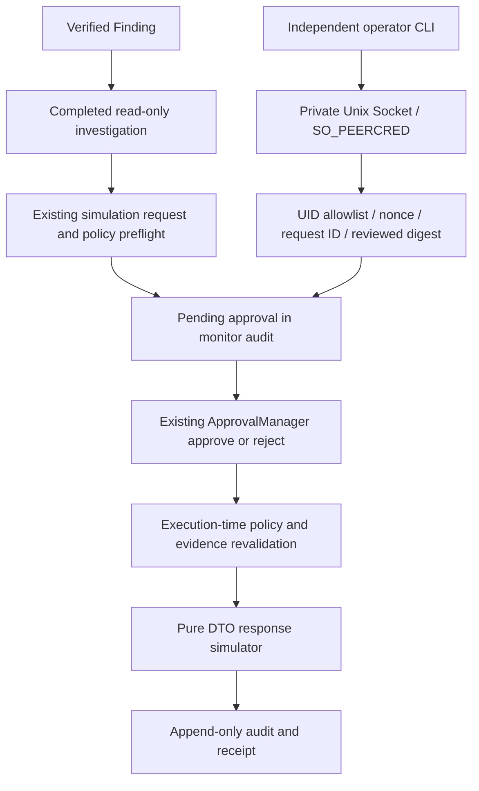

# Live Local Operator Approval — WSL2 Ubuntu

Baseline: `7421fae974ffdcb438f06a10cc9131adc6a1c8b1`, branch `main`. Date: 2026-10-14.

## Scope and verdict

VERIFIED in the tested WSL2 Ubuntu local same-UID, pure-response-simulation scope. This is not physical-server deployment approval or a verified interactive human-presence/MFA system. Actual OS response, automatic human approval and Network/DNS operational inference remain disabled. No new HTTP/API server, upper-agent interface or Windows implementation was added.

## Existing architecture and minimal connection

`linux_runtime/service.py::LinuxMonitor.run()` still owns the lifetime `writer.lock`. The optional `operator.OperatorServer` is started **inside** that lock and runs on the monitor's asyncio loop. CLI processes communicate through a Unix Domain Socket; they never open a database for approval or fall back to an offline write if communication fails. Concurrent operator commands are serialized by an asyncio lock; all SQLite transactions are synchronous and end before an await. The existing collection/investigation stages can continue while waiting for a human review.



The existing `PolicyEngine`, `ApprovalManager`, `validate_binding`, `GovernedExecutor`, `demo_response_tool` and immutable Finding/Result/Window lineage are reused. Existing test-identity offline review remains available when the monitor is stopped and remains clearly `EXPLICIT_TEST_IDENTITY`. New live review records are `OS_PEER_IDENTITY`, not a test actor string supplied in JSON.

## Authentication and authorization

- Opt-in `start --operator-uid UID`. Only the runtime owner's effective UID may be allowlisted in this release. A different UID is rejected at startup; no group sharing or privilege elevation is implemented.
- Endpoint `<private runtime directory>/operator/review.sock`: existing private directory checks, owner UID, no symlink ancestors; directory mode 0700, socket mode 0600. Unexpected regular files, symlinks, mode/owner changes or active sockets are rejected.
- Linux `SO_PEERCRED` derives the UID from the accepted connection. The UID is checked against the startup allowlist for every request and again at the ApprovalManager boundary. Approval actor is generated as `os-uid:<uid>` from the socket, never accepted from JSON.
- Server and client check endpoint identity and permissions; the client also verifies server peer UID. Startup may remove only an own stale socket after `ECONNREFUSED` while holding the writer lock. Shutdown removes only the exact socket inode it created.
- Strict versioned request: known command, UUID request ID, per-connection random challenge, UTC timestamp (maximum 30 seconds old), optional candidate ID/digest. Extra actor/action/tool/incident/command-injection fields are rejected.
- Maximum request 8192 bytes; read, lock-wait and dispatch timeouts 5 seconds; maximum 8 admitted connections. All methods remain local and bounded; no arbitrary shell or tool dispatch exists.
- Accepted request IDs are committed to `monitor_audit` before dispatch and cannot be reused after restart. Unknown commit/response outcome requires a detail query with a **new** request ID, never automatic mutation retry.
- Audit stores request ID, numeric UID, command category, opaque references and sanitized failure class. It does not store raw requests, credentials, untrusted error text or native authentication log text.

An allowlisted UID authenticates a local OS principal, not proof that a particular person typed the command. Processes running as the same UID are in the same trust domain; arbitrary untrusted Python plugins cannot be securely isolated by object fields. Dedicated accounts/process/OS isolation and stronger human authentication are future production requirements. An actual second OS UID was not launched or privileged into the private socket; denial-path tests use injected mismatching credentials alongside real same-UID kernel credential tests.

## Commands

Use an isolated private data directory. Existing runtime thresholds are supplied explicitly; the following values are examples, not validated operating thresholds.

```bash
.venv/bin/python -m soc_agent.linux_runtime --directory /tmp/soc-live-demo init \
  --repeated-failures 5 --multiple-accounts 3 --assessment-mode READ_ONLY
.venv/bin/python -m soc_agent.linux_runtime --directory /tmp/soc-live-demo simulation enable
.venv/bin/python -m soc_agent.linux_runtime --directory /tmp/soc-live-demo start \
  --operator-uid "$(id -u)"
```

From a second terminal while the runtime remains active:

```bash
.venv/bin/python -m soc_agent.linux_runtime --directory /tmp/soc-live-demo operator pending
.venv/bin/python -m soc_agent.linux_runtime --directory /tmp/soc-live-demo operator detail CANDIDATE_ID
.venv/bin/python -m soc_agent.linux_runtime --directory /tmp/soc-live-demo operator approve CANDIDATE_ID \
  --expected-digest REVIEWED_RECORD_DIGEST
# Reject is a terminal alternative to approve, not a revoke of an already decided approval.
.venv/bin/python -m soc_agent.linux_runtime --directory /tmp/soc-live-demo operator reject CANDIDATE_ID \
  --expected-digest REVIEWED_RECORD_DIGEST
# Detail again after approval, then use that approved snapshot digest for execute.
.venv/bin/python -m soc_agent.linux_runtime --directory /tmp/soc-live-demo operator execute CANDIDATE_ID \
  --expected-digest APPROVED_RECORD_DIGEST
.venv/bin/python -m soc_agent.linux_runtime --directory /tmp/soc-live-demo operator audit
.venv/bin/python -m soc_agent.linux_runtime --directory /tmp/soc-live-demo operator feedback
```

There is no live enable command or automatic review. Simulation must be explicitly enabled with the existing stopped-runtime CLI first. LLMs have no access to the operator endpoint as a Tool. Existing simulation CLI contends for the lifetime writer lock and cannot bypass the active runtime. New operator CLI supplies only reviewed opaque references, never OS targets or commands.

## Approval and state boundaries

- Snapshot digest must match before approve/reject/execute. ApprovalManager enforces one terminal review and exact expiration boundary.
- Finding, Incident, Source, Provenance v3, result digest and actually investigated Window evidence are revalidated before review and dispatch.
- The current policy must still require approval. A policy denial or weakened requirement cannot authorize the simulator.
- Pending/denied/rejected/expired approvals never dispatch. Duplicate execution is reserved durably before the pure handler call; racing execute requests yield at most one simulation.
- Display states: PENDING_APPROVAL, APPROVED, REJECTED, EXPIRED, SIMULATED, BLOCKED and UNCERTAIN. EXPIRED is a derived view of the unchanged ApprovalManager timestamp contract. STARTED/unknown results are displayed UNCERTAIN.
- Concurrent approve/reject competes for one terminal decision. Already approved action revocation is **not implemented**; rejection is allowed only before that terminal decision. A future revocation workflow requires an explicit new contract.

`RuntimeResponseSimulation` creates only the fixed pure `disable_demo_account` DTO Tool. The target is a demo identifier, not an OS account. The investigation READ-only registry is never upgraded. Actual response execution and automatic human approval are DISABLED; real OS handler count is 0.

## Persistence, failure and recovery

No schema migration or second approval database. Existing `monitor_audit` stores mode, immutable request, ApprovalManager snapshot, reservation and result. Human decision + its simulation record are one SQLite transaction. Request-attempt and transport receipt are separate transactions. A committed review/result may exist even if the client received no acknowledgment; inspect durable state rather than infer failure or repeat a command.

Original source, queue and monitor databases remain separate. No cross-database or external-call atomicity claim. After STARTED crash, existing recovery marks UNCERTAIN and does not replay the simulator. A receipt committed before crash is SIMULATED and also not replayed. Accepted request IDs survive crash. Audit write failure denies dispatch; continued audit failure stops operator admission. Runtime restart restores stored approvals, including expiry checks, but the operator allowlist must be explicitly enabled again at startup.

Graceful shutdown stops admission and cancels outstanding socket handlers. An in-flight reserved attempt without a final receipt stays uncertain until recovery. A client timeout is not a cancellation/rollback guarantee. Synchronous collector or SQLite work can delay the loop and endpoint responsiveness; there is no claim of a hard wall-clock service SLA.

## Actual WSL evidence

Fresh private stores, real retained journald records, independent Native Python Runtime and Operator CLI processes. No new authentication attempts or policy changes were generated. No LLM API was called.

- Configured 40-second runtime; parent-observed process lifetime 42.221 seconds (includes interpreter startup). Restart configured 3 seconds.
- Queue DONE: 768 unique journal records; supported accepted authentication source: 1; verified five-minute Window: 1.
- Finding: 1; DONE_READ_ONLY investigation: 1. The supported event is PAM module failure, not a claim of final login denial or attack.
- Live OS-UID review: approved; explicit pure simulation: SIMULATED (one); actual OS handlers: 0.
- Restart exit 0; simulation/approval records exactly equal; Source/Window/Provenance read revalidation and hash-chain validation passed; socket removed after shutdown.
- Private evidence: `/tmp/soc-live-native-evidence.json`, `/tmp/soc-live-native-runtime.log`, `/tmp/soc-live-native-summary.log`. These are local evidence, not committed raw logs or a new replay dataset.

Native read success is separate from fixture failure/correlation/approval-race coverage. No LLM quality, operating attack precision, physical Linux, Windows or AWS verification is claimed.

## Tests

Tests use actual Linux sockets and kernel peer credentials with explicitly fixture-produced source records. Pre-existing parser fixtures exercise a native-shaped contract; they do not represent real OS collection even where the parsed input's origin tag is NATIVE_OS. The actual native run above is independent evidence.

- `tests/integration/live_operator/test_operator.py`: auth/actor/challenge/age/size, endpoint security, timeout, snapshot/binding/policy, expiry/replay, races, audit failure, live CLI and shutdown.
- `tests/integration/live_operator/test_process.py`: owned, nonce/PID/writer-lock-verified runtime children + independent CLI, four forced-termination points: accepted request commit, approval commit, simulation reservation, simulation receipt. All four passed; original source/provenance/read-only checks passed. No foreign process or OS service was terminated.
- Existing response crash tests, Scenario S01–S12, runtime/LLM transport, policy/approval/execution, operational provenance and input-gate regressions are reused.

Final test and static-check counts are recorded in the completion evidence section after execution. Initial development failures were response-list digest canonicalization and a fixture-origin assertion; they were corrected rather than skipped.

## Remaining limits

Same-UID local trust only, no interactive presence/MFA/group operators, no approved-action revocation, no operating executor, no remote approval/API, no automatic UNCERTAIN reconciliation, no physical-server deployment or sustained load measurement. Audit history scans remain linear. A newly changed source/window intentionally blocks stale review and feedback projection until explicitly re-investigated; it is not silently attached to an older approval.

## Completion evidence

- Track A final focused/security suite: **479 passed, 0 failed**, 166.85 seconds (`/tmp/soc-live-track-a-regression.log`). Includes 27 new local-operator tests: 23 socket/workflow tests and 4 owned crash cases. Existing tests are not counted again as separate additional passes.
- Standalone development socket suite: 22 passed before the additional endpoint-permission test; standalone owned crash suite: 4 passed. These overlap the final 479 and must not be summed.
- Track B final projection scope: 14 passed separately. That refinement affects only outcome projection; the final Track A workflow code matches the 479-pass suite.
- Ruff `src tests`: PASS. Ruff format: **782 files already formatted**. `git diff --check`: PASS. Logs `/tmp/soc-live-ruff-final.log`, `/tmp/soc-live-format-final.log`.
- The exact task-start byte snapshots of all tracked files were compared. Only `linux_runtime/__main__.py`, `service.py`, `response_simulation.py` changed. Existing README, command-center document and pyproject changes, protected `tests/fusion_support.py`, Synthetic v2, Provenance v3 and policy/approval/execution implementations were preserved.

Changed/new files for this task:

```text
src/soc_agent/linux_runtime/__main__.py
src/soc_agent/linux_runtime/service.py
src/soc_agent/linux_runtime/response_simulation.py
src/soc_agent/linux_runtime/operator.py
src/soc_agent/linux_runtime/feedback_projection.py
tests/integration/live_operator/test_operator.py
tests/integration/live_operator/test_process.py
tests/integration/runtime_feedback/test_projection.py
docs/linux-soc-v1/live-operator-approval.md
docs/linux-soc-v1/self-improvement-audit.md
```

No Git stage/commit/push, schema migration, model operation, operating evidence deletion or OS response action was performed.

Final-code native recheck: a 5-second harness run completed detail and feedback queries but exited normally before the third Audit CLI; that harness attempt was not counted as a complete PASS. A 15-second rerun on the same private, retained-native-event stores passed detail, feedback and audit queries. It returned SIMULATED / OS_PEER_IDENTITY, three separately trusted feedback references (OBSERVED_EVENT, HUMAN_FEEDBACK, VERIFIED_TEST_RESULT), all labels UNLABELED, automatic changes DISABLED, actual OS handlers 0, and clean socket removal. Evidence: `/tmp/soc-live-native-final-code.json`, `/tmp/soc-live-native-final-summary-15s.log`. No new approval or response was automatically repeated in these rechecks.

Reader compatibility: OS_PEER_IDENTITY is an additive actor-assurance value in simulation snapshots. Existing EXPLICIT_TEST_IDENTITY records still round-trip. A pre-upgrade reader will reject new OS-peer review records instead of treating them as test approval. Upgrade/rollback of runtime readers must account for that fail-closed behavior; the database schema and Synthetic v2/Provenance v3 are unchanged.
