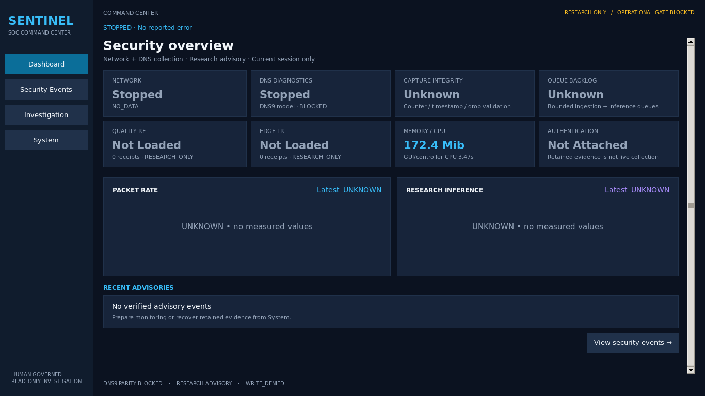
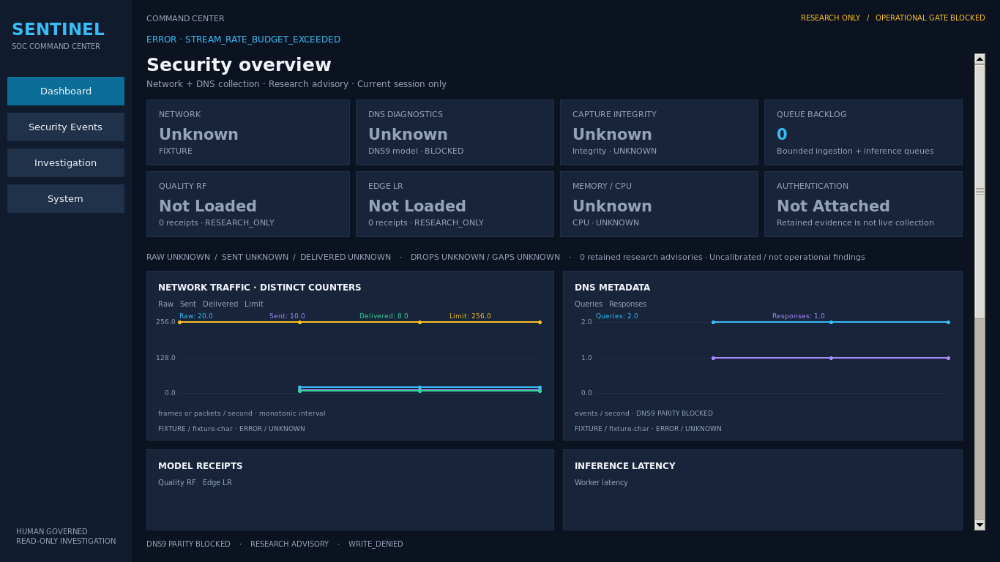

# Loopback accounting and visual Command Center

This change restores measured charts within the existing four operator screens.
It adds explicit controller-side packet accounting without changing the signed
capture bundle, rate policy, Network14 producer, model artifact or privilege path.
Native continuous E2E remains **PENDING / PARTIAL**. A rate-aborted capture does
not become successful because its prefix reached the controller.

## Native failure evidence

The retained directory `session-bcaed1d4f27144139c1fc59b4543ea8c` contains actual
session identity `b7f91c34-e3d3-47f2-bae9-15a5cad36cb0`. Its verified READY and
rejected CLOSED are distinct evidence. CLOSED was received and its counter prefix
accepted, but completion was rejected for `STREAM_RATE_BUDGET_EXCEEDED`.

| Measurement | Retained Native result |
|---|---:|
| Policy | balanced-v2 |
| Raw FPS / burst / total / duration limit | 256 / 512 / 77,312 / 300s |
| Helper elapsed | 2.7918953740154393s |
| Received raw frames | 1,217 |
| Kernel cumulative observations | 1,218 |
| Sent / controller-delivered IP packets | 608 / 608 |
| Kernel drops | 0 |
| Counter sequence | 1,218 |
| Transport backlog / high-water | 0 / 13 of 512 |
| Verified CLOSED | MISSING |
| Rejected CLOSED | EXISTS; counter validation ACCEPTED |
| Persisted sources / queue jobs / model receipts / investigations | 0 / 0 / 0 / 0 |
| SQLite integrity | All seven databases: `ok` |
| Monitor audit | 13 entries; sequence, previous digest and payload digest verified |

The quarantine audit records a 608-packet accepted prefix, four affected flow keys
and a blocked shared capture window. Three earlier 128-packet flows were excluded
with `PACKET_LIMIT`. None of this establishes an eligible, persisted model input.
The collection and research databases were inspected using read-only immutable
SQLite connections, without invoking runtime initialization. File SHA values and
the final audit digest are in the companion evidence JSON.

## Loopback packet accounting

The attested helper consumes one token for **each successful raw receive**, before
checking kernel direction or parsing IP. `Received Frames` increments before token
consumption, so it includes the failing frame. AF_PACKET packet type 4 maps to
OUTBOUND; types 0/1/2 map to INBOUND. Only OUTBOUND observations enter parsing and
metadata transport in this lo-only helper. Both directions of an application flow
can produce OUTBOUND observations; producer direction remains endpoint-relative.

This is existing kernel-direction selection, not content-based paired
Deduplication. The ratio `1,217 = 2 × 608 + 1` is consistent with paired loopback
observations but is not proof that every unforwarded frame was a duplicate. The
Native wire evidence has no direction histogram, packet pair identities or
per-frame token trajectory. These remain **UNKNOWN**. The one-frame difference
between kernel and receive counters is not an established kernel drop: kernel
statistics may include frames not yet drained. Explicit kernel drops remain 0.

New `soc-packet-accounting:v1` projections distinguish kernel observations,
received raw frames, successful raw admission (UNKNOWN), duplicate candidates
(UNKNOWN), normalized packets sent, transport deliveries, network flow inputs,
DNS diagnostic inputs, drops and explicit gaps. Each projection carries capture
identity, input origin, counter sequence and prefix/completion scope. It does not
synthesize missing direction or admission counters. Scope is projected from the
existing authoritative capture-integrity state; a model-worker error is not
reclassified as a capture-wide failure, and an unclassified abort stays UNKNOWN. DNS diagnostic inputs count
validated packet metadata offered to the DNS branch, including non-DNS packets;
DNS query/response counters remain separate.

## Rate mathematics and deduplication decision

A token bucket starting with 512 tokens and refilling at 256/s has whole-run bound
`512 + 256 × 2.791895374 = 1,226.725 raw frames`. Observed 1,217 is below this
bound, while its average (~435.9 raw FPS) exceeds the refill rate. Neither fact
identifies the short interval that exhausted tokens. Earlier bursts and time
spent at bucket capacity affect the trajectory. **ACTUAL_BURST_UNKNOWN**;
no token-bucket calculation defect was established. Low observed transport
backlog rules out outstanding metadata backlog in this saved terminal prefix;
it does not prove that every stage had adequate capacity throughout capture.

No additional deduplicator, reorder buffer, rate increase or automatic retry was
introduced. There is no reliable Native pair evidence with which to validate a
new suppression rule or window. Existing filtering still accounts raw frames,
including INBOUND frames, against the approved raw-frame budget. A future
normalized-packet budget would be a different permission contract: it would need
an independent raw CPU/frame ceiling, direction/pair diagnostics, DNS and
Network14 parity, a new bundle and explicit user approval. This work does not
enable that proposal or claim to cure the Native rate abort.

## Before / after screenshots

Previous four-screen idle dashboard (historical `7a0bd44`):



Restored measured charts, actual WSLg window with explicit chart-only FIXTURE ERROR:



These two images are layout comparisons, not identical Native traffic runs. Actual
RF/LR Fixture and investigation images are included separately; no screenshot is
used as proof of Native inference.

## Capture, Network and DNS integrity

Capture-wide counter/drop/sequence/rate failures continue to fail closed for both
Network and DNS; flow-local and DNS-local isolation remain unchanged. No frame is
silently discarded to improve a graph or to satisfy a model. Existing fixture
coverage exercises paired OUTBOUND/INBOUND observations, raw-only bursts,
counter reset/UNKNOWN/drop, DNS query/response matching and ambiguity, transport
backpressure, queue limits, stop/drain, audit corruption and recovery.

Network14 v1.1.0 feature order, float32 values, nanosecond time provenance and
independent PCAP/hand-reference golden pairs remain unchanged. Quality RF and
Edge LR run in existing isolated workers only for eligible inputs. DNS9 remains
BLOCKED until its training producer parity is verified.

## Four-screen visual layout

The four default screens remain **Dashboard, Security Events, Investigation,
System**. No research view, runtime or worker is initialized to display a chart.
All charts use lightweight Tk Canvas and the existing Pango text/color system;
no plotting dependency was added. A responsive two-column chart grid becomes
one column below 820px content width. Detail areas scroll with the operator page.

| Screen | Restored presentation |
|---|---|
| Dashboard | Existing state/model KPI cards; raw/sent/delivered counters; separate Raw FPS, normalized PPS, delivered PPS and approved raw limit; DNS query/response rates; RF/LR receipt counts; model latency; ordinal research assessment; recorded investigation activity |
| Security Events | Filtered event table, actual assessment timeline and severity distribution, source/model/feature/session references in readable detail |
| Investigation | Recorded checkpoint sequence, assessment distribution, tool evidence and actual timeline reasons, READ-only assessment summary, existing JSON/Markdown export |
| System | Controller CPU and RSS; bounded transport/inference queue depth; kernel drop/gap counters; approved raw rate and UNKNOWN token balance; existing helper, audit, recovery and archive controls |

Severity is the actual threat assessment category (Info/Low/Medium/High/Critical),
not a score-to-risk conversion. The displayed ordinal 0–4 is explicitly labeled;
uncalibrated model scores remain separate. Progress is recorded checkpoint
sequence/reasons; `ASSESSED_READ_ONLY` does not mean response execution or 100%
completion. Withdrawn advisory severity is not plotted as healthy output.

Live rate series use differences between observed counters over monotonic
observation intervals. The first observation, missing counters, reset counters
and untransmitted token balance remain UNKNOWN. A repeated cached publication
cannot invent a zero-rate point. Histories hold at most 60 observations, reset on
session/origin changes, reject stale observations and freeze on STOPPED/ERROR/
DEGRADED/retained states. Returning from a gap starts a new unknown interval.
Captions show session, input origin, state and integrity. Retained model charts
remain historical receipt data and do not animate or increment inference counts.
Increased sampling frequency, packet-arrival instantaneous rate and hidden
interpolation are not implied by these interval plots.

Charts are constructed only for the visible page; unchanged projections skip
redrawing and receipt pages retain selection when only resources change. The
existing single 15-second backend status poll and bounded completion poll remain;
there is no additional chart timer, DB poll, model loader or background worker.

## Performance, actual model evidence and screenshots

Results are recorded in `loopback-rate-visual-evidence.json`. Before/after idle
profiling uses fresh Python processes, identical artifact/interpreter paths,
three-second Tk mainloops, three repetitions each, and controller SQLite tracing.
Model profiling is serial, requires >=2GiB headroom and distinguishes GUI/controller
RSS from sampled subtree RSS. Fixture observations are not Native capacity tests. The measurement host uses Python 3.12.14, x86_64,
WSL2 kernel `6.18.33.2-microsoft-standard-WSL2`, 12 available CPUs and about 7.6GiB
RAM. Snapshot headroom/PSI and run-specific model headroom are in the evidence.
Swap was nearly full; actual model runs were serialized with >=2GiB headroom.
Historical five-minute fixture evidence remains attributed to its earlier build;
no new long-running Native or current-version soak is claimed. This change does
not alter capture timing, worker lifecycle, queues, flow aggregation or producer
admission; the new UI history is independently bounded and regression-tested.

| Identical-condition measurement | Before (`7a0bd44`) | Restored charts |
|---|---:|---:|
| Startup median (s) | 2.004 | 2.190 |
| Idle RSS median (MiB) | 174.387 | 175.348 |
| Idle CPU, one core (%) | 0.282 | 0.273 |
| Tk callback p95 median (ms) | 0.067 | 0.083 |
| Idle SQLite statements | 0.000 | 0.000 |
| Active sampled subtree peak (MiB), n=1 | 418.445 | 418.918 |
| Fixture total elapsed (s), n=1 | 5.717 | 5.499 |
| Queue peak (entries), n=1 | 1.000 | 1.000 |

Startup increased ~0.19s and idle RSS ~1MiB with six dashboard charts; this is a
measured visual cost, not a slimming claim. The earlier 2.30s/175.2MiB/417.7MiB
reference is historical and is not substituted for these same-environment runs.
The active comparison has two actual model receipts, queue final 0, peak 1,
verified audit/finalization, at most one isolated child, and 8,859 controller SQL
statements on each side. No extra idle model process, async task or SQLite query
was introduced. Instrumented cold fixture totals include isolated model startup;
per-call receipt latency is distinct. GUI fixture chart update measurements
(initial paint ~86ms, subsequent ~22/4/3ms in one measured run) include synchronous
Tk painting, not only arithmetic. Three-second idle traces do not establish
long-term Native throughput; live arrival rate and Native active RSS are UNKNOWN.


Screenshots are actual mapped WSLg Tk windows, captured without image synthesis.
`*-fixture-error-*` images display explicitly synthetic FIXTURE counters and
injected ERROR; they are chart/layout evidence only. `*-actual-model-fixture-*`
images use the actual trusted RF/LR artifacts with synthetic eligible packets.
Initial screenshots contain real idle/empty state. Dimensions, file SHA and scope
are in the evidence JSON. 1920×1080, 1366×768 and 1280×720 resizing is tested;
1280 screenshots are not claimed. No Native image/results were fabricated.

Historical slimming evidence is preserved. Three changed source files referenced
by its old hash test now resolve to immutable `7a0bd44` source fixtures. The old
benchmark JSON and screenshots were not restamped as current evidence.

## Regression and independent export

| Separate execution | Result |
|---|---|
| Workspace unit/GUI/domain contracts, before final presentation refinements | 418 passed |
| Workspace focused accounting/rate/history checks | 11 passed |
| Workspace WSLg four-screen validation | 5 passed |
| Workspace actual RF/LR GUI Fixture | 1 passed |
| Independent Export domain/producer/adapter/GUI unit suite | 424 passed |
| Independent Export WSLg pages | 5 passed |
| Independent Export actual RF/LR, investigation, export/recovery + GUI | 2 passed |
| Independent Export Policy/Approval/Investigation/Self-Improvement/Runtime | 202 passed, 2 failed (test temporary socket path too long) |
| Same two failed nodes, corrected short temporary path | 2 passed |
| Independent Export worker/transport lifecycle | 12 passed |
| Final presentation refinement: Export accounting/evidence/GUI units | 103 passed |
| Final presentation refinement: actual Export WSLg pages | 5 passed |
| Final presentation refinement: actual RF/LR Export GUI | 1 passed |
| Final accounting-scope classification / presentation / evidence check | 104 passed |

Runs overlap and **are not added together**. The initial 2 Core failures were
`OPERATOR_SOCKET_PATH_TOO_LONG`: the export harness nested its test directory
below an already-long `/tmp/soc-visual-export-*` path. The failing socket names
exceeded the unchanged 100-byte operator contract. Only those two nodes were
rechecked under a shorter private `/tmp/sv-*` base. No product path validation
was weakened and no intermittent retry is presented as a fix. All required
nodes are validated across these separately recorded runs. The final display
refinement corrects the severity legend to show total observed assessments,
keeps table scores compact (full values in detail), and invalidates chart cache
on provenance/integrity changes; the last three runs cover those changes.

SOC `ruff check src tests`, `ruff format --check .` (1,071 files) and
`git diff --check` pass. ML has no task changes and its prior whole-tree
formatting issues were left untouched.

The clean Export contains HEAD plus only the 28 task files, excluding the 122
pre-existing SOC user files and all 10 ML user files. External trusted model
files are referenced by path/SHA, never copied into the export or Git. Its ML
producer imports resolve to a clean ML HEAD export. Final source, PNG and index
SHA comparisons bind the reviewed bytes. User files (132 SHA checks), protected
session/archive/model/Final Demo files (214 SHA checks) and 58 Raw file
size/mtime/inode entries matched the pre-task inventory. Raw data was not
rehashed as a new capture experiment.

Capture/IPv4/IPv6 socket creation is denied by the test audit hook, including
spawned test workers. No sudo/pkexec/setpriv, AF_PACKET, DNS queries, external
traffic, model retraining or OS security WRITE was executed. Existing user changes,
Reliability Replay, Native/archive databases, raw data and model binaries are
excluded from the independent export and commit.

The first GUI run exposed a new chart label font size below the existing Pango
minimum; it failed explicitly and was corrected from 8 to 9. A baseline Active
profiler initially lacked its explicit external artifact root and failed before
inference (`STREAM_ARTIFACT_ENVIRONMENT_BLOCKED`); the corrected benchmark supplies
the trusted path. Neither failed run is counted as a pass. Historical SIGILL root
cause remains UNKNOWN; recurrence is not excluded by successful new GUI runs.

## Remaining blockers and Native approval scope

Native rate-aborted session status remains PARTIAL. No Native Quality/Edge receipt,
eligible persisted flow or READ-only investigation was created in that session.
Per-frame rate timing, direction counts and true duplicate pairs remain UNKNOWN.
DNS diagnostics do not imply DNS9 model eligibility. New charts cannot resolve
these evidence gaps or grant operational authority.

No helper or approval contract changed. The calibrated helper remains:

- SHA256 `375c06dbeb4e14c881fa496459182677b4efaa293845ecfac0dab0da663c4703`
- Bundle `56ec48caac56a248fc0eeb5bb09c4fae4176482ed19ea8c48526f7638ae8bb31`
- balanced-v2: lo only, <=300s, 256 raw FPS, burst 512, <=77,312 raw frames,
  temporary CAP_NET_RAW, no automatic retry, credential/payload non-retention.

Only after the user explicitly reviews/approves the unchanged scope, they can run
from an ordinary terminal (Codex does not execute it):

```bash
soc-agent start --gui --monitor total --rate-policy balanced-v2 \
  --approve-calibrated-sha 375c06dbeb4e14c881fa496459182677b4efaa293845ecfac0dab0da663c4703
```

The existing CLI asks for scope confirmation and terminal OS authentication. No
new test traffic, interface, duration or higher rate is approved here. Stop & drain
remains available. Inspect READY, complete counters/CLOSED, queue drain, eligible
IDLE/ACTIVE flows, actual receipts, audit and restored state independently. A
repeat rate failure must remain an error, with no automatic restart or promotion.

Final boundaries remain **RESEARCH_ONLY / DNS9_PARITY_BLOCKED /
OPERATIONAL_INFERENCE_BLOCKED / NOT_INFERABLE / WRITE_DENIED**.
