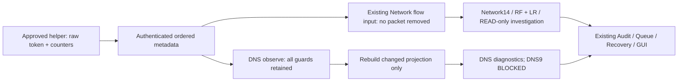

# Native capture filtering and controller optimization

## Baseline and outcome

Baseline SOC `ebfd20b6f20ccba4904107aa3218b79fcfc26c7e`, ML
`e1a01260f0463a38d4d778859bc2a86f8e9cfbde`. This work optimizes redundant
controller projection work. It does **not** install a new capture filter, suppress
packets, change raw-token placement or fix an established token-bucket defect.
Native continuous monitoring remains PENDING. Existing four-screen GUI, charts,
helper bundle, policies, model files, Native sessions and archives are preserved.

## Retained Native evidence

The directory `session-bcaed1d4f27144139c1fc59b4543ea8c` binds actual capture
session `b7f91c34-e3d3-47f2-bae9-15a5cad36cb0`. Current byte hashes match the
previous retained Native evidence. All seven databases pass read-only immutable
SQLite integrity checks; the 13-entry monitor audit sequence, previous hashes
and canonical payload hashes validate to the same head.

| Measurement | Retained result |
|---|---:|
| Policy | balanced-v2: 256 raw FPS, burst 512, <=77,312 frames, <=300s |
| Received raw frames | 1,217 |
| Kernel cumulative observations | 1,218 |
| Sent / controller delivered normalized packets | 608 / 608 |
| Helper elapsed | 2.7918953740154393s |
| Kernel drops / counter sequence | 0 / 1,218 |
| Transport terminal backlog / peak | 0 / 13 of 512 |
| READY | COUNTER_VERIFIED |
| CLOSED | Received and rejected for STREAM_RATE_BUDGET_EXCEEDED; verified CLOSED missing |
| Durable sources / queue jobs / RF-LR receipts / investigations | 0 / 0 / 0 / 0 |

Arrival times, per-frame token balance, protocol/port distribution, actual kernel
packet-type histogram and physical duplicate pair identities remain UNKNOWN.
No failed session was updated, drained, reprocessed into new receipts or archived.

## Capture and loopback contract

`capture.py` maps kernel packet type 4 to OUTBOUND, 0/1/2 to INBOUND, and other
types to UNKNOWN. It preserves integer SO_TIMESTAMPNS nanoseconds separately from
the microsecond datetime representation. The helper increments received raw
frames and consumes a token **before** direction selection. Only OUTBOUND frames
enter IP parsing. This existing selection is already avoiding inbound parsing,
serialization and transport; adding a userspace duplicate check after that point
cannot recover raw tokens or eliminate a second copy that is no longer present.

The observed ratio `1,217 = 2 × 608 + 1` is consistent with paired loopback
observations, but does not prove every excluded observation is a clone. Hashes,
opposite direction and nearby/equal timestamps alone do not establish physical
identity. The bounded two-observation Fixture classifier uses explicit synthetic
emission IDs as ground truth; without such IDs its result is UNKNOWN. It never
suppresses an observation. Same-direction retransmission, different emission ID
or changed timestamp cannot be classified as a verified Fixture pair.

PACKET_STATISTICS is reset-on-read. The existing CaptureCounters accumulator and
READY/HEARTBEAT/CLOSED sequence are unchanged. Kernel observations may include
frames not drained by recvmsg. Kernel minus user counts is not a measured kernel
drop. Drop/UNKNOWN/counter-sequence failure still blocks inference; no UNKNOWN is
replaced with 0. Existing helper counter error propagation and CLOSED rejection
remain intact.

The total-run token bound is `512 + 256 × 2.791895374 = 1,226.725` frames. Observed
received frames are below it; mean raw rate (~435.9/s) exceeds refill rate but does
not prove an instantaneous burst trajectory. The failing receive is included in
the received count. Per-frame arrival/token evidence is absent, so actual burst
and exact Native duplicate pairing remain UNKNOWN. This work does not attribute
the Native rate failure to transport, CPU or a kernel defect.

## Filtering decisions

| Option | Decision / boundary |
|---|---|
| Existing OUTBOUND selection | Preserve exactly; raw budget remains before direction filtering |
| Hash/timestamp deduplication | Not enabled: physical Native identity is absent; false suppression is not excluded |
| Filter all but DNS ports | Rejected: drops legitimate Network14 TCP/UDP traffic and encrypted-DNS visibility evidence |
| Exclude unsupported EtherTypes/protocols early | Approval/design work remains: current parser rejects unsupported input; converting rejection to exclusion changes failure/coverage semantics |
| Kernel BPF/eBPF direction/scope filter | Not implemented or applied. Requires a new signed helper, scope approval and Native counter/filter semantics validation |
| Redundant controller metadata/projection work | Enabled after exact projection and integrity regression tests |

No deduplication window, unbounded table, reorder buffer, protocol scope reduction,
rate increase or automatic capture restart was introduced. The extra digest-only
candidate benchmark is diagnostic CPU cost, not proof of safe suppression. No
proposal treats the received raw rate as a normalized packet rate.

## Implemented controller changes

1. A frozen `PacketObservation` whose DNS field is already None is reused as the
   Network input. Packets carrying DNS still get the same separate DNS-free copy.
   Original DNS metadata remains available to diagnostics; feature/provenance
   values, flow identity, direction, timestamp and packet/byte count are identical.
2. `IsolatedDNS.diagnostic_status` exposes the existing status expression without
   materializing the event ring or walking pending connections. Integrity checks
   use that authoritative property; no validation is removed.
3. For unrelated non-DNS metadata only, the already-unchanged diagnostic snapshot
   is reused. `observe()` **still runs for every validated packet**: observation
   limits, privacy checks, blocked exclusion counts and error handling remain.
   DNS packets, ports 53/443/853, blocked state and initial projection rebuild it.
   Query expiry is still connection-local; unrelated Network timestamps never
   expire DNS queries. No mutable cached diagnostic object is used as domain state.
4. Actual session-scoped counters distinguish metadata copies/reuse and snapshot
   rebuilds/skips. These are processing counters, not filtered raw frame counts.
   `packet_accounting.filtered_raw_frames` remains UNKNOWN because the approved
   helper wire contract has no such classification counter.



Raw/kernel/accepted/duplicate/filtered/normalized/delivered/flow/DNS counters remain
separate and session-bound. Accepted raw and duplicate/filtered raw classifications
are not reconstructed from ratios. Capture-wide failures still affect both domains;
flow/DNS-local quarantine and unsupported encrypted DNS remain independently
classified. No current inference can use an invalidated capture prefix.

## Network14, DNS, actual models and investigation

Projection comparison covers each packet in a mixed DNS/non-DNS sequence,
including unrelated future event time, matched responses, repeated queries,
ambiguous responses and parser failures. Before/after full Network metadata,
DNS events, status and snapshots are equal. Tests also preserve immutable inputs,
privacy rejection, the 38,656-observation guard, blocked diagnostics, timestamp
quarantine and UNKNOWN packet accounting. DNS query retransmissions remain
AMBIGUOUS; they are not quietly deduplicated.

Existing independent PCAP/hand-computed golden pairs cover Network14 feature
order, float32, duration, direction, byte/packet counts, flags, inter-arrival time,
feature digest, IDLE/ACTIVE completion and SHUTDOWN exclusion. The seven-packet
Total Fixture includes both ordinary Network and DNS traffic. It produces four
actual RF/LR receipts and four ASSESSED_READ_ONLY investigations. DNS has one
matched response; the final unmatched query remains diagnostic evidence. Receipt
SHA, 14 features, producer 1.1.0, queues, finalization and audit are verified.
Recovery keeps receipt digests, starts no inference and preserves the original
append-only audit prefix while recording normal recovery events.

All model evidence is **FIXTURE**, not NATIVE_AF_PACKET. Scores remain
RESEARCH_ONLY and uncalibrated. DNS9 producer parity and operational inference
remain BLOCKED; no Security Finding or security WRITE is generated automatically.

## Performance and GUI preservation

| Synthetic stage | Median operations/s | p50 / p95 / p99 (µs) | CPU seconds / 4,000 ops |
|---|---:|---:|---:|
| raw_parsing_existing | 95,076 | 9.664 / 12.216 / 21.929 | 0.0431 |
| transport_serialization_existing | 113,001 | 6.427 / 11.731 / 18.080 | 0.0366 |
| unix_seqpacket_roundtrip_existing | 464,405 | 1.695 / 2.726 / 2.994 | 0.0095 |
| identity_hash_candidate_only | 2,263,729 | 0.309 / 0.521 / 0.615 | 0.0026 |
| controller_projection_before | 78,264 | 10.559 / 19.722 / 30.930 | 0.0520 |
| controller_projection_after | 1,675,692 | 0.472 / 0.534 / 0.864 | 0.0034 |

Projection-only speed ratio: 21.41× in this seeded-state microbenchmark. It is not an end-to-end or Native speedup.

| Identical-condition GUI measurement | Before | After |
|---|---:|---:|
| Startup median, seconds | 2.870 | 2.412 |
| Idle RSS median, MiB | 174.828 | 175.023 |
| Idle CPU, one core % | 0.252 | 0.258 |
| Tk callback p95 median, ms | 0.073 | 0.054 |
| Idle controller SQL statements | 0.000 | 0.000 |
| Four-packet actual-model subtree peak, MiB (n=1) | 420.47 | 418.54 |

Both active runs: two actual model receipts, queue final 0 / peak 1, verified
audit/finalization and at most one isolated child; no orphan is retained. The
separate actual WSLg RF/LR render took 241.1ms. The chart-only
Fixture repaint run measured ~75/19/5/2ms for its four updates. These timings
include Tk painting; they do not assert 60 FPS or Native inference latency.


The projection measurement is deliberately separated from parsing, transport,
flow aggregation, persistence, worker cold start and investigation. It uses the
same prebuilt non-DNS packet and 128 pending DNS connections on both sides,
4,000 timed iterations, 128 warm-up iterations and five fresh-state repetitions.
Every call checks healthy diagnostic state and all 128 pending queries. Timed
loops stay below the unchanged DNS observation limit. The IPC test has one
outstanding message; kernel queue peak is NOT_MEASURED. VmHWM is process-image
high water, not the sum of isolated workers.

The GUI module files are byte-identical to baseline: no view, chart, menu,
model loader, timer or polling change. Fresh before/after WSLg profiling uses
identical existing artifact/interpreter paths, three three-second idle runs and
serial actual model fixtures. Host memory pressure varied; startup differences
are measurements, not evidence that this optimization caused faster GUI startup.
Active model peaks and rendering observations are reported with their scope.

## Validation and independent export

| Separate run | Result |
|---|---|
| Workspace Network/DNS/Producer/Worker/GUI unit regression | 432 passed |
| Workspace actual seven-packet Total model/recovery test | 1 passed after correcting two test-contract errors |
| Workspace actual WSLg pages + RF/LR GUI | 6 passed |
| Independent Export unit/contracts/Producer/Worker | 435 passed |
| Independent Export actual RF/LR + DNS + READ-only investigation + recovery | 1 passed (4 actual model receipts) |
| Independent Export WSLg four-screen/charts | 5 passed |
| Independent Export Policy/Approval/Investigation/Runtime/Worker lifecycle | 125 passed |
| Final updated public source/model/evidence proof | 13 passed |

The four primary Export suites have disjoint pytest node IDs: 566 passed in total.
Workspace and final focused rechecks overlap them and are not added to that total.
Each run denies new AF_PACKET/IPv4/IPv6 sockets via the test audit hook; all report
zero blocked attempts and no actual capture/traffic. Model tests are serial and
require >=2GiB headroom; no other process was killed, no WSL setting was changed.
The initial model run and first corrected API run failed in the new test, as
explained below; they are not silently replaced in the recorded run history.

Ruff check src/tests, whole-SOC format check (1,077 files) and git diff --check
pass. ML has no task changes; its existing formatting exceptions are not edited.
The independent export contains HEAD plus exactly the 14 task files, no Replay,
Native SQLite, model binary or raw data. User files 132 SHA checks, protected
Native/archive/model/Final Demo files 214 SHA checks, and Raw inventory 58
size/mtime/inode checks remain equal to baseline. No GUI code file changed.
No new screenshot was synthesized or claimed; current mapped WSLg tests draw the
existing charts and preserve the historical screenshot/source evidence.

The first new model test used a nonexistent `restore()` method; it was corrected
to the existing `restore_latest()`. The second attempt wrongly required an
unchanged final audit digest after recovery. Recovery legitimately appends audit
events, so the test now checks prefix byte equality plus valid extended chain.
Both initial runs failed and are not counted as successful complete E2E. There
was no product retry/approval relaxation. The initial benchmark invocation lacked
module package resolution; the recorded measurement uses `python -m
 tests.capture_filtering_profile`, not the failed invocation.

Historical visual evidence JSON and screenshots remain untouched. Its hash test
now resolves changed historical source/test files to exact non-executable
`ebfd20b` fixtures; current behavior has separate tests and current SHA evidence.
Existing user changes, Replay and protected data are excluded from export/staging.
Independent ML source comes from ML HEAD; trusted external model binaries are
referenced with their existing SHA and are not copied to export or Git.

No new long-running Native or current-build soak is claimed. Prior long Fixture
results remain scoped to their original builds. This change adds no queue,
packet retention, worker, retry or capture lifecycle; bounded dispatch, overflow,
stop, recovery and model cases are rechecked. SIGILL root cause remains UNKNOWN;
successful new runs do not exclude recurrence.

## Remaining blockers and approval scope

Native physical duplicate identity remains UNKNOWN; the last real session still
failed the approved raw budget and has zero Native inference receipts. Reducing
controller CPU does **not** raise that budget or guarantee the same traffic can
run for 300 seconds. Native continuous monitoring and true capture capacity need
separate manual validation. A new kernel/scope filter or post-dedup rate contract
would require a separately implemented/reviewed helper, new SHA/bundle, explicit
raw/counter ceiling and new user approval. None is enabled by this commit.

Unchanged calibrated helper SHA256:
`375c06dbeb4e14c881fa496459182677b4efaa293845ecfac0dab0da663c4703`.
Bundle digest:
`56ec48caac56a248fc0eeb5bb09c4fae4176482ed19ea8c48526f7638ae8bb31`.

After separately reviewing/approving the unchanged scope, the user can run:

```bash
soc-agent start --gui --monitor total --rate-policy balanced-v2 \
  --approve-calibrated-sha 375c06dbeb4e14c881fa496459182677b4efaa293845ecfac0dab0da663c4703
```

This retains lo only, <=300 seconds, 256 raw frames/s, burst 512, <=77,312 frames,
temporary CAP_NET_RAW, no automatic retry, terminal-only OS authentication,
no root GUI and no payload/password retention. No test traffic, namespace,
interface or higher policy is approved by this analysis. Codex did not execute
sudo, setpriv, pkexec, AF_PACKET capture, DNS traffic or OS security WRITE.
Inspect READY, verified CLOSED, counters, flow eligibility, actual model receipts,
READ-only investigation and audit/recovery separately; STOPPED/ERROR/UNKNOWN must
not be presented as a successful Native session.

## Verdicts

| Verdict | Result / scope |
|---|---|
| LOOPBACK_DUPLICATE | UNKNOWN for Native; only explicit Fixture ground truth verified |
| RAW_ACCOUNTING | VERIFIED existing raw-token contract; missing classifications UNKNOWN |
| FILTERING_SAFETY | VERIFIED controller redundant-work removal; new Native suppression/scope filtering BLOCKED |
| NETWORK14_PARITY | VERIFIED Fixture and independent golden pairs |
| DNS_DIAGNOSTICS | VERIFIED Fixture; DNS9 gate unchanged |
| QUALITY_FIXTURE_INFERENCE | VERIFIED actual RF artifact |
| EDGE_FIXTURE_INFERENCE | VERIFIED actual LR artifact |
| INVESTIGATION | VERIFIED four actual Fixture READ-only investigations |
| GUI_CHARTS | PRESERVED, 22 GUI source files byte-identical; mapped WSLg tested |
| AUDIT_RECOVERY | VERIFIED Fixture, prefix unchanged and extension valid; Native failure bytes preserved |
| NATIVE_CONTINUOUS_MONITORING | PENDING |
| DNS9_PARITY | BLOCKED |
| OPERATIONAL_PROMOTION | BLOCKED |

Final scope: controller optimization and Fixture parity verified;
**LOOPBACK_DUPLICATE_UNKNOWN / NATIVE_CONTINUOUS_MONITORING_PENDING /
DNS9_PARITY_BLOCKED / OPERATIONAL_PROMOTION_BLOCKED**.
