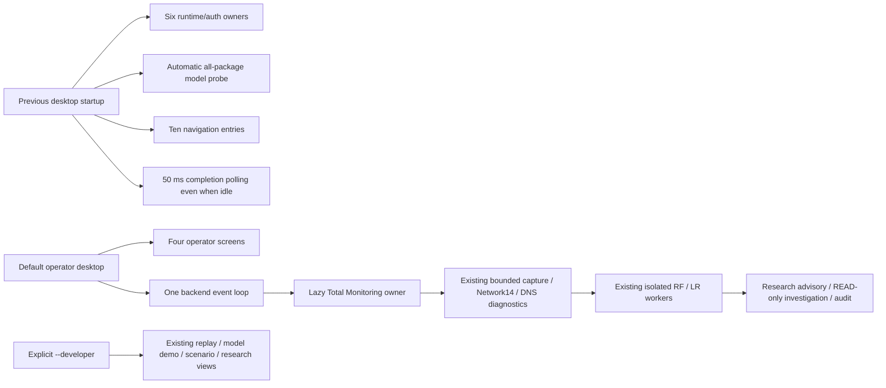
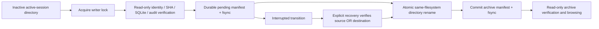

# Production slimming and runtime consolidation

Status: **Fixture/UI verified; Native Total E2E pending.** Network models remain
RESEARCH_ONLY, DNS9 parity remains BLOCKED, operational inference remains
BLOCKED / NOT_INFERABLE, and security WRITE remains WRITE_DENIED.

## Before and after architecture

Baseline SOC: `d082511629e806136a385aaf31f7ee3349795832`.
ML: `e1a01260f0463a38d4d778859bc2a86f8e9cfbde`.
The original 122 SOC and 10 ML modified/untracked files, including Reliability
Replay, are excluded from this change. The index was initially empty.



No collector, capture framework, AI model, queue service or agent runtime was
introduced. Both desktop modes use the same Backend and owned Worker event
loop. The normal entry point does not import or construct the developer
Desktop. Original research tests, fixture CLI and benchmark tools remain.

## Feature classification and GUI

| Operator screen | Information and actions |
|---|---|
| Dashboard | Network/DNS, capture integrity, queue, RF/LR worker state, GUI/controller RSS/CPU, Authentication, bounded measured charts, recent advisories |
| Security Events | Searchable model events, source, prediction, uncalibrated score, provenance and selected event detail |
| Investigation | READ-only assessment, evidence references, withdrawn advisory state, local JSON/Markdown export |
| System | Prepare/Stop/Recover, unchanged rate policies, helper approval, audit/recovery, archive verification, technical detail and developer entry |

The four screens retain a designed navy/slate layout, cyan/violet accents,
readable system Pango typography, status cards, selected navigation, clear
empty states and separate list/detail areas. Only the current page's widgets
exist. Cards reflow on small widths and the page scrolls vertically. Actual
1920×1080 and 1366×768 WSLg captures are linked below. Research and Operational
states remain separate; an idle process is never presented as an active model.

Charts reuse MetricHistory/Trend and accept measured backend values only.
History is bounded to 60 samples, reset on session/origin changes, and does not
append an unchanged stopped sample or restored historical result as new Live
data. Missing rates, drops or queue observations remain UNKNOWN. Fixture
screenshots explicitly show FIXTURE. A receipt count is not a new Live count.

## Initialization, polling and model lifecycle

- Runtime/auth objects are lazy singletons owned by one Backend. Idle operator
  startup creates zero research, live, streaming or Total owners and no model
  service. Closing an unused backend does not construct objects to stop them.
- The default GUI does not probe every model or create a model-probe database.
  Artifact/dependency validation still occurs before Monitoring preparation and
  before each inference. No integrity check was replaced with a stale cache.
- A single status request updates the currently selected page. The idle
  50 ms completion poll is removed; completion polling exists only while a
  bounded operation is pending. The normal status cadence remains 15 seconds.
- Navigation cancels/reuses the owned refresh timer. Stale monotonic observation
  stamps cannot restore old READY state; page generations prevent callbacks
  from updating destroyed widgets. Unchanged event data preserves selection.
- All database, archive and inference operations run on the existing backend
  event loop or its executor, rather than the Tk event thread.
- RF/LR remain cold, isolated, bounded per-request workers. Idle workers did not
  previously exist, so this change claims removal of eager runtime/probe work,
  not removal of nonexistent model processes. Session-spanning model caching
  was deliberately avoided: memory release, input isolation and provenance
  retain their existing failure boundaries. Warm reuse/model-load-only timing
  is UNKNOWN; end-to-end cold inference latency is measured separately.
- Shutdown stops only owned monitoring/auth resources, drains according to the
  existing deadline, shuts down async generators/default executor, joins the
  backend thread and closes the loop. An explicitly attached external
  Authentication Runtime is not killed by closing the desktop.

## Active sessions and verified archives

Active retention remains **8 session directories**. Archive retention is
**64 sessions / 2 GiB inventoried evidence bytes**, with at most 4096 entries per
session and 2 MiB per manifest, plus filesystem overhead. At least 256 MiB free
disk space is required before an archival transition. There is no automatic
pruning, deletion or unlimited archive growth. When capacity is reached, an
operator must arrange reviewed external retention; the program blocks further
archival instead of deleting evidence.

Archival is an explicit System action, never automatic on GUI startup. The
currently attached session is excluded. Every candidate must have a private,
owned directory, safe regular files, a quiescent SQLite state, valid SQLite
integrity and a valid existing monitor audit hash chain. All candidates are
verified before the first move. Per-session writer locks prevent moving active
writers. Existing empty owned 0644 `runtime/writer.lock` sentinels inside private
directories are preserved without chmod; nonempty or externally writable locks
are rejected. No database or audit record is rewritten.



A manifest records session identity, session JSON digest, identity/audit binding,
every file SHA256, byte count, audit head and a manifest digest. Failed captures
remain failed: `PRESERVED_NOT_PROMOTED` is a retention statement, not proof of a
verified CLOSED or successful inference. A session that never reached
STREAM_STARTED is marked `NOT_STARTED_RETAINED_ONLY`. A mismatched session/audit
binding is rejected.

Recovery never guesses when both source and destination exist, nor overwrites
an archive. Pending journals and damaged/orphan archives block new preparation
with `STREAM_ARCHIVE_INTEGRITY_BLOCKED`. Explicit archival recovery verifies
unchanged evidence before completing the rename. The normal 8-session guard
still applies to active directories. Archived data is accessible at
`total-monitoring/archives/session-…/`; `Archive(root).verify(name)` and the GUI's
Verify archive manifests action provide read-only validation. Archives are not
automatically resumed or fed to models.

The existing eight Native sessions were inspected read-only: 12,769,012 bytes,
valid inventories/SQLite/audit chains. **No real session was moved or modified
by this work.** Archive transitions and crash recovery used temporary fixtures.

## Performance and validation

Final measured results and individual run records are in
[production-slimming-evidence.json](production-slimming-evidence.json).
The reproducible profiler is `tests/production_slimming_profile.py`:

```bash
.venv/bin/python tests/production_slimming_profile.py --mode operator
```

For a fair comparison, use the same interpreter, WSLg display, trusted explicit
Artifact/native-interpreter paths and input fixture against the baseline Git
export (`--mode developer`) and current source (`--mode operator`). Each
measurement uses a new process/private temporary data directory. Startup means
imports through the first completed GUI/backend projection; it excludes user
sudo authentication and actual Native capture. Idle samples last three seconds;
response p50/p95 uses twenty Tk callbacks. Active comparison uses the same four
synthetic packets, balanced-v2 and two actual RF/LR inferences, one run per
version. CPU is process CPU divided by elapsed time, expressed as one-core
percentage; active RSS is sampled, not a claimed exact kernel peak. Background
host processes are uncontrolled, so these are observations, not a statistical
performance guarantee. Native monitoring RSS/throughput remains UNKNOWN.

| Same-condition measurement | Before | After |
|---|---:|---:|
| Startup median (s) | 6.745 | 2.302 |
| Idle RSS median (MiB) | 204.4 | 175.2 |
| Idle CPU median (% one core) | 0.452 | 0.264 |
| Tk response p95 median (ms) | 0.047 | 0.037 |
| Idle completion callbacks / s | 16.3 | 0.0 |
| Current-page widget count | 107 | 63 |
| Active Fixture sampled subtree peak (MiB), n=1 | 433.8 | 417.7 |
| Active Fixture elapsed (s), n=1 | 5.875 | 5.840 |

Observed startup reduction: 65.9%; Idle RSS reduction: 14.3%. Both active runs produced two identical RF/LR model input vectors, predictions and scores; final queue was zero and finalization/audit were VERIFIED. One active sample does not establish an inference latency improvement. Native active RSS is UNKNOWN. Warm/cold model-load-only timing is UNKNOWN.

Eight temporary fixture sessions (1,278,592 bytes) archived in 0.097s, CPU 0.034s. This is not a Native archive throughput claim. GUI result rendering during the actual-model Fixture took 172.1ms; this is separate from idle callback latency.


Archive overhead is measured on temporary fixtures; existing Native evidence
was only read. Source SHA maps bind the measurements and independent export.

## Security and preservation

Unchanged Calibrated Helper:
`375c06dbeb4e14c881fa496459182677b4efaa293845ecfac0dab0da663c4703`.
Unchanged bundle:
`56ec48caac56a248fc0eeb5bb09c4fae4176482ed19ea8c48526f7638ae8bb31`.

No Helper, Manifest, Calibrated Policy, Producer, Artifact, Raw Dataset or Native
session was changed. Temporary CAP_NET_RAW, lo allowlist, session digest,
authenticated socket, counter/drop/timestamp checks, bounded queues, no password
storage, no payload retention and no automatic promotion remain enforced.
Copying a helper command revalidates the current listener. Ordinary GUI launch
never authenticates or captures. Only a previously reviewed explicit CLI handoff
may invoke the existing terminal-authenticated path; tests mock that path.

## Screenshots

Actual WSLg evidence, not image synthesis:

- [Dashboard 1366×768, idle](production-slimming-screenshots/dashboard-idle-1366.png)
- [Dashboard 1920×1080, idle](production-slimming-screenshots/dashboard-idle-1920.png)
- [System, idle](production-slimming-screenshots/system-idle-1366.png)
- [Actual RF/LR on Fixture input](production-slimming-screenshots/dashboard-actual-model-fixture-1366.png)
- [READ-only Fixture investigation](production-slimming-screenshots/investigation-actual-model-fixture-1366.png)

## Known issue, test history and remaining blockers

One combined unit/GUI regression process exited with SIGILL (132) while a
backend thread was garbage-collecting. The log does not prove the responsible
native extension or a fix; ROOT_CAUSE_UNKNOWN / RECURRENCE_NOT_EXCLUDED remains.
This interrupted run is not counted as passed. Display ownership hygiene now
collects unreachable display objects on the creator thread before starting a
new backend thread, and GUI runs are verified separately. Passing separate
runs is not proof that the historical native crash is resolved.

An initial regression also found a removed `operator_request` Mock seam; a lazy
compatibility wrapper restores it. That first run was 380 passed / 1 failed and
is not represented as a passing run. Initial new archive test failures were
fixture directory permissions and an overlong Unix test socket path; those
fixtures were corrected without weakening production checks.

| Independent Export run | Passed | pytest duration |
|---|---:|---:|
| unit | 410 | 37.42s |
| gui | 6 | 24.30s |
| model | 2 | 16.69s |
| core | 204 | 130.98s |
| lifecycle | 12 | 5.02s |

These five disjoint Export suites total 634 passes; workspace and historical runs are not added to that number. All five socket guards reported zero new packet/IPv4/IPv6 socket attempts. Actual-model tests ran serially with >=2 GiB headroom. No OOM, drain timeout or SIGILL occurred in these Export runs. The interrupted combined run above remains a recorded failure, not a resolved native issue.

SOC Ruff, whole-tree format and diff checks pass. Independent Export contains only HEAD plus this task's allowlist; original user changes, Reliability Replay, operating DBs, model binaries and Raw Datasets are excluded. Model references point to the existing pinned artifacts; ML Producer code is read from an independent ML HEAD export. Artifact/input vectors/predictions match on the same Fixture; run-specific session IDs, receipt timestamps and screenshots are not required to be byte-identical across executions.

Preservation verification: all 122 original SOC and 10 original ML file hashes match; 126 protected Native/Artifact file hashes match; 58 Raw file size/mtime/inode inventories match. The 6.8 GiB Raw set was not fully rehashed again. No ML source change or ML commit is needed.

| Acceptance | Result |
|---|---|
| Four screens, navigation, empty states, status separation | VERIFIED on WSLg |
| Startup / Idle RSS / CPU / response | MEASURED, three samples per version |
| Active RSS | MEASURED on identical RF/LR Fixture, one sample each; Native UNKNOWN |
| Redundant initialization | Six eager owners and automatic model probe removed from default path |
| Redundant idle model workers | None existed; no false removal claim |
| Lazy loading, bounded isolated worker cleanup | VERIFIED |
| Session archival / interrupted transition recovery | VERIFIED in temporary fixtures |
| Network14 / DNS diagnostics / Quality / Edge | VERIFIED in fixture regressions; DNS9 inference BLOCKED |
| Investigation / JSON-Markdown export / audit recovery | VERIFIED, existing scripted READ-only research path |
| Native Total E2E | PENDING user validation |
| SIGILL root cause | UNKNOWN, recurrence not excluded |
| Operational model promotion | BLOCKED |


## Native validation plan

1. Launch `.venv/bin/python -m soc_agent.gui` as the normal user. Inspect System;
   if eight active sessions remain, explicitly review/archive inactive evidence.
   This work did not move those sessions for the user.
2. Close the GUI to release its desktop lock. Only after reviewing the unchanged
   scope, the user may run the existing one-command entry:

   ```bash
   soc-agent start --gui --monitor total --rate-policy balanced-v2 \
     --approve-calibrated-sha 375c06dbeb4e14c881fa496459182677b4efaa293845ecfac0dab0da663c4703
   ```

3. The terminal displays policy/Helper/bundle and asks for explicit scope
   confirmation followed by OS authentication. The GUI never receives a
   password. Balanced-v2 remains lo-only, at most 300 seconds, 256 raw frames/s,
   burst 512 and total 77,312 frames; no automatic retry or privilege renewal.
4. Verify authenticated READY, complete counters/CLOSED, bounded queue drain,
   eligible IDLE/ACTIVE flows, actual RF/LR receipts, READ-only investigations,
   audit and restart state. Use Stop & drain for an explicit stop. Do not
   generate unapproved traffic or interpret archive/Fixture receipts as new Live
   inference. A failed counter/drop/timestamp check must continue to block
   affected inference.

Codex performed no sudo/pkexec/setpriv, Native AF_PACKET capture, DNS test
traffic or OS security WRITE. Native Total E2E remains PENDING, DNS9 Producer
parity remains BLOCKED, and operational promotion requires a separate stage.
