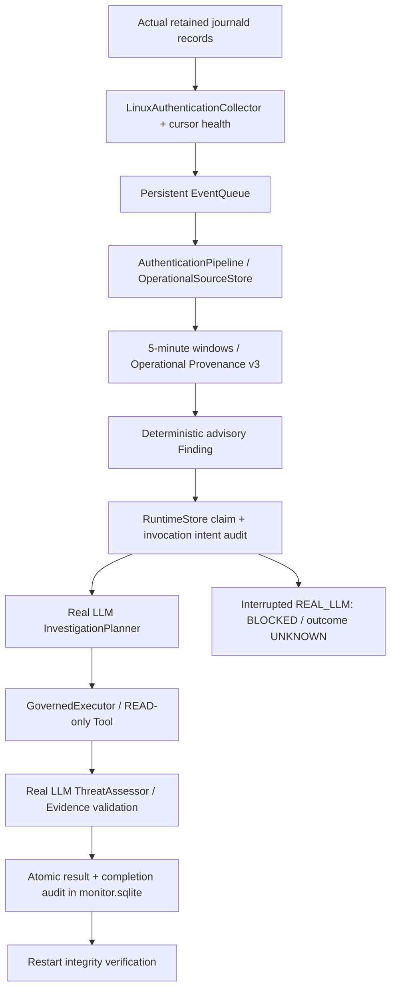

# Real LLM Continuous Investigation E2E

## 판정과 기준선

**VERIFIED — WSL2 Ubuntu의 기존 실제 journald 기록 재수집 + 실제 OpenAI-Compatible API + READ-only Investigation/Assessment + 영속 저장/재시작 범위.** 실행일: 2026-10-14.

기준 HEAD `eef4b418238bf447264ae6a2c49237ba0fe18ca1`, 브랜치 `main`. 기존 README.md, docs/soc-command-center.md, pyproject.toml의 사용자 수정 및 기존 미추적 파일을 보존했다. Commit/Stage/Push, 운영 DB Migration, 실제 보안 대응은 수행하지 않았다.

실제 로그는 과거에 발생해 현재 journald에 남아 있는 **sudo PAM 모듈 인증 실패**다. 새 로그인 실패를 생성하지 않았다. SSH 최종 로그인 실패 또는 sudo 명령의 최종 거부로 해석하지 않는다. Source Assurance는 기존 `DECLARED_UNATTESTED`이며, 직접 OS 읽기를 관찰했다는 것과 암호학적 원본 진위 증명은 구분한다. 이전 Scenario 실제 API 성공을 이번 Continuous E2E의 증거로 대체하지 않았다.

## 구조 및 재사용



기존 Native Collector, Queue, Source Store, Window, v3 Provenance, `correlate()`/`validate_finding()`, `InvestigationPlanner`, `InvestigationOrchestrator`, `ThreatAssessor`, `authentication_read_registry()`, PolicyEngine, ApprovalManager, GovernedExecutor, Runtime Lock을 재사용했다. 외부 API 서버, 새 Orchestrator, Sub-Agent는 추가하지 않았다.

위 흐름에서 Authentication 사실과 규칙 Finding, LLM 판단은 분리된다. Finding은 `SUDO_PAM_MODULE_FAILURE` 정보성 advisory이며 실행 권한이 아니다. 기존 Authentication Window는 PAM 모듈 시도 집계다. Network/DNS 모델, 운영 Feature Producer는 실행하지 않았다. `NOT_INFERABLE`, Synthetic v2 및 Operational Provenance v3 의미를 유지했다.

## 실제 결함 및 최소 수정

1. **Planner/Runtime 한도 불일치:** Runtime READ Tool 한도는 2인데 기존 Planner가 1~8단계를 요청했다. 첫 실제 응답이 한도를 초과해 `LLMResponseValidationError`로 거부됐다. Planner에 선택적 `max_steps`를 추가하고 요청 JSON Schema의 `maxItems`와 안내를 해당 값에 맞췄다. 기본 8단계는 기존 호출자의 계약을 유지한다. 응답 후 Runtime의 독립 한도 검사도 유지한다. 초과 단계를 잘라 실행하지 않는다.
2. **호출 중 비정상 종료의 불확실성:** 요청 전 intent, 응답 후 해시/Usage, 실패 시 분류를 기존 감사 체인에 영속 기록한다. intent Audit 저장 실패는 API 호출 자체를 차단한다. 외부 HTTP 호출과 DB Commit은 원자적이지 않다.
3. **복구가 변조 데이터를 재서명할 위험:** `recover()`가 모든 기존 Finding/Result 무결성을 검사하고, `finish()`도 기존 Row 및 Result의 Finding Binding을 재검증한 뒤 Commit한다.
4. **중단된 REAL_LLM의 자동 재호출 위험:** 재시작 시 RUNNING 실제 LLM 작업은 보수적으로 BLOCKED/UNKNOWN 및 운영자 검토 필요 상태로 남긴다. 호출 직전 종료도 실제 제출 여부를 확정할 수 없으므로 자동 재시도하지 않는다. Timeout/Network/Cancel의 불확실 호출은 자동 Retry 대상에서 제외한다. Source와 Finding은 삭제하지 않는다.
5. **Readiness:** 기존 LLM 성공 기록이 있어도 BLOCKED/FAILED 작업, Circuit Open, Last Error가 남으면 READY로 표시하지 않는다.
6. **기본 모드:** 신규 설정은 SCRIPTED, 실제 LLM 활성화는 REAL_LLM 명시 선택, 대응은 DISABLED. 저장된 기존 READ_ONLY 설정은 그대로 해석한다. SCRIPTED 완료는 DONE_SCRIPTED로 구분한다.
7. **Fixture 테스트 시간 의존성:** 병렬 부하에서 1.5초 내 두 작업 완료 가정이 한 번 실패했다. 해당 유한 배치 Core 테스트는 실제 `tick()` 및 다음 `investigate_one()` 완료로 검증하도록 변경했다. Lifecycle/Timeout/Shutdown 검증은 별도 테스트로 유지한다.

## 설정과 실행

API Key는 비추적 `.env`의 `SOC_LLM_API_KEY`로 제공한다. 값은 출력하지 않는다. URL/모델/Transport Timeout/Completion Budget는 기존 `SOC_LLM_*` 설정으로 관리한다. 기본 API 자동 호출이나 실패 시 SCRIPTED 대체는 없다.

```bash
# 빈 격리 디렉터리만 사용한다. 기존 사건/운영 DB를 지정하지 않는다.
.venv/bin/python -m soc_agent.linux_runtime --directory /tmp/soc-monitor-example init \
  --repeated-failures 5 --multiple-accounts 3 --poll-seconds 1 \
  --assessment-mode REAL_LLM --env-file "$PWD/.env"

SOC_LLM_BASE_URL=https://api.openai.com/v1 SOC_LLM_MODEL=gpt-5-mini \
  .venv/bin/python -m soc_agent.linux_runtime --directory /tmp/soc-monitor-example start \
  --duration-seconds 180

.venv/bin/python -m soc_agent.linux_runtime --directory /tmp/soc-monitor-example status
.venv/bin/python -m soc_agent.linux_runtime --directory /tmp/soc-monitor-example stop

# 같은 디렉터리로 start를 다시 수행하여 Cursor/결과를 복원한다.
# init를 다시 수행하거나 기존 DB를 초기화하지 않는다.
```

위 반복 실패 5/다중 계정 3 설정은 이번 검증용 명시 값이며 운영 정책으로 검증되지 않았다. PAM 모듈 실패 Finding은 기존 독립 규칙에서 생성되었으며 반복 실패 임계값을 낮춰 만든 것이 아니다. 새 기본 SCRIPTED 모드에서는 API 설정을 읽어 호출하지 않는다. REAL_LLM 설정 누락은 NOT_CONFIGURED/PENDING이며 성공으로 대체하지 않는다.

기본 제한: LLM 요청 2회/조사, READ Tool 2회/조사, 조사 120초, Worker 동시 조사 1개, 일반 Retry 0회(설정 최대 3), 지수 Backoff, Circuit Breaker 3회 실패, Pending 최대 128, Shutdown 5초. 실제 검증 설정은 Shutdown 15초였다. Provider 기본 Transport Timeout 60초, Completion Budget 4096. Timeout은 서버 측 Cancel을 의미하지 않는다. 기존 daemon Transport가 살아 있으면 같은 Client 재호출을 거부한다. 조사 Timeout과 종료 Timeout은 별도로 동작한다. 동기 SQLite/journald 처리 중에는 종료 시간이 설정값보다 늘어날 수 있다.

## 실제 WSL / 실제 API 결과

| 단계 | 첫 정상 종료 시점 | 재시작 후 최종 확인 |
|---|---:|---:|
| 영속화된 고유 journald 기록 | 800 | 864 |
| 지원 인증 이벤트 | 1 | 1 |
| 입력 부적합/지원 밖 이벤트 | 799 | 863 |
| 인증 이벤트 거부 | 0 | 0 |
| 5분 Window | 1 | 1 |
| 조사 완료 Finding | 1 | 1 |
| API 요청/응답 | 2 / 2 | 2 / 2 |
| Queue DONE / PENDING | 791 / 9 | 864 / 0 |

첫 종료 때 남은 Pending 9건은 재시작 때 처리되어 유실되지 않았다. 이후 Cursor 이어 읽기로 추가 메타데이터를 수집했다. 과거 Journal 재조회와 새로운 인증 이벤트 발생은 구분한다. 최종 `864`건은 실제 OS 읽기 경로에서 유지된 고유 Queue 기록 수이며, 추정된 로그인 시도 수가 아니다.

- 성공 실행 모델: **gpt-5-mini**, 실제 OpenAI-Compatible API `https://api.openai.com/v1`.
- 정상 조사 요청: Planner 1회 + ThreatAssessor 1회 = **2회**.
- 첫 한도 초과 거부 실험까지 포함한 이번 실제 API 요청: **총 3회**. 해당 실패 기록은 다른 격리 DB에 그대로 보존했다.
- READ Tool: `1`회 `read_authentication_context`, 실제 GovernedExecutor/Orchestrator 경유, 모든 Step completed.
- Supporting Evidence: `3`개, Incident 및 Evidence ID 참조 검증 성공. Finding Source Event/Digest/v3 Provenance 재검증 성공.
- Threat Assessment: severity `info`, confidence `0.65`. 이 confidence를 공격 확률로 해석하지 않는다. 의미의 진실성을 Digest만으로 증명하지 않는다.
- 실제 OS 보안 WRITE Handler 호출: **0회**. Runtime 직접 ActionProposal의 WRITE Probe는 `DENIED_HANDLER_NOT_REGISTERED`. Fixture 보안 검증은 WRITE Spy가 실제 등록된 경계에서도 호출 0을 확인했다.
- API Key 값이 두 격리 환경의 SQLite/Runtime 로그에 포함되지 않았음을 메모리 내 비교로 확인했다. 보고서에는 인증 원문·계정·주소·호스트를 싣지 않았다.

실제 실행 시간: 정상 첫 실행 117.515초, 첫 재시작 8.721초, 최종 보강 코드 재시작 4.978초. **장시간 Soak 검증으로 표현하지 않는다.** 실행 중 Status는 RUNNING/HEALTHY/READY, RESUMED_EXACT, Queue Backlog 0을 실제 확인했다. 정상 종료 후 STOPPED/NOT_READY로 구분됐다. 최초 실험의 병행 Status 조회에서 StorageError가 한 차례 있었고 이후 조회는 성공했다. 해당 일시 오류의 원인 Trace는 보존되지 않아 원인 확정/해결 완료로 주장하지 않는다.

## Usage와 비용

| 실제 요청 | Prompt Tokens | Completion Tokens |
|---|---:|---:|
| 정상 Planner | 726 | 819 |
| 정상 ThreatAssessor | 5493 | 3540 |
| 합계(정상 조사) | 6219 | 4359 |
| 최초 한도 초과 거부 Planner | 726 | 1300 |

Provider 응답 Usage를 수집했다. Usage가 없거나 부적합하면 None/UNKNOWN이며 0으로 대체하지 않는다. **비용 추정은 UNKNOWN(None)**: 현재 코드에 검증된 모델 단가 계약이 없으며 금액을 임의 계산하지 않았다. 실패·중단 요청이 서버에서 처리되었거나 비용이 발생했을 가능성을 배제하지 않는다.

## Persistence / Restart / Crash

Queue, Source Store, Monitor, Collection Audit는 별도 SQLite 저장소다. 전체를 단일 Transaction이라고 주장하지 않는다. Queue의 At-Least-Once + Source 처리 Idempotency를 기존 계약으로 유지한다. Result와 해당 완료 Audit는 monitor.sqlite의 같은 Transaction으로 Commit된다. 호출 intent/응답 Audit는 외부 호출 전후 독립 Commit이며 서버 작업과 원자적이지 않다.

재시작 후 Finding ID, Result 전체, Investigation/Assessment/Result Digest가 그대로 유지됐다. 완료 Finding 재전달은 새 조사/API 호출로 이어지지 않았다. Audit Hash Chain과 세 SQLite `PRAGMA integrity_check`가 모두 통과했다. 운영 DB나 기존 테스트 결과 DB의 Migration/초기화는 하지 않았다.

새 프로세스 Crash 테스트 5개는 Fixture Client 및 Harness가 생성한 자식만 강제 종료했다:

| Crash Point | 복구 결과 |
|---|---|
| Finding Commit 직후 | PENDING 보존, 안전한 Claim 가능 |
| 실제 호출 직전(intent Commit 직후) | BLOCKED / UNKNOWN, 자동 재호출 없음 |
| Fixture LLM 응답 Audit Commit 직후 | BLOCKED / UNKNOWN, Source 보존 |
| 최종 Result Commit 직전 | BLOCKED / UNKNOWN, 부분 완료 기록 없음 |
| 최종 Result+Audit Commit 직후 | DONE 및 연결된 Digest 복원, 중복 조사 없음 |

모든 신규 Crash Point에서 Queue/Source/Monitor SQLite 무결성, Source/Window/Provenance 재조회, WRITE Spy 0, Incident Binding을 검증했다. 실제 원격 API 호출 중 프로세스 강제 종료는 실행하지 않았다. 기존 Worker Claim/Detection Commit 자식 Crash, Authentication Crash Recovery 테스트도 별도로 실행했다. Exactly-Once 외부 LLM 호출은 보장하지 않는다. 현재 BLOCKED 실제 LLM 작업의 수동 검토/재개 관리 인터페이스는 후속 작업이다.

## 테스트 증거

모든 자동 회귀는 `RUN_LIVE_LLM_TESTS=0`, Fixture/Mock Transport 기반이다. 실제 API 실행은 위 격리 Native Runtime 실행과 별도로 기록했다. 테스트 수는 겹치는 실행을 합산하지 않는다.

| 실행 | 결과 | 로그 |
|---|---|---|
| 기존 LLM Transport/Shutdown 선검증 | 20 passed | `/tmp/soc-continuous-transport.log` |
| Runtime/Planner/Transport 중간 집중 회귀 | 95 passed | `/tmp/soc-continuous-regression2.log` |
| Scenario/Operational/Policy/Approval/Execution/Runtime/Planner/LLM/External Runtime | 616 passed, 0 failed | `/tmp/soc-continuous-final-regression.log` |
| Crash/Queue/Realtime/Runtime 복구 묶음 | 66 passed, 1 failed(테스트 시간 가정) | `/tmp/soc-continuous-final-recovery.log` |
| 최종 Monitor/신규 Invocation Recovery/Usage 재검증 | 37 passed, 0 failed | `/tmp/soc-continuous-final-verified.log` |
| Readiness 보강 및 Scenario Completion 집중 실행 | 43 passed, 0 failed | `/tmp/soc-continuous-final-delta.log` |

복구 묶음의 1개 실패를 숨기거나 skip하지 않았다. Core Fixture 테스트의 고정 시간 가정을 수정한 뒤 최종 37개 묶음에서 해당 테스트를 통과시켰다. 새 Invocation Recovery 테스트 21개와 Usage 테스트 4개는 최종 실행에 포함된다. S01~S12는 기존 실제 Queue/Source/Approval Simulation 경로로 각 2회 재현한 Fixture+SCRIPTED 검증이며 전체 PASS다. 정상 승인·만료·대상 변조·거부, WRITE_DENIED, Network/DNS NOT_INFERABLE, Evidence/Incident 위조, Prompt Injection/WRITE Tool 요청 거부가 관련 회귀에서 유지됐다.

추가 검증: intent Audit 실패 시 API Spy 0, 결과 Commit 실패 시 부분 DONE/Audit 없음, Timeout 결과 UNKNOWN 및 설정된 Retry도 미실행, Circuit Open 재시작 보존, Cancel 후 BLOCKED, 변조된 완료 Receipt 재시작 거부, 잘못된 Finding/Attempt Binding 거부. API Key/원문을 오류 메시지로 복사하지 않는다.

최종 Ruff PASS, Format PASS(769개 파일), `git diff --check` PASS. 보호 파일 SHA PASS, Stage 목록은 비어 있다. 전체 회귀를 다시 실행하지 않았다. 변경된 Core Planner는 기본 계약 회귀 및 관련 실행 경로 616개로 확인했으나 프로젝트 전체 테스트를 새로 PASS했다고 주장하지 않는다.

## 변경 파일

수정 소스 7개:
- `src/soc_agent/linux_runtime/models.py`: 명시 모드, 신규 기본 SCRIPTED.
- `src/soc_agent/linux_runtime/__main__.py`: 모드/중단 작업 출력, Fail-Closed Readiness.
- `src/soc_agent/linux_runtime/service.py`: 요청 예산 및 영속 호출 Audit, 실패 Usage/불확실성 보존.
- `src/soc_agent/linux_runtime/store.py`: 호출 Binding, 무결성 검사, 보수적 중단 복구.
- `src/soc_agent/planning/planner.py`: 선택적 계획 한도 및 구조화 응답 검증.
- `src/soc_agent/planning/prompts.py`: 실제 계획 한도 전달.
- `src/soc_agent/demo/scenario_analysis.py`: 계획 한도 전달, SCRIPTED 표시.

테스트 3개:
- 수정 `tests/integration/linux_runtime/test_monitor.py`: 기존 READ_ONLY 선택 명시, Cancel 결과 불확실성, 유한 배치 검증.
- 신규 `tests/integration/linux_runtime/test_invocation_recovery.py`: 실제 Ledger/Guard, 자식 Crash 5개, Budget/보안/Commit/복구/Readiness.
- 신규 `tests/unit/llm/test_transport_usage.py`: Usage 정상/누락/비정상 4개.

신규 문서: `docs/linux-soc-v1/real-llm-continuous-e2e.md`(이 보고서).

Synthetic v2 모델, Operational Provenance v3, `tests/fusion_support.py` SHA-256은 작업 시작 값과 일치한다. 보호 파일 예상 SHA `e5f9d10f706f71b82e80261f7633a1504e27ba24499be948d04adb6eeb3a21c9` 유지. Decision Payload/ID, Fusion v1, Policy/Approval 코드 및 기존 모델 Artifact는 수정하지 않았다.

## 재검증 명령

```bash
RUN_LIVE_LLM_TESTS=0 .venv/bin/python -m pytest -q \
  tests/integration/linux_runtime/test_monitor.py \
  tests/integration/linux_runtime/test_invocation_recovery.py \
  tests/unit/llm/test_transport_usage.py

.venv/bin/python -m ruff check src tests
.venv/bin/python -m ruff format --check .
git diff --check
```

로컬 증거는 `/tmp/soc-continuous-real-before-restart.json`, `/tmp/soc-continuous-real-after-restart.json`, `/tmp/soc-continuous-real-final-evidence.json`, `/tmp/soc-continuous-real-status.json`에 저장했다. 민감 원본을 가진 SQLite는 각각 별도 private `/tmp/soc-continuous-real-*` 디렉터리에 있고 Git에 포함하지 않는다. `/tmp` 증거는 영구 보관소가 아니므로 이후 재현 또는 승인된 보존 절차가 필요하다.

최종 Result Digest: `2740594380bc442bc0a5b971e002678eb9121137d8474e83b04fc4adec9b8556`.
최종 Audit Head: `77dc536aacf9bd3b696b6fa1e2646bfa40ce1b176ea6fd8e569077f1b7f2c7e8`.

## 남은 위험 / 다음 단계

- 물리 Linux 서버, 실제 SSH 성공/실패, 충분한 다중 계정/반복 공격 로그: **미검증**. WSL 과거 PAM 모듈 실패 1건 검증으로 대체하지 않는다.
- 운영 임계값 튜닝, 장시간 실제 LLM Soak/Rate Limit/비용 예산, 큰 과거 Window의 Prompt 입력량: **미검증**. 현재 Source View는 과거 데이터가 커지면 입력 제한 때문에 명시적으로 실패할 수 있다.
- 실제 API 중 서버 단절/Timeout/강제 종료 및 Provider 과금 정합성: **Fixture 검증 범위**. 원격 Cancel을 주장하지 않으며 미완료 실제 호출은 수동 검토가 필요하다.
- Secret/개인정보는 보고서에서 제외했고 API Key 비노출을 점검했다. 기존 Source Digest는 원본 진위·계산 학습 정합성·LLM 결론의 진실성을 보장하지 않는다.
- Python 프로세스 내부의 악성 코드 격리는 객체 Guard만으로 보장하지 않는다. 실제 배포 시 OS 권한/프로세스 격리 후속 검증이 필요하다.
- 후속 권장: 물리 Ubuntu 서버의 최소 journald 읽기 권한, 기존 SSH 기록 재조회, 실제 Runtime Stop/Restart/Soak 및 용량 관측; BLOCKED 호출 운영자 검토 절차; 검증된 단가/비용 예산 계약.
- Windows/AWS, systemd 운영 배포, 실제 Firewall/계정/프로세스 대응, Network/DNS Producer Parity는 이번 범위에 포함하지 않았다.
