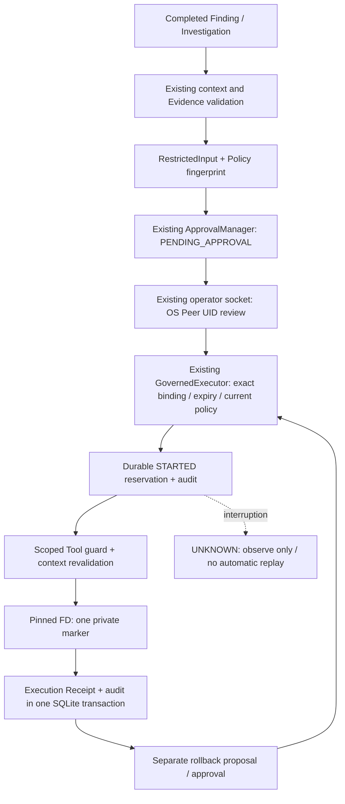

# Linux Response Executor v1 — Restricted Test Resource

## Verdict / baseline

**VERIFIED — WSL2 Ubuntu의 등록된 테스트 Marker 변경·별도 승인 Rollback·Crash Recovery 범위.** 운영 Firewall, 계정, 프로세스, 서비스 또는 임의 파일에 대응하는 Executor는 구현하지 않았다. 물리 Linux 서버 검증은 후속 작업이다.

실행일 2026-10-14. 기준 `main`, HEAD `048163a2cc0dfdf9cbb4017753ebcff4b0c88656`. 기존 사용자 변경 및 미커밋 Reliability Replay는 보존·커밋 제외한다. 새로운 의존성, 운영 DB Migration, 모델 변경, 실제 LLM 요청은 없다.

## Architecture / reuse



기존 `GovernedExecutor`, `ApprovalManager`, `PolicyEngine`, RuntimeStore hash-chain audit, Runtime writer lock, OperatorServer의 Peer UID / challenge / replay protection을 재사용한다.

기존 `RuntimeResponseSimulation._context()`의 완료 조사·Finding·Incident·Source·Window 검증을 재사용한다. 시뮬레이션 활성화 없이 해당 읽기 검증을 호출하며, 시뮬레이션 권한을 새 Executor의 권한으로 간주하지 않는다. 새 FILE_WRITE Tool은 기존 Agent READ registry에 등록하지 않는다. `RestrictedDispatchGuard`는 planning을 허용하지 않으며 durable reservation 이후 발급된 scoped dispatch가 없으면 직접 `Tool.execute()`도 거부한다.

Runtime의 기존 Unix socket을 확장했다. 새 HTTP/API 서버, 별도 Writer, Agent/Sub-Agent 인터페이스는 없다. 실제 운영자 명령은 기존 runtime writer lock 및 serialized endpoint 아래에서 처리된다. 준비 CLI만 Runtime 종료 상태에서 writer lock을 얻고 명시적으로 테스트 리소스를 생성한다.

## Action / approval contract

- 새 계약 버전: `soc-restricted-test-response:v1`.
- Resource ID는 **`test-marker` 하나**다. Tool은 `change_registered_test_marker`, action type은 `TEST_RESOURCE_QUARANTINE` / `TEST_RESOURCE_ROLLBACK`만 허용한다.
- 입력은 Incident/Finding ID, Finding digest, 완료 Runtime investigation-result digest(`investigation_digest` 필드), Evidence digest/references, Resource registration digest, pre-state digest, Policy fingerprint를 포함한다. Rollback은 원래 execution receipt digest를 추가로 요구한다.
- Candidate/input digest는 canonical SHA-256, Action ID는 이 digest의 UUID5다. 동일 입력의 요청은 기존 기록을 반환하며 동일 Action의 완료·예약·불확실 시도는 재실행하지 않는다.
- Policy fingerprint는 Tool metadata, 현재 PolicyResult, policy class identity 및 source implementation digest를 포함한다. REQUIRE_APPROVAL 이외의 결과는 거부한다. 정책 클래스가 변경되거나 동일 결정의 reason/source가 달라져도 검토 당시 binding과 불일치하면 거부한다.
- 기존 ApprovalRequest에 exact action/input/incident/tool/permission/risk와 expiry가 결합된다. 기본 TTL 300초. 새로운 승인 플래그나 actor 문자열에 따른 인증 경로는 없다.
- 검토 및 실행마다 OS가 확인한 socket peer credentials의 현재 runtime UID를 재검증한다. 실행 시 Runtime은 RUNNING이고 stop 요청이 없어야 한다. Source/Evidence/Incident와 Marker를 재검증하며 GovernedExecutor는 dispatch 직전에 승인·정책을 다시 확인한다. Runtime config digest도 binding에 포함한다. Marker FD를 연 뒤 실제 pwrite 직전에도 별도 callback으로 승인·Peer UID·Source·Policy·Resource를 다시 검증한다.
- 운영자 CLI의 `expected_digest`는 현재 immutable record digest와 같아야 한다. 오래된 검토 화면, 거부·만료된 승인, 대상/Incident/Evidence 변경 및 중복 실행을 허용하지 않는다.

## Test resource isolation

전용 경로는 기존 private Runtime Root 아래 **`test-resources/marker`**다. Action 입력으로 절대/상대 파일 경로나 다른 Resource ID를 받을 수 없다. Runtime Root / resource directory는 현재 UID 소유 0700, Marker는 현재 UID 소유 regular file 0600 및 hardlink count 1을 요구한다. 기존 테스트 디렉터리·파일은 자동으로 adopt하지 않는다.

경로의 각 구성요소를 directory FD와 O_NOFOLLOW로 열고 고정한다. 등록한 Runtime Root / resource Root / Marker의 device/inode와 현재 namespace 연결을 재검증한다. Runtime location digest도 고정하여 기존 Root를 rename한 뒤 원래 경로에 symlink로 연결해 resolve 우회를 하는 경우를 거부한다. marker FD는 status/probe에서 O_RDONLY, 실제 변경에서만 O_RDWR다. Symlink, parent redirect, root/resource 교체, hardlink 및 권한 변경을 거부한다.

Marker 초기 내용은 `SOC_TEST_RESOURCE_AVAILABLE\n`, 격리 상태는 `SOC_TEST_RESOURCE_QUARANTINED\n`이다. 실제 `pwrite` / `ftruncate` / `fsync` 후 read-back으로 검증한다. **실제 파일시스템 변경이며 시뮬레이션이 아니다.** Marker 표시를 변경할 뿐 호스트·네트워크·다른 파일을 격리하지 않는다.

상태 digest는 Marker 내용의 SHA-256이다. 별도 registration digest와 runtime checks가 inode/ownership/permission을 묶는다. 같은 내용으로 다시 쓰거나 touch한 모든 과거 행위의 검출을 주장하지 않는다. Runtime UID의 Python 코드와 root는 신뢰 경계이며, 같은 UID/root의 악성 코드에 대한 sandbox나 외부 attestation을 제공하지 않는다.

초기 준비의 파일 생성과 audit commit도 원자적이지 않다. 실패 시 orphan 테스트 디렉터리가 남을 수 있고 재준비는 fail-closed한다. 자동 삭제·재등록·복구는 하지 않는다.

## Receipt / audit / rollback

Receipt는 Action/Approval ID, input digest, before/after digest, 실제 test-filesystem-change 여부, OS-security-configuration-change=false, 승인 decision과 일치하는 Operator UID, OS_PEER_UID assurance 및 UTC 기록 시각을 가진다. Receipt는 Action/Approval record와 연결되며 자체 canonical digest를 제공한다.

완료 Receipt와 `RESTRICTED_RECORD` audit는 **같은 monitor.sqlite transaction**에 저장한다. STARTED reservation은 별도 transaction으로 파일 변경 전에 commit한다. 추가 Operator request/receipt audit가 transport나 저장 실패로 완료되지 않아도 실제 완료 기록은 durable record에서 재조회해야 한다. 실패한 요청을 성공으로 자동 재전송하지 않는다.

Rollback은 원래 TEST_RESOURCE_CHANGED 기록과 receipt digest에 결합된 **별도 Action ID / 별도 Approval ID**다. 현재 state가 원래 receipt의 after-state와 같고 Source/Incident/Evidence/Policy가 여전히 유효해야 한다. 외부 변경, 원본 Receipt 누락, 불확실 원본 또는 중복 Rollback은 거부한다. 원래 실행 승인을 Rollback 승인으로 재사용하지 않는다.

Historical TEST_RESOURCE_CHANGED receipt는 승인된 Rollback 이후에도 변경하지 않는다. 최종 resource 상태는 가장 마지막 완료 receipt로 검증한다. 확인되지 않은 변경은 성공 Receipt를 만들지 않는다.

## Recovery / state semantics

| 상태 | 의미 |
|---|---|
| DISABLED | 등록된 명시적 Test Mode 없음; default deny |
| PENDING_APPROVAL / APPROVED / REJECTED | 기존 Human Approval 단계; 실행 결과 아님 |
| EXPIRED | expiry에 따른 조회 표시; 실행 시에도 manager가 만료를 거부 |
| STARTED | durable attempt reservation; 외부 효과를 확정할 수 없음 |
| TEST_RESOURCE_CHANGED | 실제 Marker 격리 표시와 완료 Receipt 저장 |
| ROLLED_BACK | 별도 승인 후 Marker 복원과 완료 Receipt 저장 |
| UNKNOWN | 중단/저장 실패 후 결과 불확실; 자동 재실행 금지 |
| BLOCKED | 잘못된 요청/검증 실패/불명확 리소스; 실행 거부 |

기존 Response Simulation의 SIMULATED 상태는 그대로 유지한다. 기존 `linux_runtime status`의 `response_execution=DISABLED`, `real_os_handler_calls=0`는 운영 OS 대응/기존 시뮬레이션 범위다. 실제 테스트 파일 변경은 별도 `restricted_cli list`의 record/receipt로 확인하며 OS 변경 0건이라는 문구로 Marker 변경을 숨기지 않는다.

Operator endpoint 시작 시 recovery를 실행한다. STARTED는 실제 Marker를 읽어 UNCHANGED / EXPECTED_AFTER / CONFLICT / UNAVAILABLE observation을 기록한 UNKNOWN으로 전이한다. 관측이 expected-after여도 과거 수행 주체나 완전한 effect/commit을 확정하지 않으므로 성공으로 승격하지 않는다. UNKNOWN이 남은 Resource는 새 Action도 차단한다.

확정된 완료 Receipt 또는 초기 등록 상태와 실제 Marker가 다르면 `RESTRICTED_RECOVERY_CONFLICT`를 기록하고 capability를 BLOCKED로 유지한다. 새로 등록했지만 실행 기록이 없는 리소스도 초기 AVAILABLE을 확인한다. 자동 overwrite/rollback/reset은 없다. UNKNOWN/conflict 해소용 운영자 reconciliation은 v1에서 구현하지 않았으며 테스트 Root를 수동으로 검토해야 한다.

Filesystem effect와 SQLite commit, 여러 Source/Queue DB, Operator transport는 하나의 transaction이 아니다. Exactly-once 외부 효과를 주장하지 않는다. Runtime lifetime single-writer, transaction reservation, immutable input 및 uncertain-attempt 차단을 제공한다.

## WSL validation

최종 추가 보안 보완까지 포함한 Git export에서 기존 Native Collector와 SCRIPTED 조사 경로를 실행했다. 기존 journald 기록을 읽었으며 새로운 로그인 실패나 공격 트래픽을 생성하지 않았다.

| 단계 | 실제 WSL 결과 |
|---|---:|
| 최종 고유 Queue / DONE | 160 / 160 |
| 지원 인증 이벤트 | 1 |
| 지원 밖 기록 | 159 |
| Authentication Window / DONE_SCRIPTED Finding | 1 / 1 |
| 실행 승인 / Rollback 승인 | 각각 별도 1회 |
| 실제 Marker 변경 | 격리 표시 1회 + 복원 1회 |
| 종료·재시작 후 state | TEST_RESOURCE_CHANGED / ROLLED_BACK 두 historical receipt 유지 |
| Cursor | RESUMED_EXACT |
| 세 SQLite integrity_check | 모두 ok |
| 최종 resource health | VALIDATED_TEST_RESOURCE |
| 실제 LLM / OS 보안 설정 변경 | 0 / 0 |

실제 경과시간 **14.609초**, 장시간 Soak가 아니다. 지원 기록은 retained sudo PAM 모듈 실패다. 최종 로그인 실패, 최종 sudo 거부 또는 공격 사실로 승격하지 않는다. Source assurance DECLARED_UNATTESTED를 유지한다. OS Peer UID가 확인된 **진단 테스트 클라이언트**가 승인 요청을 제출했으며 실제 운영자의 수동 검토나 자동 운영 승인으로 표시하지 않는다.

최종 audit digest `d93885381bfc45f310940371cf9d4a82d63b45245f63853e187b9ccb68b7ef67`.
실행/복원 receipt digests: `1bae1c8c2e818d9767f95ac3a1a6d20558de401c5add8799332f69385beb15b4`, `c8cce4a195bb3c400c3fc1ddfce30f96affff5aadd0cd1b069a726606625d02a`.
로컬 진단 `/tmp/soc-restricted-native.py`, `/tmp/soc-restricted-native-location.json`은 커밋하지 않는다. 원문 인증 로그·계정·IP·호스트·API key는 보고서에 포함하지 않는다.

## Security / crash tests

Fixture 입력은 실제 Native 로그로 주장하지 않는다. 파일시스템 및 socket 인증은 실제 WSL Linux 경로다. `test_process.py`는 Runtime 프로세스와 독립 CLI 프로세스로 요청→승인→실행→별도 승인→Rollback→정상 종료를 검증한다.

추가 보안 테스트는 socket facade/subclass 거부, runtime config 변경, partial/denied file write의 UNKNOWN 및 재사용 차단, Runtime location 변경, 열린 FD에서 쓰기 직전 만료, Receipt의 실제 Operator UID, orphan 등록 거부 및 부모 경로 교체·read-only probe를 확인한다. ToolError는 UNKNOWN recovery와 structured operator 오류로 연결하며 성공으로 대체하지 않는다.

보안 검증: default deny, 미인증/unauthorized peer, actor/target/incident wire 위조, 만료·거부·stale snapshot, policy source/result 변경, evidence digest 변경, stop 상태, 직접 Tool 호출, Action replay, 동시 CLI, resource/root symlink/교체/hardlink/권한/내용 변경, Runtime Root clone, Rollback conflict, audit 실패, UNKNOWN 재사용 차단.

| 소유 자식 Crash Point | 복원 결과 / Marker |
|---|---|
| 승인 검증 직후 | APPROVED / AVAILABLE; reservation 이전, 자동 실행 없음 |
| 파일 변경 직전 | UNKNOWN / AVAILABLE |
| 파일 변경 직후 | UNKNOWN / QUARANTINED |
| Receipt 저장 직전 | UNKNOWN / QUARANTINED |
| 완료 Audit 저장 직전 | UNKNOWN / QUARANTINED |
| Rollback 직전 | UNKNOWN / QUARANTINED |
| Rollback 직후 | UNKNOWN / AVAILABLE |
| Rollback Audit 저장 직전 | UNKNOWN / AVAILABLE |
| 추가: 완료 Receipt/Audit commit 직후 | TEST_RESOURCE_CHANGED / QUARANTINED |

**9개 강제 종료**는 Harness가 생성하고 PID/nonce/active-child 및 writer lock 소유권을 검증한 자식에만 수행했다. 복원 후 Source/Window/Provenance 동일성, SQLite integrity, Audit 및 기존 WRITE spy 호출 0을 확인했다. Receipt 저장과 완료 Audit 저장 지점은 같은 transaction이며 별도의 파일-system commit으로 설명하지 않는다.

## Results / defects / reproducibility

실행별로 기록하며 중복 수치를 합산하지 않는다. Live API는 모든 자동 테스트에서 비활성이다.

| 실행 | 결과 |
|---|---|
| 최초 최소 구현 집중 | 24 passed / 29.60초 |
| 초기 확장 검증 | 37 passed, 2 failed / 78.68초; 테스트 import와 unauthorized handshake 방식 수정 |
| 해당 수정 확인 | 5 passed / 6.64초 |
| 확장 집중 | 40 passed / 89.78초 (Crash 9 포함) |
| 기존 Scenario/Runtime/Operator/Simulation/Feedback/Failure/Approval/Execution/Policy/LLM 회귀 | 336 passed / 352.39초 |
| Operational Features / Authentication Crash 회귀 | 196 passed / 34.48초 |
| 초기 독립 export 전체 연결 검증 | 187 passed / 384.03초 |
| 첫 실행 전 등록 state 검증 결함 재현 | 1 failed, 1 passed / 0.70초 |
| startup conflict 표시 재현 보강 | 수정 중 41 passed, 1 failed; ExecutionDeniedError의 health 표시 처리를 보완 |
| startup/completed-conflict 수정 확인 | 2 passed / 2.41초 |
| startup/FD 수정본 독립 export: 신규 42개 + Operator/Simulation/최종 통합 | 91 passed, 0 failed / 196.11초 |
| 추가 보안 보완 독립 export: 신규 60개 + 기존 통합 49개 | 109 passed, 0 failed / 251.37초 |
| **최종 location-binding 포함 신규 테스트 export** | **61 passed, 0 failed / 128.20초 (Crash 9 포함)** |
| Ruff check / format / git diff check | PASS |

발견·수정한 제품 결함: 등록된 리소스에 아직 실행 기록이 없으면 recovery가 early-return하여 외부 Marker 변경을 정상 health로 표시했다. 실패 재현 후 초기 AVAILABLE 및 마지막 완료 Receipt의 digest를 검증하도록 수정했다. 검증 실패의 ExecutionDeniedError는 health BLOCKED로 표시하고 conflict audit를 유지한다. 경로 구성요소 FD pinning과 read-only probe도 최종 소스로 검증했다. Guard·테스트를 삭제하거나 skip/xfail로 바꾸지 않았다.

최종 export는 커밋된 HEAD + 이번 소스/테스트 10개만으로 구성했다. 원래 pyproject/README, 미커밋 Replay 함수·모듈·테스트는 포함하지 않았다. PYTHONPATH/작업 디렉터리를 export에 고정했고 테스트 및 Native 진단에서 해당 소스를 사용했다. 최종 소스/테스트가 export 파일과 byte-for-byte 동일한지 확인했다. 기존 개발 가상환경은 재사용했으며 클린 설치 검증으로 주장하지 않는다.

최종 startup/resource 검증 변경은 Test Mode 활성 리소스 경로에 한정한다. default-disabled 기존 경로 및 Scenario 계약을 변경하지 않았으며 기존 광범위 회귀 결과와 최종 Operator/Simulation 회귀를 구분해 재사용한다.

```bash
RUN_LIVE_LLM_TESTS=0 .venv/bin/python -m pytest --import-mode=importlib -q \
  tests/unit/restricted_response tests/integration/restricted_response tests/integration/live_operator \
  tests/integration/response_simulation \
  tests/integration/linux_runtime/test_final_integration_audit.py
.venv/bin/python -m ruff check src tests
.venv/bin/python -m ruff format --check .
git diff --check
```

## CLI procedure

Runtime 디렉터리는 새 테스트용 private directory여야 한다. 초기 CLI의 `init`를 사용하며 운영 Root/DB에는 적용하지 않는다.

```bash
python -m soc_agent.linux_runtime --directory /tmp/soc-test-response-new init \
  --repeated-failures 5 --multiple-accounts 3 --assessment-mode SCRIPTED
python -m soc_agent.linux_runtime.restricted_cli --directory /tmp/soc-test-response-new \
  prepare --test-mode
python -m soc_agent.linux_runtime --directory /tmp/soc-test-response-new start \
  --operator-uid "$(id -u)"
```

다른 터미널에서 **실제 완료 Finding ID 및 검토한 현재 record digest**를 사용한다. 아래 placeholder를 그대로 실행하지 않는다.

```text
python -m soc_agent.linux_runtime.restricted_cli --directory <TEST_RUNTIME> list
python -m soc_agent.linux_runtime.restricted_cli --directory <TEST_RUNTIME> request <FINDING_ID>
python -m soc_agent.linux_runtime.restricted_cli --directory <TEST_RUNTIME> approve <CANDIDATE_ID> --expected-digest <PENDING_RECORD_DIGEST>
python -m soc_agent.linux_runtime.restricted_cli --directory <TEST_RUNTIME> execute <CANDIDATE_ID> --expected-digest <APPROVED_RECORD_DIGEST>
python -m soc_agent.linux_runtime.restricted_cli --directory <TEST_RUNTIME> rollback-request <FINDING_ID> <ORIGINAL_CANDIDATE_ID>
# Rollback은 반환된 새 Candidate ID / 새 digest로 별도 approve, execute한다.
```

`reject`도 같은 candidate/digest를 요구한다. Runtime 종료 상태에서 prepare 외의 명령은 DB를 직접 수정하지 않으며 socket 부재를 임의 승인으로 대체하지 않는다. 동일 Runtime에서 Marker 하나를 여러 테스트 리소스로 일반화하지 않는다.

## Changed files / remaining risks

소스 5개:

- `src/soc_agent/linux_runtime/restricted_models.py` — 새 계약.
- `src/soc_agent/linux_runtime/restricted_resource.py` — FD 기반 한정 파일 I/O.
- `src/soc_agent/linux_runtime/restricted_response.py` — 기존 governance 연결, audit ledger, rollback/recovery.
- `src/soc_agent/linux_runtime/restricted_cli.py` — 명시적 offline 준비 및 authenticated client.
- `src/soc_agent/linux_runtime/operator.py` — 기존 socket namespace/dispatch/startup recovery 확장.

테스트 5개: `tests/integration/restricted_response/test_executor.py`, `test_crash.py`, `test_process.py`, `test_v1_security.py`, `tests/unit/restricted_response/test_resource_v1.py`. 문서 1개: 본 보고서. **이번 커밋 대상은 11개만**이다. 기존 사용자/Replay 변경, 모델/DB/로그/임시 export 및 테스트 데이터는 제외한다. 기존 903개 파일 중 operator.py 이외의 내용은 보존하고, 보호된 `tests/fusion_support.py` SHA `e5f9d10f706f71b82e80261f7633a1504e27ba24499be948d04adb6eeb3a21c9`를 유지한다.

잔여 제약:

- UNKNOWN/conflict 수동 reconciliation, 승인 취소·재검토를 포함한 운영 절차는 후속 작업이다. v1은 불확실 리소스를 자동 복원하거나 재등록하지 않는다.
- 같은 UID/root의 악성 코드, filesystem/kernel 손상, 전원 손실 durability, 모든 inode 재사용 및 동일 내용 rewrite 이력은 이번 검증으로 방어·입증하지 않는다. hash chain은 외부 서명이 아니다.
- synchronous filesystem/SQLite 접근은 storage stall 동안 operator timeout보다 길어질 수 있다. 즉시 OS I/O cancellation이나 exactly-once 효과는 제공하지 않는다.
- 실제 WSL 인증 기록 1건을 탐지 정확도 또는 운영 공격 대응의 증거로 사용하지 않는다. 이번 실제 API 요청은 0건이다.
- Synthetic v2 / Operational Provenance v3 / 기존 Decision·Approval 계약은 유지한다. Network/DNS Producer parity는 미확보로 NOT_INFERABLE, Agent READ scope는 WRITE_DENIED다.
- 실제 Firewall·계정·프로세스 대응, systemd 배포, 물리 Linux/Windows/AWS 및 조직 운영자 신원·권한 체계 검증은 이번 단계 밖이다. 실제 운영 대응은 별도 제한 Adapter·권한·승인·Rollback·실환경 검증이 필요하다.
