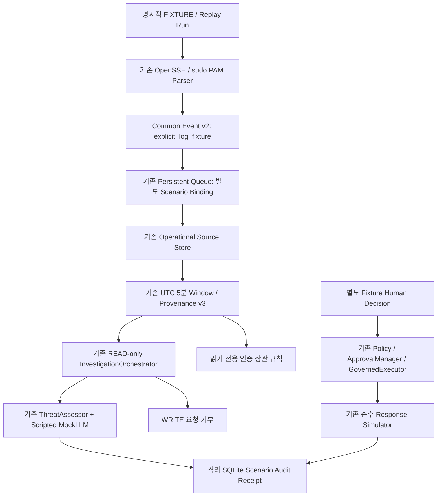

# Linux Scenario Demo Mode — WSL2 Ubuntu

검증일: 2026-10-14. main HEAD `873835360b0b3c5e27c01b2bd7776da3ff82fdc9`.
지원/실행 범위는 **WSL2 Ubuntu**다. Windows 및 AWS는 현재 완료 조건에 포함하지 않는다.

판정: **WSL2 검증 범위 내 VERIFIED**. S01~S12 Fixture 시연 및 S09 만료 경계를 검증했다.
실제 gpt-5-mini S03 Investigation/Assessment와 실제 WSL 인증 로그 기반 READ 조사는 별도 검증했다.
Native 로그 + REAL_LLM을 하나의 실행으로 결합한 검증과 실제 OS 대응은 미실행이다.

## 1. 실행 구조와 재사용



Queue, AuthenticationPipeline, Source Store, 5분 집계, Provenance v3,
`authentication_read_registry`, `investigate_authentication`, `ThreatAssessor`,
`PolicyEngine`, `ApprovalManager`, `GovernedExecutor`, `simulate_disable`,
`exclusive_runtime_lock`, 테스트 전용 Crash Harness를 재사용한다.
기존 Collector의 poll이나 journald는 Scenario 실행 시 호출하지 않는다.
GUI/API/기존 Demo CLI를 재작성하지 않고 `soc_agent.demo.scenario` 진입점만 추가했다.

## 2. 입력·대응 계약

- 입력 모드: `LIVE_LINUX`와 `SCENARIO`. `run`/`run-all` 명령 자체가 명시적인 Scenario Opt-in이다.
- `run --input-mode LIVE_LINUX`는 오류 종료한다. Native 수집은 명시적인 `run-live` 진입점에서만 실행하며 Fixture를 실제 수집 결과로 바꾸지 않는다.
- 대응 모드: 기본 `DISABLED`; 별도 `--response-mode RESPONSE_SIMULATION`으로만 허용.
- Scenario ID/version, FIXTURE origin, fixture identity SHA, replay run UUID 및 기대 탐지/조사/정책/승인/실행 결과를 명시한다.
- 항상 새로운 private 임시 디렉터리/SQLite 파일을 생성한다. 운영 DB나 사용자의 기존 DB를 채택하는 API가 없다.
- 임시 증거는 삭제하지 않고 CLI `audit_path`에 위치를 출력한다. 재실행하면 별도 저장소가 생기므로 시연 반복 시 디스크 사용을 확인한다.

Native `soc-common-event:v1`의 출처를 재해석하지 않는다.
Scenario 로그 projection에만 `soc-common-event:v2`, `validated_fixture`,
`explicit_log_fixture`, `scenario-auth-pam:v1`, `scenario:` Source namespace를 함께 요구한다.
원본 Fixture journal 문자열은 기존 parser로 해석하지만 저장된 Event는 명시적인 Fixture다.
Replay run을 Source generation에 포함하고 원본 event ID, raw record digest, Incident binding을 유지한다.
Native binding의 Queue에는 Scenario binding을 채택할 수 없다.
구버전 reader는 새 v2/출처 enum을 이해하지 못하므로 거부한다. DB schema migration은 추가하지 않았다.

Source/Provenance에는 Scenario Source identity가 계속 보존된다.
기존 `soc-operational-provenance:v3` 및 합성 전용 Security AI v2 계약은 변경하지 않았다.
출처 연결은 DECLARED_UNATTESTED이며 NOT_INFERABLE, WRITE_DENIED를 유지한다.
Common Event v2는 External Model Context v2와 다른 계약이다.

## 3. 탐지와 Assessment

`security_ai/operational/authentication_detection.py::detect`는 기존 저장소 무결성 조회 후
ACCEPTED 인증 이벤트만 읽는다. 별도의 모델이나 가짜 학습 추론을 만들지 않았다.
규칙은 상태·심각도·권한을 변경하지 않는 advisory signal을 반환한다.
모듈은 동일한 검증 파이프라인에서 재사용할 수 있지만 **이번 규칙 검증은 Fixture만 사용했다**.
실제 Linux 공격 탐지 효능이나 운영 임계값은 검증되지 않았다.

- 반복 실패: 같은 source와 UTC 5분 bucket에서 실패 5개 이상.
- 다중 계정: 같은 source/5분 bucket에서 서로 다른 attempted account 실패 3개 이상.
- 실패 후 성공: 같은 source/account/5분 bucket에서 엄밀히 더 늦은 성공 시각이 있어야 한다.
- sudo: 기존 parser가 지원하는 `pam_unix(sudo:auth)` module failure만 별도 signal로 표시한다.
- PAM module failure를 최종 로그인/전체 sudo 명령 실패로 합산하지 않는다.
- 지연 격리 이벤트는 탐지 집계에서 제외한다. 동일 Timestamp로 선후관계를 만들어내지 않는다.

5/3은 `DetectionConfig`의 **EXAMPLE_UNVALIDATED 설정값**이다. 운영 기본값이라는 주장은 하지 않는다.
다른 값을 지정하면 기대 결과와의 불일치를 FAIL로 표시한다.

Investigation은 기존 실제 Governed READ Tool을 실행한다. LLM 계획 생성은 하지 않는다.
기본 SCRIPTED 모드의 ThreatAssessor는 기존 validator/prompt/AssessmentResult 경로를 실행하되,
`MockLLMClient`의 Scripted advisory를 사용한다. 결과는 info/confidence 0,
공격 확정 없음, 실제 LLM 호출 없음이며 기존 Evidence ID를 참조한다.
탐지 signal을 관측 사실 또는 자동 Risk Score로 승격하지 않는다.
SOCRuntime의 전체 Decision/Response lifecycle, 운영 Human authentication 및 UI 승인은 이번 새 Runner에 연결하지 않았다.
REAL_LLM에서는 기존 InvestigationPlanner를 호출하며 결과와 검증 수준은 아래 후속 실행에 기록했다.

## 4. 시나리오 및 실제 CLI 결과

아래는 WSL2 Ubuntu에서 `run-all --response-mode RESPONSE_SIMULATION`을 실제 실행한 결과다.
입력은 전부 코드로 고정한 Fixture이며 실제 인증 시도를 생성하지 않았다.

| ID | 입력/기대 동작 | 실제 결과 | Simulator 호출 |
|---|---|---|---|
| S01 | OpenSSH Accepted 정상 인증 | PASS, NO_SIGNAL | 0 |
| S02 | 단일 sudo PAM module 실패 | PASS, SUDO_PAM_MODULE_FAILURE | 0 |
| S03 | 동일 출처 인증 실패 5개 | PASS, REPEATED_AUTH_FAILURE | 0 |
| S04 | 동일 출처 3개 attempted account 실패 | PASS, MULTI_ACCOUNT_FAILURE | 0 |
| S05 | 동일 계정 실패 후 성공 | PASS, FAILURE_THEN_SUCCESS | 0 |
| S06 | sudo 실패의 제한된 의미 | PASS, SUDO_PAM_MODULE_FAILURE | 0 |
| S07 | 승인 전 거부→Fixture 승인→순수 시뮬레이션 | PASS, APPROVED_SIMULATION_ONLY / SIMULATED | 1 |
| S08 | Fixture 승인 거부 | PASS, REJECTED / DENIED | 0 |
| S09 | 승인 만료 | PASS, EXPIRED / DENIED, 만료 Snapshot 복원 후에도 거부 | 0 |
| S10 | 승인된 action의 account 입력 변경 | PASS, BINDING_MISMATCH_DENIED | 0 |
| S11 | Claim 후 SQLite reopen/recover 및 중복 Replay | PASS, 중복 2개 제거, 고유 이벤트 2개 | 0 |
| S12 | Network/DNS declared source→v3 검증 | PASS, 양쪽 NOT_INFERABLE | 0 |

S02와 S06은 동일한 지원 PAM 실패 형식을 서로 다른 시연 ID로 사용한다.
새 PAM 성공/최종 로그인 parser를 추가했다고 주장하지 않는다.
Source 기반 SSH/PAM Fixture 형식의 근거는 기존
`operational/native_authentication.py`의 OpenSSH V_8_9_P1 auth_log 및 reviewed PAM profile,
`tests/unit/operational_features/test_{native,pam}_authentication.py`에 있다.

기본 대응 모드에서는 S07/S08/S09/S10은 전체 SKIPPED다.
다른 Scenario의 approval/response stage도 NOT_REQUESTED/DISABLED를 SKIPPED로 표시한다.
CLI exit 0은 선택한 모드의 진단 실행 종료 의미이며 미실행 단계의 완료 판정이 아니다. FAIL/BLOCKED 결과는 exit 1이다.

## 5. Approval과 Response Simulation의 경계

READ-only 조사 registry는 WRITE ActionProposal을 실제 Guard에서 거부한다.
조사 결과나 Provenance가 승인·대응 권한을 발급하지 않는다.
대응 시뮬레이션은 분리된 fixture registry의 `disable_demo_account` 하나만 사용한다.
허용 입력은 기존 `demo-alice`/`demo-bob` Literal이며 handler는 기존 순수 `simulate_disable`이다.
Firewall/계정/프로세스/파일에 접근하는 OS handler는 등록하지 않는다.

기존 PolicyEngine의 REQUIRE_APPROVAL, ApprovalManager의 exact action/input binding,
GovernedExecutor의 승인 전 거부·거부 승인 차단·중복 action 시도 차단을 실제 호출한다.
S07은 변경된 destructive metadata registry로 같은 승인 요청을 재검증하고 정책 DENY를 확인한다.
승인은 명시적 Fixture human attribution이며 실제 사람 인증을 수행한 것이 아니다.
ApprovalManager는 in-memory이며 이번에 선택적 expires_at과 신뢰된 Clock을 추가했다.
S09는 기존 GovernedExecutor의 실제 실행 거부를 검증하고 예상 문자열만 반환하지 않는다.
만료가 없는 Legacy 승인은 기존 직렬화 의미를 유지한다. 만료 필드는 None일 때 출력하지 않는다.
중복 action 보호도 한 Executor 내 보호이며 프로세스 간 durable 승인 replay 보호를 증명하지 않는다.

Simulator 예외 주입 시 FAIL로 표시하고 감사 receipt에 고정 오류 분류만 저장한다.
불명확한 simulator 호출 횟수는 null/UNKNOWN이며 0으로 위장하지 않는다.
모든 실제 시연에서 real OS handler는 0개다. 실제 계정/Firewall/로그/보안 설정 변경 없음.

## 6. Audit와 재시작

별도 시연 Queue SQLite에 `scenario_audit` companion table을 생성한다.
STARTED 및 최종 receipt를 previous digest로 연결하고 Scenario/Run/Incident/Fixture origin,
Evidence/Provenance/Assessment/Investigation state digest와 단계 결과를 저장한다.
민감한 인증 원문·자격 증명은 감사 receipt에 넣지 않는다.
기존 SOC audit hash chain을 수정하거나 새로운 의미로 재작성하지 않는다.

Receipt를 reopen하여 chain/Incident/digest를 검증한다. 감사 저장·검증 실패는 성공으로 반환하지 않는다.
Hash chain은 로컬 변경/손상 탐지이며 재해싱 가능한 공격자의 진위 증명이나 외부 서명은 아니다.
Source/Queue와 receipt는 별도 transaction이며 전체 원자적 publication이라고 주장하지 않는다.
중단되면 STARTED만 남을 수 있고 이것은 완료 receipt가 아니다.

S11은 동일 프로세스 내 저장소 객체 reopen/recover를 검증한다.
별도의 5개 Crash 테스트는 기존 owned-child Harness로 실제 테스트 자식 프로세스를 강제 종료했다.
PID/nonce/lock 소유 검증 후에만 종료하며 OS 서비스나 다른 프로세스는 종료하지 않는다.

## 7. 이번 검증 명령과 결과

```bash
RUN_LIVE_LLM_TESTS=0 .venv/bin/python -m pytest -q tests/integration/scenario
# 33 passed, 0 failed, 74.31초. /tmp/soc-scenario-tests-final.log

RUN_LIVE_LLM_TESTS=0 .venv/bin/python -m pytest -q \
  tests/unit/operational_features/test_native_authentication.py \
  tests/unit/operational_features/test_pam_authentication.py \
  tests/unit/operational_features/test_authentication_investigation.py \
  tests/unit/operational_features/test_operational_provenance.py \
  tests/unit/realtime tests/unit/approval tests/unit/policy tests/unit/execution \
  tests/unit/assessment tests/integration/external_read_only_backend/test_guard.py
# 348 passed, 0 failed, 41.17초. /tmp/soc-scenario-security-final.log

.venv/bin/python -m ruff check src tests
.venv/bin/python -m ruff format --check .
git diff --check
# Ruff PASS, Format 753 files PASS, Diff PASS
```

신규 테스트: 12개 Scenario 반복 실행/결정성, 별도 DB, Fixture 출처 위조 거부,
Native binding 혼입 거부, threshold 불일치, 중복 replay, audit 변조/실패,
simulator 부분 실패/민감 오류 누출 방지, CLI/LIVE 거부,
동일 시각·역순·지연 이벤트, 5개 실제 owned-child Crash 복구.
CP-02/04/05/08/10 모두 PASS: 유실 0, 중복 집계 효과 0, 무결성/READ-only 보호 유지.
Scripted/simulation/SQLite/실제 자식 프로세스 검증이며 실제 Native 인증 수집이나 모델 추론은 아니다.

개발 중 SourceStore 필수 인자 누락 및 demo audit table 중복 초기화를 발견·수정했다.
초기 신규 26 passed/1 failed, 초기 합동 494 passed/18 failed는 최종 PASS 증거로 사용하지 않는다.
수정 후 위 신규 33개 및 관련 보안 348개가 통과했다. 실행 건수는 중복 범위가 있어 합산하지 않는다.
전체 회귀·장시간 Soak는 재실행하지 않았다.

최종 CLI 로그: `/tmp/soc-scenario-cli-final.json`, stderr 비어 있음.
각 결과의 `audit_path`는 보존된 격리 SQLite 증거를 가리킨다.

## 8. 변경 파일과 호환성

신규:
- `src/soc_agent/demo/scenario.py`
- `src/soc_agent/demo/scenario_models.py`
- `src/soc_agent/demo/scenario_pipeline.py`
- `src/soc_agent/demo/scenario_response.py`
- `src/soc_agent/security_ai/operational/authentication_detection.py`
- `tests/integration/scenario/test_linux_scenario.py`
- 이 문서

최소 수정:
- `src/soc_agent/realtime/models.py`: 명시적 fixture-log v2/출처 조합.
- `src/soc_agent/security_ai/operational/native_authentication.py`: 별도 Scenario projection을 기존 변환으로 수용.
- `src/soc_agent/security_ai/operational/authentication_pipeline.py`: 별도 Scenario binding만 허용.

기존 사용자 README.md/docs/soc-command-center.md/pyproject.toml 수정 및 미추적 파일 보존.
External Model v2, Provenance v3, 보호 tests/fusion_support.py SHA 불변 확인.
기존 Windows 전용 코드 변경/신규 Windows 테스트 개발 없음.
Commit/Stage/Push/권한 상승/운영 DB Migration 없음.

## 9. 실행 방법

```bash
cd ~/kdt-linux/autonomous-soc-agent
.venv/bin/python -m soc_agent.demo.scenario list
.venv/bin/python -m soc_agent.demo.scenario run S03
.venv/bin/python -m soc_agent.demo.scenario run S07 --response-mode RESPONSE_SIMULATION
.venv/bin/python -m soc_agent.demo.scenario run-all --response-mode RESPONSE_SIMULATION
```

CLI에는 Input Origin, Queue/Evidence/Detection/Investigation/Assessment/Policy/Approval/
Response/Audit/Overall stage가 표시된다. 별도 라이브 인증 수집을 실행한 것처럼 보이지 않는다.
모델 Producer parity가 BLOCKED인 Network/DNS에는 실제 추론을 실행하지 않는다.

## 10. 미구현·후속 계획

현재 제약: 운영 사람 인증, 전체 SOCRuntime/Decision publication 연결,
UI Scenario 선택/실시간 갱신, 프로세스 간 durable simulation approval lifecycle,
실제 탐지 임계값 효능, 신규 경로 장시간 Soak 및 별도 Linux 호스트 검증.
Python 객체/registry는 신뢰된 process 내 구성 경계이며 악성 Python 코드를 실행하는 sandbox가 아니다.

AWS EC2/독립 Ubuntu Server는 **계획만** 기록한다:
Ubuntu/Python 재현, systemd 실행, 최소 journald 권한, 실제 SSH 이벤트,
서버 재시작/Crash Recovery, 장시간 Soak, 디스크·메모리·Queue 부하,
네트워크 단절/복구 검증. 실제 Firewall 대응/승인된 executor/Rollback은 별도 권한·격리 테스트가 필요하다.
Windows Native/Event Log/Response Adapter/서비스 설치는 후속 로드맵이며 이번 완료 조건이 아니다.
실제 OS 대응이나 클라우드 배포는 수행하지 않았다.


## 11. Scenario Completion & Real LLM — 후속 실행 결과

2026-10-14, 같은 HEAD `873835360b0b3c5e27c01b2bd7776da3ff82fdc9`에서 기존 미커밋 작업을 보존하고 직접 재검증했다.
위 33/348 수치는 1차 이력이며 이번 실행 수치와 합산하지 않는다.

### 승인 만료 계약

`approval/models.py::ApprovalRequest.expires_at`은 선택적 UTC 시각이다.
`ApprovalManager`에 신뢰된 Clock/`require_current`/신뢰된 Snapshot 복원 API를 추가하고
`GovernedExecutor.preflight`에서 exact binding/현재 정책과 함께 만료를 검증한다.
`now >= expires_at`은 DENY다. 승인 기록은 삭제하지 않고 `get`으로 조회 가능하다.
만료된 pending request의 approve/reject도 거부하며 결정 시각이 만료 시각 이후인 Snapshot은 거부한다.
Legacy non-expiring JSON에는 새 필드를 출력하지 않아 기존 payload 의미를 보존했다.
Clock이나 승인 복원 API를 JSON/LLM/공개 CLI의 승인 발급 경로로 노출하지 않는다.

S09의 Fake Clock은 만료 1 microsecond 전 preflight 유효성, 만료 정확 시점/이후 실행 거부,
serialized typed approval을 새 Manager에 복원한 후 거부를 확인한다. Simulator 호출은 0이다.
추가 테스트는 유효한 승인으로 실제 순수 simulator 실행, 만료 승인 재사용 거부,
Legacy JSON 필드 유지 및 만료 pending 승인 거부를 검증했다.
Snapshot 재수화는 실제 타입/API 검증이며 별도 프로세스의 Human Approval DB 재시작 검증으로 표현하지 않는다.
실제 자식 프로세스 Crash 5개는 Authentication Queue/Source/Window 경로의 검증이다.

### 실제 LLM 실행

사용자 지정 Base URL `https://api.openai.com/v1`, Model `gpt-5-mini`.
프로젝트 상대 `.env`에는 Key가 있으나 URL/model은 없어서 명시적 환경 변수로 제공했다.
Secret 값과 .env 내용은 로그/보고서/Git에 출력하거나 복사하지 않았다.

```bash
SOC_LLM_BASE_URL=https://api.openai.com/v1 SOC_LLM_MODEL=gpt-5-mini \
  .venv/bin/python -m soc_agent.demo.scenario run S03 \
  --assessment-mode REAL_LLM --env-file .env
```

**실제 LLM S03: PASS, 요청/응답 2회**, 입력 FIXTURE, 대응 DISABLED.
`OpenAICompatibleClient` → 실제 InvestigationPlanner → allowlisted READ Tool →
기존 InvestigationOrchestrator → 실제 ThreatAssessor → Evidence ID 검증을 실행했다.
READ-only WRITE 거부, NOT_INFERABLE, SQLite reopen, 감사 receipt도 PASS다.
요청/응답은 원문 대신 digest/상태를 receipt에 저장했다. API Key는 저장하지 않았다.
로그 `/tmp/soc-real-llm-s03-unrestricted.json`, 감사 DB `/tmp/soc-scenario-fbffrji8/queue.sqlite`.
모델 결과는 advisory이며 확정 공격이나 대응 승인으로 사용하지 않았다.
실제 모델 호출은 위 Opt-in 실행만 수행했고 REAL_LLM 부재 시 Scripted로 대체하지 않는다.
LLM/Planning/Assessment 검증 실패는 BLOCKED이며 대응 simulator도 시작하지 않는다.

제한 네트워크의 첫 시도는 LLMTimeoutError/BLOCKED였고, 승인된 네트워크 환경에서 재실행하여 성공했다.
첫 시도 로그 `/tmp/soc-real-llm-s03.json`은 성공 증거로 사용하지 않는다.
기존 urllib/asyncio.to_thread transport가 제한 네트워크에서 timeout 이후 thread 정리를 지연시키며
300초 executor shutdown 경고를 남긴 것을 확인했다. 도메인 결과는 BLOCKED이고 WRITE는 허용되지 않는다.
이 전송 계층의 shutdown 지연은 남은 운영 위험이다. 임의 retry나 Secret 노출로 우회하지 않았다.

### LIVE_LINUX 실제 WSL 조회

```bash
.venv/bin/python -m soc_agent.demo.scenario run-live --batches 8
```

기본 SCRIPTED/대응 DISABLED. batch당 최대 16개, 최대 8 batch로 bounded 조회한다.
기존 Collector/Cursor/Queue를 사용하며 Source/Incident/출처를 Native로 기록한다.
Fixture Runner와 별도 private 저장소를 사용하고 운영 로그·권한·설정을 변경하지 않는다.

초기 16개 조회는 지원 인증 이벤트 0개로 E2E BLOCKED였다.
최종 실제 조회는 **journal 128개 / Queue 128개 / 검증 인증 이벤트 1개 / unsupported 127개**다.
지원 PAM module failure의 원본→Queue→Source→5분 Window→Provenance v3→
실제 READ-only Investigation→Scripted Assessment 및 실제 WRITE 요청 거부: **PASS**.
전체 로그인 실패나 sudo 명령 최종 실패라고 해석하지 않는다.
원본의 사용자/주소/호스트/Cursor 값은 보고서에 노출하지 않았다.
최종 로그 `/tmp/soc-completion-live-final.json`, stderr 비어 있음.
실제 WSL 이벤트에 REAL_LLM을 추가로 호출한 조합은 미실행이며 위 Fixture+REAL_LLM과 합치지 않는다.

### 이번 테스트 및 최종 품질

```bash
RUN_LIVE_LLM_TESTS=0 .venv/bin/python -m pytest -q \
  tests/integration/scenario \
  tests/unit/approval tests/unit/execution tests/unit/planning tests/unit/assessment \
  tests/unit/operational_features/test_authentication_investigation.py \
  tests/integration/external_read_only_backend/test_guard.py
```

최종 **332 passed, 0 failed, 54.90초**, `/tmp/soc-completion-tests-final.log`.
S01~S12 직접 CLI 재실행은 **12 PASS**, `/tmp/soc-completion-all.json`.
새 완료 테스트는 Fake Clock 만료/복원, 실제 Planner/Registry를 통한 WRITE prompt injection 차단,
알 수 없는 Evidence ID 거부, Timeout/BLOCKED, 설정 부재 시 fallback 금지,
BLOCKED 이후 simulator 미실행, LIVE 경계(이 테스트만 OS record stub)를 검증한다.
Guard/Planner/Assessor를 Mock으로 대체하지 않았다. 적대적 LLM/Timeout 응답 자체는 Mock Fixture다.
실제 공급자에 Prompt Injection/Timeout 실패를 별도로 유발한 검증은 하지 않았다.
Ruff src/tests PASS, 전체 Format 756 files PASS, git diff --check PASS.
전체 회귀는 실행하지 않았다. 선택적 만료 필드는 신규 행동 계약이며 전체 회귀/구버전 Reader
및 모든 durable deployment 경로의 expiry 호환성은 후속 검증 대상으로 남긴다.

### 후속 변경 파일

신규:
- `src/soc_agent/demo/scenario_analysis.py`: 실제 Client/Planner/Assessor Opt-in 및 sanitized exchange receipt.
- `src/soc_agent/demo/scenario_live.py`: 실제 bounded journald probe/READ-only 경계.
- `tests/integration/scenario/test_completion.py`: 만료 및 LLM/Live 경계 테스트.

이번 수정:
- `src/soc_agent/approval/models.py`, `manager.py`, `errors.py`
- `src/soc_agent/execution/executor.py`
- 기존 미커밋 `src/soc_agent/demo/scenario.py`, `scenario_models.py`, `scenario_response.py`
- 기존 미커밋 `tests/integration/scenario/test_linux_scenario.py`
- 이 문서

이전 사용자 README/docs/pyproject 변경 및 미추적 자료를 보존했다.
Synthetic v2, Operational Provenance v3, 보호 tests/fusion_support.py SHA 불변 확인.
Network/DNS 운영 모델은 NOT_INFERABLE을 유지하며 실제 추론하지 않았다.
OS Firewall/계정/프로세스/로그 변경, 권한 상승, Commit/Stage/Push 없음.
Windows/AWS는 후속 로드맵이며 이번 완료 조건에 포함하지 않는다.
