# Security AI Auto-Connection & One-Click Fixture Demo

검증 환경: WSL2 Ubuntu / WSLg. 기준 HEAD:
`9cd1de1266eb148dde8035ae4a999ee91c486cf1`.

## 문제 원인

기존 기본 GUI는 `--native-python` / `--artifacts`가 없으면 SOC `.venv`에서만
조회했다. SOC 환경에는 LightGBM, PyTorch, LiteRT가 없고 Artifact 경로도 미설정이었다.
실제 Native 추론에 성공했던 환경은 `/tmp/soc-native-validation-6uxdtrx9`에 남아 있었다.
GUI 기본 실행은 그 환경과 연결되지 않았다. 이전 검증 이력이 현재 환경을 설정하지는 않는다.
모델 자체의 실패를 Mock 성공으로 바꾼 문제가 아니다.

기준 HEAD의 별도 Git Export에서 기본 설정 GUI를 실행해 Before 화면과
Backend UNAVAILABLE / Native UNKNOWN을 재현했다. 원래 Before 이미지는 보존했다.

## 지속 가능한 로컬 환경

- 프로젝트의 고정된 `.security-ai-demo/`만 자동 탐색한다. `.gitignore`로 제외한다.
- 기존 격리 환경 약 61MB와 공식 Artifact 약 47MB를 로컬에 보존했다. 추가 설치·다운로드 0.
- SOC `.venv`, ML `.venv`, 원본 모델·Scaler는 수정하지 않았다.
- Python은 현재 SOC와 동일한 CPython 3.12.14 실행 파일로 해석되어야 한다.
- private root(0700), 소유권, 경로의 symlink, 파일 SHA-256, Python 별칭,
  허용된 ML/SOC `.pth` 경로, 공유 시작 코드 및 배포 METADATA/RECORD를 검사한다.
- Artifact 10개는 기존 공식 Catalog/Binding/SHA 검증을 계속 통과해야 한다.
- 환경 변수의 임의 Python 경로를 자동 채택하지 않는다. receipt가 실행 경로를 선택하지 않는다.
- 환경 점검은 READ-only이며 자동 설치, 자동 복구, 자동 모델 추론을 하지 않는다.

현재 환경은 기존 ML/SOC site-packages를 **읽기 전용으로 공유**한다. 독립 배포용 환경이나
클린 설치 재현성을 의미하지 않는다. 공유 환경이 변경·삭제되면 점검을 다시 통과해야 한다.
receipt는 로컬 무결성 기록이며 서명, sandbox 또는 같은 UID의 악의적 변경에 대한
보안 경계가 아니다. Python bytecode cache는 변경 가능한 캐시로 hash 목록에서 제외한다.

기존의 명시적 `--native-python` / `--artifacts`는 trusted composition 설정으로 유지한다.
GUI에 임의 Python/Artifact 경로를 입력하는 기능은 추가하지 않았다.

명시적 관리 작업에 한해 다음 오프라인 준비 도구를 제공한다. GUI 실행 때 호출하지 않는다.
이미 존재하는 목적지는 덮어쓰지 않으며 실패 후 불완전한 목적지를 자동 승인하지 않는다.

```bash
.venv/bin/python -m soc_agent.gui.environment --prepare-from /explicit/reviewed/previous-environment
```

이 도구는 검증된 로컬 복사본 보존용이며 패키지 설치 플랫폼이 아니다.
다른 컴퓨터에는 해당 경로의 기존 환경이 없으므로 별도 준비·검증이 필요하다.

## 실행 방법 및 상태

```bash
.venv/bin/python -m soc_agent.gui
```

1. 비동기 환경 점검이 자동 실행된다. 상단 `AI: READY`는 사전 점검 통과다.
2. **Security AI Models → Run native Fixture demo → 확인**을 선택한다.
3. 실제 Quality / Edge / DNS Native 모델이 실행된다. UI는 진행 표시와 함께 응답을 유지한다.
4. 카드·모델 출력·시간 그래프·Advisory Context가 자동 갱신된다. 별도 Refresh는 불필요하다.
5. 오류 시 원인과 환경 재점검/재시도 안내를 표시한다. 중복 실행은 거부한다.

| 상태 | 의미 |
|---|---|
| READY | 패키지/계약/Artifact/Backend metadata 사전 점검 통과. 추론 성공과 구분 |
| SETUP_REQUIRED | 프로젝트 전용 환경 또는 필요한 설정 없음 |
| ARTIFACT_MISSING | Artifact 부재 또는 공식 Artifact 검증 미완료 |
| BACKEND_UNAVAILABLE | Native 조회 실패 또는 Backend 의존성 미확인 |
| VALIDATION_FAILED | 환경 파일/시작 코드/계약 무결성 점검 실패 |
| UNKNOWN | 확인할 근거 부족 |

Runtime OFFLINE/NOT_READY와 AI READY를 별도로 표시한다. 환경 점검만으로 Native를
VERIFIED로 표시하지 않는다. 실제 실행한 Native 결과와 과거 검증 이력을 구분한다.
실패 시 기존 차트·성공 카드가 새 성공으로 남지 않도록 무효화한다.

## 기존 파이프라인 재사용

```mermaid
flowchart LR
    GUI[GUI: explicit Fixture opt-in] --> Env[Fixed local environment validation]
    Env --> Probe[Existing synthetic Feature fixture]
    Probe --> Native[Official Quality / Edge / DNS predictors]
    Native --> Adapter[Existing External Adapter / source binding]
    Adapter --> Context[Persisted Advisory Context]
    Context --> Runtime[Existing SOCRuntime / READ tool / SCRIPTED assessment]
    Runtime --> Restore[Checkpoint restore verification]
    Restore --> View[Actual output / measured latency / context reference]
```



모델 Feature, Artifact, Synthetic v2, Operational Provenance v3는 변경하지 않았다.
LLM provider 호출은 0이다. 기존 Runtime Guard, Evidence/Incident 검증, Checkpoint 복원을 통과한다.
3모델이지만 Quality/Edge는 같은 Network 관측을 공유하므로 관측 그룹은 2개다.
모델 점수를 평균하거나 합치지 않고, 각 모델의 uncalibrated 출력으로 표시한다.

그래프는 공식 Prediction의 `inference_latency_ms`를 사용한다. 누락·비유한·잘못된 값은
UNKNOWN이며 0으로 보완하지 않는다. 전체 시간은 monotonic clock으로 별도 측정하며,
transport·Artifact 검증·Context·SCRIPTED Runtime을 포함한다. 모델 단독 시간과 구분한다.

## 실제 Native 결과

합성 Feature는 공식 40열/9열에 각 값 1.0인 기존 검증 Fixture다.
실제 PCAP/FQDN에서 추출한 Feature가 아니다. DNS의 MALICIOUS 라벨을 실제 공격의
증거로 해석하지 않는다. 아래 시간은 이번 WSLg 실행의 실측값이며 성능 보장을 의미하지 않는다.

| 모델 | 실제 모델 출력 | 첫 실행 (ms) | GUI 재실행 (ms) |
|---|---|---:|---:|
| Quality / v4-b2 | Benign, confidence 0.9109205524702049 | 410.820 | 528.586 |
| Edge / v4-fp32-epoch13 | Benign, confidence 0.6496654748916626 | 1654.643 | 1554.253 |
| DNS / int8-sha256-28e089af363d | MALICIOUS, uncalibrated probability 0.55859375 | 18.810 | 21.352 |

전체 실행은 첫 회 **13.491초**, 재실행 **13.823초**다. 두 회 모두 실제 3모델,
Context 결과 3개, 관측 그룹 2개, SCRIPTED 조사와 Checkpoint 복원을 통과했다.
추가 Native 진단/Export 테스트도 모델을 실행했으므로 전체 추론 횟수를 6회라고 주장하지 않는다.
상세 Fixture 출력은 [실행 결과 JSON](security-ai-one-click-demo-results.json)에 기록했다.

## 보안과 복구

- 자동 탐색에서 임의 실행 파일·`.pth`·symlink·변조된 receipt 연결을 거부한다.
- GUI와 Backend의 중복 실행 방지를 유지한다. 실패 후 명시적인 재시도만 허용한다.
- Secret·예외 원문·Native stderr·불필요한 로컬 경로를 출력하지 않는다.
- 기존 Adapter의 Artifact/Feature/order/Binding/source/context/promotion guard를 재사용한다.
- Network/DNS 운영 입력은 **NOT_INFERABLE**이다. Producer Parity는 미확보다.
- **WRITE_DENIED** 유지. 실제 OS 보안 변경·외부 LLM 호출은 0이다.

## 실제 화면과 실행 검증

- 기준 HEAD의 별도 Export에서 경로 인자 없는 Before 화면을 실제 캡처했다.
- 현재 GUI는 기본 설정으로 환경을 찾고, 점검만으로는 `demo_inference=UNKNOWN`을 유지했다.
- 버튼으로 실행 후 별도 Refresh 없이 카드·모델 출력·실측 그래프·Context가 표시됐다.
- 두 번의 별도 Tk 세션에서 실제 Native 시연을 실행했다. 작업 중 UI 이벤트를 계속 처리했다.
- 별도 새 Shell 두 개에서 **기본 GUI 명령 그대로** 실행하고 X11 mapped window와 Exit 0을
  확인했다. 추가 Native 경로 인자·환경 변수를 전달하지 않았다.
- 1920×1080 및 1366×768 화면을 실제 WSLg에서 캡처하고 점검했다. 작은 창은 스크롤한다.
- 실패 표시·Secret 비노출·중복 클릭 차단·환경 재점검 후 복구를 검증했다.

| 이미지 | 내용 |
|---|---|
| [Before](security-ai-one-click-screenshots/ai-before-default-1920.png) | 기준 HEAD 기본 실행, Backend 미연결 |
| [환경 점검](security-ai-one-click-screenshots/ai-environment-ready-1920.png) | AI READY와 Runtime OFFLINE 분리, 추론 UNKNOWN |
| [분석 완료](security-ai-one-click-screenshots/ai-native-results-1920.png) | 실제 합성 Fixture Native 출력·시간·Context |
| [작은 창](security-ai-one-click-screenshots/ai-native-results-1366.png) | 1366×768, 스크롤 지원 |
| [재실행](security-ai-one-click-screenshots/ai-relaunch-1920.png) | 동일 환경 재사용, 새로운 Fixture 분석 |
| [새 Shell](security-ai-one-click-screenshots/ai-default-fresh-shell-2.png) | 기본 명령 실행, AI READY / Runtime NOT_READY |

## 테스트와 독립 재현

| 실행 | 결과 | 로그 |
|---|---|---|
| 초기 GUI 집중 | 34 passed, 13.02초 | `/tmp/soc-oneclick-gui.log` |
| 신규 환경 보안 | 12 passed, 0.97초 | `/tmp/soc-oneclick-environment.log` |
| 최초 WSLg 실행 | 테스트 프로세스 SIGILL로 미완료 | `/tmp/soc-oneclick-wslg.log` |
| 창 정리 수정 후 집중 WSLg | 1 passed, 51.95초 | `/tmp/soc-oneclick-wslg-final.log` |
| 최종 실제 WSLg / 오류 복구 / 기존 UI 동선 | **8 passed, 136.69초** | `/tmp/soc-oneclick-display-final.log` |
| GUI / 패키지 / Adapter / Context / Runtime / Restricted / v3 회귀 | **295 passed, 183.01초** | `/tmp/soc-oneclick-regression.log` |
| 독립 Git Export / Native GUI / 상태 | **80 passed, 53.94초** | `/tmp/soc-oneclick-export-tests.log` |
| Ruff / Format / Diff | PASS, 851개 Python 파일 format 통과 | `/tmp/soc-oneclick-ruff-final.log`, `/tmp/soc-oneclick-format-final.log` |

서로 중복되는 실행이므로 테스트 수를 합산하지 않는다. 최종 실행에 실패·Skip은 없다.
첫 WSLg 자동화는 같은 프로세스에서 두 창을 연속 생성할 때 이전 Tcl interpreter를
백그라운드 GC가 정리하며 SIGILL이 발생했다. 테스트에서 창을 닫은 후 생성 스레드에서
참조 해제와 GC를 수행해 재현 원인을 제거했다. 실제 사용자 재실행은 별도 프로세스다.

집중/회귀 명령:

```bash
RUN_LIVE_LLM_TESTS=0 .venv/bin/python -m pytest --import-mode=importlib -q \
  tests/unit/gui tests/integration/gui tests/unit/package_status tests/integration/package_status \
  tests/unit/security_ai/external tests/unit/external_context tests/integration/native_hardening \
  tests/integration/linux_runtime tests/integration/restricted_response \
  tests/unit/operational_features/test_operational_provenance.py \
  tests/unit/operational_features/test_adapter_boundary.py

RUN_LIVE_LLM_TESTS=0 .venv/bin/python -m pytest --import-mode=importlib -q \
  tests/gui_oneclick_checks.py tests/gui_wslg_checks.py tests/gui_visual_checks.py
```

독립 Export는 기준 HEAD의 `git archive`에 이번 소스/테스트만 적용했다. 원본 경로가 아닌
Export의 `src`를 import했다. 미커밋 Replay 코드는 포함하지 않았다. Native 테스트는
검증된 로컬 환경을 명시적으로 연결했으며, 기본 자동 탐색은 실제 작업 저장소와 신규
환경 보안 테스트에서 검증했다. 클린 설치 시험은 아니다. Export와 Stage 소스 SHA도 비교했다.

## 변경 파일

- `.gitignore` — 로컬 환경 제외.
- `src/soc_agent/gui/environment.py` — 고정 경로·소유권·실행 파일·receipt·공유 환경 점검, 명시적 보존 도구.
- `src/soc_agent/gui/backend.py` — 비동기 자동 연결·상태 분류·중복 실행 차단·실행 전후 재점검.
- `src/soc_agent/gui/app.py` — 자동 점검·상태 분리·진행/오류/재시도 안내·자동 결과 갱신.
- `src/soc_agent/gui/charts.py` — 패키지 실측 시간 그래프.
- `src/soc_agent/gui/probe.py` — 기존 추론 결과·버전·시간·Advisory 참조 전달.
- `src/soc_agent/gui/presentation.py` — Fixture 모델 출력과 Context 설명.
- `tests/unit/gui/test_environment.py` — 신규 보안 계약 12개.
- `tests/gui_oneclick_checks.py` — 실제 WSLg Native 2회, 오류 후 복구.
- 이 보고서, Fixture 결과 JSON, 실제 화면 PNG 9장.

기존 사용자 변경, 미커밋 Replay, 모든 다른 미추적 파일은 이번 커밋에서 제외한다.
로컬 환경·Artifact·모델·DB·Secret·임시 테스트 로그도 커밋하지 않는다.

## 최종 판정과 제한

**VERIFIED — 현재 WSL2 Ubuntu/WSLg의 지속 가능한 로컬 연결 및 원클릭 합성 Fixture 시연 범위.**

실제 재부팅은 **미실행/BLOCKED**다. 재부팅 후 `/tmp` 삭제에 의존하지 않는 구조와 새 Shell /
GUI 재실행은 검증했지만, reboot 검증을 대체하지 않는다.

실제 Network/DNS 운영 입력은 계속 **NOT_INFERABLE**이다. 운영 Producer Parity,
실제 Linux 이벤트의 새로운 E2E, 운영 정확도, 물리 Linux, Windows, AWS, 독립 설치,
장시간 Soak는 이번 검증 범위 밖이다. 다음 단계는 물리 Linux용 명시적 의존성 lock과
독립 환경 준비·ABI 검증이다. 모델 조회/Fixture 시연은 운영 대응 권한을 부여하지 않는다.

검증된 소스/테스트 9개는 Export SHA와 일치했고, 이번 범위 밖 기존 파일 965개의 SHA는 보존됐다.
보호 파일 `tests/fusion_support.py` SHA-256은
`e5f9d10f706f71b82e80261f7633a1504e27ba24499be948d04adb6eeb3a21c9`로 유지됐다.
