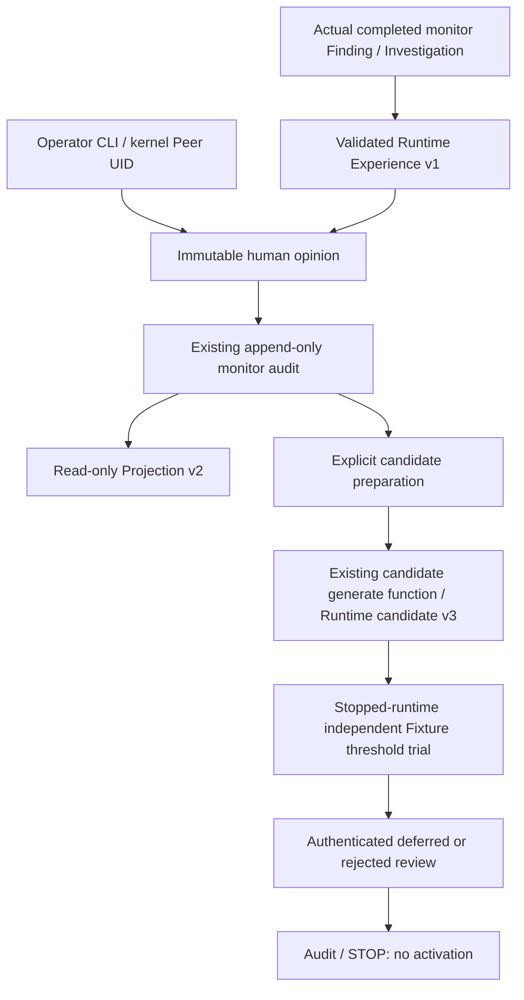

# Self-Improvement Feedback Loop & Offline Evaluation

Date: 2026-10-14. WSL2 Ubuntu only. Baseline `42a8996ba6051b70be75ed3ba9bfab68a5a45e3b` contains the live operator approval/projection implementation. `README.md`, `docs/soc-command-center.md`, `pyproject.toml` and unrelated untracked work were present at task start and are preserved.

## Verdict

**PARTIAL.** Authenticated feedback, immutable monitor experience linkage, candidate generation, independent-Fixture offline trials, deferred/rejected human review, restart and security boundaries are implemented and tested. Actual WSL events reached feedback/experience/projection. The available real data does not provide two independent FP opinions; no native candidate/evaluation was fabricated. Operating improvement efficacy and promotion eligibility remain INCONCLUSIVE/BLOCKED. No operating configuration, model, code, Tool permission or policy was automatically changed.

## Source contracts and reuse

The existing `experience/capture.py::ExperienceCaptureService` requires a real Core WorkflowCheckpoint, trace and StateAnchor. The Linux monitor ledger has a different source contract. This implementation does **not** synthesize those Core artifacts or insert monitor outcomes into the old `experiences` table.

New `experience/runtime.py::RuntimeExperience` (`soc-monitor-experience:v1`) is captured from actual completed monitor results through existing `RuntimeResponseSimulation._context`, `InvestigationResult`, Finding integrity, Source Store, native receipt/Provenance v3 and reviewed Window checks. It preserves plan ID, Incident/Finding/result/investigation digests, original source/provenance references and assessment mode. `source_digest` is the reviewed source-set/Window/provenance integrity digest, not a claim that one hash proves source authenticity.

Existing Core `ExperienceStore`/`AnalystFeedbackService` retain their original schema/authentication rules. The monitor adapter persists a verified runtime experience **inside the same immutable audit record as the diagnostic feedback**, under the existing `monitor_audit` transaction. No second incident store, database migration or invented Core trace is added. Historical Core experience tests are run independently.



## Feedback contract and authentication

`linux_runtime/feedback_loop.py::RuntimeFeedbackRequest` accepts:

- caller-retained Feedback UUID, Finding ID and reviewed Experience ID;
- TRUE_POSITIVE, FALSE_POSITIVE or INCONCLUSIVE;
- one fixed reason code: EXPECTED_ACTIVITY, SUSPICIOUS_PATTERN, INSUFFICIENT_CONTEXT or INVESTIGATION_INACCURATE;
- optional `supersedes` UUID for an explicit correction;
- immutable interpretation OPERATOR_OPINION_NOT_GROUND_TRUTH.

`RuntimeFeedback` binds that request to the captured experience, kernel-derived reviewer UID, OS_PEER_IDENTITY, UTC review time, RECORDED state and full feedback digest. Finding/Investigation/Incident/Evidence/Source digests are in the nested experience rather than redundant independently writable fields.

The existing Unix Socket allowlist, 0700 directory / 0600 socket, peer credentials, endpoint identity, per-connection challenge, fresh request ID, 8192-byte limit and bounded timeout are reused. `submit()` checks SO_PEERCRED again. Actor/reviewer/Incident/policy fields supplied in the request are rejected. No free-form note is accepted or passed into a prompt. Numeric UID is a local OS principal; it does not prove interactive human presence or MFA. Same-UID processes remain trusted; a process/OS isolation boundary is required for truly untrusted code.

Approval/rejection of a response simulation remains distinct from diagnostic feedback. Neither is automatically converted into the other's labels. TRUE_POSITIVE remains an operator opinion, not a verified attack fact or independent Ground Truth.

## Persistence, replay and correction

- Validate audit, completed Finding, typed Investigation/Assessment, result digest, current source/Incident and provenance before accepting feedback.
- Review must bind the exact captured Experience ID; stale source/result data fails closed.
- Experience + feedback + audit are one monitor SQLite append transaction. Source/queue databases are separate and are not represented as an atomic multi-database commit.
- Same Feedback ID, same body, same UID and same source snapshot returns the original record/time/digest. Changed content with the same ID is rejected.
- Transport request IDs are separately one-use. A retransmission uses a new transport request ID and the same semantic Feedback ID.
- Correction requires a new Feedback ID explicitly superseding the latest same-Finding/same-UID record. Original records are retained; no UPDATE/DELETE of audit or feedback occurs.
- Candidate generation uses latest opinions; a correction that changes support invalidates a previously prepared candidate. Ambiguous/unconfirmed source state is not silently repaired.
- A crash before commit leaves no feedback; after commit but before response can leave a durable record without acknowledgment. New-request-ID retransmission restores the original result idempotently.

## Runtime projection

`feedback_projection.py` is explicitly versioned `soc-runtime-feedback-projection:v2`. It retains reference-only outcome items and adds `human_diagnostic_feedback`. Current active feedback source links are revalidated; projection performs no writes.

Outcome labels remain UNLABELED. Explicit diagnostic opinions are separately tagged OPERATOR_OPINION_NOT_GROUND_TRUTH. Original input origin and assessment mode remain visible. A scripted assessment is not a real LLM assessment; OS-shaped parser fixtures used by unit/integration harnesses are not actual OS collection, even where their parsed contract tag is NATIVE_OS. Real journald evidence is reported separately below.

## Candidate generation

`RuntimeFeedbackLoop.prepare_candidates()` is explicit opt-in, not called automatically by collection or investigation. It requires at least two FP opinions backed by **nonoverlapping original source evidence**. Two rule Findings over the same source events count as one support unit. TRUE_POSITIVE/INCONCLUSIVE do not create FP patterns. Mixed declared source origins are rejected.

`improvement_candidates/runtime_models.py` introduces a versioned monitor-source pattern; the existing `generation.py::generate()` and `ImprovementCandidate` content-addressed contract are reused. Runtime candidate schema v3 / monitor generator v1 adds the bounded DETECTION_RULE_REVIEW proposal: compare explicitly supplied settings offline, never apply them automatically. Original candidate v1/v2 semantics and factories remain intact.

Candidate references bind Feedback digests and verified Runtime Experience records; the pattern declares HUMAN_OPINION_NOT_GROUND_TRUTH. Candidate IDs exclude creation-time metadata, and repeated preparation returns the first saved candidate rather than duplicating it. Proposed change/rationale/expected effect are advisory; validation is linked through the immutable offline trial and review records. The persisted candidate initially has PENDING_REVIEW and OFFLINE_TRIAL_ONLY_NO_AUTHORITY risk.

The old Core Offline Planner explicitly rejects the monitor candidate family. Core stores/promotion cannot silently adopt monitor experiences as Core checkpoint samples. `compile_candidate_strategy()` also rejects this proposal; it is not executable read-only coverage, a policy patch or a model replacement. Tests for all original candidate families remain in place; new-family tests assert fail-closed refusal at those older boundaries.

Only repeated FP review is exposed in this version. FN diagnosis, tool failures, unnecessary tool calls, LLM timeout and investigation-failure source mappings remain in existing offline components or require a future monitor adapter. No automatic FN label is derived from an event with no Finding.

## Offline evaluation

`learning-evaluate` requires the monitor to be stopped and reacquires the existing lifetime writer lock. The operator supplies explicit trial thresholds; evaluation runs only in the existing Runner's private temporary Fixture databases. Runtime config digest/thresholds remain unchanged. No new external API or background second writer is added.

The existing `evaluation/authentication.py::fixture_dataset/evaluate` and actual Detection Engine are reused. The dataset consists of 11 independently pre-authored Fixture cases and 60 Incident×UTC-five-minute-Window×Rule units (9 expected advisories, 51 negatives). The opinion records are **not** supplied as Ground Truth. Both runs use the same validated dataset digest, code identity and Feature-independent authentication engine; denominator-zero metrics retain None.

Each audit trial records baseline/trial settings, confusion matrices, per-rule statistics, FP/FN cases, precision/recall/F1/FPR/FNR, Fixture latency distribution, evaluation digest, code version and engine/adapter source SHA. Wall-clock replay timings are separate observations and excluded from deterministic evaluation identity.

Representative Fixture trial: Runtime baseline repeat=3, multi-account=3; explicit offline trial repeat=5, multi-account=3:

| Metric | Baseline | Trial |
|---|---:|---:|
| TP | 7 | 7 |
| FP | 3 | 2 |
| TN | 48 | 49 |
| FN | 2 | 2 |
| Precision | 0.7000 | 0.7778 |
| Recall | 0.7778 | 0.7778 |
| F1 | 0.7368 | 0.7778 |
| FPR | 0.0588 | 0.0392 |
| FNR | 0.2222 | 0.2222 |

This is a controlled Fixture observation, **not verified operating improvement**. The data are fixed and are not an independent prospective/held-out corpus. Latency uses the evaluator's explicitly simulated processing clock (10 seconds for measured cases); actual replay duration is recorded separately and is not production detection delay.

The repeat=6 trial also exercises regression detection: increased FN count produces REGRESSED. Any FP or FN count increase is flagged even if another metric improves. Candidate trial verdict remains INCONCLUSIVE and Promotion BLOCKED. Candidate-specific scenario acceptance/operational performance is not inferred from the shared regression suite.

## Human review

The socket `candidate-review` reuses the existing `ReviewDecision` vocabulary and peer-authentication boundary. Its versioned source adapter stores a candidate/evaluation-digest-bound review in the monitor audit. Core `ImprovementReviewService` requires a different Core evaluation/source graph and is preserved, not invoked with fabricated artifacts.

- PENDING_REVIEW after candidate preparation.
- DEFER → INCONCLUSIVE; REJECT → REJECTED.
- APPROVE is explicitly refused while this non-held-out trial is INCONCLUSIVE. No unsupported APPROVED or measurable benefit is claimed.
- Repeated identical decisions are idempotent; conflicting terminal decisions/evaluation references are rejected.
- No activation/promotion/rollback service is exposed to this endpoint. Original governed promotion/rollback contracts are tested separately and remain unchanged.

## CLI

Against an explicitly enabled running same-UID operator runtime:

```bash
.venv/bin/python -m soc_agent.linux_runtime --directory PRIVATE_DIR operator experience FINDING_ID
.venv/bin/python -m soc_agent.linux_runtime --directory PRIVATE_DIR operator feedback-submit FINDING_ID \
  --experience-id REVIEWED_EXPERIENCE_ID --feedback-id RETAINED_UUID \
  --label INCONCLUSIVE --reason-code INSUFFICIENT_CONTEXT
# Correction additionally uses --supersedes PREVIOUS_FEEDBACK_UUID with a new Feedback UUID.
.venv/bin/python -m soc_agent.linux_runtime --directory PRIVATE_DIR operator feedback-list
.venv/bin/python -m soc_agent.linux_runtime --directory PRIVATE_DIR operator feedback
.venv/bin/python -m soc_agent.linux_runtime --directory PRIVATE_DIR operator candidates
```

Stop the monitor normally before explicit offline evaluation:

```bash
.venv/bin/python -m soc_agent.linux_runtime --directory PRIVATE_DIR learning-evaluate CANDIDATE_ID \
  --repeated-failures 5 --multiple-accounts 3
```

Restart with the same explicit operator opt-in, then review the returned evaluation ID:

```bash
.venv/bin/python -m soc_agent.linux_runtime --directory PRIVATE_DIR start --operator-uid "$(id -u)"
.venv/bin/python -m soc_agent.linux_runtime --directory PRIVATE_DIR operator candidate-review CANDIDATE_ID \
  --decision DEFER --evaluation-id REVIEWED_EVALUATION_ID
```

There is no auto-approval/auto-evaluation/auto-promotion. Old or incompatible readers reject unknown candidate/feedback versions; no silent downgrade into a Core dataset is supported.

## Actual WSL validation

Fresh isolated private stores, real retained journald input and independent Runtime/Operator CLI processes. No authentication attempts were generated or OS settings changed. Configured 45-second run; parent-observed process lifetime 47.453 seconds, including startup. Restart configured 3 seconds.

- Queue DONE 736 journal records; accepted supported authentication sources 1; DONE_READ_ONLY investigation 1.
- Captured Native Runtime Experience; one authenticated INCONCLUSIVE diagnostic opinion with INSUFFICIENT_CONTEXT.
- Same semantic Feedback ID retransmission returned byte-equivalent record; projection contained that opinion; audit validation passed.
- Restart exit 0; exactly the same feedback restored. Real LLM calls 0; actual OS handlers 0.
- Candidate count 0: TWO_NONOVERLAPPING_HUMAN_FP_OPINIONS was not satisfied. No native candidate/evaluation/human-candidate-review completion was fabricated from this single event.

The supported authentication input is a PAM module failure, not a proved attack or necessarily final login denial. Local evidence: `/tmp/soc-feedback-native-evidence.json`, `/tmp/soc-feedback-native-runtime.log`, `/tmp/soc-feedback-native-summary.log`. These private logs/databases are not committed artifacts; no raw username/IP/log text is reproduced here.

## Security and recovery

The same UID trust limits from live approval apply. Wire-supplied reviewer/actor, unknown reason codes, injected instructions, mismatched Finding/Incident/evidence/source/digest, conflicting Feedback ID, stale source graph and contaminated Ground Truth are rejected or excluded. Notes/prose are not interpreted. Simulation approval never becomes an attack label.

Feedback history remains append-only. Tests terminate only nonce/PID/writer-lock-verified, harness-owned Fixture child processes at feedback commit-before/after boundaries. Original source/Window/provenance and SQLite integrity are rechecked after restart; write-spy calls remain 0. Audit failure rolls back feedback and embedded experience. An accepted transport attempt without a semantic record is not counted as completed feedback.

Synthetic external v2, Operational Provenance v3, Network/DNS NOT_INFERABLE, existing Policy/Approval/Execution and READ-only guards remain unchanged. Actual operating evidence/model/config/code is never rewritten by this loop. Temporary offline Fixture storage is separate from monitor/source databases.

## Remaining limits

1. Operating candidate/evaluation evidence is missing: acquire independently reviewable, nonoverlapping real cases and an independently labeled holdout/prospective evaluation corpus. Do not use the submitted opinions themselves as the evaluation truth.
2. APPROVED/promotion eligibility remains blocked pending stronger evaluation; neither human consent nor Fixture F1 increases grant operating change authority.
3. Failure/FN/coverage-review monitor adapters are not implemented. The legacy offline components exist, but their Core source graph must not be forged.
4. Same-UID kernel identity is not interactive human presence/MFA or a distinct multi-user role service. Any cross-user/physical-server rollout needs separate OS/process isolation and explicit permissions testing.
5. Inline audit history scans and large native histories remain a capacity concern; no sustained-load or physical Linux service deployment was performed.
6. Fixed Fixture trials do not establish causal improvement, operating detector precision or real detection latency. Windows/AWS are not implemented/tested in this task.
7. No automatic application interface exists. Any future operating change requires separate verified evaluation, human authorization and guarded promotion.

Final test counts, checks and changed files follow after verification completes.

## Test evidence and changes

Executed runs (overlapping suites are not summed):

| Run | Result | Local log |
|---|---|---|
| Initial new loop | 7 passed / 7 failed, UTC digest normalization | `/tmp/soc-feedback-new.log` |
| After UTC fix | 12 passed / 2 failed, candidate creation-time comparison | `/tmp/soc-feedback-fixed.log` |
| Initial complete new/Projection suite | 32 passed / 1 failed, appended test import | `/tmp/soc-feedback-new-complete.log` |
| Legacy first run | 207 passed / 1 failed, new enum Fixture mapping | `/tmp/soc-feedback-legacy-regression.log` |
| Guard/Fixture correction scope | 122 passed | `/tmp/soc-feedback-delta.log` |
| Final new loop + Projection | **33 passed, 0 failed**, 210.03 seconds | `/tmp/soc-feedback-final-new.log` |
| Final legacy experience/feedback/candidate/review/evaluation/promotion contracts | **208 passed, 0 failed**, 190.75 seconds | `/tmp/soc-feedback-final-legacy.log` |
| Runtime/Scenario/transport/approval/execution/policy/detection/operational | **479 passed, 0 failed**, 172.40 seconds | `/tmp/soc-feedback-runtime-regression.log` |
| Final projection-version/compatible wire/review-query delta | **16 passed, 0 failed**, 35.19 seconds | `/tmp/soc-feedback-final-delta.log` |

The 33 run includes **19 new loop/crash cases** and 14 existing projection cases. Two new owned-process crash points (before/after feedback commit) were actually executed, in addition to the prior live-operator/response crash regressions in the 479 run. Runtime data delivery remains at-least-once with idempotent effects; no exactly-once network/LLM invocation claim.

Promotion/rollback source was not changed. Unit contract and promotion eligibility security regressions were executed; the expensive full legacy activation/rollback E2E was not rerun. No activation occurred in the new loop.

Reproduction:

```bash
RUN_LIVE_LLM_TESTS=0 .venv/bin/python -m pytest -q \
  tests/integration/feedback_loop tests/integration/runtime_feedback
RUN_LIVE_LLM_TESTS=0 .venv/bin/python -m pytest -q \
  tests/integration/experience tests/integration/feedback tests/integration/improvement_candidates \
  tests/unit/improvement_candidates tests/unit/improvement_review tests/unit/improvement_promotion \
  tests/integration/improvement_promotion/test_eligibility.py tests/integration/improvement_review \
  tests/unit/offline_evaluation tests/unit/offline_comparison
RUN_LIVE_LLM_TESTS=0 .venv/bin/python -m pytest -q \
  tests/integration/live_operator tests/integration/response_simulation \
  tests/integration/linux_runtime tests/integration/scenario tests/unit/approval \
  tests/unit/execution tests/unit/policy tests/unit/llm tests/unit/detection_evaluation \
  tests/unit/operational_features
.venv/bin/python -m ruff check src tests
.venv/bin/python -m ruff format --check .
git diff --check
```

Ruff / format / diff PASS; final format check reports **788 files already formatted**. No failed test was skipped, removed or marked xfail to obtain these results. Existing helper tests were extended for the new source family and retained old-family assertions; the Core planner's new family rejection is now explicitly verified.

Task files (15):

```text
src/soc_agent/experience/runtime.py
src/soc_agent/improvement_candidates/runtime_models.py
src/soc_agent/improvement_candidates/models.py
src/soc_agent/improvement_candidates/generation.py
src/soc_agent/linux_runtime/feedback_loop.py
src/soc_agent/linux_runtime/feedback_projection.py
src/soc_agent/linux_runtime/operator.py
src/soc_agent/linux_runtime/__main__.py
src/soc_agent/offline_evaluation/planning.py
tests/integration/feedback_loop/test_loop.py
tests/integration/feedback_loop/test_crash.py
tests/integration/runtime_feedback/test_projection.py
tests/unit/offline_evaluation/test_planning.py
tests/unit/offline_comparison/test_evaluation.py
docs/linux-soc-v1/self-improvement-feedback-loop.md
```

Task-start SHA snapshots verify preserved user/protected/Synthetic-v2/Provenance-v3 files. HEAD remains `42a8996ba6051b70be75ed3ba9bfab68a5a45e3b`, index empty. No Commit/Push, operating DB migration, OS security write, Windows/AWS work or live LLM call was performed.

Final-code WSL recheck ran the retained-native-event private runtime for a configured 15 seconds. Independent CLI queries returned projection v2, one restored diagnostic opinion, zero candidates/reviews, NOT_INFERABLE, WRITE_DENIED and automatic changes DISABLED. The stored Feedback record remained exactly equal; runtime exit was 0 and actual OS handlers were 0. Evidence: `/tmp/soc-feedback-native-final-code.json`, `/tmp/soc-feedback-native-final-summary.log`. No additional opinion, label or candidate was manufactured in this recheck.

Final scope/integrity scan: exactly the 15 task files above; no credential/private-key patterns or local configured secret values in those files. All task-start user/untracked entries remain. Protected fixture SHA remains `e5f9d10f706f71b82e80261f7633a1504e27ba24499be948d04adb6eeb3a21c9`; v2/v3/security sources remain byte-identical. The Stage is empty and HEAD unchanged.
