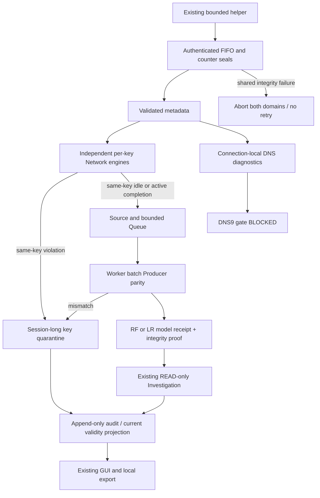

# Total Monitoring Event-time Integrity and Fault Isolation

Validation date: 2026-10-19. Baseline SOC
`cf3ac374df4797b9d2aa312b1e695319ef753726`, ML
`e1a01260f0463a38d4d778859bc2a86f8e9cfbde`.

This change implements and tests Total-mode domain isolation in the existing
StreamingMonitoring/Queue/SourceStore/Research Adapter/Orchestrator/Tk GUI.
There is no new collector, privileged helper, model, agent runtime or framework.
**Native Total E2E remains PENDING; DNS9 and operational promotion remain BLOCKED.**

## 1. Baseline and preservation

Both repositories were on main at the expected baselines with empty stages.
Private before/after SHA inventories cover 122 existing SOC user/Replay files,
10 ML user files, 80 Total-session files, the prior native report/evidence,
the Network Producer source and the RF/LR/helper files. Existing modifications,
Raw Datasets, installed packages, model artifacts and production databases were
not edited, staged or reset. No privilege command, AF_PACKET capture, DNS query,
test traffic, interface change or system-clock change was executed.

## 2. Historical Native evidence is unchanged

[Original diagnosis](total-native-timestamp-dns-diagnosis.md) and
[original evidence](total-native-timestamp-dns-evidence.json) still describe the
old runtime, not a successful run of this implementation.

- Directory: `session-efe2ca83d4f543b9befca9abdbfd687a`.
- Manifest ID: `e344f991-aac8-4c11-aa92-f0dfcb232c72`.
- Session digest: `a5f7e5a9071a28d505bdb154c8c4eeed8eef867fcac470d9b231624f4699add6`.
- Packet/helper sequence 18; controller accepted 17; raw frames 36.
- Previous ns `1792367059623629397`, rejected ns `1792367059623629386`:
  **11 ns global regression**. Counter sample 38 at comparison; later sample 40.
- OUTBOUND / KERNEL_SO_TIMESTAMPNS. Rejected key digest recorded; the previous
  flow identity, rejected DNS headers and ancillary bytes are UNKNOWN/not retained.
- READY present, CLOSED missing; last observed kernel counter 36/drop 0 is only a
  verified prefix. Final counter status is UNKNOWN. RF/LR receipts/investigations 0.
- Audit head `857b6004a04079af447325c2391d8580cf2c9439f009185f61ef6cd358cce43c`.
  All seven original SQLite databases were rechecked with read-only immutable
  connections and passed integrity_check; all 80 original file hashes still match.

The immediate old abort condition is known. Kernel generation order versus UTC
adjustment remains UNKNOWN. The new partition logic does not retrospectively
classify this old packet pair as independent or rescue that session.

## 3. Event-time contract

| Time / identity | Use after this change |
| --- | --- |
| Kernel integer ns | Preserved through recvmsg/parser/transport; never clamped or sorted |
| Packet datetime UTC | Existing microsecond representation; never replaces exact Native ns |
| Monotonic processing time | Existing deadlines, uptime, rate budget, worker timeout and UI ordering |
| Packet sequence / counter seal | Existing authenticated FIFO/order/counter checks, before either domain |
| Flow first/last event time | Per bidirectional key, first-seen direction, duration/IAT for Network14 |
| DNS event time | Per DNS endpoint/transport connection; matching duration never negative |
| Receipt / audit UTC | Existing occurrence/processing evidence; append-only history unchanged |

The prior **global** check was stronger than the Producer's per-flow order
requirement. Removing it alone would be unsafe: FlowTable also expires unrelated
keys using the incoming packet time. A far-future B packet could close A, followed
by an earlier A packet that should have belonged to the closed group.

Total mode therefore uses `IsolatedFlows`, a bounded composition of the existing
StreamingFlows/FlowTable/Statistics engine with exactly one engine per canonical
bidirectional key. **No foreign key advances another key's expiry.** Idle 30s and
active 120s are evaluated only on a later packet of that same key. Equal times
remain allowed; any negative same-key delta quarantines the key. First-seen
direction and packet order are unchanged. Raw ns are not normalized to UTC now,
and no reorder window or tolerance was added.

The original non-Total Streaming mode retains its strict global policy. New Total
policy is independently versioned as
`soc-total-flow-isolation:v1:SAME_KEY_EVENT_TIME_ONLY`, recorded in
TOTAL_INTEGRITY_POLICY with session digest, capacities and fail-closed requirement.
It is not a new Producer/feature version.

**Tradeoff:** a silent flow cannot be finalized solely because other traffic or
wall time advances. It waits for same-key idle/active evidence; otherwise it is
excluded at SHUTDOWN/PACKET_LIMIT/RESTART_GAP. This deliberately reduces/defers
candidates. It does not infer missing packet time or claim training-distribution
equivalence. The new idle-finalization policy needs Native validation.

## 4. Integrity domains and states

| Domain | Evidence / action |
| --- | --- |
| Capture-wide | Existing helper attestation, session, counter/drop, packet/counter sequence, authenticated transport failure: abort both domains; CAPTURE_INTEGRITY_FAILED |
| Flow-local | Known key with same-key time regression or demonstrated Network14 parity mismatch: release its packet state, seal a quarantine reference, never reuse the key during this session |
| Cross-flow event time | Distinct partition state and individually ordered packets: record non-monotonic global order, DEGRADED, continue independently verified keys |
| DNS-local | Parse/unsupported framing/matching problems: diagnostic events; same DNS connection time regression: DNS_TIMESTAMP_QUARANTINED; budget exhaustion: DNS_DIAGNOSTIC_BLOCKED |
| Unknown scope | Stop processing and inference with UNKNOWN / RECOVERY_PENDING; no local-isolation assumption |

Collection lifecycle and integrity health are separate. A running Fixture may be
DEGRADED while its source is explicitly FIXTURE_NO_CAPTURE. A stopped source never
shows LIVE. QUARANTINED_FLOW and DNS_DIAGNOSTIC_BLOCKED describe domain dispositions;
HEALTHY/DEGRADED describe aggregate processing health. Stop preserves the prior
health as retained_integrity_health and reports STOPPED; explicit recovery reports
RECOVERY_PENDING / RETAINED_NO_CAPTURE_NO_RETRY.

Independence is established for the current captured prefix by: validated common
source/sequences, disjoint canonical keys, disjoint state/expiry, and an independent
batch Producer check on every inferred flow. It is not a claim that the system
clock, physical capture or model is operationally validated. Unknown errors do not
get converted into flow-local failures.

## 5. Streaming architecture and bounds

- Existing helper/rate/transport/inference/resource limits are unchanged.
- At most 128 active Network keys; 8 MiB aggregate serialized packet-metadata
  budget; max 128 packet references per flow in the existing engine.
- Key histories/quarantine tombstones and completed flow references are bounded by
  max_flow_records (1024). Packet identity tombstones are capped by the session
  frame budget (38,656), preventing duplicate IDs across completed partitions.
  Tombstones retain identities/hashes, not raw packet bodies.
- Quarantined keys are not evicted/reintroduced. History/memory/queue exhaustion
  raises an explicit failure instead of dropping state or relaxing validation.
- DNS has at most 128 connection histories, 128 aggregate pending/ambiguous
  questions and one 128-event display ring. Exhaustion blocks DNS diagnostics and
  emits a bounded reason while ordered Network metadata remains independently usable.
- Queued flow inputs remain private transient metadata until a durable no-retry
  outcome; existing purge/audit policy is reused. No raw payload/name is persisted.

## 6. DNS isolation

After common transport/origin validation, DNS and Network process the same source
metadata independently. DNS is no longer downstream of Network's feature check.
Malformed DNS on port 53 is a diagnostic failure, not permission to discard valid
IP/TCP/UDP metadata. Private-name spoofing is still a shared input/privacy violation.

Each DNS bidirectional connection has its own existing bounded DNSDiagnostics
engine. Other Network/DNS connections do not expire its queries. Matching and
5-second missing-response diagnostics use that connection's event time. Duplicate
question identity remains AMBIGUOUS; duplicate/late unmatched responses do not get
a second match. A time-regressed connection releases pending questions as unverified
and cannot later generate a match. It does not poison another connection's table.

UDP and single complete TCP DNS messages are supported; TCP reassembly/coalescing,
encrypted DNS and virtual host-side tunneling remain visibility limitations. WSL
DNS visibility is not newly proved. DNS9 raw-query training Producer parity is
UNVERIFIED and inference is still BLOCKED. No DNS7 compatibility assumption was made.

## 7. Network14 and model integrity

The ML Producer v1.1.0 is unchanged: 14 ordered float32 features, IP byte units,
first-seen bidirectional counts, flags, duration and IAT from the original per-flow
packet sequence. Contract
`84ba0916f0ce4e9e12bb70712db2cd1eaea84ba4173acd57b647faf38efb1c6e`;
configuration
`7999723911ce3d2e9cd3b3b6e0d45e11f44b1316cdf9c7f4883d7e2a69ca21a7`.
Tests compare incremental values against that batch Producer, including exact-ns,
first-direction, idle and active cases. Origin and input identities intentionally
remain part of digests; equal values do not mean equal Native/Fixture identities.

The existing RF/LR worker validates artifact SHA/input/source and produces the same
v1 model receipt. Dispatch, receipt validation and asynchronous investigation
completion recheck current flow eligibility. The guard reloads the claimed durable
input/provenance and compares it to the exact request. Unknown worker outcomes keep
the existing circuit/no-retry policy; they are not fabricated as local parity faults.

New **companion integrity receipt** `soc-total-inference-integrity:v1` binds the
unchanged model receipt digest, capture session, key/flow, feature/artifact/source
digests, policy, as-of prefix status and RESEARCH_ONLY restriction. It is typed,
hash-bound and appended to the runtime audit; the outer research result binds it
in the existing research audit. It does not modify the worker's receipt schema or
claim future capture quality. A missing proof on a historical receipt is reported
as LEGACY_NO_ISOLATION_PROOF, not synthesized.

If a key fails **after** a past result, historical bytes/audit are kept. Current
projections mark QUARANTINED_FLOW / WITHDRAWN_RESEARCH_ONLY with the quarantine
reference. Current exported risk_assessment becomes null; the old assessment is
explicitly historical. Existing READ-only work cannot be undone, but it cannot be
promoted as current valid evidence. A shared/unknown integrity failure withdraws
current use of all such results. No Operational Finding or OS WRITE is created.

## 8. Actual Fixture evidence and Investigation

[Actual artifact Fixture evidence](total-event-time-fixture-evidence.json) records
two real model receipts (Quality RF and Edge LR), two existing READ-only
investigations, one quarantined Network key, a matched DNS response and a DNS parse
diagnostic. Inputs are explicitly synthetic FIXTURE, not recorded Native traffic.
The normal key is still processed while the bad key is excluded. Tests also cover
late withdrawal, same-session duplicate suppression, in-flight quarantine, exact
11ns unit/Unix metadata cases and a targeted parity mismatch with another valid key.

Trusted model SHAs remain:

- RF: `53c1029cc70b9d038bf46278818905c969dc3ddfb086c673466298ebdfa56603`.
- Scaler/LR: `661322193df782f958e88eb9da23f0dc4d17be328cfa63635865ce63e0fd2882`.

The captured actual Fixture worker prediction latencies were 10.958079 ms (RF) and
7.739067 ms (LR), not full process-start or investigation latency and not a Native
performance claim. Scores remain uncalibrated research scores. Model selection,
thresholds, scalers, artifacts and training data were not changed.

## 9. GUI and export

The existing Total Monitoring page shows collection lifecycle, Capture Integrity,
event-time policy/state, healthy/quarantined flow-key counts, DNS diagnostics,
model results/worker state, recovery and domain error separately. DEGRADED is
visible in the headline; it is not replaced by HEALTHY when collection continues.
Withdrawn rows show their current integrity disposition rather than only a past
ASSESSED status. Detail includes the proof/quarantine context. JSON/Markdown export
adds integrity state/proofs and current-versus-historical assessment distinctions.
No password input, security WRITE or new privileged GUI action was added.

Actual WSLg tests exercise degraded Fixture rendering, disabled duplicate Start,
Stop/drain, restored quarantine and zero new inference after recovery. Existing GUI
Artifact Fixture paths and timestamp-error rendering remain in regression scope.

## 10. Audit and recovery

TOTAL_INTEGRITY_POLICY, TOTAL_FLOW_QUARANTINED, cross-flow/exclusion events,
TOTAL_DNS_EVENT and TOTAL_FLOW_INTEGRITY_RECEIPT append to the existing hash chain.
Proof and quarantine references are checked during recovery, including session and
policy identity. Recovery never reconstructs a healthy flow from quarantined packet
state and does not retry an unknown inference. Current inference counters reset to
zero; retained receipts/quarantine references remain visible. Source/Queue/outcome
transactions and no-retry cleanup are unchanged. SQLite/audit corruption still
blocks results. Old native evidence was not resumed or restamped.

The quarantine decision and audit append do not yield to the inference consumer.
After a process interruption, quarantine counts/references are rebuilt from audit,
not a potentially older periodic monitor snapshot. No verified terminal lifecycle
or a conflicting/incomplete finalization snapshot means RECOVERY_PENDING and
withdrawal of current Advisory use even for otherwise ordered retained receipts.
Healthy live-key counts are UNKNOWN on recovery, not resurrected from memory.
A crash-boundary fixture verifies a durable quarantine with a deliberately stale
state snapshot and no STOPPED record; no receipt is promoted and no inference retries.

## 11. Stability and tests

Historical five-minute Fixture results in the earlier Total report remain
historical; they are not evidence for the new expiry policy. The changed paths had
an additional measured 60-second synthetic processing soak:

- 60.159761s monotonic elapsed; 593 metadata packets, 36 flow completion records
  (including diagnostic closures); deliberately paced 9.857087 metadata packets/s.
- 1 quarantined key; final Queue 0, retained packet metadata 0.
- Peak sampled process RSS 183,857,152 bytes; CPU between first/last samples
  2.882199s; sampled queue peak 1.
- A simulated UNKNOWN worker ran once and was not retried; model inference count 0.
  This exercises failure continuity, not actual inference latency or 128 raw-fps capacity.
- Audit head `7f16ac743fe439c44e573a72aac0bf35eef19fcee6f73bfe9e2b0f1e318e977d`.

[Measured soak data](total-event-time-fixture-stability.json) includes sample
curves and a result digest. Quarantine size is serialized diagnostic size, not an
allocator measurement; RSS is measured separately. No baseline speedup is claimed.

Development validations, counted separately:

- Basic/legacy/Total integration: 34 passed, 28.66s.
- New unit isolation: 8 passed, 0.47s.
- Isolation + artifact/recovery tests: 17 passed, 23.80s.
- WSLg degraded UI + Total transport: 6 passed, 19.99s.
- First broad candidate: 456 passed, 1 failed, 2 skipped, 289.42s.
  Failure was deterministic historical Clock source-SHA comparison, not a flaky
  runtime failure. The immutable Clock evidence JSON was preserved. Exact service
  source from commit 0ee341b is now non-executable test data with its original SHA;
  current Clock/Checkpoint behavior is still tested against the live source.
- Selected Clock/Checkpoint + isolation follow-up: 18 passed, 27.42s.
- Guard-strengthened actual-artifact evidence run: 1 passed, 6.60s.
- Additional soak: 1 passed, 60.53s. Guard reported zero network-socket attempts
  in each completed execution above; no new Native capture/test traffic.
- Subsequent broad candidate (before final crash-boundary strengthening):
  535 passed, 2 skipped, 295.09s, including Policy/Approval and Clock regression.
- Final crash-boundary and GUI regression: 11 passed, 42.15s.
- Final durability-path soak: 1 passed, 60.68s, retained separately in
  [recovery stability data](total-event-time-recovery-stability.json). The first
  soak was preserved; its results are not silently replaced or added to this run.
  Final-code measurements: 60.298083s, 600 packets, 38 completion records,
  184,610,816-byte peak sampled RSS, 3.317428s sampled CPU, queue peak 2/final 0,
  packet metadata 0, one simulated worker failure/no retry. It is deliberately
  paced at 9.950565 metadata packets/s, not a capture-capacity benchmark.
- An additional recovery observation on the owned temporary Export Fixture took
  0.223563s, restored 2 retained receipts and 1 quarantine, produced 0 new inferences
  and made 0 network-socket attempts. Last-profile model-plus-investigation
  processing time stored in that Fixture was 2.663707s. This is not packet-to-detection
  latency (which includes waiting for flow completion and remains unmeasured).

## 11a. Final independent Export and quality

An Export of SOC HEAD plus exactly the 20 task files and ML HEAD, excluding user
changes/Replay, passed the full final selection: **536 passed, 2 skipped in
304.17s**. Network-capture, Streaming/Live Network, both new isolation suites,
actual Research Adapters, Clock/Checkpoint, Policy/Approval and actual WSLg
Streaming/Total GUI paths are included. `--import-mode=importlib` was used with
`tests.native_capture_verification_guard`; blocked socket attempts were **0**.

The two skips require explicit opt-in: the 60s soak (executed separately above)
and the retained Native idle-budget test. Skips are not PASS counts; runs are not
summed. A preliminary Export attempt was interrupted after a preparation working-
directory error; it was not counted. Final source/test/evidence hashes were checked
against the working copy before starting the completed Export.

Working Ruff check (`src tests`), whole-tree format check (1027 files), Diff check,
and Export Ruff/format (983 files) passed. All three Fixture JSON evidence digests,
both externally referenced model SHAs, the unchanged helper bundle and all 13
original native-evidence file hashes were independently checked from the Export.
No model binary/Raw Dataset/native DB was copied into it. Current clock behavior
is tested on the new live service; the separate historical source fixture verifies
the immutable prior SHA without restamping old evidence.

The last report-only result updates are synchronized to the Export before Stage
SHA comparison. Source/test bytes are the exact final versions exercised there.
The model environment remains a required external trusted dependency; this is not
a standalone binary model distribution. ML has no task changes/commit.

| Final acceptance | Scope / result |
| --- | --- |
| EVENT_TIME_CONTRACT_VERIFIED | Per-key timing/expiry and strict legacy behavior tested |
| CAPTURE_WIDE_INTEGRITY_VERIFIED | Mock/Unix-shape fail-closed checks; Native quality not newly validated |
| FLOW_LOCAL_ISOLATION_VERIFIED | Exact 11ns synthetic metadata, key tombstones, independent valid flows |
| DNS_FAULT_ISOLATION_VERIFIED | Parser/time/matching/budget faults, separate Network validity |
| NETWORK14_PARITY_VERIFIED | Unchanged batch Producer versus per-key incremental/arithmetic references |
| QUALITY_FIXTURE_INFERENCE_VERIFIED | Actual trusted RF; Fixture source only |
| EDGE_FIXTURE_INFERENCE_VERIFIED | Actual trusted scaler/LR; Fixture source only |
| SOC_INVESTIGATION_VERIFIED | Existing READ-only Scripted research path, not an operational finding |
| GUI_DEGRADED_STATE_VERIFIED | Actual WSLg Fixture degraded/stop/recovery and existing GUI regression |
| AUDIT_RECOVERY_VERIFIED | Temporary stores, crash boundary, no retry/no quarantine promotion |
| NATIVE_TOTAL_E2E_PENDING | No new privilege execution or Capture |
| DNS9_PARITY_BLOCKED | Raw-query Producer parity remains unverified |
| OPERATIONAL_PROMOTION_BLOCKED | RESEARCH_ONLY / NOT_INFERABLE / WRITE_DENIED maintained |

## 12. Limitations and next Native validation

Fixture isolation/parity does not resolve the historical kernel/UTC root cause.
Native capture-wide integrity, DNS visibility, eligible-flow creation and actual
RF/LR receipts under the new policy require a separate user-run session. Silent
keys no longer complete on another key's time; the operator must account for
same-key idle/active evidence or accept diagnostic-only SHUTDOWN. A late violation
can withdraw historical Advisory validity; RESEARCH_ONLY results are never final
operational approvals. No throughput/long-term capacity guarantee is inferred from
the bounded low-rate soak.

No Helper change or new SHA was necessary. Unchanged identities:

- Total helper: `1c178e650e08f6c8da9957ee8020bd594cd71efff222dbfc8ac22739371d1e31`.
- Shared stream helper: `5f767a6e6cb69a9b79853d5f714649f5a8ebf74af9c05867f393273b68fb633b`.
- Legacy one-shot helper: `a8a0cafe7494922a0296a250129ab5695b681dbbec6febf512509b023ef44856`.
- Nine-file Total bundle: `e26057b77534b552701826dd1c4d6829e76d94fcfc0bb8c263fd661f2038ac0f`.

After reviewing this controller-policy change, the next approval scope is a fresh
user-started Total session: **lo only, maximum 300 seconds, 128 raw frames/s,
burst 256, maximum 38,656 frames, temporary CAP_NET_RAW, no retry, unchanged
bounded queues and no payload/name retention**. The GUI stays a normal user
process; existing terminal authentication is performed only by the user. The
existing `soc-agent start --gui --monitor total` entry point is unchanged, but was
not executed for Native collection here. Do not reuse the failed session command.
Any deliberate local traffic stimulus needs explicit separate approval; none was
generated here. No interface/budget/DNS9/operational promotion approval is implied.
