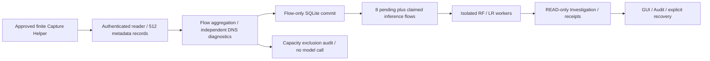

# Total Monitoring rate budget and backpressure stabilization

Status: **PARTIAL — fixture processing verified; Native Total E2E pending.**
Baseline SOC `0f992e0bde8cb10c65cf0534460d6c031768b6a1`; ML
`e1a01260f0463a38d4d778859bc2a86f8e9cfbde`.
Measurements and immutable historical file references are recorded in
[total-rate-backpressure-evidence.json](total-rate-backpressure-evidence.json).
No privileged command, AF_PACKET socket, test traffic, OS security WRITE, model
training, artifact replacement, or operational promotion was performed.

## 1. Native failure evidence

The historical directory `session-44bccafed5934b2e97e3d10a0dffd8cb` contains
manifest capture identity `347c6117-3692-4f22-a83d-d834b8417f9e`. Directory and
manifest identities are recorded separately; they are not assumed interchangeable.
The original directory was opened read-only; all seven SQLite databases returned
`integrity_check=ok`. The monitor audit has nine records and a valid hash chain,
ending `764d2009cf380501586534ce28a5147704ff78d7c6f28b9f3de3e30d76e0a460`.
READY has counter sequence 1 and zero initial packets/drops. Rejected CLOSED has
sequence 385, cumulative kernel packets 384, raw frames 384, sent metadata 192,
drops 0, elapsed 1.0236316919908859 seconds, and
`STREAM_RATE_BUDGET_EXCEEDED`. Its counter validation was ACCEPTED and capability
fields matched, but completion was explicitly false. Verified CLOSED is MISSING.

All 192 sent metadata packets reached the Controller. Reader queue peak was
9/512, terminal backlog 0. No source flow commits, inference receipts, or
investigations exist. Four flow keys were observed before abort. The absence of
`transport-unprocessed.json` does not prove source persistence or successful
finalization. No historical DB, receipt, or evidence file was repaired/restamped.
Kernel drops 0 is a measured rejected-terminal value; it does not authorize the
failed session or establish that every possible packet was collected.

## 2. Rate mathematics and root cause

The unchanged token bucket starts with 256 tokens, refills at 128 raw frames/s
using monotonic time, clips to 256, consumes one per raw frame **before** loopback
OUTBOUND filtering, and fails if the balance is below one. Loopback inbound clones
therefore consume the approved budget too. Fractional refill is retained.
`received_frames` increments before consume; the rejected attempt is included in
384. No metadata is sent for a rejected attempt. `finally` samples counters and
attempts CLOSED; the receiver deliberately preserves errored CLOSED as rejected
rather than accepting it as verified completion.

The loose cumulative upper envelope is `B + r*t`. Substituting the reported
capture elapsed gives `256 + 128*1.0236316919908859 = 387.0248565748334` frames.
384 is below that envelope. This is not a proof of admissibility: capacity clipping
can waste earlier refill, arrivals can cluster later, and the bucket is initialized
before socket opening whereas elapsed starts after opening. The approximate
session average 375 raw frames/s is not the instantaneous burst history.

Per-frame arrival times, last-refill time, balance at failure, and actual burst
window are **UNKNOWN**. Fixtures demonstrate accepted and rejected schedules with
the same aggregate count/duration. The approved arithmetic passes boundary,
fractional-refill, equal-clock, reversed-clock and long virtual refill tests.
`RATE_ROOT_CAUSE_UNKNOWN / ACTUAL_BURST_UNKNOWN`; no token-bucket defect or kernel
performance defect is established. Queue peak 9/512 provides no evidence that
Controller backpressure caused this particular rate failure.

## 3. Architecture and minimal implementation

The existing reader already continuously drains the authenticated Unix
SOCK_SEQPACKET channel on a separate bounded thread. A second packet queue/runtime
would duplicate that work. The existing asynchronous inference consumer and
isolated per-request model workers are retained.

A confirmed implementation defect was separate from the Native rate cause:
`StreamStore.commit()` raising `STREAM_INFERENCE_QUEUE_BACKPRESSURE` propagated to
capture-wide abort. AI capacity saturation unnecessarily stopped independent
collection and DNS diagnostics. Now only this precise, pre-commit capacity error
creates `STREAM_FLOW_INFERENCE_EXCLUDED`. It includes session/origin/flow identity,
input and vector digests, packet count, verified counter window, reason, and
`NOT_INFERRED_NO_RETRY`. No source commit or model receipt is fabricated. A blocked
model circuit takes the same explicit no-retry exclusion path for subsequent
completed flows. No metadata input file is created for those exclusions.

Other errors, including SQLite failure, audit failure, retention limit, and a
partially completed source commit, still abort fail-closed. A capacity exclusion
is not a corrupt flow or a capture gap: all of its packet statistics were
processed. It is counted separately from eligible, shutdown/packet-limit diagnostic,
quarantined, and successfully inferred flows. Integrity health remains DEGRADED
when any inference was excluded. Finalization VERIFIED only means every accepted
item received an auditable disposition; it does not mean every flow was inferred.

## 4. Queue contracts and resource bounds

| Stage | Capacity | High / low | Overflow / failure | Drain |
|---|---:|---:|---|---|
| Reader / ingestion | 512 metadata records, each wire record <=8192 bytes | 384 / 128 | Explicit transport/seal backpressure; shared window blocked | Existing graceful deadline 30s |
| Inference | 8 PENDING + CLAIMED flows, one serial consumer | 6 / 2 | Completed flow excluded with durable audit; no automatic retry | Existing 30s; timeout UNKNOWN/no retry |
| Active aggregation | 128 active keys, 8 MiB metadata | Hard bound | Explicit resource error; no silent eviction | IDLE30s / ACTIVE120s event time; SHUTDOWN excluded |
| Histories | 1024 flow/key records; 38,656 packet identities | Hard bound | Fail-closed; no tombstone eviction | Session lifetime |

Watermarks are controller observability/hysteresis thresholds derived as 75%/25%
of existing capacities, not a mechanism to raise capture rate. Peak is the peak
sampled queue depth (plus an observed full-queue rejection), not an unmeasured
continuous history. Ingestion reader's own peak remains authoritative. There is
no extra unbounded memory queue or task-per-packet allocation. Eight transient
inference envelopes have a 256 KiB per-file read limit. Existing controller RSS
768 MiB, metadata 8 MiB, disk 64 MiB, finite CPU budget and model worker limits
remain active. Exclusion histories remain bounded by the existing flow history
limit and disk budget. Overload does not increase concurrency or retry counts.

## 5. Shared capture failure, gaps and quarantine

Rate, counter, sequence, session/authentication and transport loss errors are
separate from model capacity. Unknown shared loss scope still blocks both
Network and DNS. The Controller appends
`TOTAL_CAPTURE_WINDOW_QUARANTINED` before releasing active state, binding session,
accepted packet prefix, bounded affected key list, error and no-retry disposition.
Unobserved packet count is null, not zero. The record does not invent kernel
packet loss. Existing transport failure diagnostics retain queued/unadmitted
metadata counts where observable. Existing gap count increments once on abort;
DNS finishes pending work as unverified and reports DNS_DIAGNOSTIC_BLOCKED.
All current research advisory projections are withdrawn on capture-wide failure.

Flow-local timestamp quarantine and DNS-local failures retain the preceding
fault-isolation contract. No timestamp clamp, reordering, feature repair, counter
relaxation, shutdown-flow promotion or global DNS9 activation was added.
A new helper/session always needs explicit user action after a shared failure;
there is no capture restart, privilege reacquisition or retry loop.

## 6. Measured processing capacity

These are **offline Synthetic Fixture** measurements on shared WSL2 x86_64,
Python 3.12.14, kernel 6.18.33.2-microsoft-standard-WSL2, without CPU affinity or
exclusive machine control. Quantiles use nearest rank. Small-N p95/p99 are maxima,
not reliable production tail estimates. Parsing uses synthetic binary IPv4/DNS;
Unix transfer is a local uncontended socketpair, not AF_PACKET throughput.

| Stage | N | p50 ms | p95 ms | p99 ms | Measured operations/s |
|---|---:|---:|---:|---:|---:|
| Packet parse including DNS | 1000 | 0.01501 | 0.02312 | 0.03493 | 61,729 |
| DNS extraction only (overlapping parse work) | 1000 | 0.00413 | 0.00710 | 0.00760 | 203,920 |
| Metadata JSON serialization | 1000 | 0.00374 | 0.00534 | 0.00717 | 241,105 |
| Unix seqpacket send + receive | 1000 | 0.00111 | 0.00117 | 0.00138 | 823,790 |
| Streaming aggregation | 1000 | 0.03330 | 0.06795 | 0.13458 | 23,645 |
| Warm Network14 Producer | 100 | 0.12112 | 0.24513 | 0.31210 | 6,573 |
| SQLite flow source/audit commit | 2 | 20.82997 | 27.11566 | 27.11566 | Not isolated capacity |
| Real isolated worker startup + Producer + inference | 4 | 1943.13083 | 2036.78570 | 2036.78570 | Not isolated capacity |
| READ-only Investigation | 4 | 272.44242 | 365.47392 | 365.47392 | Not isolated capacity |
| Actual WSLg render + idle drawing | 20 | 10.43762 | 15.38620 | 16.35669 | 86.06 |

JSON includes per-stage CPU and RSS. Async persistence/model/investigation share
one run: their CPU/RSS fields explicitly describe shared Controller accounting,
not independently attributable worker costs. Receipts separately contain each
worker's measured peak RSS and CPU. No end-to-end Native capacity can be inferred
by adding overlapping microbenchmarks. Startup isolation is much slower than the
warm feature kernel; this supports independent bounded AI admission rather than
raising capture limits or claiming a Native parsing bottleneck.

Same 38-packet/12-completed-flow congestion fixture, same approved budgets,
same blocked UNKNOWN Mock Worker and environment:

| Outcome | Baseline HEAD | Candidate |
|---|---:|---:|
| Packet metadata processed | 27/38, abort | 38/38 |
| Matched DNS responses | 0 | 1 |
| Explicit capacity exclusions | None; global abort | 4 |
| Actual model inference | 0 (Mock) | 0 (Mock) |

Elapsed/CPU/RSS values are retained in evidence. Because baseline aborts early,
this demonstrates completion/fault isolation, **not a throughput speedup**.
There is no claim that packet loss was reduced on Native capture.

## 7. Rate policy candidates — not activated

1. **Current approved capture unchanged**: 128 raw FPS, burst256, 38,656 frames,
   lo, 300s. Adapt AI admission to actual queue occupancy and circuit health;
   explicit model-capacity exclusion rather than interrupting capture. This is
   the implemented choice. Benchmarks do not qualify a higher Native rate.
2. **Proposal only**: keep 128 steady raw FPS, allow burst512, keep the independent
   38,656 total-frame and 300s hard caps. This requires a new policy/version,
   helper attestation digest and explicit user approval; it is not representable
   as silently changing the current computed budget. The additional 256 raw
   frames can imply up to 256 metadata records: worst-case encoded record budget
   256*8192 = 2 MiB. Existing reader512 gives a bounded envelope, not a proof of
   CPU/counter/socket capacity or adequacy of burst512. Arrival histogram/token
   trajectory evidence and an approved Native resource validation are still
   required. Do not call this a selected safe burst size.

No execution-time rate increase, FPS auto-tuning, capability change or automatic
retry is enabled. A measured model service rate cannot safely determine the
kernel raw-frame admission rate; the independent queues and excluded-outcome
counts expose this mismatch instead of hiding it.

## 8. Model, Producer, Investigation and GUI

Network14 version1.1.0, 14 names/order/float32, event-time duration/IAT and feature
configuration digest remain unchanged. Existing independent wire/PCAP golden
pairs and per-flow incremental-vs-Producer equality are rechecked in regression.
Actual RF/LR Fixture profile produced four valid receipts and four
ASSESSED_READ_ONLY investigations; each receipt digest and artifact identity is
in evidence. Fixtures remain FIXTURE and never authorize NATIVE_AF_PACKET.
Existing per-request worker isolation, SHA checks, 30s timeout, one consumer,
64-attempt budget, duplicate ledger, no-retry UNKNOWN and receipt persistence
are preserved. Neither model was retrained or promoted.

GUI now reads approved rate and burst from Backend metrics rather than hardcoded
text. It displays observed raw-frame rate, rate budget, both queue pressure
records, capacity/circuit exclusions, worker health, shared-window quarantine,
DNS integrity, recovery and errors. Observed raw rate is a counter delta divided
by a monotonic observation interval: unknown until two observations, not kernel
packet-arrival timing or token balance. Fixture/recovered/stopped rate is UNKNOWN.
Token balance remains UNKNOWN. Restart resets current counts/rates/worker state
without replaying old inference. Actual WSLg tests verify full-queue pressure,
DEGRADED state, stop, retained recovery and zero fabricated model successes.

## 9. Stability, recovery and tests

Historical five-minute Fixture evidence belongs to its earlier implementation;
it was not rerun or relabeled as this build. A focused additional 60.0868s Fixture
soak processed 618 packets and 38 flow records; sampled peak RSS 184,963,072 bytes,
Controller CPU 2.23674s, terminal queue0, retained packet metadata0. It used one
simulated UNKNOWN model call and **zero actual model inferences**; DNS continued,
no automatic retry occurred and audit verification passed. Sampled queue peak0
is only the periodic sampled value. Concurrent completed-flow queue saturation
is covered separately by the congestion fixture. This is not a Native soak.

Current execution logs are retained privately under Git metadata, and committed
JSON records actual measurement runs separately from Native history.
Focused profile/load/GUI run: 21 passed in 34.57s; soak: 1 passed in 60.57s.
An initial profile attempt failed because the test process lacked the ML source
path; the fixture now explicitly supplies the verified ML source. A temporary
private script name also shadowed stdlib inspect. That import reran inventory,
including nine task-owned files in its user-file list. The overwritten private
manifest was retained, those owned entries were removed, and all 122 original SOC
user-file hashes plus ten ML user-file hashes were independently matched against
the prior task preservation manifest. Initial Git status also confirms those
nine files were task-owned changes. Protected Native/artifact hashes were checked
again before stage; Native databases were only accessed read-only. The script was
renamed before evidence assembly. Neither failure was counted as a successful
validation. This inventory provenance correction does not alter Native evidence.
Final independent Export and quality results are recorded in section 11.

## 10. Security, preservation and next Native scope

Existing user/Replay changes, raw datasets, model binaries, historical sessions
and prior final-demo evidence are excluded from stage. Both indexes were empty
at baseline; no unrelated staged entry was modified. The ML repository is unchanged
by this task. Old Native sessions were never loaded through mutating Runtime
recovery APIs. All protected hashes are compared before commit.

Helper files are unchanged:

- Total wrapper: `1c178e650e08f6c8da9957ee8020bd594cd71efff222dbfc8ac22739371d1e31`
- Streaming engine: `5f767a6e6cb69a9b79853d5f714649f5a8ebf74af9c05867f393273b68fb633b`
- Legacy one-shot: `a8a0cafe7494922a0296a250129ab5695b681dbbec6febf512509b023ef44856`

No new helper SHA or elevated approval is introduced by controller changes.
A future **user-run** Native check must prepare a new session and review the
current GUI/CLI's SHA-bound command and manifest; do not reuse the failed session.
The scope remains lo only, <=300s, 128 raw FPS, burst256, <=38,656 raw frames,
temporary CAP_NET_RAW, normal-user GUI, no raw payload/names, no automatic restart,
no test traffic and READ-only investigation. Agent execution is not authorized.
A higher burst/FPS or different interface requires separate approval and new
attestation. Rate failure recurrence is not excluded; the missing arrival/token
trajectory remains a blocker to root-cause attribution.

Final boundaries: NATIVE_TOTAL_E2E_PENDING, DNS9_PARITY_BLOCKED,
OPERATIONAL_PROMOTION_BLOCKED, RESEARCH_ONLY, NOT_INFERABLE, WRITE_DENIED.

## 11. Final independent validation and acceptance

Independent Export consists of clean SOC/ML HEAD archives plus only the twelve
allowlisted task files. Original research binaries and the trusted interpreter
are referenced read-only with existing SHA checks. User/Replay files are absent.

- Broad frozen Export: **556 passed, 4 skipped, 301.84s**. Coverage includes
  Capture/Transport, Streaming/Total, Flow/Producer parity, Live adapter, actual
  RF/LR fixtures, Checkpoint, Policy/Approval and WSLg GUI. Skips are the two
  explicit profile entrypoints, opt-in soak and opt-in retained Native session.
  These are not counted as passes. This snapshot predates only the equal-clock
  observation refinement below.
- Final refinement: an equal monotonic observation timestamp must yield UNKNOWN
  rate and preserve the prior count/time baseline, rather than causing a new
  capture-integrity error. Negative count delta or backwards monotonic time
  still fails explicitly. Direct boundary tests: **8 passed, 0.31s**.
- Resynchronized final Export: **26 passed, 24.37s**, covering rate boundaries,
  evidence integrity, inference congestion, virtual loads 64/128/256/512 FPS,
  counter/drop/rate/transport fail-closed, actual RF/LR with quarantine and
  recovery, and actual WSLg full-queue/stop/recovery. No product/source changes
  followed this final run. Test counts are per execution, not added together.
- SOC Ruff check and format pass; clean Export **991 files formatted**; working
  tree **1035 files formatted**, including unrelated existing files. Diff check
  passes. The final equal-clock source and test were resynchronized before the
  final Export run, and final index/export SHA comparisons are mandatory.
- ML's own venv lacks Ruff. Read-only fallback to the SOC Ruff executable passes
  ML lint, while ML format reports **24 existing violations / 121 formatted**.
  ML file hashes match baseline and no ML formatting change is included.
- Preservation audit: **122 existing SOC user files, 10 existing ML user files,
  130 protected Native/artifact files** unchanged by SHA; both original indexes
  preserved. Network14 Producer SHA remains
  `19fbcd702632b9b86605681b3b3f54a5b759b9ee26c373256dae360cf4b4634f`.

| Acceptance item | Verdict / scope |
|---|---|
| RATE_ROOT_CAUSE | UNKNOWN; ACTUAL_BURST_UNKNOWN |
| PROCESSING_CAPACITY_MEASURED | Offline stage measurements; no Native capacity qualification |
| BACKPRESSURE_VERIFIED | Bounded reader/inference queue and explicit capacity/circuit disposition |
| CAPTURE_GAP_ACCOUNTING_VERIFIED | Fixture shared-window failure; loss count UNKNOWN unless observed |
| FLOW_QUARANTINE_VERIFIED | Existing local isolation retained; shared window explicitly blocked |
| NETWORK14_PARITY_VERIFIED | Existing independent golden/Producer regression; unchanged contract |
| QUALITY_INFERENCE_VERIFIED | Actual RF Artifact on FIXTURE, not Native |
| EDGE_INFERENCE_VERIFIED | Actual LR Artifact on FIXTURE, not Native |
| DNS_DIAGNOSTICS_VERIFIED | Synthetic UDP/TCP supported-header fixtures and independent failure states |
| GUI_RATE_HEALTH_VERIFIED | Actual WSLg fixture UI; unobserved values UNKNOWN |
| AUDIT_RECOVERY_VERIFIED | Temporary fixture stores, hash chain, no retry/duplicate inference |
| NATIVE_TOTAL_E2E_PENDING | Original Native capture failed rate policy; no new capture executed |
| DNS9_PARITY_BLOCKED | No DNS9 activation |
| OPERATIONAL_PROMOTION_BLOCKED | No model promotion or OS WRITE |

Changed implementation files: `research/backpressure.py`,
`research/stream_service.py`, `research/stream_store.py`, `gui/live_view.py`.
Associated unit/integration/WSLg tests, offline profile support, this report and
its redacted evidence JSON are the complete commit scope. Raw packets, original
labels, runtime DBs, model binaries, private logs and previous user work are excluded.
