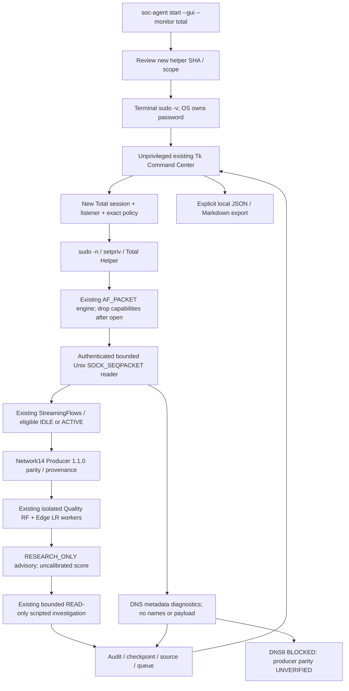
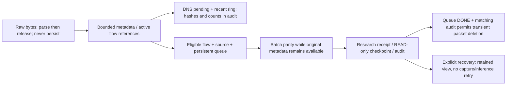

# Unified Total Monitoring

## Scope and baseline

SOC baseline: `1c1fd27b82b7e967bc3c23936681d8d9629c4c31`, main;
ML: `e1a01260f0463a38d4d778859bc2a86f8e9cfbde`. Validation: 2026-10-16,
WSL2/WSLg. Both starting indexes were empty. Inventories preserve 122 existing
SOC changes, 10 ML changes, the failed native session and research artifacts.
No raw data, model, existing native DB, checkpoint or historical evidence is edited.
The only shared dirty file is pyproject.toml: the new console-script stanza is
staged separately; the user's existing pytest marker stays uncommitted.

This implements a bounded **Network research + DNS diagnostic** monitoring mode.
It does not provide operational Network/DNS AI, proven native total E2E, encrypted
DNS inspection, a recovered DNS9 producer or confirmed attack classification.

## Unified architecture



There is one privileged capture source. TotalCapture extends the existing reader;
StreamingMonitoring has an explicit total mode, not a second agent/runtime.
total_helper.py is a separate entry point into stream_helper.run. Its reviewed
session loader and DNS metadata option reuse the existing capture loop, statistics,
privilege drop, heartbeat, finite deadline, reader and backpressure handling.

## CLI startup and installation

The project console entry is `soc-agent = soc_agent.cli:main`. In the existing
activated environment:

```bash
cd ~/kdt-linux/autonomous-soc-agent
source .venv/bin/activate
soc-agent start --gui --monitor total
```

`.venv/bin/soc-agent start --gui --monitor total` is the equivalent explicit path.
The existing local environment received only this console launcher; no package
or model was copied/reinstalled. A clean installation obtains it from the project
metadata through the normal environment setup. `python -m soc_agent` is also supported.
The old `python -m soc_agent.gui` command remains available without auto-capture.

Startup verifies normal UID/capabilities, display/Tk availability, the checked-in
helper manifest and existing Network research artifact/environment metadata.
It prints the new helper and bundle digests, exact scope and DNS9 restriction.
Only an explicit `yes` proceeds to terminal sudo authentication. That confirmation
is a scope decision, not a password prompt. Cancellation, denial, no terminal,
missing display/dependency/artifact and timeouts block startup.

After one interactive `sudo -v`, the normal-user GUI opens. Its Backend prepares
a fresh private session/listener and launches only a fixed `sudo -n setpriv ...`
command with that session digest. The second invocation cannot prompt. A missing
or expired sudo ticket is refused, not recovered by asking for a GUI password.
No sudo -S, shell interpolation, password API, credential pipe, password file,
sudoers change, root GUI, global Python setcap or unbounded restart is used.
The OS's normal sudo ticket policy is unchanged. GUI Stop/Close first shuts down
the owned session, drains or rejects pending work, then cancels its owned launcher.

The authentication handoff is Mock-verified only. Actual terminal authentication,
sudo/setpriv execution and capture were **not** performed by the agent. GUI Start
without a CLI-approved SHA requests a fresh terminal launch. Restart can reuse
only the same explicitly approved helper scope and a still-valid OS ticket;
expiry/failure is visible and never causes another interactive prompt or retry.

## Privilege scope and new approval

The Total session contract is `soc-total-monitoring-session:v1`; it accepts only
the exact default reviewed policy: lo, 300 seconds, 128 raw frames/s, burst 256,
maximum 38,656 raw frames, transport queue 512, inference queue 8, active flows 128,
8 MiB packet metadata, controller RSS 768 MiB, disk 64 MiB, 64 inference attempts
and 30-second graceful deadline. Existing lower-level schemas allowing other
durations do not authorize them for Total mode. No rate/frame/duration increase.

After the socket opens, effective/permitted/inheritable/ambient capabilities
must be zero, bounding set limited to NET_RAW and NoNewPrivs=1. Peer verification
checks UID/GID, executable, argv/module, session digest, process start, capabilities
and the opened lo raw socket. Total mode rejects an ordinary-helper module or
changed session/code/interface/interpreter. Names in transported DNS metadata are
rejected. No native request is authorized by a caller-supplied fixture flag.

**The previous streaming-helper approval is invalid for the new engine bytes.**
Historical evidence and its original SHA are preserved, not restamped as new proof.

| Reviewed file / bundle | SHA256 |
|---|---|
| Previous streaming helper, historical only | `1cc1c1f39007d1e8f53207dcd5f79f2128b12ea8077d5d09fcb6a72c5d037c84` |
| New separate total_helper.py | `1c178e650e08f6c8da9957ee8020bd594cd71efff222dbfc8ac22739371d1e31` |
| Changed shared stream_helper.py | `5f767a6e6cb69a9b79853d5f714649f5a8ebf74af9c05867f393273b68fb633b` |
| Canonical nine-file Total bundle | `e26057b77534b552701826dd1c4d6829e76d94fcfc0bb8c263fd661f2038ac0f` |

`total-helper-manifest.json` pins all nine helper/dependency files; Total startup
and helper loading compare current bytes against it. The legacy one-shot
live_helper.py remains unchanged. New native execution requires separate user
approval of the new SHA, bundle and DNS metadata scope. Old failed commands are
not reusable and historical native session loaders are not silently migrated.

## Network and DNS processing

Network14's names/order, float32, packet IP lengths, exact kernel ns, first-seen
direction, idle=30s and active=120s remain unchanged. Event time advances timeout
processing; no wall-clock packet or idle observation is fabricated. Without a
later packet watermark, a pending flow can end SHUTDOWN and remains ineligible.
Each eligible flow is checked against the existing batch Producer before inference.

DNS uses the existing bounded Ethernet/IP/UDP/TCP parser, retain_name=false.
Only transaction ID, response flag/rcode, question type/class and original-case
wire-name digest cross the socket. UDP DNS and one complete length-prefixed TCP
DNS message per packet are supported. TCP segmentation/coalescing/reassembly,
fragments and unsupported DNS formats remain parse diagnostics. No second raw
socket, plaintext FQDN retention or payload storage is introduced.

DNS correlation includes session, protocol, client/server endpoints, transaction
ID, type, class and question digest. Published references hash session, packet
sequence, input metadata digest and timestamp origin. Pending queries and
ambiguity tombstones are bounded to 128 each. Duplicate query identities are
ambiguous, not guessed unique; unmatched responses remain unmatched. The 5-second
event-time diagnostic window reports missing responses only as not observed,
not confirmed packet loss/attack. Stop also records queries with no observed
response; abort marks their assurance unverified. Pending-cap overflow aborts.
GUI history holds the latest 128 diagnostics; full diagnostic events remain in
the bounded runtime audit/disk budget. TCP retransmissions are not silently counted
as new verified queries. Port 443/853 content is UNKNOWN, not inferred DoH/DoT traffic.

The ML DNS9 contract was inspected: FQDN_count, subdomain_length, numeric, entropy,
special, labels, labels_max, labels_average, len; contract digest
`3276c1b595ec566677bce530f2839247b7fa1320dc5e3549f85c0c17c959edd0`.
Preprocessing is named StandardScaler followed by manifest round/clip/int8 tensor
quantization. Existing model SHA is
`28e089af363dd565a4fb3d3f202de9e9f9804bd14a164de4fd7b61adb1201e33`;
scaler SHA is
`2735f7650a7d7888ee68f2df870b4e29d83666962931ae2aecb9aa339f40266a`.
Both existing local files match. Raw-FQDN training producer/golden parity is still
absent. The separate experimental DNS7 producer is incompatible. Total mode
therefore produces DNS diagnostic counts, query type, rcode and response latency,
**no DNS9 vector, DNS9 worker invocation or DNS9 detection claim**.

## AI and autonomous READ-only investigation

Eligible Network flows feed the existing serial consumer and isolated model
processes. Quality RF SHA:
`53c1029cc70b9d038bf46278818905c969dc3ddfb086c673466298ebdfa56603`;
Edge scaler/LR SHA:
`661322193df782f958e88eb9da23f0dc4d17be328cfa63635865ce63e0fd2882`.
Artifact verification precedes deserialization. Network14 input/provenance/digests,
bounded attempts, worker timeout/crash isolation and duplicate receipts are reused.
Workers do not share privileges with capture.

Successful research outputs automatically enter the existing READ-only scripted
investigation, including anomalous scores. It preserves separate advisory context,
evidence references, INFO/unknown operational threat confidence, assessment,
checkpoint and audit. One serial dispatch, 20-second investigation timeout and
existing deterministic advance/tool budgets prevent unbounded investigation.
This is not a newly enabled online LLM provider or a validated operational risk
classifier. Uncalibrated scores are not attack probabilities. No new operational
Finding, policy override, automatic model promotion or security WRITE is created.

## GUI and result sharing

The existing Tk Command Center adds Total Monitoring navigation and dashboard
summary. Its streaming view reuses packet/flow/inference/queue/resource charts,
worker counts, collector and authentication states, timestamp/counter integrity,
abort/last error, DNS diagnostics and explicitly blocked DNS9/operational gates.
DNS diagnostics appear separately from model results with their real input origin;
they never increment DNS inference counts. Model/investigation/audit details reuse
the existing detail view. No data is generated to fill empty graphs.

Explicit Export JSON / Export Markdown buttons use the local save dialog. Output
includes event/session identity, source/provenance digests, bounded model receipt
fields, uncalibrated score, actual assessment assurance, investigation/checkpoint
summary, evidence references, diagnostic DNS events and the audit head. It excludes
raw frames/payload, plaintext DNS names, endpoint addresses, credentials and local
configuration paths. Files are new-only, mode 0600, <=1 MiB, fsynced; existing files
and symlinks are not overwritten. There is no upload/network-sharing operation.

## Retention, audit and recovery



Active flow memory is bounded and released on completion/abort. Up to 128 packet
references per flow are retained until batch parity, rather than deleting them
before the Producer can verify them. Queue capacity, active-state budget, disk
limit and retained-flow limit fail closed. Receipt, source identity, advisory and
audit persist under those limits. No old native evidence is pruned.

Normal CLOSED drains validated transport packets before finalization; missing,
unclean or rejected CLOSED blocks completion. Counter UNKNOWN, drops, sequence
errors, reverse event time, queue overflow, SQLite/checkpoint corruption and worker
uncertainty retain UNKNOWN/BLOCKED dispositions. Recovery never resumes capture or
repeats an uncertain inference. Retained results do not increment current calls.
DNS diagnostics restore from the retained validated runtime state, with no new
DNS observation. Restart requires explicit operator action and a new session.

## Failed native session and unresolved causes

Read-only session: `session-1ebbfc50fe9341609f252a22d3df6b1f`.
Its verified READY has zero initial kernel packets/drops. Rejected CLOSED reports
364 raw frames, 182 sent packets, elapsed 0.8638847119982529s, counter sequence 365,
kernel cumulative 364, drops 0, explicit STREAM_RATE_BUDGET_EXCEEDED and matching
post-drop capabilities. Transport delivered 182, queued 0, high-water 19/512.
The six-entry audit verifies through
`a4c6e5d0060392d2d409aa443b941d8701cfa8e4be6d0232e2b4190cf5012ad2`;
its Abort Audit binds the rejected CLOSED digest
`2646844919a76fe27abfd00f0946ea1c366388f34daa504bd6cea4203ea680c1`.
All native SQLite integrity checks are `ok`; finalized flows/inferences are zero.

This confirms rate rejection and preserved failure evidence, not a clean capture
completion. Tokens/refill timestamps and the offending subwindow remain absent:
ACTUAL_BURST_UNKNOWN and TOKEN_BUCKET_DEFECT_UNKNOWN. Overall elapsed/average rate
cannot reconstruct a token bucket trajectory, including capped refill before the
first receive or delayed/bursty receives. No limiter tolerance or policy is raised.
The prior STREAM_TIME_REVERSED root cause remains UNKNOWN; strict ns ordering is
unchanged. The integration does not claim those native root causes are solved.

## Validation results

All native permission launchers in tests are Mocks; an audit hook rejects
AF_PACKET/IPv4/IPv6 socket creation. Unix sockets are ordinary-user local fixtures.
Actual model inference is distinguished from Mock authentication/capture/clocks.
Results below are separate invocations, never summed as independent tests.

| Invocation | Result | Elapsed |
|---|---|---|
| Initial Total DNS / helper / actual model integration | 18 passed | 10.79 s |
| CLI / authentication mocks | 9 passed | 3.79 s |
| Total Unix transport / helper / WSLg | 21 passed | 27.83 s |
| First related full regression | 465 passed, 2 failed, 1 skipped | 331.26 s |
| Historical approval identity correction | 3 passed | 0.34 s |
| Additional bounded Unix replay to actual RF/LR | 2 passed | 29.79 s |
| First independent export | 465 passed, 2 failed, 1 skipped | 324.18 s |
| Isolated diagnosis of the stale Mock heartbeat case | 1 passed; not itself a fix | 1.91 s |
| Deterministic READY/startup preparation corrections | 11 passed | 87.91 s |
| Final independent export including governance | **574 passed, 1 skipped** | **287.34 s** |

The first full run failed because historical evidence tests compared the new
shared-helper bytes to the old approval. The immutable evidence stays unchanged;
tests now assert the historical SHA and separately verify the new pinned bundle,
explicitly rejecting approval transfer. The first export then exposed two setup
races: a Mock READY aged through SQLite setup before the no-op handshake, and a
GUI fixture could click before the scheduled initial model-status lookup. The
Mock now delivers READY at handshake; Desktop exposes startup_complete and the
GUI test pump waits for it. Production's 2-second heartbeat lease is unchanged.
An isolated rerun passing was diagnostic, not treated as resolution. The final
full export exercises the corrected cases. No failed run is reported as passed.

Final groups: unit/network_capture, unit/streaming_network,
integration/streaming_network, unit/live_network, integration/live_network,
integration/research_adapter, integration/linux_runtime, unit/policy, unit/approval,
unit/improvement_candidates, unit/improvement_review, unit/improvement_promotion,
gui_streaming_checks.py, gui_live_network_checks.py and gui_total_monitoring_checks.py.
The one skip requires explicit retained-native-session opt-in. Guard-reported
AF_PACKET/IPv4/IPv6 socket attempts are zero in these runs. No retained-session
opt-in or native permission command was executed.

Actual WSLg tests exercise CLI-approved automatic startup with a Mock launcher,
visible auth/start failure, real RF/LR on explicit fixtures, DNS diagnostics,
GUI-triggered local export and resize at 1920x1080, 1366x768 and 1280x720.
Retained receipt restoration asserts zero new inference and no LIVE state. The
Unix replay test exercises the reader/queue and converts its mocked kernel-shaped
input explicitly to FIXTURE before the models; mocked peer attestation is never
used to claim Native model authorization.

The final export contains only the recorded clean SOC/ML HEADs and 32 explicit
task files. User changes and Reliability Replay are absent. pyproject.toml is
the clean HEAD plus only the console-script stanza. Existing trusted external
models/interpreter are referenced and SHA-checked; binaries are not copied.
Source/test SHA comparison, package entry metadata, helper manifest, receipt and
document digests are checked against that export before staging. Ruff check,
format check and git diff --check pass; no ML file was changed or reformatted.

### Actual research evidence and performance

[Public redacted fixture evidence](unified-total-monitoring-fixture-evidence.json)
records session `15127d03-2325-4e90-9b86-f1341c63b007`: two eligible flows,
Quality 2 and Edge 2 actual calls, four ASSESSED_READ_ONLY investigations and a
matched DNS response. All predictions are CLASS_0; this is not an attack-detection
or accuracy experiment. Document digest:
`20cd79e6a13f580f24c40d07349ec5afff14dfff93e57f57fdccd5a32c1eb2e1`.

| Actual Fixture result | Score | Model inference ms | Worker peak RSS bytes |
|---|---:|---:|---:|
| Quality / Network flow | 0.140625 | 9.6140 | 233820160 |
| Edge / Network flow | 0.0876602530 | 11.9877 | 232726528 |
| Quality / DNS transport flow | 0.2265625 | 16.2972 | 233484288 |
| Edge / DNS transport flow | 0.0252856854 | 6.4508 | 232939520 |

The latter two are **Network14 classification of packet flows carrying DNS**,
not DNS9 inference. Worker startup and investigation time are excluded from the
model latency field. Measurements are single runs under concurrent WSL load,
not model-ranking or hardware-capacity benchmarks.

Five-minute paced real-time Fixture command:

```bash
.venv/bin/python -m tests.total_monitoring_soak /tmp/total-soak-result.json
```

| Final 5-minute Fixture metric | Measured result |
|---|---:|
| Monotonic elapsed including startup/drain | 302.255565581 s |
| Periodic samples | 273 |
| Packets / finalized flows | 350 / 13 |
| Eligible / excluded flows | 10 / 3 |
| Actual Quality+Edge calls | 20 |
| DNS queries / matched responses | 28 / 28 |
| Sampled controller peak RSS | 184946688 bytes |
| Controller CPU (excludes worker CPU) | 29.167301875 s |
| Sampled peak inference backlog / capacity | 2 / 8 |
| Last / maximum sampled advisory processing time | 5.122941395 s |
| Final backlog / active metadata bytes | 0 / 0 |
| Finalization / last error | VERIFIED / null |
| Timestamp status | ORDERED_PREFIX_ONLY |
| Kernel drops / native rate / total detection latency | UNKNOWN / UNKNOWN / UNKNOWN |

No worker failure was observed. The processing metric includes worker lifecycle
and investigation; it is not event-to-detection latency. Synthetic events are
paced near 1/s, so this does not qualify native 128 FPS throughput or a 30-minute
Total soak. Rate burst/boundary/backpressure cases are separate fixtures. The
prior 30-minute Network-only evidence remains historical. A preliminary Total
soak also completed (301.758830863 s, 20 calls), before the final DNS input-reference
hash addition; it is not substituted for the final run.

Final soak audit head:
`d2c7c6ba8da6298f4cbfc42825debb49a2600c47317ba5ff3252cfcfd785346a`.
Private detailed resource-result SHA256:
`1409e882ac36562305685e0dce9a0ac474dfdf296a889749ba3306f28b4aed95`.
Temporary Fixture DBs are not committed. The subsequent GUI-startup and export
presentation changes do not alter the capture/flow/worker path measured by this
soak and are covered by the final functional regression.

### Acceptance matrix

| Item | Result / validation scope |
|---|---|
| ONE_COMMAND_STARTUP_READY | Console entry/help and complete Mock handoff verified |
| AUTHENTICATION_HANDOFF_VERIFIED | Mock only; actual sudo authentication pending |
| NETWORK_COLLECTION_READY | Implemented; new helper approval/native run pending |
| DNS_COLLECTION_READY | Bounded metadata diagnostics; Native total run pending |
| STREAMING_STABILITY_VERIFIED | 5-minute Fixture and bounded failure regressions only |
| NETWORK14_PARITY_VERIFIED | Existing Producer unchanged; per-flow actual worker checks |
| DNS9_PARITY | BLOCKED |
| QUALITY_INFERENCE_VERIFIED | Actual Artifact, explicit Fixture |
| EDGE_INFERENCE_VERIFIED | Actual Artifact, explicit Fixture |
| DNS_INFERENCE | BLOCKED |
| AUTONOMOUS_INVESTIGATION_VERIFIED | Existing scripted READ-only research path |
| GUI_TOTAL_MONITORING_VERIFIED | Actual WSLg, Mock auth and explicit Fixture data |
| RESULT_EXPORT_VERIFIED | Explicit local JSON / Markdown; no overwrite or upload |
| AUDIT_RECOVERY_VERIFIED | Fixture/retained receipts, no automatic retry/promotion |
| NATIVE_TOTAL_E2E | PENDING |
| OPERATIONAL_PROMOTION | BLOCKED |

## Native validation plan and remaining blockers

1. Review/approve the new Total helper SHA, bundle, DNS metadata scope and unchanged
   lo/300s/128 FPS/burst256/frame38656 policy. No previous approval transfers.
2. Close the old GUI, activate the existing environment and run the one-command
   CLI yourself. Confirm scope, authenticate once in the terminal, then inspect
   individual collector, counter, timestamp, DNS9 and worker states in the GUI.
3. Use Stop (drain) or the finite deadline. A rejected/missing CLOSED is failure,
   not success. Preserve the new session's audit and rejected/verified CLOSED.
4. Verify eligible IDLE/ACTIVE flows and actual NATIVE_AF_PACKET receipts,
   read-only investigations, no duplicates and recovery; export explicitly.
   No eligible flow means inference pending, not a fabricated zero-latency result.

The agent has not performed these privileged steps. Heavy lo background traffic
can still exceed the approved raw rate. Exact native rate/timestamp causes require
separate instrumentation/evidence and possibly a separately approved isolation or
budget experiment. DNS9 training parity, physical-server performance, encrypted
DNS visibility and validated operational threat assessment remain blocked.
Overall readiness is **PARTIAL / NATIVE_TOTAL_E2E_PENDING**; operational promotion
and security WRITE remain blocked.
