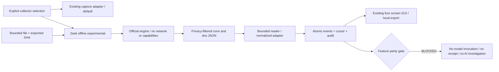

# Experimental Zeek collector integration

## 1. Result and collector selection

**PARTIAL — actual Zeek offline analysis and adapters verified; Zeek model inference blocked.**

The existing capture collector remains the default. Zeek is an explicitly selected
experimental **offline PCAP** collector. Native Zeek capture is not implemented or
approved in this change. The legacy, calibrated v2 and direction-aware v3 helpers,
policies, manifests, Native sessions and previous evidence remain intact.

Baseline: SOC `53c378ab511353c5775f436d24656652c84fc694`,
ML `e1a01260f0463a38d4d778859bc2a86f8e9cfbde`.
Original uncommitted user files: SOC 122, ML 10; the initial index was empty.
Implementation details and measurements are recorded in
[zeek-collector-evidence.json](zeek-collector-evidence.json).

Zeek provides connection and DNS protocol summaries and an established parser.
Its summaries do **not** establish compatibility with packet-derived trained
features. Collector choice and model input eligibility are separate decisions.

## 2. Version, license and environment

Actual tested environment: Ubuntu 24.04.4 / WSL2 kernel
`6.18.33.2-microsoft-standard-WSL2`, Python 3.12.14, CPU affinity 12,
approximately 7.6 GiB guest RAM, no GPU use. Existing Docker was accessible to the
ordinary user; no host system package, Python model environment or WSL setting
was changed. No host Zeek executable was available.

The official `zeek/zeek` amd64 image was pulled and verified as **Zeek 9.0.0**:

```text
zeek/zeek@sha256:3fac39de707be96cb1a8163cab98a11bb2a1aa9e3535247db0f17b9c4670a019
```

Zeek uses the BSD 3-Clause license. Official sources:
[repository](https://github.com/zeek/zeek),
[license](https://github.com/zeek/zeek/blob/v9.0.0/COPYING),
[official image instructions](https://github.com/zeek/zeek/blob/v9.0.0/docker/README).
The application only inspects the pinned local image; it never automatically
pulls a missing image. Docker membership is an existing host trust boundary,
not an authentication mechanism added to the GUI.

WSL2 **offline container execution** was observed. Official Windows/WSL live
support, live interface visibility and Native throughput remain UNKNOWN. No
installation workaround or unverified third-party binary was used.

## 3. Architecture and lifecycle



`Collector` exposes prepare, start, stop, health, network_events, dns_events,
metrics, snapshot and recover. `ExistingCaptureCollectorAdapter` forwards the
existing owner without creating a second runtime or worker. Its network event
projection retains the existing research-record meaning; it is not a packet
source. `FixtureCollector` uses the same adapter/store with explicit
`SYNTHETIC_ZEEK_JSON` provenance and no Zeek process.

The GUI reuses its existing asynchronous worker. Zeek owns only one bounded
file-analysis subprocess; models are never loaded by this collector. Backend
admission rejects concurrent preparation/processing against existing live,
streaming or Total owners. There is no second privileged collector.

Lifecycle: STOPPED → READY_OFFLINE → OFFLINE_PROCESSING → STOPPED / ERROR.
Recovery never launches Zeek. A missing successful process-output manifest,
changed log, invalid cursor, conflicting event identity or broken audit blocks
recovery. It cannot turn a failed session into a verified capture.

## 4. Installation and reproduction

Prerequisites are the existing SOC virtual environment, accessible Docker, and
the exact official image above. Where the image is absent, an operator with
existing Docker authorization may install it using:

```bash
docker pull zeek/zeek@sha256:3fac39de707be96cb1a8163cab98a11bb2a1aa9e3535247db0f17b9c4670a019
```

Application startup does not install packages or request OS authentication for
file analysis. From the SOC repository:

```bash
.venv/bin/soc-agent start --gui --monitor total --collector zeek-offline \
  --pcap /approved/input.pcap --pcap-sha256 EXPECTED_SHA256
```

System opens with Zeek selected. Press **Prepare monitoring** to start offline
processing. GUI selection also supports a file dialog; bounded hashing runs off
the Tk thread. Existing `python -m soc_agent.gui` still starts the default GUI.
No model, Native capture or fixture replay runs merely because the GUI starts.
Stop, recover and JSON/Markdown export use the selected collector. Zeek archival
requires verified manual review; existing Native archival tools remain intact.

## 5. Offline execution and source identity

The test PCAP is built from existing synthetic Golden packet fixtures, not a
recording of a newly generated network exchange. Its SHA256 is:

```text
442e4a47f1345e315005e56c29a95460be40ab97a17caffe0a503adf948c3d80
```

Actual official Zeek processing produced **2 connection records and 1 matched
DNS transaction**. The selected Golden connection had duration 1 s, forward/back
packet counts 2/1, IP bytes 120/60. DNS transaction 7 had qtype 1, rcode 0,
TTL 60 and reported RTT 0.04999995231628418 s. This precision is Zeek's reported
value, not a claim of exact kernel nanosecond accuracy.

Each event binds the session UUID, PCAP digest, Zeek version, schema, origin,
UID, raw-record digest and durable collector sequence. Zeek UID identifies a
Zeek connection; it is not the existing Network14 flow ID or a global identity
across new Zeek invocations. Re-running a PCAP creates a new explicit session.

The first smoke run exposed an incorrect privacy filter (`id` rather than dotted
endpoint fields). That diagnostic run is not the successful mapping evidence;
the corrected privacy script and all final tests use dotted field names.

## 6. Network event schema

The normalized record preserves reported start time as integer nanoseconds,
UID, endpoints, protocol, optional duration/counts/IP bytes, connection state
and missed bytes. Missing values remain null. NaN, invalid types, sub-nanosecond
reported timestamps, oversized rows and unsupported schemas fail closed.
Global connection start times may arrive out of order because logs describe
completed connections; this is counted, not confused with per-packet ordering.
No packet ordering, losslessness or Native counter verification is inferred
from a `conn.log` summary. See the official
[conn.log reference](https://docs.zeek.org/en/current/reference/logs/conn.html).

## 7. Network14 feature mapping

Existing producer: `network14` / v1.1.0, float32, unchanged feature order.
Feature-contract digest:
`84ba0916f0ce4e9e12bb70712db2cd1eaea84ba4173acd57b647faf38efb1c6e`.

| Feature | Classification | Limitation |
| --- | --- | --- |
| duration_seconds | SEMANTIC_MISMATCH | Connection lifetime versus 30 s idle / 120 s active windows |
| forward_packet_count | SEMANTIC_MISMATCH | Originator versus proven first-seen/window direction |
| backward_packet_count | SEMANTIC_MISMATCH | Responder/window identity unverified |
| forward_ip_bytes | SEMANTIC_MISMATCH | Direction/window identity unverified |
| backward_ip_bytes | SEMANTIC_MISMATCH | Direction/window identity unverified |
| ip_length_min | MISSING | Per-packet lengths absent |
| ip_length_max | MISSING | Per-packet lengths absent |
| ip_length_mean | DERIVED | Conditional on identical complete counts and byte scope |
| ip_length_population_std | MISSING | Second moment absent |
| tcp_syn_packet_count | MISSING | History is not every packet's flag count |
| tcp_fin_packet_count | MISSING | Same limitation |
| tcp_rst_packet_count | MISSING | Same limitation |
| iat_mean_seconds | DERIVED | Conditional on identical ordered complete packet window |
| iat_max_seconds | MISSING | Per-packet arrival sequence absent |

The real ML producer test constructs two traces with identical connection
summary counts, bytes and duration, but different length statistics and maximum
IAT. Therefore the summary is not invertible. Selected Golden fields agree;
**full Network14 parity does not**. No padded vector, feature digest or model
receipt is manufactured.

Alternatives: (A) add a separately reviewed Zeek packet/window script and prove
all 14 features against independent Golden pairs, including direction, flags,
precision and windows; (B) keep the existing packet metadata producer (current
default, without concurrent duplicate interface capture); (C) train a distinct
Zeek-feature model under a separate approved project. No retraining is done here.

## 8. DNS mapping and DNS9 gate

The privacy-filtered DNS log maps transaction ID, reported query time,
query type, rcode, optional RTT, TTL list and truncation bit. TCP/UDP JSON records
are accepted; the actual engine integration test exercised UDP. Actual TCP
reassembly/completeness is not claimed. Zeek supplies transaction-level matching;
UID + transaction + timestamp scopes duplicate suppression. Missing response
metadata is explicit and is not converted to a zero RTT. Conflicting identities
are rejected. The adapter cannot reconstruct individual query/response packet
times when Zeek omits them. See
[dns.log reference](https://docs.zeek.org/en/current/reference/logs/dns.html).

FQDNs, answers and payload are excluded before host persistence. The DNS9 fields
`FQDN_count`, `subdomain_length`, `numeric`, `entropy`, `special`, `labels`,
`labels_max`, `labels_average`, `len` are all MISSING under this collection policy.
Its training-producer/scaler parity is independently unverified. **DNS9 BLOCKED.**
Encrypted-transport port hints indicate visibility limits, not proof of DoH/DoT
or a finding. Zero plaintext DNS events cannot establish absence of DNS traffic.

## 9. Bounded reader, audit and recovery

- Input PCAP: 16 MiB maximum, expected SHA, size/magic checks, no symlink leaf.
- Official container: ordinary UID/GID, network none, all capabilities dropped,
  read-only root, no-new-privileges, 512 MiB memory/no additional swap, one CPU,
  64 PIDs, 16 MiB private tmpfs, no Docker stdout log retention.
- Inner engine deadline 55 s (+2 s kill grace), controller watchdog 60 s;
  no automatic restart or unlimited retry. Only its own returned container ID
  is removed. Abrupt parent SIGKILL can leave stopped container metadata;
  Native parent-crash supervision is not asserted.
- Row: 16 KiB, max 128 keys. Total transported output: 8 MiB. Reader batch and
  queue: 32, high watermark 24. Queue overflow is explicit failure.
- Store: 4,096 events, 64 MiB per-session budget checked each ingestion batch,
  eight sessions (at most 512 MiB checked data budget, filesystem overhead
  additional). On retention exhaustion, manual verified review is required;
  no existing evidence is deleted and no limit is silently expanded.
- Normalized event, deduplication ID, cursor and audit commit atomically in the
  existing SQLite/governance infrastructure. Events/cursors/source identity
  are checked against the existing hash-chain audit. Payload+local-digest
  rewrites and missing checkpoint rows are rejected.
- Reader handles newline-complete records, bounded partial rows, prefix digest,
  rename rotation and draining the previously opened inode. Truncation, changed
  prefix and uncheckpointed rotation after process restart fail closed.
  Writes to an old inode after observed EOF cannot be proven complete.

Offline output is ingested after Zeek completes, so the tested application path
is bounded offline processing, not a running live log tailer. The incremental
reader is fixture-tested independently. Capture-to-log latency, Native loss,
Native log lag and future live rotation completeness remain UNKNOWN.
The Zeek log framework and filter/rotation concepts are documented in the
[official logging framework](https://docs.zeek.org/en/current/frameworks/logging.html).

## 10. AI and SOC investigation

Zeek input is blocked before any model invocation. Source digest verification
proves a file's identity, not Native capture quality or feature equivalence.
There are **zero Zeek model receipts, zero AI advisories and zero AI-triggered
investigations**. Diagnostic events stay distinct from the advisory count.

The unchanged existing packet/producer path was exercised with actual RF/LR
artifacts in isolated synthetic fixture runs. This checks regression preservation
only. It does not validate a Zeek feature vector. Research-only receipts and
READ-only investigations retain their existing provenance and policy boundary.
Artifact SHAs remain Quality
`53c1029cc70b9d038bf46278818905c969dc3ddfb086c673466298ebdfa56603`, Edge
`661322193df782f958e88eb9da23f0dc4d17be328cfa63635865ce63e0fd2882`.

## 11. GUI and local export

Dashboard, Security Events, Investigation and System remain the four screens.
Existing cards, Canvas charts, timelines and detail panels remain. System adds
an explicit collector selector, health, queue, parity and error details; no new
research navigation screen or visualization dependency is added. Offline log
record rates have different keys/units from Native frame/packet rates.
Stopped/error sessions do not generate moving Live history. Unobserved latency,
loss and lag are UNKNOWN, not zero. Model scores are absent when inference is
blocked. Diagnostic facts have no fabricated severity or investigation progress.

Twelve actual WSLg screenshots at 1920×1080 and 1366×768 are retained in
[zeek-collector-screenshots](zeek-collector-screenshots/): eight explicitly
Synthetic JSON screens and four **actual Zeek offline PCAP** Dashboard/System
screens. Neither group is Native capture evidence. Screenshot hashes are in the
JSON evidence. Public screens contain no source PCAP path or credentials.

JSON/Markdown export is a user action, contains normalized source facts, audit
reference and blocked gates, and refuses overwrite. It does not create model
receipts, send to a remote service or initialize the Native runtime.

## 12. Performance

Same WSLg/interpreter, baseline Git export versus changed workspace, three fresh
idle processes each, 3 s idle observation per run. Startup includes imports and
first completed backend status. Idle medians:

| Metric | Baseline | Changed |
| --- | --- | --- |
| Startup | 2.566 s | 2.340 s |
| Idle RSS | 175.24 MiB | 175.00 MiB |
| Idle one-core CPU | 0.328% | 0.278% |
| Tk callback p95 | 0.063 ms | 0.028 ms |
| Idle model/runtime owners | 0 / 0 | 0 / 0 |
| Idle owned child processes / SQL statements | 0 / 0 | 0 / 0 |
| Widgets | 68 | 69 |

One active existing-path RF/LR fixture run each: sampled subtree peak RSS
419.72 → 422.05 MiB, elapsed 5.42 → 5.10 s, queue final 0, one owned model
subprocess, finalization/audit VERIFIED and no child remaining after close.
Small differences are observations, not a controlled speedup or proof of a
memory reduction. This does not include a Native Zeek collector workload.

Adapter benchmark: same three-packet Golden flow, 100 warmup operations,
five rounds ×1,000 operations per stage. Existing three-packet decoding:
22,851 flow operations/s, p50/p95/p99 0.031/0.070/0.132 ms;
one precomputed Zeek summary mapping: 43,447/s, 0.017/0.038/0.065 ms.
Zeek engine processing is excluded from that adapter figure, and the outputs
have different information content. **These are not equivalent full pipelines
or a Native throughput comparison.** CPU/RSS and exact measurements are in JSON.
Reproduce this bounded microbenchmark with
`.venv/bin/python -m tests.zeek_collector_profile`.

## 13. Tests and independent export

Workspace final contract run: **48 passed**. Actual WSLg collector/default
four-screen/chart run: **7 passed**. Earlier broad workspace regression:
531 passed, explicitly an earlier run before the final display/recovery fixes.
Counts are per invocation and must not be added across overlapping runs.
Final independent-export runs (all exit 0, with the capture-denial guard):

| Invocation | Result | pytest elapsed |
| --- | --- | --- |
| Collector + existing Network/DNS/GUI/producer/research unit regression | 533 passed | 47.66 s |
| Actual official Zeek offline integration | 1 passed | 1.54 s |
| Existing actual RF/LR fixture + READ-only investigation/recovery | 1 passed | 11.26 s |
| Actual WSLg collector + default four-screen/chart regression | 7 passed | 26.54 s |
| Policy, approval, investigation, audit, transport recovery | 125 passed | 13.24 s |

These five disjoint suites contain 667 tests. Model regression produced four
FIXTURE-origin receipts (two per profile), four READ-only investigations, zero
final queue backlog and recovery without new inference. It is not Zeek AI
success. Model preflight MemAvailable was 4.19 GiB and PSI avg10 was 0.00;
actual model tests ran serially. No test failed or was retried to conceal failure.
A subsequent two-test GUI run refreshed the final screenshot set; it overlaps
these suites and is not added to their count. Documentation/manifest integrity
was separately verified with 2 passed in the workspace and 2 passed in the
independent export (the same two tests, not four distinct tests). Thus the
export contains 669 distinct passing tests across these six invocations.
Ruff, format and workspace diff checks passed; the clean export also passed
Ruff/format. An offline wheel build passed and contains the exact privacy Zeek
script. No package was installed by the build.

Independent export uses Git HEAD plus the exact task file allowlist, clean ML
HEAD for producer source, and external unchanged model/interpreter references.
It excludes the 132 original user files, Reliability Replay, Native DBs,
archives, raw datasets and model binaries. No model artifact is copied.
Timestamp/UID/screenshot pixels are not expected to match new runs bytewise;
source PCAP, model/feature contract identity, event counts, source origin, gates,
receipts (where allowed), audit/recovery behavior and screenshot file digests
are checked instead.

Tests cover missing/invalid/schema fields, reported timestamp precision,
privacy, duplicates/conflicts, rotation/partial/truncated logs, resource bounds,
process failure/cleanup, source/output/checkpoint/audit tampering, recovery
without restart, CLI no-auth handoff, blocked model eligibility, existing
producer/model/SOC preservation, four-screen GUI and local exports.
No privileged command, AF_PACKET socket or test network traffic is executed.
The capture-denial guard reports zero network socket attempts.
Historical SIGILL root cause remains UNKNOWN; no claim of fixing it is made.

## 14. Remaining blockers and security

Network14 full parity BLOCKED; DNS9 parity BLOCKED; Zeek RF/LR and AI-triggered
SOC investigation BLOCKED. Native Zeek collection, live resource sizing,
rotation/restart losslessness and capture-to-log latency are PENDING.
Offline processing completion is not capture integrity verification.

No root GUI, password handling, raw payload retention, OS security WRITE,
automatic model promotion or privileged restart was added. Operational gate
remains BLOCKED / WRITE_DENIED. Existing helpers/manifests/policies were not
modified; no new privileged helper SHA or bundle approval replaces v3.

## 15. Next Native approval scope

No privileged live Zeek command is enabled in this revision. Before a user-run
Native trial, separately review a pinned executable/image and policy digest,
interface allowlist, bounded duration/rate/storage, minimal capture privilege
and privilege drop, process supervision, DNS visibility/privacy, shared capture
ownership, stop/drain and source attestation. Native execution must receive
explicit user approval under that reviewed contract. Existing helper approval
is not transferable. Feature parity must be independently established before
Zeek events can invoke Quality/Edge; DNS9 remains gated independently.


The unchanged direction-v3 helper SHA is
`aca215a347dfff3ada09e8605d0d490e4fcaa51c83c4f40318f5d916a45020a9`,
bundle `b072ab20ba3e08e74a3ba7e392ad5515ca65b60e8f6a094ec5c8d0b4f909cd96`.
Calibrated v2 remains
`375c06dbeb4e14c881fa496459182677b4efaa293845ecfac0dab0da663c4703`,
bundle `56ec48caac56a248fc0eeb5bb09c4fae4176482ed19ea8c48526f7638ae8bb31`.
The pinned official image plus audited `collectors/privacy.zeek` identify the
offline engine path; they are not a new privileged capture-helper approval.
