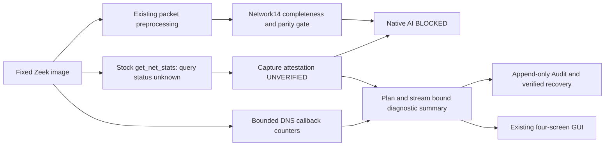

# Zeek capture attestation and DNS visibility diagnostics

Status: **PARTIAL**. Stock-image counter/query/handle limitations are preserved, not
renamed VERIFIED. DNS stage instrumentation is implemented and exercised by actual
nonprivileged Zeek offline analysis. No Native capture, sudo/setpriv/pkexec, network
or DNS test traffic, system security WRITE or model retraining occurred.

## Baseline and existing Native evidence

SOC baseline `9d48db524a900cd39f5b5a3303c438793b15f51c`, ML
`e1a01260f0463a38d4d778859bc2a86f8e9cfbde`, main, original indexes empty. Original
user/Replay changes, Native sessions/archives, Audit/checkpoints, model artifacts and
raw dataset metadata were recorded before edits. Original session inspection remains
read-only; no collector/runtime store was opened against that session.

Retained session `b9fe165ac83046edb2b6f82f14fc4e10` has 4096 packet metadata records,
117 durable Network events, stream sequence 4215, genuine CLOSED, exit 0 and verified
cleanup. All 51 windows end PACKET_LIMIT. There are 68 UDP53 metadata records and zero
DNS events. The earlier GUI 101 count was an intermediate observation. No packet
payload, analyzer-stage trace or same-handle query status was retained. No failed
session was replayed or modified. Packet records are not kernel/link packet counters.
The prior [integrity](zeek-native-capture-integrity.md) and
[preprocessing](zeek-realtime-preprocessing.md) reports remain immutable.

## Actual Zeek and libpcap research

The unchanged pinned image is:

`zeek/zeek@sha256:3fac39de707be96cb1a8163cab98a11bb2a1aa9e3535247db0f17b9c4670a019`.

A read-only, network-disabled, capability-free image query reports Zeek 9.0.0. Dynamic
link inspection identifies `/lib/x86_64-linux-gnu/libpcap.so.0.8`; calling that library's
actual `pcap_lib_version()` reports **libpcap 1.10.5 (with TPACKET_V3)**. Its binary SHA256
is `221fe09f13b357ef354caf2209c886f1c1f8161c5b26ff8ab73afa47dd922f28`.
This improves the previous UNKNOWN package query. The exact distro-patch source and
historic process memory mapping are not independently attested by an upstream tag.

Zeek 9.0.0 keeps `pcap_t* pd` private inside PcapSource. Statistics calls `pcap_stats(pd)`
for a live open source, but the script-facing numeric result has no query-success or
handle identity. Failure closes the source and cached totals can still appear; offline
or closed-source paths also expose accumulated values. Therefore numeric zero drops,
CLOSED and exit 0 do not prove successful capture statistics or window coverage.
[Zeek pcap source](https://github.com/zeek/zeek/blob/v9.0.0/src/iosource/pcap/Source.cc),
[private handle definition](https://github.com/zeek/zeek/blob/v9.0.0/src/iosource/pcap/Source.h),
[script statistics API](https://github.com/zeek/zeek/blob/v9.0.0/src/stats.bif).

Linux libpcap accumulates reset-on-read packet-socket statistics. `ps_recv` covers a
socket/filter/queue scope, not identical userspace metadata delivery; `ps_drop` is not
all interface/NIC loss. Loopback outgoing filtering can change observed/delivered counts.
A separate socket or tcpdump cannot attest Zeek's handle. An external read of reset-on-read
statistics can interfere with intervals and is not used.
[libpcap 1.10.5 Linux source](https://github.com/the-tcpdump-group/libpcap/blob/libpcap-1.10.5/pcap-linux.c).

A real offline-only C API experiment opens the synthetic PCAP with `pcap_open_offline`,
queries that same owned handle with `pcap_stats`, and closes it. The actual library
returns unsupported savefile statistics. Received/drop values are recorded **null**, not
zero. Its scope is OWNED_OFFLINE_HANDLE_NOT_ZEEK_NATIVE_HANDLE. This verifies the failure
path and library identity, not Native same-handle proof. No live-opening API is called.

## Attestation architecture and provider boundary

| Option | Same-handle and query status | Decision |
|---|---|---|
| Existing get_net_stats API | Handle/query success not exposed | Implement stock-image UNVERIFIED projection |
| Ordinary script/plugin consuming existing Stats | Cannot recover missing success/private handle proof | Not an attestation provider |
| New packet-source plugin owning Zeek's selected handle | Possible with separate reviewed implementation/image | Pending, not built or admitted |
| Core PcapSource extension around its own query | Can preserve original handle and explicit return status | Recommended future provider |

The chosen implemented path provides strict evidence schema/validation and stock-image
uncertainty, plus real DNS diagnostics. **No same-handle Native provider, patched Zeek
image or executable plugin was built/admitted in this change.** This is a material blocker,
not a successful Native attestation. No unvalidated C++ source or invented binary SHA is
presented as a working provider. A resource-heavy full Zeek rebuild is not performed.

A future Source extension should emit query return status before error handling erases
context, opaque handle generation, interface/namespace identity, before-first-delivery
and after-last-delivery boundaries, cumulative/reset semantics and bounded monotonic
samples. It should instrument the existing query, not create a second capture socket.
It needs a newly pinned image/provider digest, reproducible build/tests and separate
approval. Extra broad capabilities, ptrace or privileged sidecar capture are unnecessary
and not introduced. WSL2 Native compatibility remains untested.



## Evidence schema and validation

`capture_attestation.py` defines frozen `CaptureScope` and `CaptureSample`. They bind:
session UUID, collector/interface/image/provider digests, lo, namespace, opaque handle
identity/generation, counter source/width/semantics, sequence, START/INTERVAL/END,
explicit SUCCESS/FAILED/UNSUPPORTED/UNKNOWN, monotonic processing time, aware event UTC
and optional received/drop values. Failure/unknown samples carrying zero counters are
rejected. Samples are bounded to602; counters to their declared32/64-bit width.

The proposed-provider validator is **fixture conformance only**, with an explicit
SYNTHETIC_PROVIDER_CONFORMANCE_NOT_NATIVE_PROOF scope. A conformant fixture never grants
Native authorization. It verifies scope/generation/sequence, process/stream prerequisites,
complete observation-window coverage, known gaps and losses. It accumulates reset-on-read
intervals and checks cumulative monotonicity; reset or wrap is rejected unless a future
reviewed epoch contract proves its interpretation. Initial cumulative drops are not hidden.
UTC adjustments are not used as elapsed/deadline time. Missing bounds/gaps/query evidence
remain UNVERIFIED. Any loss or identity mismatch fails closed.

Actual stock-image session evidence includes declared plan/image/interface/namespace,
process/stream linkage, metadata accounting, unknown handle/query/start/end/delta/kernel
loss/gap fields, digest and UNVERIFIED verdict. Collector identity here is the bound plan
digest; it is not claimed to independently prove a capture handle. Existing process
identity verification remains separate. Query timestamps are unknown; Audit UTC is not
mislabelled as the time of a kernel statistics query.

| Domain | VERIFIED requires | Failure / missing evidence |
|---|---|---|
| Process | Identity, genuine CLOSED, reviewed exit and cleanup | FAILED / UNVERIFIED |
| Stream | Authenticated source, exact sequence/digest/closed accounting, drain | FAILED / UNVERIFIED |
| Counter | Reviewed same-handle provider, successful full-window queries | FAILED / UNVERIFIED |
| Packet accounting | Explicit scope and received/filter/delivery correspondence | UNKNOWN, never numeric equivalence |
| Flow | Existing complete supported timeout window | Incomplete budget/stop/gap remains blocked |
| Feature | Independent Network14 reference and digest/schema | BLOCKED_FEATURE_PARITY / unsupported |
| Native AI | All above plus explicit admission policy | BLOCKED; policy remains unchanged |

A fixture VERIFIED status is never projected as Native capture VERIFIED. Recovery does
not read a caller-provided counter sidecar as authority. There is no reviewed Native
provider registry entry or new Native model request path.

## DNS visibility pipeline

`visibility.zeek` uses existing Zeek events and DNS::LOG; it implements no new analyzer.
`live.zeek` includes a bounded `dns_diagnostics` extension in its **real** CLOSED event.
No extra stream sequence/event or synthetic CLOSED is added. The launcher and controller
validate the optional extension separately from legacy CLOSED accounting. Old CLOSED
records without diagnostics stay NOT_OBSERVED rather than becoming zero-valued records.
The entire extended CLOSED is covered by the exact existing stream digest and byte budget.

| Stage | Actual observation / unit |
|---|---|
| UDP/TCP53 candidate | raw_packet header ports, first4096 delivered header events |
| Header validated | Existing dns_message callback, header-level only |
| Header invalid | Exact DNS_truncated_len_lt_hdr_len anomaly |
| Analyzer dispatch | dns_message callback count; not every attempted dispatch |
| Query parsed | Existing dns_request questions, not necessarily one per packet |
| Response parsed | QR messages in dns_message |
| Transaction matched | Existing DNS::LOG with RTT metadata |
| Event emitted | DNS::LOG policy-hook invocation, before output filtering |
| Adapter accepted/rejected | Controller parser outcome; rejection remains fail-closed |
| DNS9 features generated |0, known blocked policy; no invented vector |

The header callback precedes full question/answer validation; it is not full-message
validity. Reviewed DNS_* anomaly counts diagnose parse failures without retaining the
reason text or payload. Transaction ambiguity and confirmed non-DNS/analyzer-not-attached
have no definitive source signal in this implementation and remain optional UNKNOWN;
zero is not invented for those stages. Schema fixtures exercise those classifications
only when explicit evidence is supplied. The stock Native projection does not claim
those missing proofs. DNS query/response association remains Zeek's existing bounded
transaction state, not a new independently validated raw-packet matcher.
[Zeek DNS interpreter](https://github.com/zeek/zeek/blob/v9.0.0/src/analyzer/protocol/dns/DNS.cc),
[DNS event signatures](https://github.com/zeek/zeek/blob/v9.0.0/src/analyzer/protocol/dns/events.bif),
[DNS transaction state](https://github.com/zeek/zeek/blob/v9.0.0/scripts/base/protocols/dns/main.zeek).

Raw input callbacks have a4096-event accounting bound; other diagnostic observations
cap at65536. Exhaustion explicitly sets diagnostic_truncated and classification becomes
UNKNOWN. No payload, name, answer, arbitrary anomaly string or endpoint is added to this
log. Existing default logs remain suppressed; container storage/capabilities are unchanged.

## DNS classifications and observed scope

The classifier distinguishes NO_DNS_TRAFFIC_OBSERVED, PORT53_NON_DNS, DNS_HEADER_INVALID,
DNS_ANALYZER_NOT_ATTACHED, DNS_PARSE_FAILED, DNS_RESPONSE_MISSING,
DNS_TRANSACTION_AMBIGUOUS, DNS_EVENT_NOT_EMITTED, DNS_ADAPTER_REJECTED and
DNS_VISIBILITY_UNKNOWN. It also exposes successful DNS_METADATA_OBSERVED. Specific
negative labels require specific evidence; absence of an event is not proof of failure.
No-traffic conclusions apply only to the observed plaintext DNS window, not encrypted
DNS or network-wide traffic. DoH/DoT plaintext-query invisibility is explicitly retained.

Actual offline file-only experiments verify a normal query/response path, short-header
failure, unsupported-opcode parse failure and query-only missing-response metadata.
These prove the instrumented pinned-image paths for synthetic fixtures. They do not
prove why the historical Native68 UDP53 records produced no DNS events: payload and
analyzer evidence were not retained. That historical reason remains DNS_VISIBILITY_UNKNOWN.
Nameserver/WSL DNS tunneling, cache, non-DNS content, incomplete messages or analyzer/adapter
behaviour are hypotheses, not findings. No DNS query, route/resolver change, eth0 capture
or interface approval was performed.

## Network14, models and SOC

Packet normalization, first-seen direction, 30s Idle/120s Active segmentation, feature
order, float32 arithmetic and existing producer/worker/artifacts are unchanged. All 51
historical budget-ended windows remain incomplete. New attestation evidence binds the
existing preprocessing Flow-decision digest and declares NATIVE_BLOCKED_CAPTURE_ATTESTATION;
it never changes producer eligibility. Counter conformance alone cannot complete a Flow.

Actual Quality RF/Edge LR integration remains offline PCAP-only, with independent reference,
artifact SHA/digest validation, bounded serial workers, duplicate suppression and existing
scripted READ-only SOC investigation/export/checkpoint restoration. Native source and policy
gates remain BLOCKED. DNS9 parity and operational promotion also remain BLOCKED; a high
research score is not an operational risk probability and never authorizes security WRITE.

## GUI, Audit and recovery

All four screens/cards/charts/timelines remain. System displays attestation verdict,
retrieval uncertainty, same-handle scope, DNS candidate/analyzer/stage/classification and
adapter rejection. Existing reported Zeek zero versus verified-kernel UNKNOWN distinction
is preserved. No new polling timer, model initialization or worker is added.

A bounded atomic no-replace `capture-attestation.json` is bound by append-only
ZEEK_CAPTURE_ATTESTATION_DIAGNOSTIC Audit, including plan/stream/counter/DNS digests.
Failure Audit includes partial DNS/attestation evidence without fabricating CLOSED.
Missing DNS timestamp now produces a reviewed schema error instead of an uncaught KeyError.
Adapter rejection counts include pre-parse privacy/endpoint/timestamp validation and
parser failures; only successfully accepted DNS records remove the tentative rejection.
Legacy sessions are not assigned new proof on restore. Recovery verifies source/Audit,
exact stream/sequence/real CLOSED, reparses bounded metadata, compares the certificate and
its bindings and does not dispatch any inference or capture. Tamper/missing/unbound evidence
fails closed. Existing Audit records and original Native files are never rewritten.

## Performance, tests and approval

Exact runs, current source hashes, actual offline evidence, resource samples and performance
appear in the accompanying evidence JSON. Model tests are serial and require ≥2GiB available
memory with low recent PSI. Native CPU/RSS, true kernel-counter overhead, compatibility and
same-handle proof remain UNKNOWN. SIGILL root cause remains UNKNOWN.

The existing image, launcher, lo/300s/4096 records/8192 events/output8MiB/queue32/CPU1/
RAM512MiB/disk16MiB capture bounds remain. One additional reviewed read-only script mount
and revised controller/bundle require a fresh session-specific approval. Old approvals are
not reused. Native AI/DNS9/operational gates remain BLOCKED. Future Source/plugin/image
instrumentation requires a separately reviewed executable/image SHA and provider contract;
no unbuilt provider SHA is invented here.

## Verification results

Independent Export from the baseline excludes all 132 pre-existing SOC/ML dirty files,
Replay, operating databases, model binaries and raw datasets. Source SHA is compared
between workspace, Export and index. The clean ML HEAD supplies the reference producer;
existing actual artifacts are read/verified without modification.

| Export group | Result |
|---|---|
| Unit: collector/preprocessing/GUI/research/streaming | 606 passed |
| Actual pinned-image offline / lifecycle / Golden parity | 47 passed |
| Actual RF and LR, READ-only investigation and recovery | 1 passed, two receipts |
| Actual WSLg four-screen/charts/state/close | 15 passed |
| Policy/approval/checkpoint/Audit/transport | 125 passed |

The first integration attempt had five failures because the new script was not mounted
in Docker. Adding its explicit read-only mount fixed the defect. The full matrix then
exposed three existing policy-copy fixtures missing that same script. Updating those
isolated fixture copies produced 47 passing integrations. Neither failure was concealed
by simply retrying unchanged code. No SIGILL/OOM/model drain timeout occurred in this run.

Model preflight sampled available memory three times (3.89–3.97GiB), PSI avg10 0.00.
Actual offline model integration took 8.35s, process CPU 1.46s, parent peak RSS 176.0MiB;
these are test-process measurements, not aggregate Zeek/model/GUI memory. Ingestion queue
peak/final 7/0; inference queue 2/0. Actual process drain was 0.230s. Audit digest survived
recovery and new inference count remained zero. Each RF/LR receipt carries its artifact
SHA and independent reference feature digest in the evidence JSON.

Three fresh WSLg idle processes on each side, same default GUI/profile:

| Metric | Baseline median | Changed median |
|---|---:|---:|
| Startup | 2.312s | 2.424s |
| Idle RSS | 175.13MiB | 174.95MiB |
| Idle CPU, one core | 0.252% | 0.331% |
| GUI callback p95 | 0.042ms | 0.064ms |
| Threads / background async tasks | 2 / 0 | 2 / 0 |

No performance improvement is claimed. Changed startup samples are 4.450/2.424/2.116s;
the first overlapped the final lightweight Audit regression, limiting strict comparability.
Three repeats are too few to isolate scheduler/environment effects from a small regression.
No extra idle child process or model loader is introduced. Active offline model measurements
are above; a matched active-before/after and Native counter overhead remain UNKNOWN.

DNS summary validation benchmark: 100 warm-up, 3000 repetitions, same synthetic two-candidate
record; p50/p95/p99 4.610/8.121/9.208μs, 0.0172 CPU seconds, standalone interpreter peak
RSS 143.8MiB (imports included, not incremental diagnostic memory). It is not packet-level
or Native throughput. No long soak was repeated because worker/time/queue lifecycles are
unchanged; previous bounded fixture results are not relabelled as current Native proof.

WSLg screenshots preserve the existing design and are explicitly **Native-protocol Fixture,
NO CAPTURE**: [1366×768](zeek-native-attestation-dns-visibility-screenshots/system-fixture-1366.png),
[1920×1080](zeek-native-attestation-dns-visibility-screenshots/system-fixture-1920.png).

## Final verdict and remaining blockers

| Requirement | Verdict / scope |
|---|---|
| Capture attestation design | VERIFIED schema, bounded fixture conformance, uncertainty and binding |
| Same-handle counter proof | BLOCKED: no reviewed Native provider |
| Counter retrieval | Native UNKNOWN; owned offline handle UNSUPPORTED actually observed |
| DNS visibility diagnostics | VERIFIED implemented callbacks / offline cases |
| DNS analyzer path | VERIFIED offline; historical Native UNKNOWN |
| Network14 parity | VERIFIED offline Golden Pair; Native completeness still blocked |
| Flow completeness | BLOCKED for all 51 historical PACKET_LIMIT windows |
| Quality / Edge Native eligibility | BLOCKED |
| SOC investigation | VERIFIED offline actual-model fixture; Native BLOCKED |
| GUI / Audit recovery | VERIFIED tested scope |
| Native capture | PENDING, none performed in this task |
| Native AI / DNS9 / operational promotion | BLOCKED |

Overall **PARTIAL**. Stock script-side counters cannot attest query success/full-window
same-handle scope. Historic DNS cause cannot be inferred without analyzer evidence.
Core Source instrumentation, provider admission, reproducible image build and actual
user-approved Native validation remain necessary before reconsidering Native AI policy.

## Reviewed execution identity and next approval

Unchanged launcher SHA256:

`e6fdd36e0b21455c087d1466cba94061e83cb8a0c8dc97533b8649f4be39707a`

Revised bundle digest:

`e665e7629a2b945ab84ccf26f78b1a492e5acd2d00f6197da5517be67ab2c7ef`

The pinned image digest is unchanged; visibility.zeek plus the controller/read-only mount
changes are a new bundle, not covered by the previous session approval. No plugin/new image
exists to approve in this change. Capture bounds remain lo only, 300 seconds, 4096 packet
records, 8192 events, 8MiB output, CPU 1, 512MiB container RAM, 16MiB disk, queue 32.
The terminal authentication path remains scoped to the existing collector command;
GUI stays non-root, no sudoers/password changes, no new privilege or second capture socket.

After separate user approval of the displayed new bundle/scope, the user may execute:

```bash
cd ~/kdt-linux/autonomous-soc-agent
.venv/bin/soc-agent start --gui --monitor total --collector zeek-live
```

Use a fresh session, inspect its image/bundle/plan/interface/resources in the terminal,
explicitly approve that session and authenticate through the OS terminal. Do not reuse the
old session or remove stop.request. After genuine Stop/budget completion, inspect CLOSED,
exit/cleanup, queue drain, capture-attestation.json, DNS stage summary and Audit recovery.
Unknown same-handle status must remain UNVERIFIED; missing DNS observations remain UNKNOWN.
This diagnostic run would not authorize Native AI, DNS9, operational promotion, an eth0
scope expansion, new test traffic or a future patched image. Codex did not run this command.

Final pre-parse rejection accounting regression: 34 unit tests passed; affected actual
image integration 47 passed and actual RF/LR integration 1 passed again against the new
bundle. The initial unchanged groups remain valid because GUI/worker/producer/governance
source did not change. Public source-bound evidence tests and final packaging/quality
checks are recorded separately. Final resource observation: 3.80GiB available, about
770MiB swap used, PSI avg10 0.03/avg60 0.43; no process was killed or WSL setting changed.

Final independent Export: 39 source-bound/attestation/prior-evidence checks passed.
Ruff `check src tests`, format check and diff check passed in workspace and Export.
An offline clean-Export wheel build passed; all 477 packaged Python/Zeek/JSON source
files matched Export bytes and the `soc-agent = soc_agent.cli:main` entry point remained.
Wheel SHA and quality commands are recorded in the accompanying evidence JSON.
No dependency, existing v2/v3 Helper, calibrated policy, model binary or pinned image changed.
