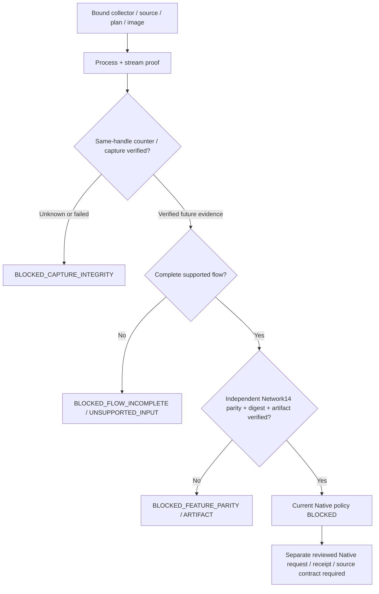

# Zeek Native capture integrity and Network14 eligibility

Status: **PARTIAL — Native process/stream finalization verified from stored evidence;
Native capture quality and AI eligibility remain blocked**. No privileged command,
Native capture or test traffic was executed by Codex.

## Native evidence

Baseline SOC HEAD is `7dd0f66d0e5621eebaa1af1f0c1f49d970d20217`; ML remains
`e1a01260f0463a38d4d778859bc2a86f8e9cfbde`. Pre-existing user changes, Replay,
models, raw datasets, sessions, archives, Audit and Checkpoints are preserved.

Session `b9fe165ac83046edb2b6f82f14fc4e10` was inspected using read-only immutable
SQLite and ordinary file reads. No runtime store was constructed on the original
session and no recovery/stop/model operation was applied to it.

| Stored observation | Verified result |
|---|---|
| Exit / helper error | 0 / null |
| Duration / launcher drain | 126.7170s / 0.2580s |
| Actual Zeek CLOSED reason | PACKET_LIMIT_REACHED |
| Controller stop tombstone | COLLECTOR_EXIT, subsequent lifecycle cleanup |
| Stream envelopes | 4215 |
| READY / packet / Network / DNS / CLOSED | 1 / 4096 / 117 / 0 / 1 |
| Persisted normalized events | 117 Network, 0 DNS |
| SQLite / event-Audit binding / Audit chain | ok / VERIFIED / VERIFIED |
| Audit records | 864 |
| Protocol finalized / container absence / cleanup | true / true / true |
| Reported Zeek received / link / dropped | 4096 / 8200 / 0 |
| Reconstructed flow windows | 51, all PACKET_LIMIT |
| Timeout-complete eligible windows | 0 |
| Quality / Edge receipts and investigations | 0 / 0 / 0 |

The GUI's 101 events were an earlier observation; the final durable count is 117.
Stream sequence, packet records, Network summaries and kernel/socket statistics are
separate quantities. The 8200/4096 relationship does not prove pairwise duplication
or packet loss. There is no per-direction kernel identity in the retained metadata.

## Counter provenance and research

Zeek 9.0.0 `get_net_stats()` returns a numeric record without a query-success field.
Its pcap source keeps separate delivered-packet and libpcap link/drop statistics.
In the reviewed failure path it closes the source and can return cached cumulative
values. Therefore a zero dropped value does not independently attest successful
statistics retrieval or complete interval coverage. This is an API evidence limit,
not evidence that this particular Native query failed.
[Zeek 9.0.0 statistics API](https://github.com/zeek/zeek/blob/v9.0.0/src/stats.bif),
[Zeek 9.0.0 pcap source](https://github.com/zeek/zeek/blob/v9.0.0/src/iosource/pcap/Source.cc).

On Linux, libpcap accumulates socket statistics across reset-on-read kernel queries;
Zeek then accumulates differences from libpcap's cumulative values. Link counts can
include filtered-socket arrivals still queued and loopback observations omitted by
userspace direction handling. A second AF_PACKET socket measures its own drops,
not Zeek's socket. Interfering reads of Zeek's socket could steal intervals.
[libpcap Linux implementation](https://github.com/the-tcpdump-group/libpcap/blob/libpcap-1.10.5/pcap-linux.c),
[Linux packet socket implementation](https://github.com/torvalds/linux/blob/v6.18/net/packet/af_packet.c).

Observed WSL kernel is `6.18.33.2-microsoft-standard-WSL2`. Upstream Linux and a tagged
libpcap source were reviewed; they do not constitute binary attestation of this exact
Microsoft kernel/libpcap build. A capability-free, network-disabled package query
returned no version text, so the image's libpcap package version is UNKNOWN. Some
optional local source downloads received HTTP 429; the official sources were reviewed
through the web tool without unbounded download retries. No kernel statistics query
or Native compatibility experiment was run.

## Integrity domains

| Domain | Required evidence | This Native session |
|---|---|---|
| Process | Bound plan/image/process identity, valid exit, verified cleanup/absence | VERIFIED from stored audit-bound certificate |
| Stream | Exact byte digest, sequence/count ledger, genuine CLOSED, drained queue | VERIFIED |
| Counter | Same-handle identity, explicit query success, complete ordered intervals, known reset semantics | UNVERIFIED; API provenance known |
| Capture | Trusted source/window, verified counter, no unknown loss/gap | UNVERIFIED |
| Flow completeness | Supported packets and genuine IDLE/ACTIVE boundaries | DEGRADED; PACKET_LIMIT only |
| Features | Exact names/order/float32/values digest plus independent producer/reference parity | Metadata arithmetic verified; Native raw-reference parity UNVERIFIED |
| Native model eligibility | All technical prerequisites and reviewed Native admission policy | BLOCKED |

Classifications are VERIFIED, DEGRADED, UNVERIFIED, FAILED and NOT_OBSERVED.
NOT_OBSERVED denotes absent evidence, UNVERIFIED denotes insufficient proof,
DEGRADED denotes bounded partial/completion limitations, and FAILED denotes an
observed integrity violation. VERIFIED is evidence-specific; a verified process is
not verified capture. Positive reported drops fail closed. Missing counters remain
unknown and never become zero. An intact metadata stream does not imply zero
capture gaps.

The new `integrity.py` uses typed, immutable models. A pure fixture-only counter
validator checks same session/plan/handle, READY/interval/CLOSED order, sequence,
explicit success, missing intervals, regression/reset and cumulative versus
reset-on-read accounting. Its successful result is labelled SAME_HANDLE_FIXTURE,
not a Native attestation. Current Native `assess_session` cannot manufacture
VERIFIED capture from numeric NetStats. Even a fixture modelling every technical
prerequisite still reaches BLOCKED_POLICY for Native.

## Network14 feature validation

The unchanged v1.1.0 producer's ordered float32 features are:

| Order | Feature | Unit / meaning |
|---:|---|---|
| 1 | duration_seconds | Last minus first packet event time, seconds |
| 2–3 | forward_packet_count / backward_packet_count | First-seen bidirectional orientation |
| 4–5 | forward_ip_bytes / backward_ip_bytes | IP bytes in the same packet window |
| 6–9 | ip_length_min / max / mean / population_std | IP-byte length statistics |
| 10–12 | tcp_syn_packet_count / fin / rst | Per-packet TCP flag counts |
| 13–14 | iat_mean_seconds / iat_max_seconds | Ordered per-flow inter-arrival times |

The new validator verifies packet schema/support, one flow identity, unambiguous
first-seen direction, unique increasing packet sequence, per-flow event order,
30s/120s boundaries, exact feature names/order, finite float32 values, recomputed
candidate values digest and flow identity. It does not clamp timestamps, invent
missing values, sort packets or change Producer formulas.

All 51 retained Native metadata windows reproduce 14/14 values against the unchanged
ML reference arithmetic. This analysis uses the FIXTURE origin explicitly for
metadata arithmetic, with no model invocation or Native receipt. It does not prove
raw packet extraction, native timestamp precision or capture completeness. Of these
windows, 29 hit the existing per-flow 128-packet bound; the remaining windows were
closed by the session packet budget. All 51 are ineligible. PACKET_LIMIT and SHUTDOWN
are not promoted to timeout-complete flows.

The supported Golden Pair scope remains classic microsecond Ethernet PCAP,
IPv4/IPv6 TCP/UDP, no fragments, unsupported extensions, unknown encapsulation or
nanosecond PCAP. Zeek's recorded seconds/microseconds survive transport unchanged.
An original Native nanosecond timestamp, payload and packet direction identity
cannot be reconstructed from these retained records.

## Session / flow admission and AI



Decisions include ELIGIBLE, BLOCKED_CAPTURE_INTEGRITY, BLOCKED_FEATURE_PARITY,
BLOCKED_ARTIFACT, BLOCKED_FLOW_INCOMPLETE, BLOCKED_UNSUPPORTED_INPUT, BLOCKED_POLICY
and UNKNOWN. The diagnostic classifier grants no model execution authority.

`ProducerService.request` now checks the complete stored metadata feature/flow
contract before constructing a request. Existing offline source admission, independent
ML producer verification, artifact SHA checking, worker isolation and receipt validation
remain mandatory. Offline diagnostic eligibility can be ELIGIBLE after those checks;
it does not authorize a Native source. The existing `ZeekRequest` is still
ZEEK_OFFLINE_PCAP-only, and the Native source guard remains in place.

Actual RF/LR offline fixture tests verify both artifact SHA values, Feature Digest,
receipts, bounded queue, duplicate suppression, READ-only investigations, JSON/Markdown
export and checkpoint/audit restoration. No Native input was passed to a model.
Research scores remain uncalibrated research outputs, not operational risk probabilities.

## DNS visibility

The retained stream contains **68 UDP port-53 packet records**, but no Zeek DNS
transaction event. A port number is not a validated DNS header, query or response.
Raw payload was intentionally not retained, so DNS parse outcome, message contents,
cache behaviour and request/response matching cannot be reconstructed. This is
UNKNOWN_PORT53_METADATA_WITHOUT_DNS_EVENT, not proven NO_TRAFFIC or PARSE_REJECTED.

Read-only configuration shows the resolver `10.255.255.254` routed locally over lo;
eth0 carries the default route. WSL DNS tunneling can answer through virtualization
without ordinary network DNS packets. Effective Windows host DNS-tunneling policy
was not confirmed from guest configuration alone. DNS cache, tunneling, encrypted
DNS and unsupported/malformed traffic remain possible explanations, not findings.
[Microsoft WSL networking](https://learn.microsoft.com/en-us/windows/wsl/networking).

The existing Zeek hook and adapter support the tested UDP/TCP DNS fixtures. DNS log
mapping errors are distinct from no DNS event being emitted. DNS9 requires lexical
FQDN-derived features absent under current privacy policy and remains BLOCKED.
No DNS test request, resolver change, eth0 capture or new interface approval occurred.

## Runtime, GUI and recovery

The existing bounded stream/flow machinery and four screens/cards/charts/timelines
are retained. A new bounded finalization summary is written atomically, no-replace,
for newly completed Native sessions. Its digest and session/plan/stream binding are
appended to the existing Audit chain. No per-poll model loading or new worker is added.
Failure reports remain fail-closed and are included in the existing abort event.

System shows process/stream/capture status, counter provenance and query status,
reported Zeek drops separately from verified kernel drops, capture gaps, complete
Network14 windows, AI block reason, DNS visibility and last verified PROCESS
session. Unknown kernel drops render UNKNOWN rather than zero.

A concrete recovery display defect is fixed: earlier recovery could show no packet
count and no CLOSED because only in-memory Stream fields were read. Recovery now
revalidates the bounded saved stream, exact digest/ledger and audit-bound diagnostic
certificate, then exposes retained final counts and CLOSED. Collection stays stopped
and no inference/capture is replayed. Legacy completed sessions without the new
certificate can be projected from existing trusted evidence without writing a new
file or Audit entry. Tampered summaries, streams and Audit fail closed. Original
Native session recovery was analysed read-only, never invoked via a writing store.

## Additional instrumentation and approvals

A separate AF_PACKET capture helper is not sufficient to certify Zeek's handle.
Reliable future instrumentation should expose explicit same-handle libpcap query
success/failure, handle generation, bounded interval sequence, capture-window start/end,
reset semantics, userspace delivery and loss coverage through a reviewed Zeek source
plugin or patched collector build. A companion process must not independently read
reset-on-read counters from Zeek's descriptor or request broad tracing capabilities.

This is a design requirement, not an implemented/approved new privileged helper.
No new helper SHA, container image or permission grant is invented. Such a change
requires a newly pinned executable/image, bundle, bounded process contract and
separate user approval before execution. It must be tested against the actual WSL
kernel and libpcap backend.

Native AI also requires eligible IDLE/ACTIVE windows within existing producer limits,
independent Native extraction/precision parity, and a separately reviewed Native
request/receipt admission contract. Counter instrumentation alone will not make
this session's 51 incomplete windows eligible. Existing capture bounds and Native
AI/DNS9/operational gates are unchanged.

## Validation, performance and next Native scope

Exact test runs, Source SHA inventory, independent Export results, resource observations,
actual offline receipts, screenshots and performance measurements accompany this file
in `zeek-native-capture-integrity-evidence.json`. Actual Native counter overhead remains
UNKNOWN; fixture classifier/feature/audit timings are measured separately and are not
Native throughput. SIGILL root cause remains UNKNOWN.

No actual Native execution is required to view or verify these saved results. A future
user Native diagnostics run remains lo / 300s / 4096 packet records / 8192 events /
8MiB output / queue 32 / CPU 1 / RAM 512MiB, with Native AI BLOCKED. Code-bundle changes
require fresh displayed approval even though the launcher and capture limits remain
unchanged. A new interface, statistics plugin or Native AI admission is a separate
approval. Never reuse this session or clear stop.request.

### Executed verification

All automated capture-path tests used the verification guard denying privileged
launches, AF_PACKET/INET capture sockets and test traffic. Actual Zeek runs used the
existing pinned image against file-only synthetic PCAP, network disabled and capabilities
dropped. Model workers ran serially with the existing 2GiB/PSI headroom gate.

| Independent Export verification | Result |
|---|---|
| Zeek, streaming, GUI contracts, research adapters, production unit regression | 542 passed, 44.86s |
| Stream/controller, offline PCAP Golden Pair and finalization integration | 27 passed, 40.21s |
| Final affected integrity/controller/recovery contracts | 86 passed, 8.24s |
| Actual offline Zeek → RF/LR → READ-only investigation/recovery | 1 passed, 7.73s |
| Actual WSLg GUI, four-screen charts and lifecycle | 13 passed, 57.03s |
| Policy/Approval/Investigation/Audit/transport regression | 125 passed, 13.44s |

These overlapping groups are separate runs, not a count of distinct tests. The final
source was tested again for the affected recovery changes; the final actual-model
fixture's plan is bound to the final bundle below. The Export excludes all original
user/Replay changes and model binaries. Tests use explicitly read-only external model
artifacts, independently exported ML source and allowlisted validation configuration.

Two failures are retained explicitly:

* The first broad Export run had **1 failed, 541 passed**: atomic `exit.json` could
  become visible before the launch-failure sidecar, masking Docker spawn failure as
  a generic missing-CLOSED error. A deterministic ordering fixture now covers it.
  The controller validates plan/stream digest/sequence before propagating the reviewed
  exit error; successful finalization still requires genuine CLOSED and cleanup.
* One actual-model fixture stopped at `ZEEK_MODEL_HEADROOM_REQUIRED` after a completed
  Quality receipt, before Edge dispatch. Initial headroom was about 4.27GB, PSI avg10
  0.02; the old failure event did not record the exact failing resource primitive,
  so that primitive is UNKNOWN. The original failed fixture and logs were preserved.
  Subsequent bounded resource observation and new, separate fixture sessions passed.
  This does not prove resource pressure is fixed. The threshold and no-automatic-retry
  policy remain unchanged. New failure Audit metadata includes MemAvailable and PSI.

Recovery also now clears previous in-memory stream/result/producer ownership before
selecting another retained session, preventing cross-session packet/receipt metrics.
A test deliberately poisons the previous controller state and verifies the selected
session's counts, no new inference and unchanged Audit. Certificate/stream/Audit tamper
fixtures fail closed; restore never promotes an old quarantine or incomplete window.

The final actual offline fixture produced **two receipts and two scripted READ-only
investigations**, queue peak/final **7/0**, inference queue peak/final **2/0**. RF/LR
inference latency was **10.461ms / 12.874ms**, worker peak RSS **223.81 / 222.26MiB**.
Process peak RSS was **174.258MiB**, excluding isolated model workers and Docker.
Finalization was PCAP_REFERENCE_FINALIZED; restore produced zero new inferences and
the Audit digest stayed unchanged. No external LLM call or security WRITE occurred.
These research receipts retain UNKNOWN capture quality and are not Native receipts.

### Performance and GUI evidence

Three fresh default operator GUI processes per side, clean baseline versus Export,
actual WSLg, same configuration, no monitoring or model dispatch:

| Metric (median) | Before | After |
|---|---:|---:|
| Startup | 2.290s | 2.178s |
| Idle RSS | 174.762MiB | 174.668MiB |
| Idle CPU, one core | 0.232% | 0.207% |
| GUI callback p95 | 0.0587ms | 0.0404ms |
| Idle child processes / background async tasks | 0 / 0 | 0 / 0 |
| Controller SQLite statements in idle observation | 0 | 0 |

The host load was not controlled; these short measurements do not establish a causal
performance improvement. No new polling timer, model initialization or worker was
introduced. Active Native RSS/CPU, Native counter-query overhead and Native inference
latency are UNKNOWN. Offline model-process and worker RSS scopes remain separate.

Fixture diagnostic timings after ten warm-up iterations: counter classification
3000 samples p50/p95/p99 **0.00222/0.00286/0.00359ms**; feature validation 1000 samples
**0.0603/0.1261/0.2102ms**. Temporary SQLite Audit append+verify 30 samples after two
warm-ups: **10.590/15.807/16.496ms**. These are offline classifier/validation/storage
costs, not actual kernel counter-query latency or Native capture throughput.

New actual WSLg screenshots use **Native-protocol FIXTURE**, clearly marked, at
[1366×768](zeek-native-capture-integrity-screenshots/system-fixture-1366.png) and
[1920×1080](zeek-native-capture-integrity-screenshots/system-fixture-1920.png).
They show reported Zeek zero drops separately from verified-kernel UNKNOWN, retained
packet/CLOSED counts, blocked AI, and no claim of Native capture.

### Reviewed code identity and user procedure

Existing launcher `collectors/live_process.py` is unchanged:

```text
SHA256: e6fdd36e0b21455c087d1466cba94061e83cb8a0c8dc97533b8649f4be39707a
Bundle: aabfcc24ea719cf40c4d915d36cb05bbc32e99dfd788b254d3e4119b7fa5f34f
Image: zeek/zeek@sha256:3fac39de707be96cb1a8163cab98a11bb2a1aa9e3535247db0f17b9c4670a019
```

The new diagnostic modules and revised controller are included in the bundle. No
legacy/calibrated/direction-aware helper, capture policy, Zeek script or model artifact
was changed. Old approvals do not authorize this new bundle. A separately approved
future diagnostics run must create a fresh session, display these identities and the
unchanged lo/300s/resource scope, then obtain user terminal-only OS authentication:

```bash
.venv/bin/soc-agent start --gui --monitor total --collector zeek-live
```

This command is provided for the user and was **not executed by Codex**. Stop/limit
completion must retain actual CLOSED, exit, cleanup, drained queue, Audit digest and
`native-integrity.json`; report Counter UNKNOWN honestly. Reopening saved diagnostics
must not restart capture or dispatch Native models. Same-handle instrumentation,
eth0 capture or Native AI admission needs an additional reviewed contract/approval.

| Final item | Verdict |
|---|---|
| Native process finalization | VERIFIED from retained evidence |
| Counter API/source provenance | VERIFIED; query success/window UNKNOWN |
| Native capture integrity | UNVERIFIED |
| Network14 Native feature parity | BLOCKED; metadata arithmetic51/51 only |
| Quality/Edge Native eligibility | BLOCKED |
| SOC Native investigation | BLOCKED; none exists |
| DNS visibility | UNKNOWN; 68 UDP53 records, zero DNS events |
| GUI / Audit / recovery | VERIFIED by nonprivileged fixtures |
| DNS9 parity / operational promotion | BLOCKED |

Overall remains **PARTIAL**. Additional same-handle evidence and complete, independently
verified Native windows are required before considering a separate Native AI approval.

Final published-evidence Export check: **89 passed in 8.86s**; Ruff, format and diff
checks passed. The offline wheel built successfully; all **471 packaged Python/Zeek/JSON
source files** matched the clean Export byte-for-byte, including the new integrity
modules and unchanged launcher/policies. Console entry point remains `soc-agent`.
No pre-existing dirty `pyproject.toml`, user documentation or Replay file was exported.
Preservation recheck passed for 132 original user files, 267 protected files and 58 raw
dataset stat records. Raw/model/runtime files were not staged.

Changed ownership is limited to collector integrity/summary modules, controller
finalization/recovery, packet-port metadata count, producer validation/resource Audit,
reviewed handoff codes, bundle membership, System diagnostic rendering, their tests,
and this report/evidence/screenshots. Historical startup evidence tests now pin the
previous immutable evidence rather than treating its old bundle as current authority.

Final review also propagates a FAILED diagnostic verdict to the collector, Network
integrity and finalization fields; a specific-error fixture verifies all projections.
