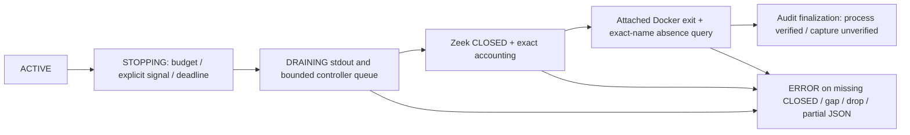

# Zeek Native packet budget and graceful finalization

Scope: code, non-privileged process/Unix fixtures, actual pinned Zeek **offline**
processing, independent Git export. No Native capture, sudo/setpriv/pkexec, test
traffic or OS security WRITE was executed. Overall Native result remains PARTIAL.

## 1. Historical Native failure

Read-only session: `session-ed853af81c5c4300b76ff70e3df7990f`, based on SOC
`a7dc0c1636ff9b60a2be49bebf85d27712181878`. Its source files and SQLite were hashed
before changes. SQLite integrity is `ok`; the existing 874-record audit chain
verifies to `90e6aaab42229a352ea05d0ef6d274c1aee1b4d594f461cb8166969fb62a7c6a`.
The stored Network event count is 106. Neither DNS events nor AI receipts were
observed. No existing file or audit record was modified.

The stream contains 4,203 consecutive envelopes: READY 1, Packet 4,096, Network
106, DNS 0, CLOSED 0. The last packet sequence is 4,096, timestamp seconds
1792401363 / microseconds 950285. No IP, domain or payload is published here.
Stream size is 1,164,603 bytes; SHA256
`4dcf56c2b4db275e6a53260eab4f1176b1066c36bb4462efa0dab663e4d912aa`.
The attached Docker command returned 1 after 128.198464 monotonic seconds;
cleanup_verified=false, capture_integrity=UNVERIFIED, stopped=false.
The existing Stop tombstone says LAUNCH_FAILED; it does not prove user Stop.

## 2. Root cause and limits of the conclusion

The old `network14.zeek` increments the packet sequence and invokes
Reporter::fatal on packet **4,097**, after publishing 4,096 records. The old live
message limit similarly used fatal termination. Launcher stderr was discarded,
so the historical session does not contain the exact Zeek fatal diagnostic.

A file-only 4,097-packet fixture reproduced exit 1, Packet 4,096 and missing CLOSED
with the old code. A 4,096-packet file ended normally with CLOSED. This verifies the
**implementation defect and reproducible mechanism**. Its match to the Native file
state is strong evidence, but the exact Native exception remains UNKNOWN; another
fatal condition cannot be excluded without the lost stderr.

Zeek 9.0.0 [Reporter source](https://github.com/zeek/zeek/blob/v9.0.0/src/Reporter.cc)
uses `_exit(1)` for fatal errors, bypassing normal event shutdown. Its
[termination source](https://github.com/zeek/zeek/blob/v9.0.0/src/zeek-setup.cc)
enqueues zeek_done and drains events during normal shutdown. The documented
[terminate API](https://docs.zeek.org/en/v9.0.0/scripts/base/bif/zeek.bif.zeek.html#id-terminate)
requests graceful termination. These are version-pinned API/source findings, not
claims that Native kernel capture quality is verified.

## 3. Packet, event and byte budget

| Quantity | Contract | Meaning |
|---|---|---|
| Kernel observed / pcap statistics | Returned by Zeek; Native validity UNVERIFIED | Not the metadata limit |
| Packet metadata | At most 4,096 | Supported and unsupported packet header records |
| Network / DNS events | Separately counted | Privacy-filtered conn/DNS summaries |
| Stream envelopes | At most 8,192 total | Includes one READY and one reserved CLOSED |
| Stream output | At most 8 MiB | 2 KiB reserved for CLOSED |
| Reader queue | 32 | Bounded ingestion batches |
| Active session | At most 300 s | Original capture duration retained |

The Network14 script keeps its original offline fatal guard by default. Only the
live script enables the graceful limit hook. At record 4,096 it requests normal
termination. Additional callbacks that cannot be represented have explicit omitted
packet/event counts; they are not kernel drops or successful analysis inputs.
No rate limit, direction semantics or feature formula changes.

At the event/byte boundary, new data emission stops with an explicit termination
reason and omission accounting. A terminal envelope remains available. Attempts to
emit after CLOSED fail instead of silently adding or hiding records. CLOSED itself
is produced only by the Zeek termination hook, never synthesized by the launcher.

## 4. Termination and verification contract



Reasons are distinct: PACKET_LIMIT_REACHED, EVENT_LIMIT_REACHED,
OUTPUT_LIMIT_REACHED, USER_STOP, SESSION_TIMEOUT, CONTROLLER_STOP and
INPUT_EXHAUSTED for complete offline input. Runtime, Docker and protocol failures
remain errors. An unexplained Native ZEEK_DONE is rejected; EOF alone cannot claim
normal Native completion. The Zeek hook's observed budget reason takes precedence
over a concurrent external Stop/timeout; the external request is retained separately.

The strict CLOSED schema binds packet/network/DNS counts, message sequence, exact
preceding byte count, omission counts and final pcap statistics. Missing/invalid
counters, drops, duplicate CLOSED, trailing records, truncated JSON and mismatched
counts fail closed. Zero reported drops still does not attest Native capture quality.

## 5. Launcher and Docker lifecycle

The attached launcher reads through EOF even after process exit. Stop uses one
bounded control worker while the reader continues draining stdout; it never waits
for Docker Stop on the stdout reader thread. A fixture exceeding one pipe buffer
verifies this ordering. Stop is idempotent; the worker is joined and no capture is
restarted.

Docker is configured with SIGINT as its Stop signal and a 5 s grace interval. This
replaces the previous 2 s external Stop grace; the existing inner timeout remains
SIGINT followed by its bounded kill fallback. Container names, plan labels,
generation and image identity are checked before signaling. Docker
[Stop documentation](https://docs.docker.com/reference/cli/docker/container/stop/)
defines the initial signal and forced kill after its grace period.

`--rm` is retained but no longer treated as cleanup proof. A successful exact-name
`docker container ls --all` query must show absence. Query failure, a remaining
container or identity mismatch blocks cleanup verification. The recorded exit code
is explicitly sourced from attached `docker run`, not a nonexistent post-removal
container inspection. A separate successful absence query verifies cleanup only;
it does not repair a bad exit or missing CLOSED.

## 6. Stop races, audit and recovery

A single Stop request is retained with its original actor/reason/session/generation.
The existing control listener and command are invalidated on explicit Stop/close.
The launcher observes the Stop file, signals its verified container and keeps reading.
A race with an already removed container still requires EOF, CLOSED and exit proof.
Controller loss requests bounded cleanup but remains a failure, even if CLOSED arrives.

The controller drains bounded batches before checking exit/stream hashes, closure,
cleanup and counts. It records COLLECTOR_CLOSED only after verification, then audit
completion/finalization. Failed sessions remain ERROR. Cancellation and completed
results recover without automatic capture restart or duplicate inference. Existing
audit hashes are not rewritten. Legacy plans remain non-launchable.

### Atomic certificate publication

A final contract run exposed a race: wrong approval once surfaced as generic
ZEEK_LIVE_INTEGRITY_FAILED. The old `open("x")` writer exposed an empty file before
JSON was written. A paused-write fixture reproduces the wrong classification. New
plan/process/exit/Stop/rejection certificates are bounded to 8 KiB, written privately,
fsynced, then published with an atomic no-replace link and directory fsync. Existing
evidence is never replaced. A paused-publish fixture verifies the controller cannot
see a partial certificate and preserves ZEEK_APPROVAL_DIGEST_MISMATCH. Shared
research persistence and historical session files are not modified. Both the old
fault injection and corrected publication are explicitly distinguished in tests.

## 7. Network14, DNS, AI and SOC

The 14 feature names/order, float32 conversion, packet timestamps/direction and
Network14 v1.1.0 formulas are unchanged. Supported IPv4/IPv6 TCP/UDP golden fixtures
and DNS query/response privacy/matching are rerun. SHUTDOWN and PACKET_LIMIT flows
remain ineligible. Budget-ended offline sessions cannot trigger model production,
even if an earlier window was otherwise eligible.

Only a complete, reference-verified offline fixture may invoke RF/LR and READ-only
SOC investigation. Actual artifact SHA, receipt and feature digest are recorded in
the evidence JSON. Fixture success is never counted as Native inference. Native AI,
DNS9 parity and operational promotion remain BLOCKED; security WRITE is denied.

## 8. GUI

The Dashboard, Security Events, Investigation and System screens retain their cards,
charts, timelines and details. System additionally shows termination reason, packet
and event budgets, CLOSED status, attached container exit, cleanup and finalization.
A process-completed Native session remains explicitly capture-UNVERIFIED/DEGRADED;
an error is not displayed as healthy completion. UNKNOWN observations remain UNKNOWN.
The preparation/terminal approval UI and generation-bound Copy check are retained.

## 9. Performance and tests

Final measurements and per-run results are in `zeek-native-finalization-evidence.json`.
Independent Export results (overlapping runs are not summed):

| Run | Result | Meaning |
|---|---|---|
| Main unit matrix | 475 passed | Collector/producer/GUI/research/streaming |
| Main process/stream matrix | 20 passed | Zeek scripts, boundaries, signals, parity, controller |
| Actual RF/LR integration | 1 passed | Two receipts and two READ-only investigations |
| WSLg GUI matrix | 10 passed | Four screens, charts, actual offline completion |
| Audit / governance | 125 passed | Policy, approval, checkpoint, audit and recovery |
| Final affected matrix | 111 passed | Drain, cleanup, bounded EOF, Stop, label checks and atomic publication |
| Final actual RF/LR integration | 1 passed | Final bundle; two offline receipts, no restored invocation |
| Final public evidence / contracts | 98 passed | Current source, atomic publication, receipts, historical scope |

The main matrix preceded final drain/cleanup hardening. The final affected matrix
and model run verify the final source. Product SHA maps bind the tested export to
the final workspace. Model input origin is ZEEK_OFFLINE_PCAP. Queue peak/final:
7/0; inference queue: 2/0. Audit SHA matches after recovery, and restored new
inferences are zero. Resource headroom was above 4 GiB, memory PSI avg10 0.00;
models ran serially. Original user changes/Replay and protected evidence are excluded
from the export. Before/after GUI runs use the same interpreter/WSLg host and three fresh idle
processes per side. Stream benchmarks use the same file-only fixture and record
CPU/RSS scope separately from unmeasured container resource usage. No Native
throughput or Native finalization success is inferred from these measurements.

Tests cover packet limits below/at/above, event/output terminal reserve, real offline
Zeek timeout/SIGINT, exit 0/1/124, stdout backpressure during Stop, duplicate/missing
CLOSED, partial JSON, exact byte/count integrity, queue drain, audit recovery,
Network14/DNS, RF/LR, READ-only investigation and four-screen WSLg rendering.
The lowered event/output test policies are isolated test copies, never selectable
Native policies. Production limits remain unchanged.

Initial development failures are retained in private logs: old mock exit certificates
lacked the new proof, recovery had a hard-coded v2 contract, and pytest reserved the
parameter name request. The later torn-publication contract failure was reproduced
and corrected through atomic publication; its failed log is retained. These were corrected with explicit tests. Historical SIGILL
root cause remains UNKNOWN. No failure was hidden by an unchanged retry.


| Median of 3 runs | Before | After |
|---|---:|---:|
| GUI startup | 2.686 s | 3.392 s |
| GUI idle RSS | 175.18 MiB | 175.64 MiB |
| Idle CPU (% of one core) | 0.284% | 0.365% |
| Threads / idle children | 2 / 0 | 2 / 0 |
| Same offline PCAP total | 0.694 s | 2.262 s |
| CLOSED callback to launcher return | 84.2 ms | 392.4 ms |
| Python CPU per stream run | 3.35 ms | 11.76 ms |
| Python peak RSS per stream run | 164.14 MiB | 164.27 MiB |
| Stream bytes | 1492 | 1672 |

**Measured startup and return latency increased.** Added fsync and cleanup queries
are present, but their share of the observed increase was not isolated. GUI timing
attribution remains UNKNOWN; concurrent host load was not controlled. A read-only
observation after profiling showed load average 5.60, CPU PSI avg10 0.22 and IO PSI
avg10 0.79; these are not per-sample explanations. No speedup or performance
non-regression is claimed. Container CPU/RSS and Native performance are UNKNOWN.
Two actual WSLg System screenshots at 1366×768 and 1920×1080 show an **offline**
packet-budget session, with no Native capture or model invocation.

## 10. Native approval and manual validation

New review identities:

- Launcher SHA256: `42799625829c83ddf87e70770cbc35a655e6c520f74a64fe478e92dba36a086c`
- Bundle digest: `4aeb467c7c6143967f517d7c22ddc288038dffe567339981f7f463c4f9df95ec`
- Image: `zeek/zeek@sha256:3fac39de707be96cb1a8163cab98a11bb2a1aa9e3535247db0f17b9c4670a019`
- Contract: `soc-zeek-native-plan:v3`.

Changed files: collector `finalization.py`, `live.zeek`, `network14.zeek`,
`live_contract.py`, `live_process.py`, `live_stream.py`, `live.py`, `handoff.py`,
GUI `operator_view.py`, finalization/WSLg tests and historical contract/evidence tests.
Existing historical reports and their original bundle identities remain unchanged.
The 132 original dirty SOC/ML files and 232 protected artifact/evidence files retain
matching SHA256; 58 raw dataset files retain size/mtime/inode. No model/raw dataset
was copied into the export or commit. Workspace/export Ruff, Format and Diff checks
and offline wheel verification passed. Final package bytes match exported collector
modules and Zeek scripts. Final evidence-only checks run again after documentation
finalization; unchanged model tests are not repeated.

The approval contract is now `soc-zeek-native-plan:v3`; new script/launcher/bundle
hashes require fresh approval. Existing v2/v3 capture helpers and their original
manifests are not modified. Old sessions, commands and Stop files are never reused.
The fixed Zeek 9.0.0 image digest and original lo/IP scope, CPU 1, RSS 512 MiB,
16 MiB tmpfs, 8 MiB metadata spool and research/operational gates are retained.

Start only the unprivileged GUI and keep its controller/terminal alive:

```bash
.venv/bin/soc-agent start --gui --monitor total --collector zeek-live
```

Prepare a fresh session in System, verify controller/listener/COMMAND_VALID, review
the new SHA/bundle/scope, then Copy the exact session-bound terminal command. After
separate approval, the **user** runs it in a second interactive terminal:

```bash
.venv/bin/python -m soc_agent.security_ai.collectors.live_process \
  --session '<fresh session directory>' --approve '<fresh v3 plan digest>'
```

The command displays scope and obtains terminal sudo authentication once, then uses
predefined Zeek start/stop/cleanup commands without another password prompt. The GUI
never authenticates or stores passwords. No sudoers rule is added; sudo credential
validation itself does not create a new command-scoped OS permission rule. The
existing container requires NET_RAW for its bounded lifetime; post-open capability
removal and actual Native permission behavior remain unverified.

After a separately approved run, compare CLOSED counters/sequence, bounded omissions,
exit/cleanup, queue final zero, stop reason and audit integrity. A packet-budget end
is not evidence of a complete traffic window or permission to enable Native AI.
Do not delete stop.request or automatically restart a failed capture.

## 11. Verdict

Implementation and offline finalization verification do not establish Native success.
PACKET_LIMIT_ROOT_CAUSE_VERIFIED applies to the reproduced fatal implementation
mechanism; the exact historical Native fatal cause remains UNKNOWN.
ZEEK_GRACEFUL_FINALIZATION_VERIFIED, CONTAINER_EXIT_VERIFIED,
CLOSED_PROTOCOL_VERIFIED, QUEUE_DRAIN_VERIFIED, NETWORK14_PARITY_VERIFIED,
DNS_DIAGNOSTICS_VERIFIED, QUALITY_FIXTURE_INFERENCE_VERIFIED,
EDGE_FIXTURE_INFERENCE_VERIFIED, SOC_INVESTIGATION_VERIFIED, GUI_PRESERVED and
AUDIT_RECOVERY_VERIFIED apply to offline/fixture verification only.
NATIVE_FINALIZATION_PENDING; NATIVE_AI_BLOCKED; DNS9_PARITY_BLOCKED;
OPERATIONAL_PROMOTION_BLOCKED. Exact Native stderr/root cause is UNKNOWN; the prior
packet-limit fatal path is reproducibly defective and replaced by bounded graceful
termination with strict closure and cleanup checks.
