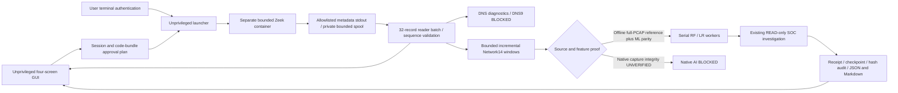

# Zeek Native Live integration

Verdict: **PARTIAL — Native capture and Native AI remain unverified.**

This implementation adds an explicitly selected Zeek live preparation/attachment path,
a user-terminal launcher, a bounded real-time metadata protocol, incremental flow
candidates, DNS diagnostics, GUI state, and audited drain/recovery. Actual RF/LR and
SOC validation uses the same protocol with an offline PCAP. It is not Native capture.

## 1. Architecture



Existing capture v2/v3, their manifests, the offline Zeek collector, Network14
producer v1.1.0, model binaries, four GUI pages, charts and developer tools remain.
The default collector remains `existing-capture`; `zeek-live` is experimental.
There is no second concurrent capture runtime, automatic privilege escalation,
automatic capture restart or automatic replay of uncertain inference attempts.

## 2. Zeek process isolation

The exact locally installed official image is
`zeek/zeek@sha256:3fac39de707be96cb1a8163cab98a11bb2a1aa9e3535247db0f17b9c4670a019`
(Zeek 9.0.0). No pull, installation or replacement occurred.

Offline verification uses `--network=none`, the ordinary UID/GID and no capabilities.
A reviewed Native launch instead requires the Docker daemon's host network namespace,
uses only `NET_RAW` after `--cap-drop=ALL`, and runs Zeek as container UID 0. The GUI
and terminal launcher remain ordinary users. This is **not** a proven capability drop
after socket open: NET_RAW remains for the bounded container lifetime. NET_ADMIN,
SYS_ADMIN, privileged containers, host PID namespace, Docker socket mounts and host
output-directory mounts are absent. No fallback adds capabilities on failure.

Host networking shares the **daemon** namespace, not necessarily the user's WSL
namespace. A fixed pre-capture check compares `/proc/self/ns/net` in the container
with the session's namespace identity. A mismatch exits before `zeek -i lo`.
Docker Desktop's layer-4 host networking is unsuitable as proof of packet-interface
visibility. Current read-only Docker information identifies a Linux Ubuntu daemon
with the WSL2 kernel; actual interface access remains pending user validation.
See [Docker host networking](https://docs.docker.com/engine/network/drivers/host/).

The pinned [Zeek pcap source](https://github.com/zeek/zeek/blob/v9.0.0/src/iosource/pcap/Source.cc)
requests promiscuous capture. NET_RAW sufficiency for this exact image/WSL interface
has not been exercised. Permission failure must stop; it does not authorize NET_ADMIN.
Default Docker seccomp remains enabled, with no-new-privileges and a read-only rootfs.

## 3. Approval scope and budgets

A fresh plan binds UUID, image digest, interface, network namespace, policy limits
and the code-bundle digest. An old v2/v3 approval grants no Zeek authority.

| Resource | Enforced scope |
|---|---|
| Interface | `lo` only; fixed `ip or ip6` capture filter |
| Runtime | At most 300 s; inner SIGINT timeout, 2 s kill grace |
| CPU / memory | 1 logical CPU quota / 512 MiB including swap cap |
| PIDs / rootfs | 64 / read-only |
| Temporary disk | 16 MiB tmpfs; no host Zeek log mounts |
| Host metadata spool | 8 MiB / 16 KiB per row |
| Metadata events | 8,192 protocol messages; 4,096 packet records |
| Processing queue | At most 32 rows per batch; explicit overflow/error |
| Flow state | 128 active keys, 128 packets/window, 1,024 finalizations |
| Inference | At most 8 eligible windows / 16 invocations, concurrency 1 |
| Session storage | 8 sessions, 64 MiB/session checked; no silent deletion |

The packet-record limit is **not** a Kernel raw-frame counter or FPS approval.
The old raw-rate budgets are not reinterpreted or reused. This is a separate bounded
Zeek diagnostic capture proposal, not calibrated continuous Native performance.
Disk exhaustion, spool overflow and packet/event limits fail closed. Eight sessions
require explicit retention review; this implementation does not delete old evidence.

The launcher calls terminal-only `sudo -v`, then `sudo -n -- docker ...`. Password
input belongs to sudo's inherited terminal, never a GUI widget, PIPE, file or DB.
Cancellation, timeout and denial produce bounded failure codes visible to the GUI.
Stop uses only the session-owned container name; a failure to stop is not success.
The inner timeout limits capture even if GUI/launcher exits. Docker daemon failure
or a SIGKILL may leave container metadata; no claim of cleanup is made without exit
proof. A stopped/failed session command cannot be reused.

## 4. Live event streaming

`live.zeek` loads the unchanged packet script and emits ordered, newline-delimited
READY / PACKET / NETWORK / DNS / CLOSED envelopes. A log-policy hook prevents all
normal Zeek log writes; selected fields are reconstructed before serialization.
Query names, answers, raw payloads, file bodies and credentials are not emitted.
Endpoint addresses/ports are retained as bounded investigation metadata in the
private session. Raw packet bytes exist only transiently inside Zeek.

The launcher validates row size, allowed fields and sequence before host persistence.
The controller reads at most 32 rows per batch off the GUI thread, revalidates packet
and event schemas, and commits normalized events/cursors with the existing hash audit.
The disk spool decouples acquisition from SQLite/model processing but is bounded;
there is no unbounded in-memory queue or silent discard. The existing LogReader
handles partial records, rotation and truncation. Unverifiable rotated recovery
fails closed. No captured rows are sorted or timestamp-clamped.

## 5. Network14 and the Native integrity blocker

The incremental producer retains first-seen direction, integer microsecond packet
provenance, directional bytes/counts, length moments, TCP flags and IAT. Idle 30 s
and active 120 s finalization are witnessed by a later packet of the **same key**.
Wall time does not modify feature duration. SHUTDOWN/PACKET_LIMIT windows are ineligible.
Unsupported metadata, truncation, same-flow time regression and sequence gaps stop
this experimental stream; no unverified flow is promoted.

For an offline stream, every packet record is compared against the full independent
PCAP reference, then all 14 float32 values are independently recomputed by unchanged
ML producer v1.1.0 before model execution. This verifies bounded fixture windows,
not all possible Live encapsulations. Nanosecond PCAP, fragments, unsupported IPv6
extensions and unknown encapsulations remain unsupported.

**Native inference is explicitly BLOCKED.** The pinned Zeek pcap implementation can
report a pcap statistics error without returning a distinct validity flag through
`get_net_stats()`; its numeric results alone do not establish that statistics
collection succeeded. CLOSED with zero reported drops is therefore process evidence,
not capture-quality verification. Native packets also lack the complete-PCAP
independent reference used by the existing admitted offline request contract.
The separate Source gate rejects Native input before any offline request or worker
invocation. No Native data is relabeled as OFFLINE_PCAP or NATIVE_AF_PACKET.
A valid Native producer/counter admission contract must be developed and separately
verified before enabling Native RF/LR. Reusing a fixture receipt cannot satisfy it.

See the [Zeek 9.0.0 statistics API](https://docs.zeek.org/en/v9.0.0/scripts/base/bif/zeek.bif.zeek.html#get_net_stats)
and pinned source above. The current change does not claim to fix this upstream
observability limitation or the historical SIGILL, whose root cause remains UNKNOWN.

## 6. DNS diagnostics

The same Zeek source emits allowlisted UDP/TCP DNS transaction metadata: timestamp,
UID, endpoints, transaction ID, qtype, rcode, TTLs, RTT and truncation. Zeek performs
transaction association. Adapter event identity suppresses exact repeats; changed
same-ID rows fail closed. Missing response metadata stays missing. DNS-over-HTTPS
and DNS-over-TLS cannot be claimed visible as plaintext DNS. No DNS test query ran.
DNS9's upstream lexical feature producer remains unverified, so DNS9 AI stays BLOCKED.

## 7. AI inference and SOC investigation

Existing isolated RF/LR workers, immutable artifact hashes, bounded queue, headroom
checks, timeouts, ledger/idempotency keys and Single Orchestrator are reused. A memory
headroom of 2 GiB and PSI avg10 below 1 are checked before model work. Workers run
serially with existing CPU/address-space/result-file limits and network denial.
Inference runs after a stream is sealed and its offline source proof is verified;
there is currently **no pre-CLOSED Native inference**.

Successful fixture receipts retain `ZEEK_OFFLINE_PCAP`, research-only status,
uncalibrated-score labeling and WRITE_DENIED. Existing READ-only investigation,
checkpoint restoration and local JSON/Markdown export are used. The model never
creates an operational finding or triggers a security WRITE.

## 8. GUI

Dashboard, Security Events, Investigation and System retain the existing cards,
Canvas charts, timelines, scrolling and bounded history. System exposes `zeek-live`,
source/interface, process/queue health, approval digest, capture-integrity blocker,
model status, last error and recovery state. Prepare generates a command and watches
for user launch; it does not authenticate. Command copying rechecks the latest session
and state. Stale commands are disabled. No Native chart moves without an observed
running process; diagnostic event rates are labeled separately from raw packet rate.
Fixture and Native histories use separate identities. Missing metrics remain UNKNOWN.

Screenshots under `zeek-native-live-screenshots/` are actual WSLg preparation screens,
with a mocked environment preflight and **no authentication or capture**. They are not
Native evidence. Both 1920×1080 and 1366×768 were exercised for all four pages.

## 9. Audit and recovery

The existing SQLite transaction/hash-chain store binds Source identity, normalized
events, reader cursors, stream progress, process completion and finalization. Session
plan, launcher PID plus process-start ticks, image digest, CLOSED/exit state and stream
SHA are checked separately. Process exit does not terminate the reader early: every
remaining bounded batch drains before EOF/CLOSED and exit-hash verification.
Missing CLOSED, drops, wrong sequence/digest, crash or persistence failure produces
ERROR and a stop request. ERROR never becomes successful STOPPED through cleanup.
Recovery verifies committed audit/completion and restores existing receipts; it never
starts capture or reruns model attempts. Unfinished or tampered sessions remain blocked.
Original Native sessions, helpers, model binaries and old audits are untouched.

## 10. Performance and tests

See `zeek-native-live-evidence.json` for exact per-run identities, receipts, hashes,
measurement scopes, resource readings, screenshots and final independent-export results.
Fresh-process idle comparisons use three runs before/after against the same interpreter,
WSLg environment and 3 s observation window. The small packet benchmark uses the same
four-packet Golden PCAP, 20 warmups and 500 repetitions. JSON validation overhead is
included in the stream path; it is not evidence of increased Native throughput.
Model and GUI measurements are separate runs, never merged under one session identity.
Native CPU/RSS, capture-to-log latency and throughput remain UNKNOWN.

Independent Export results: 581 unit tests, 7 offline/stream tests, 2 real-artifact
model tests, 8 WSLg tests and 125 governance/recovery tests passed (723 distinct cases).
A final 36-case stream/lifecycle run added 5 new scenarios; its 31 repeated cases are
not added again. Product coverage is 728 distinct passing cases. Public evidence/digest
checks are a separate 2-case suite. After expanding the approval bundle to pin terminal
authentication and source-admission code, all 37 affected stream/lifecycle/real-model
cases passed in the final export (overlapping cases, not added again). All model tests ran serially; a prior PSI avg10=1.56
preflight held model execution, then passed after pressure subsided. This was a
resource hold, not a model failure or a suppressed retry.

| Same-environment idle median, 3 fresh processes | Before HEAD | After |
|---|---:|---:|
| Startup | 2.315 s | 2.296 s |
| Idle RSS | 174.98 MiB | 174.98 MiB |
| Idle CPU, one core | 0.293% | 0.280% |
| Tk callback p95 median | 0.0163 ms | 0.0475 ms |
| Idle child processes / initialized runtime owners / SQL queries | 0 / 0 / 0 | 0 / 0 / 0 |

These samples show similar startup/RSS, not a statistically established improvement;
callback p95 was higher. On the four-packet CPU fixture, existing aggregation p50 was
0.0510 ms and streamed JSON validation plus aggregation was 0.1551 ms. The latter
includes additional work; Native throughput remains UNKNOWN. The separate WSLg
preparation run measured 2.004 s startup, 217.4 MiB current RSS after eight resize/render
operations, and 27.8–513.4 ms full render/update samples. The actual streamed model run
recorded worker CPU/RSS/latency in each receipt; these are not Native capture metrics.
Initial development failures (test field/import errors, stale-session failure-artifact
collision and the offline export title compatibility check) were retained in private
logs, corrected, and followed by focused regression. They are not counted as passes
or dismissed as flaky. No OOM/SIGILL/Drain Timeout was treated as success.

## 11. Remaining blockers

- Native pcap statistics validity and full Native producer admission are unverified;
  Native RF/LR and automatic SOC investigation from Native AI remain BLOCKED.
- Exact WSL namespace/interface visibility, NET_RAW-only activation, graceful native
  SIGINT/CLOSED and performance require a separately approved direct user run.
- Native nanosecond precision, unsupported frames and DNS visibility are unverified.
- DNS9 producer parity and operational model promotion remain BLOCKED.
- This is bounded experimental monitoring, not an unlimited or production-verified
  continuous capture service. No automatic privileged restart exists.

## 12. User Native execution procedure — approval required

Do **not** run capture until the new Zeek scope/digests have been explicitly reviewed
and approved. Old helper approvals are not applicable. The current executable/image,
launcher SHA and code-bundle digest are recorded in the evidence file:

- Launcher SHA256: `5b3f203cc4e55031e2f33f5a26e6e650b17bf0e67334cf3924fa7aebd867d936`
- Bundle Digest: `fd190b1d44f0a5027d110d1395bc4fadaee3c8a32c172f59c9f66d3435ab5144`
- Stream script SHA256: `9d593eda5ab3d8b77317e1080040295d8d2dc1049bf3c7fa5d72de77b892bfb9`

The full reviewed file hash map is in the evidence JSON. Any change requires a fresh
plan/digest review; none of these identities authorizes capture by Codex.

Start only the ordinary-user GUI (no capture):

```bash
.venv/bin/soc-agent start --gui --monitor total --collector zeek-live
```

If a console script is unavailable, the equivalent preparation entry is:

```bash
.venv/bin/python -m soc_agent.gui --collector zeek-live
```

In System select `zeek-live`, then Prepare monitoring. Review `plan.json` in the new
`zeek-live-collector/session-<UUID>` directory and the System technical status. Review
lo-only / IP filter / 300 s / resource limits / metadata retention / Native AI blocker.
After separate approval, use **Copy collector command** and run that exact command
in an interactive user terminal. Its shape is:

```bash
.venv/bin/python -m soc_agent.security_ai.collectors.live_process \
  --session '<fresh session directory>' --approve '<full plan digest>'
```

The command performs terminal sudo authentication once and runs only the scoped
container. GUI Stop requests bounded graceful termination; terminal Ctrl+C also ends
the launcher and cleanup path. If terminal authentication expires before stop, cleanup
may be unverified; the inner watchdog still bounds capture. Reuse is denied: prepare
a new session after any failed or completed attempt, without deleting old evidence.

After a user run, validate `process.json`, `stream.jsonl`, `exit.json`, READY/CLOSED,
sequence, namespace, reported counters, stream SHA, SQLite audit and final Queue=0.
Zero drops or exit=0 alone do not permit Native inference. No Native success or
operational promotion may be declared from this preparation/fixture validation.
