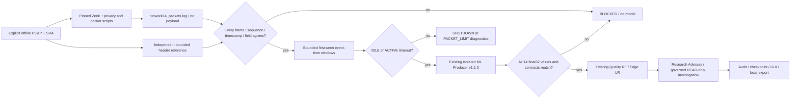

# Zeek packet Network14 producer and DNS9 parity research

## 1. Result and baseline

**PARTIAL: Network14 is reproducible for the explicitly bounded offline scope;
DNS9 and all Native/operational inference remain gated.**

Baseline SOC `3301714923d1f62ba2a1bd28bd47b6fe6a140669`,
ML `e1a01260f0463a38d4d778859bc2a86f8e9cfbde`. The initial index was empty;
122 SOC and 10 ML user files were already dirty. No original user file, Replay,
Native session, archive, raw dataset, model artifact or previous report is part
of this change. The original summary-only Zeek mode and existing helpers remain.

The official Zeek 9.0.0 image is unchanged:
`zeek/zeek@sha256:3fac39de707be96cb1a8163cab98a11bb2a1aa9e3535247db0f17b9c4670a019`.
The original baseline PCAP is reprocessed independently from the new packet
producer tests. Synthetic wire fixtures are files only; no packets were sent.
Machine-readable evidence is in
[zeek-network14-dns9-evidence.json](zeek-network14-dns9-evidence.json).

## 2. Zeek API research

Pinned official v9.0.0 sources were reviewed, and the script compiled/executed
in the existing official image:

- [event.bif](https://github.com/zeek/zeek/blob/v9.0.0/src/event.bif):
  `raw_packet` runs at the link-layer packet boundary. `new_packet` runs later
  and excludes additional packets rejected by connection processing. Connection
  completion summaries cannot recover every packet's length, flags and IAT.
- [header definitions](https://github.com/zeek/zeek/blob/v9.0.0/scripts/base/init-bare.zeek):
  IPv4 total length, IPv6 payload length, source/destination ports and TCP flags
  are available as structured fields. IPv6 IP length adds the fixed 40-byte
  header. Originator/responder classification is not used for feature direction.
- [get_current_packet](https://github.com/zeek/zeek/blob/v9.0.0/src/zeek.bif) and
  [Packet::ToVal](https://github.com/zeek/zeek/blob/v9.0.0/src/iosource/Packet.cc):
  within the raw event, integer seconds/microseconds come from the recorded PCAP
  header. They avoid conversion through floating-point `network_time()`.
  This API also creates a transient packet-data object; only selected header
  fields are written, never its payload.
- [DNS events](https://github.com/zeek/zeek/blob/v9.0.0/src/analyzer/protocol/dns/events.bif):
  DNS events support UDP/TCP, lowercase query text and an original-case argument.
  These do not define the upstream DNS9 training feature formulas.

The official raw-packet API is documented as expensive. This implementation is
an offline research path, not a claim that script-level raw events scale to
continuous Native capture. No undocumented API, kernel filter or privilege
change was used.

## 3. Supported packet scope and architecture

Explicit scope:
`ETHERNET_CLASSIC_PCAP_USEC_TCP_UDP_NO_FRAGMENTS_EXTENSIONS_OR_NS:v1`.

Supported inputs are classic PCAP v2.4, Ethernet, recorded microseconds, full
captured frames, IPv4/IPv6 TCP/UDP without fragments, IPv6 extension headers,
tunnels/VLANs or TCP reserved/NS bits. Nanosecond PCAP and PCAPNG are rejected
for this producer rather than rounded. Unsupported frames block the packet
producer for the entire file. The original summary collector can still be
selected independently for diagnostics.



The existing offline runner, bounded JSON reader, normalized conn/DNS adapters,
collector store, worker sandbox, no-retry ledger and SOC orchestrator are reused.
No new capture helper or agent runtime is introduced. `ProducerService` composes
these components; it does not own a privileged socket or a new worker system.

## 4. Network14 contract

Authoritative arithmetic is the unchanged ML
`src/ml/verified_producers/network_v1_1.py` with producer version **1.1.0**.
The new wrapper is `zeek-packet-network14:v1`. Feature contract digest:
`84ba0916f0ce4e9e12bb70712db2cd1eaea84ba4173acd57b647faf38efb1c6e`;
producer configuration:
`7999723911ce3d2e9cd3b3b6e0d45e11f44b1316cdf9c7f4883d7e2a69ca21a7`.

All outputs use binary64/integer intermediate arithmetic and a single final
IEEE754 float32 conversion. Missing values are rejected, never imputed.
The packet source is recorded as `ZEEK_OFFLINE_PCAP`; the unchanged ML producer
uses its existing `OFFLINE_PCAP` arithmetic origin. Receipts retain both.

| Order | Feature | Unit / calculation | Required metadata |
| --- | --- | --- | --- |
| 0 | duration_seconds | (last ns − first ns) / 1e9 | recorded packet timestamps |
| 1 | forward_packet_count | count in first-observed endpoint direction | endpoints, sequence |
| 2 | backward_packet_count | count in reverse direction | endpoints, sequence |
| 3 | forward_ip_bytes | sum of forward IP lengths | IP total length, direction |
| 4 | backward_ip_bytes | sum of reverse IP lengths | same |
| 5 | ip_length_min | minimum IP bytes | every packet's IP length |
| 6 | ip_length_max | maximum IP bytes | same |
| 7 | ip_length_mean | total IP bytes / packet count | same |
| 8 | ip_length_population_std | sqrt(population variance) | integer first/second moments |
| 9 | tcp_syn_packet_count | number of packets with bit 2 | TCP flags; UDP zero by schema |
| 10 | tcp_fin_packet_count | number with bit 1 | same |
| 11 | tcp_rst_packet_count | number with bit 4 | same |
| 12 | iat_mean_seconds | mean consecutive event-time delta / 1e9 | ordered packet timestamps |
| 13 | iat_max_seconds | max consecutive delta / 1e9 | same |

Singleton IAT and population variance are zero **by the existing formula**,
not because a measurement is missing. Direction means first-seen endpoint pair,
not host inbound/outbound and not Zeek's possibly reoriented originator role.

Window boundaries preserve 30 s idle, 120 s active, strict inside-window deltas
below 30 s and span below 120 s. A later packet on the **same key** provides the
timeout witness. Other keys do not advance a key's clock. EOF does not invent an
idle timeout. SHUTDOWN, PACKET_LIMIT and incomplete windows are not inferable.
No packet is sorted, clamped, discarded or assigned current wall time.

## 5. Packet mapping and Golden pairs

`network14.zeek` logs only sequence, integer recorded time, frame/capture length,
IP endpoints, transport/ports, IP length and flags. A bounded independent Python
PCAP/header reader compares **every** emitted row against the original file.
Missing events, sequence differences, timestamp differences and parser
differences have separate error codes. PCAP/script/log digests bind the proof.
Zeek UID remains a connection-summary identifier; the model window ID is a
session + canonical key + first packet sequence digest, not a substituted UID.

Actual pinned Zeek tests cover IPv4 TCP, IPv4 UDP, IPv6 TCP, IPv6 UDP and ACTIVE
TCP expiry. All fourteen names, values, float32 conversion and full reference
feature digests agree on their recorded inputs. The ML producer independently
recomputes the candidate values again inside the model worker before loading
or invoking RF/LR. A mismatch blocks that request.

The IDLE TCP Golden file SHA is
`ca8eec496c54c71cd923d18707e1bbf6fe868917b68af7a2b09d9a9575d9cf35`.
The eligible first three packets are 40/60/80 IP bytes, F/B/F, times 0/0.5/1 s,
flags SYN/ACK/FIN. A fourth same-key packet at 32 s closes the prior window.
Expected values:

```text
1, 2, 1, 120, 60, 40, 80, 60, 16.329931259155273, 1, 1, 0, 0.5, 0.5
```

The last packet is SHUTDOWN and remains excluded. ACTIVE tests contain a later
same-key packet at 120 s with all preceding IATs below 30 s. Reported feature
duration is the last included packet's timestamp minus the first, not the
expiration time. Additional arithmetic tests cover equal timestamps, extreme
lengths/flags, singleton and 128-packet limits. Within-flow regression aborts;
cross-flow ordering does not change independent flow features.

Remaining limitations are explicit scope rejections, not silently approximated
features: nanosecond/PCAPNG precision, unsupported link/fragment/extension/NS
forms and unverified Native completeness. A theoretical integer-moment versus
reference rounding discrepancy also fails the per-request float32 equality gate.

## 6. DNS9 contract and mapping

The actual ML package contract is
`packages/dns-security-ai/src/dns_security_ai/feature_contract.json`.
Every feature's upstream unit/extraction semantics is explicitly UNVERIFIED.
The fitted scaler validates exact named order and nine features. Existing
preprocessing remains float32 → fitted named StandardScaler → round/clip INT8
using the existing tensor quantization parameters. No scaler is refitted.

| Order | Feature | Current mapping | Why query API alone is insufficient |
| --- | --- | --- | --- |
| 0 | FQDN_count | MISSING | query count versus name-character count/aggregation unknown |
| 1 | subdomain_length | MISSING | suffix/subdomain boundary and normalization unknown |
| 2 | numeric | MISSING | count/ratio and character population unknown |
| 3 | entropy | MISSING | case, population, dots and entropy normalization unknown |
| 4 | special | MISSING | character population and count/ratio unknown |
| 5 | labels | MISSING | root-dot and label policy unknown |
| 6 | labels_max | MISSING | length units/root/prefix handling unknown |
| 7 | labels_average | MISSING | denominator/root policy unknown |
| 8 | len | MISSING | wire, byte or textual length unknown |

All nine hypothetical query-text derivations remain SEMANTIC_MISMATCH candidates
until upstream formulas and Golden pairs exist. Query type, rcode, TTL and RTT
map DIRECTLY to existing **DNS diagnostics**, not to DNS9 model columns.
Lowercase/original-case API availability does not establish which was trained.
No original FQDN, answer or payload is newly persisted. No guessed DNS9 vector
is produced and no DNS9 model is invoked. UDP/TCP JSON mapping and previous DNS
matching/privacy/duplicate/missing-response regressions remain in the suite.
Actual new packet Golden tests exercise transport metadata; they do not add a
claim of complete Native TCP-DNS or encrypted-DNS visibility.

**Decision:** existing RF/LR models can be retained for the verified bounded
Network14 windows. No Network14 retraining is necessary for those inputs.
DNS9 requires recovery of the original training producer and successful
semantic/Golden parity, or a separately approved model trained for a documented
DNS feature producer. Retraining is not performed in this task.

## 7. AI eligibility and receipt provenance

The separate opt-in mode is `zeek-network14-offline`. Summary-only
`zeek-offline` still blocks all model inference. The default existing Native
collector is unchanged. New model eligibility requires:

1. Exact source file and pinned engine/script identity.
2. Complete reference/log packet sequence and metadata agreement.
3. Eligible timeout window with no unsupported/unknown input.
4. The unchanged ML feature contract/configuration and all 14 reference values.
5. Existing RF/LR artifact, manifest, interpreter and backend checks.

Requests cannot authorize themselves: the adapter requires the collector's
audit-bound proof callback. It checks PCAP/script/proof identity before dispatch
and again before completing investigation. Source proof, log hash, flow ID,
feature/source digests and session references bind each `ZeekReceipt`.
`origin=ZEEK_OFFLINE_PCAP` is distinct from Native and generic fixture receipts.
The arithmetic origin remains `OFFLINE_PCAP`, capture quality UNKNOWN,
RESEARCH_ONLY, uncalibrated score, operational gate BLOCKED, WRITE_DENIED.

Actual RF/LR invocations and investigations use the Zeek-emitted packet inputs;
previous generic fixture successes are not counted as Zeek successes. Raw model
scores are not attack probabilities. These Golden results are CLASS_0 research
outputs, not observed attacks or operational findings.

## 8. SOC investigation and export

The existing orchestrator, evidence-reading tool, assessment, governance,
audit and checkpoint runtime are reused. The research client is the existing
bounded **scripted offline** client, not an external LLM provider. Model output
is advisory context; it cannot become an observation or authorize OS WRITE.
Each successful record includes READ-only assessment, evidence references and
checkpoint restoration. The original investigation step/time budgets remain.

JSON/Markdown exports now include actual verified Zeek research receipts and
investigations when present. Summary-only exports contain none. Invalid
collector/producer audit state blocks export. Files are local, explicitly
requested, private and refuse overwrite; there is no automatic external send.

## 9. Bounds, lifecycle, audit and recovery

The prior offline runner's limits remain: 16 MiB PCAP, 8 MiB transported JSON,
512 MiB/one-CPU/no-extra-swap container, all capabilities dropped, network none,
ordinary UID/GID, read-only mounts/root, no-new-privileges, 55 s engine deadline
and 60 s controller watchdog. The packet script caps 4,096 frames. The producer
caps 128 active flows, 128 packet references per window and 1,024 completions.
The entire file has at most 4,096 packet metadata records; no raw payload is
persisted. Window state is released on completion, while bounded proof metadata
is retained for inference, audit and recovery. The proof read itself is bounded.

The new session namespace is `zeek-network14-collector`; existing summary Zeek
and Native directories are preserved. Eight sessions / 64 MiB checked session
budget remain fail-closed, without automatic deletion. Completed metadata proof
is written before its audit binding; an interrupted unaudited proof cannot be
accepted on recovery. There is no source identity reuse.

At most eight eligible flow references / sixteen inference requests are
admitted before inference, with one model worker at a time. MemAvailable must
be at least 2 GiB and memory PSI avg10 below 1 before each new model request.
No automatic retry occurs after worker failure, timeout, stop or recovery.
A successful model receipt followed by failed investigation remains distinct
from a complete investigation. Queue and confirmed inference counts are not
fabricated. Disk budget is checked again after each model/investigation result.

Producer proof, normalized sources/cursors, model ledger and investigation
checkpoint audits are independently validated. Recovery binds each stored
receipt to its original flow/proof and feature digest, restores observations,
and sets new-inference count to zero. It never reruns Zeek, acquires privilege,
retries an unknown invocation or changes SHUTDOWN into a valid timeout.

## 10. GUI and command

The same four screens, cards, Canvas charts, timelines and detail panels are
preserved. System adds the explicit packet-producer mode and shows producer
state, scope, eligible/rejected windows, Network14/DNS9 parity and errors.
Receipt charts and investigation details retain Zeek origin/session identity.
Offline record rates are not Native packet rates. Collector lag and unobserved
Native loss remain UNKNOWN. Stop/error states do not synthesize moving Live data.
No new research screen, GUI framework, default worker or automatic authentication
was added.

```bash
.venv/bin/soc-agent start --gui --monitor total \
  --collector zeek-network14-offline \
  --pcap /approved/input.pcap --pcap-sha256 EXPECTED_SHA256
```

Press Prepare monitoring on System. This analyzes a bounded file without sudo,
network access or capture. Real RF/LR models execute only after the checks above;
resource/producer failure is blocked. Selecting `zeek-offline` retains the
previous diagnostics-only behavior. Native Zeek is not an accepted mode.

Actual WSLg screenshots are in
[zeek-network14-screenshots](zeek-network14-screenshots/), labelled offline and
kept separate from the previous collector screenshots and Native evidence.
GUI/model/Golden test executions are separate runs; their session/audit digests
are not merged into one inferred run identity.

## 11. Performance

Measurements use the same four-packet Golden PCAP. Arithmetic-only benchmark:
100 warmups and five rounds ×1,000 operations, two vectors per operation.
Existing ML v1.1.0 arithmetic produced about 22,354 vectors/s,
p50/p95/p99 0.072/0.145/0.207 ms per operation. Incremental candidate arithmetic
plus windowing produced about 31,516 vectors/s, 0.049/0.101/0.140 ms. Host CPU
was 0.448 versus 0.318 s; process peak RSS was 164.25 MiB in that shared process.
This excludes Zeek parsing and is not a full collector speedup claim.

Actual pinned-engine + container + validation runs, after one warmup, took
1.042/0.841/0.784 s for four packets and two windows. Container startup/teardown
dominates this tiny trace. Controller CPU was about 0.004 s per run; container
CPU/RSS were **not** measured by host process-tree sampling. Their configured
limits are bounds, not measured usage. Continuous Native throughput and
capture-to-log latency remain UNKNOWN. No default collector switch is justified
by this small offline benchmark.

Same-machine fresh-process idle GUI comparison, baseline Git export versus
changed tree, three 3-second runs each: startup median 2.365 → 2.179 s,
RSS median 175.64 → 175.52 MiB. Both initialized zero runtime/model owners and
zero owned child processes. Small differences are observations, not proof of a
performance gain. Actual Zeek GUI model/host memory and latency measurements are
in the JSON evidence. Cold page/resize paint was materially slower than retained
chart updates (first measurement up to 664 ms versus approximately 27–51 ms on
subsequent sizes); compositor/font/layout contributions are not isolated. No
Native real-time responsiveness claim is made.

Reproduce bounded arithmetic/engine profiling with
`.venv/bin/python -m tests.zeek_producer_profile`. Default GUI profiling retains
the previous `tests.loopback_visual_profile` procedure.

## 12. Tests and independent export

Workspace initial API/contract run: 61 passed; later focused unit run: 90 passed.
They are overlapping invocations, not a summed count. Broad final workspace unit
regression: **549 passed**. First actual Zeek RF/LR/SOC test passed, followed by
an eight-test actual WSLg/default/collector/chart suite. Final independent-export invocations (all exit 0, no skipped real-engine/model cases):

| Suite | Result | pytest time |
| --- | --- | --- |
| Producer + collector + existing Network/DNS/runtime/GUI/research unit regression | 549 passed | 50.03 s |
| Original summary baseline + five actual packet Golden cases | 6 passed | 6.13 s |
| Actual Zeek RF/LR/SOC/recovery + unchanged v3 model regression | 2 passed | 18.77 s |
| Actual WSLg producer/collector/default four-screen/chart checks | 8 passed | 40.04 s |
| Policy/approval/investigation/audit/transport recovery | 125 passed | 13.79 s |

These five disjoint suites contain 690 tests. Two additional public evidence/
screenshot integrity tests run separately in workspace and export; overlapping
runs are not added together. The code was revalidated after correcting inference
queue projection and propagating model UNKNOWN/failure codes to GUI Last Error.
Earlier successful runs are retained privately and not summed into final counts.

Tests cover script execution, IPv4/IPv6 TCP/UDP, fourteen-feature Golden/digest
parity, integer/microsecond precision, same-key timeout boundaries, first-seen
direction, equal/regressing timestamps, memory/packet limits, missing events,
parser differences, proof tampering, missing metadata, unauthenticated requests,
DNS9 gate/order, model failure/timeout mocks, duplicate inference prevention,
receipt/source binding, recovery without retry, GUI charts/export and shutdown.
Existing capture, rate, counter, timestamp, source/audit, policy and approval
regressions remain. Native counter UNKNOWN and drop behavior are not relaxed.

The independent export contains Git HEAD plus the exact task file allowlist and
clean ML HEAD source, without user changes/Replay, Native sessions, archives,
raw datasets or model binaries. Existing trusted external interpreter/artifacts
are referenced without copying or modifying them. Timestamps, Zeek UIDs and GUI
pixels need not match across runs; feature values/contracts, source-file hashes,
receipt provenance, audits and recovery behavior do. Stage hashes must match
that validated export.

## 13. Remaining blockers and Native validation plan

- DNS9 producer/training semantics and Golden parity remain BLOCKED.
- Packet Network14 is verified only for the stated supported offline forms.
  Nanosecond precision, fragments/extensions/tunnels and Native coverage require
  additional independent proof before any activation.
- Raw-event API performance and Native Zeek lifecycle/capture privilege contract
  are not calibrated. Native live mode remains rejected.
- Existing historical SIGILL root cause remains UNKNOWN.
- Research scores are uncalibrated; no operational promotion or OS security WRITE.

The new offline script is not a privileged capture helper. Existing v2/v3 helper
SHA/bundle approvals are preserved and not transferable. A future Native trial
requires separate executable/script identity, interface allowlist, bounded
capture/resource/storage limits, minimal privilege/drop, source attestation,
privacy/visibility, supervision and stop/drain policy review and explicit user
approval. No such command was executed or enabled here.


Offline packet-script SHA256:
`b93fbb1ab28354ead4f9b96cbbf74d2c937024f01452332c77463ac133216dae`.
This is not a privileged helper approval. Existing direction-v3 helper remains
`aca215a347dfff3ada09e8605d0d490e4fcaa51c83c4f40318f5d916a45020a9`,
bundle `b072ab20ba3e08e74a3ba7e392ad5515ca65b60e8f6a094ec5c8d0b4f909cd96`.
No helper, manifest or approved Rate policy was changed. No model binary or
operational database is included in Git.


Final public evidence/screenshot validation passed in workspace and independent
export (2 tests in each, not summed as four). Including the two new tests, the
independent export has **692 distinct passing tests**. Ruff, format and diff
checks passed. An offline wheel build passed and contains byte-identical
`privacy.zeek` and `network14.zeek`; the build installs no package.
Model timeout/failure and resource-block codes reach the collector/GUI Last Error
rather than leaving a false “No reported error” status. Source completion and
research completion remain independently auditable.
