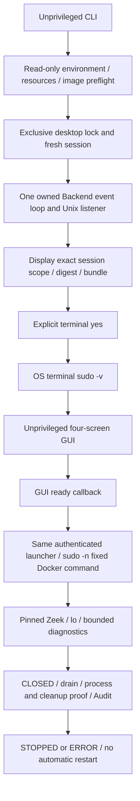

# Zeek one-command startup and terminal authentication

Status: **PARTIAL — Native execution pending**. This change implements and tests
terminal approval/authentication orchestration. It does not attest Native capture,
Native AI inference, DNS9 parity or operational readiness.

## Flow and ownership



The CLI owns the desktop lock before preparation. One Worker creates the Backend,
collector, session, generation and authenticated Unix listener. That same Worker
is passed to the desktop; the controller PID and start ticks do not change during
the terminal handoff. No second GUI Worker, controller session or launcher approval
is created. The listener remains owned while approval is pending.

Preparation and authentication do not capture packets. The GUI creates and renders
successfully before its ready callback submits the approved runner to the Backend.
The existing reader, bounded queue, strict CLOSED checks and finalization code are
reused. The direct developer GUI/manual launcher remains a separate fallback.

## Preflight and scope

Preflight rejects root, a noninteractive stdin, missing WSLg/Tk, less than 2GiB
available memory, fewer than two affinity CPUs, memory PSI avg10 >= 1, an unavailable
pinned image, and any existing `soc-zeek-*` container. The last check is a read-only,
unprivileged Docker inventory. An inventory failure blocks startup; it does not
justify silently removing an old container or requesting credentials early.

A private, locked desktop directory prevents a second GUI from being prepared.
Session retention still requires review at eight retained Zeek sessions. Existing
sessions, stop tombstones, archives, Audit and model files are preserved.

The new `soc-zeek-native-plan:v4` binds the new startup code, GUI execution boundary,
launcher and existing producer policies. Older plans are not approval for this
bundle. Their read-only recovery remains classified as legacy; no old session is
reactivated. The reviewed terminal display includes:

| Scope | Limit |
|---|---|
| Collector | Zeek 9.0.0, fixed official image digest |
| Interface | `lo`, caller's network namespace |
| Duration | 300 seconds from launcher execution |
| Packet metadata | 4096 records |
| Events | 8192 |
| Output / queue | 8MiB / 32 records |
| CPU / RAM / tmpfs | 1 / 512MiB / 16MiB |
| Native AI / DNS9 / operational gate | BLOCKED |

Approval waiting has no capture deadline. The existing 90-second accepted-launcher
watchdog bounds authentication/startup; OS authentication itself has a 60-second
timeout. Delayed GUI startup cannot grant an unbounded launch window.

## Authentication and privilege boundary

A new session requires a typed `yes` after the scope, session ID, plan digest,
controller PID/start ticks/generation, image digest, launcher SHA and bundle digest
are displayed. Rejection or EOF cancels the session.

Only `sudo -v` inherits the OS terminal for password handling. There is no `sudo -S`,
password prompt widget, password environment variable, credential logging or stored
password. The same process-local runner binds successful authentication to the exact
plan. There is no public `--preauthenticated` switch, reusable auth file or exported
auth token. Subsequent fixed Docker start/inspect/stop calls use `sudo -n`, so they
cannot ask for a second password from the GUI.

`sudo -v` uses the user's existing sudo policy and timestamp cache; it does **not**
create an OS command-scoped sudoers authorization. No sudoers or permanent capability
rule is installed. Application code validates the fixed commands and exact session.
The existing rootful Docker daemon remains a trusted privileged dependency. The
container retains only NET_RAW under the existing contract; post-open removal is
not newly attested by this work. GUI and launcher remain unprivileged.

If the OS timestamp expires, noninteractive privileged operations fail closed.
Cleanup failure remains UNVERIFIED; no automatic reauthentication or capture retry
is attempted. Native verification must test the host's actual sudo/TTY policy.

## Stop and recovery

Ctrl+C during approval/authentication is caught before capture. It records a bounded
reviewed failure code, requests USER_STOP, closes the listener and preserves the
session. Authentication failures/denials/timeouts follow the same no-capture path.

During the GUI, SIGINT schedules USER_STOP on the GUI thread; SIGTERM/SIGHUP request
CONTROLLER_EXIT. The Native attached Docker client uses a separate process group
within the same terminal session. This preserves terminal sudo cache semantics while
routing Ctrl+C through controller Stop/drain instead of directly interrupting the
attached Docker client. Its stdin is disconnected after authentication, so the
collector client cannot read terminal input. This contract has Mock/fixture coverage; actual OS sudo
behavior remains pending user validation.

GUI Stop/close and the existing packet/event/output/timeout boundaries reuse the
strict shutdown sequence: request Stop once, keep reading stdout, validate actual
CLOSED, drain the bounded queue, verify exit and exact container absence, append
Audit and release the listener/Worker. CLOSED is never synthesized. Docker `--rm`
or a dead CLI is insufficient cleanup proof. Failures remain ERROR.

`cli-exit.json` is an atomic, no-replace session-bound orchestration certificate.
It distinguishes NOT_STARTED, cleanup VERIFIED and cleanup UNVERIFIED. Audit records
APPROVAL_REQUIRED, AUTHENTICATING, STARTING, startup failure and GUI-ready launch
request alongside the existing accepted/started/closed/controller events. No Audit
chain is rewritten and no interrupted inference is automatically replayed.

## Historical failure

Session `99153ebf75c140c88181b4008166c5f7` was inspected read-only. Its Audit chain
verifies and includes LAUNCHER_ACCEPTED, COLLECTOR_STARTED and stream progress.
The exit certificate has 3195 messages, 884736 stream bytes, about 93.8493 seconds,
attached Docker client exit -9, missing CLOSED, and unverified cleanup/container
absence. A stop tombstone subsequently prevents reuse.

The user reported a sudo prompt and Ctrl+C. Stored evidence does not establish the
exact Ctrl+C phase, signal ordering or causal link to cleanup failure. In particular,
this session cannot be described as having no collector start. Root cause of that
specific interruption remains UNKNOWN. Original session files were neither changed
nor reused. The integration addresses a reproducible lifecycle hazard: direct terminal
interruption of the attached client and a separate manual handoff are removed from
the default flow; cleanup verification remains strict.

## GUI

Dashboard, Security Events, Investigation and System keep their cards, lightweight
charts, timelines and detail panels. System distinguishes the terminal-authenticated
session from the manual-copy fallback. Copy and new Prepare are disabled for the
managed command; another capture requires a fresh terminal command and approval.
Backend phase and process state drive PREPARING / APPROVAL_REQUIRED / AUTHENTICATING /
STARTING / ACTIVE / STOPPING / STOPPED / ERROR. Network/DNS event observations remain
NOT_OBSERVED when there are no corresponding records. ACTIVE is not model success.
No live graph or receipt is fabricated. Native AI, DNS9 and operational promotion
remain blocked.

## Validation and performance

Final numerical results, source SHA inventory, resource observations and exact test
suites are in `zeek-one-command-evidence.json`. Tests run under the privilege/network
execution guard: sudo/pkexec/setpriv, AF_PACKET/Internet sockets and Native Docker
options are denied. Only file fixtures, Unix sockets, owned process mocks and the
pinned offline Zeek image execute.

The one-command integration uses actual offline Zeek with packet-limit finalization,
mock OS authentication and a Mock GUI admission boundary. Its Native protocol labels
are deliberately exercised by the test, but the executed Docker command is replaced
with `--network=none`, no capabilities and a PCAP file. That is fixture evidence,
not Native capture. Separate actual WSLg tests exercise the shared Worker, ready
callback, four screens/resizing, disabled stale commands, Stop and SIGINT routing.
Actual RF/LR inference and READ-only investigations use the unchanged offline producer
path and model artifacts, with serial execution and memory preflight.

GUI measurements compare three fresh idle processes per source side, the same profiling
fixture/configuration and current WSLg host. Active fixture RSS is measured separately.
OS authentication overhead and Native collector/cleanup latency remain UNKNOWN because
real authentication/capture were not executed. Shared host load is uncontrolled; timing
changes are observations, not a claimed causal performance improvement. Historical
SIGILL root cause remains UNKNOWN.

## User Native validation

Close an existing SOC GUI normally before invoking a new desktop; the CLI does not
kill it. If startup reports prior containers or retention review, inspect and resolve
that state explicitly; never delete `stop.request` or reuse an old plan.

```bash
cd ~/kdt-linux/autonomous-soc-agent
.venv/bin/soc-agent start --gui --monitor total --collector zeek-live
```

With an activated environment, the command is simply
`soc-agent start --gui --monitor total --collector zeek-live`.
Review the new printed SHA/bundle and complete scope, type `yes` for that session,
then enter the password only into the OS sudo terminal prompt. The GUI opens as the
ordinary user, and collector startup follows its ready callback. Check Collector
ACTIVE separately from actual Network/DNS event observation and blocked model gates.
Stop via GUI or Ctrl+C; verify actual CLOSED, queue zero, cleanup proof, final state,
Audit and `cli-exit.json`. On failure retain the new session and report its reviewed
error. Do not retry that session or clear its stop file.

This command will perform real capture **only when the user separately approves and
executes it**. No Native command, privileged authentication or test traffic was run
by Codex for this change. The newly displayed launcher SHA/bundle require fresh
approval; prior helper approvals do not apply.

## Final measured results and approval identity

| Independent Export check | Result |
|---|---|
| Initial unit / contract / GUI-backend regression | 503 passed |
| Actual offline Zeek / controller / one-command fixture | 21 passed |
| Actual WSLg four-screen / charts / lifecycle | 12 passed |
| Policy / approval / Investigation / Audit / recovery | 125 passed |
| Final changed-path verification, including GUI creation failure | 126 passed |
| Final RF/LR / investigation / recovery integration | 1 passed |
| RF/LR proof-retention test update | 1 passed, two actual receipts |
| Final launcher terminal-I/O contract and retained model proof | 1 passed, two receipts |
| Published identity / startup contract tests | 20 passed |
| Ruff / format / clean wheel build | PASS |

The first and final matrices overlap; these counts are not a unique test total.
After final GUI failure handling, its affected paths were rerun. Product sources
then remained unchanged. The model test was subsequently updated to persist the
actual tested Plan and exit certificate inside its evidence JSON, because pytest's
retention cleanup can remove earlier temporary sessions. Its successful run and
retained artifacts are separate from the earlier successful model runs.

Initial new test harness failures were explicit: a dummy GUI omitted its render
callback, and a mock runner exited without CLOSED. The latter was correctly rejected
by the existing strict protocol. The GUI-only test now mocks capture admission;
the complete protocol integration uses actual offline Zeek CLOSED evidence. These
were fixture corrections, not an assertion that a flaky production fault was fixed.
No SIGILL, OOM or model drain timeout was observed in the final validation.

| Same GUI profiling configuration | Before | After |
|---|---:|---:|
| Fresh startup median, 3 samples | 2.3821s | 2.4972s |
| Idle RSS median | 174.51MiB | 174.66MiB |
| Idle CPU, percent of one core | 0.238% | 0.262% |
| Tk callback response p95 median | 0.0415ms | 0.0519ms |
| Active RF/LR fixture subtree peak RSS, 1 sample | 421.40MiB | 420.84MiB |
| Idle child / remaining child processes | 0 / 0 | 0 / 0 |
| Offline Zeek + launcher elapsed median, 3 samples | 0.8828s | 0.8214s |

Startup increased by about 0.115s in this sample. These measurements do not establish
a speed improvement or identify a cause under uncontrolled WSL host load. The tiny
Tk callback timings are event-loop probes, not full backend action latency.
The normal GUI component benchmark excludes terminal approval/password waiting.
Native authentication, collection latency and Native cleanup performance remain
UNKNOWN. The final model proof had more than 2GiB memory headroom (approximately 4GiB) and PSI avg10=0.00
before starting; inference and model checks ran serially. Full raw measurements and
worker CPU/RSS are preserved in the evidence JSON.

Preservation checks passed for 132 pre-existing dirty files across SOC/ML, 245 protected
SHA256 files, and the size/mtime/inode inventory of 58 raw dataset files. Raw datasets
were not rehashed wholesale. Existing model artifact SHA, legacy helpers/manifests,
Native evidence, Replay and existing staged state were preserved. The initial index
was empty. A read-only container inventory after verification found no remaining
`soc-zeek-*` containers; this does not retroactively verify the historical failed
session's cleanup certificate.

**New launcher SHA256**

`e6fdd36e0b21455c087d1466cba94061e83cb8a0c8dc97533b8649f4be39707a`

**New bundle digest**

`6e240ecbd69908a10676cfe9a300a0eca09aa6ddef0589e47f6b6fd42961a8dd`

The SHA/digest above require fresh session-specific approval. The pinned image is
`zeek/zeek@sha256:3fac39de707be96cb1a8163cab98a11bb2a1aa9e3535247db0f17b9c4670a019`.
The authorization scope remains lo / 300s / 4096 packet records / 8192 events /
8MiB output / queue 32 / CPU 1 / RAM 512MiB. Permission handling uses the existing
Docker daemon and terminal sudo policy, with NET_RAW for the bounded collector.
Native AI, DNS9 and operational promotion are still BLOCKED.

After the final stdin-disconnection change, the current-bundle identity guard
correctly failed against the superseded proof (one SHA mismatch; 125 other checks
passed). This was a source revision mismatch, not an intermittent test. The new
launcher and bundle were re-bound to newly executed offline model evidence before
repeating publication/affected-path checks. No old model plan was reconstructed.
