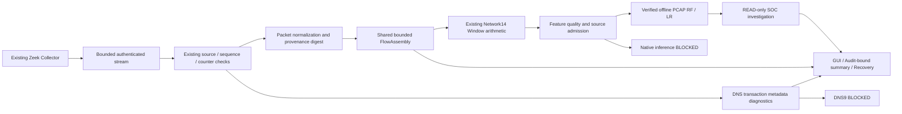

# Zeek real-time preprocessing

This change implements metadata preprocessing and lifecycle/quality evidence on the
existing bounded Zeek streaming runtime. Native capture quality remains UNVERIFIED;
Native AI, DNS9 and operational promotion remain BLOCKED. No privileged command,
Native capture, network/DNS test traffic, model retraining or security WRITE was run.

## Existing architecture and ownership

Baseline SOC `464dc87c722be9ee9eec2ec5ac8aba17b653c577`, ML
`e1a01260f0463a38d4d778859bc2a86f8e9cfbde`. Both main branches and initial empty
indexes were checked. Original user changes/Replay and protected artifacts/evidence
were hashed before edits; raw dataset sizes/mtime/inodes were recorded. The independent
Export excludes these dirty files and all model binaries, Native sessions and raw data.

Existing `Packet`, `Window`, Network14 arithmetic, metadata PCAP reference, adapters,
Integrity Verifier, offline model workers, SOC investigation and GUI are reused.
The duplicate Flow loop in `Stream` and `aggregate` is replaced by one `FlowAssembly`.
`preprocessing.py` owns normalized metadata provenance, bounded DNS transaction
counters and quality projections. `preprocessing_store.py` binds a final summary to
the existing append-only Audit. No second Collector, model or background worker is added.



## Network14 training contract

The source audit uses ML `verified_producers/network_v1_1.py`, `contracts.py`,
`network_research/dataset.py`, `training.py`, `evaluation.py`, `ctu13/flows.py` and the
existing artifact manifest. Actual artifact SHAs and manifest digests are verified by
the existing isolated worker; artifacts are never rewritten.

| Order | Name | Unit / formula before final float 32 conversion |
|---:|---|---|
| 1 | duration_seconds | (last packet ns − first packet ns) / 1e9 |
| 2 | forward_packet_count | first-observed endpoint-pair packet count |
| 3 | backward_packet_count | opposite endpoint-pair packet count |
| 4 | forward_ip_bytes | sum full IP length in first-seen direction |
| 5 | backward_ip_bytes | sum full IP length in reverse direction |
| 6 | ip_length_min | minimum full IP bytes |
| 7 | ip_length_max | maximum full IP bytes |
| 8 | ip_length_mean | sum IP bytes / packet count |
| 9 | ip_length_population_std | population standard deviation of IP lengths |
| 10 | tcp_syn_packet_count | packets with SYN bit, including retransmissions |
| 11 | tcp_fin_packet_count | packets with FIN bit |
| 12 | tcp_rst_packet_count | packets with RST bit |
| 13 | iat_mean_seconds | mean consecutive per-window delta / 1e9 |
| 14 | iat_max_seconds | maximum consecutive per-window delta / 1e9 |

Order is exact; all values are finite float 32 after binary64 arithmetic. Singleton
IAT zero is a defined formula, not imputation. Missing inputs/NaN/Inf are rejected.
Endpoints are canonical IPv4/IPv6, same family, TCP/UDP. Direction is first observed,
not host inbound/outbound or Zeek conn.log originator. Packet sizes are IP bytes,
not Ethernet frame bytes. No Flow duration is replaced by wall-clock elapsed time.

Training matrix construction verifies exact float 32 representation. Quality RF has no
scaler/imputer; Edge LR contains its training-only fitted StandardScaler followed by
LogisticRegression. The scaler stays in its existing artifact and is not refitted.

Training rows are verified packet Flow units, with 30s Idle and 120s Active boundaries,
source/label binding and complete-PCAP EOF handling. They are not arbitrary fixed or
sliding samples and do not split solely at TCP FIN/RST. The training assembler uses a
global event watermark and can expire other idle keys; the Zeek assembler preserves
its narrower same-key event-time closure policy. Ordered Golden fixtures verify packet
membership and features for the admitted timeout windows; they do not prove all Native
late-arrival populations match training. Runtime per-flow 128 and session 4096 bounds
are stricter than the producer arithmetic's 4096-per-window bound. Budget-ended windows
are incomplete, never promoted to complete training units.

Thus the numeric/training preprocessing contract is verified from source/manifests;
Native capture/population/window equivalence remains unverified. A new FIN/RST,
fixed/sliding Window strategy needs separate parity/evaluation and potentially retraining.
This change neither changes training semantics nor trains a model.

## Capture integrity and normalization

Process, stream, counter, capture, flow completeness and feature integrity remain
separate. CLOSED/Exit0/Cleanup verify process/protocol, not successful counter queries.
Numeric `get_net_stats()` zero drops cannot attest query success/window coverage.
The existing verifier keeps Native capture UNVERIFIED, gaps/kernel drops UNKNOWN.
The prior [integrity report](zeek-native-capture-integrity.md) records primary sources.
No independent AF_PACKET socket is treated as evidence of Zeek's socket losses.

Normalized records bind Session ID, Source digest/origin, envelope sequence, separate
Packet sequence, exact integer event time, declared precision, first-seen direction,
Flow-key digest, lengths/flags and parser support. The existing frozen Packet is reused;
no new raw payload/FQDN is stored. Declared microseconds do not prove Native timestamp
accuracy; Native extraction/precision parity remains unverified. Unsupported mixed
families, truncation, invalid IP length, UDP flags and ambiguous endpoints fail closed.
No zero-fill, clamping, sorting or false retransmission deduplication occurs.

Each accepted normalized record extends a session/source-bound rolling digest. The
record is discarded after accounting; existing bounded packet references remain only
where the producer requires them. Duplicate packet/envelope sequences fail closed.
Identical retransmissions with distinct valid sequences remain packets. Cross-Flow
start order can regress without changing per-Flow times; same-Flow regression aborts.

## Flow reconstruction, finalization and Window strategy

`FlowAssembly` owns active and finalized windows: at most 128 active keys,
128 packets per Flow,4096 packets per session and 1024 finalized windows. Existing
first-seen direction, packet/byte/flag statistics and exact integer IAT are retained.
`Stream` and the offline `aggregate` now call the same assembler and produce identical
Flow IDs, packet membership, float 32 values and values digests on Golden fixtures.

| Observation / termination | Treatment |
|---|---|
| IDLE_TIMEOUT / ACTIVE_TIMEOUT | Existing timeout candidate; all other gates still required |
| TCP_FIN / TCP_RST | Counted as Features; no new closure authority |
| VERIFIED_WINDOW_END / fixed or sliding window | Unsupported model boundary; rejected |
| Per-flow/session PACKET_LIMIT | Explicit incomplete window; inference blocked |
| EVENT_LIMIT / OUTPUT_LIMIT | Recorded finalization context; existing SHUTDOWN window stays incomplete |
| USER_STOP / CONTROLLER_STOP / timeout | Actual launcher reason retained; COLLECTOR_STOP context |
| CAPTURE_GAP / parser unsupported | Fail closed through existing capture/stream failure path |

A finalization is performed once. Duplicate finish, late packet after closure, sequence
gap and resource overflow raise reviewed errors; no silent eviction or automatic retry.
No packet-free wall-clock timer fabricates an Idle closure. Durations use only first
and last packet events, never the time of the next timeout-triggering packet.

## DNS preprocessing and visibility

The existing allowlisted Zeek DNS adapter produces transaction-summary metadata:
UID, transaction ID, query type, RCODE, RTT, bounded TTLs, truncation, protocol and
transaction-start time. Missing values remain None. New bounded counters distinguish
matched transaction metadata, response without timing, missing-response metadata,
missing query/TTL fields, duplicate records and transaction-start completion ordering.

This is not independent reconstruction of raw query/response packets. dns.log may be
written after a transaction completes, so decreasing transaction-start timestamps across
records are observed rather than falsely classified as packet reordering. Exact duplicate
IDs/digests are counted once; conflicting duplicate content fails closed. No query packet
count is invented from a summary, no missing RTT becomes zero, and DNS9 stays BLOCKED.

The original Native session was re-read without invoking a runtime store or changing
any evidence. The metadata projection contains 4096 packets,51 PACKET_LIMIT windows,
68 UDP53 records and zero DNS events. All 51 window arithmetic checks pass, but no
window is timeout-complete; Native models are not invoked. UDP53 is not a validated DNS
header. The preserved stream lacks payload/analyzer traces, so non-DNS format, analyzer
attachment, parse failure, incomplete transaction, adapter omission and WSL resolver
behaviour cannot be resolved. Verdict remains UNKNOWN_PORT53_METADATA_WITHOUT_DNS_EVENT.
No DNS request, resolver/interface modification or new capture occurred.

DNS9 lexical inputs (FQDN_count, subdomain_length, numeric, entropy, special, labels,
labels_max, labels_average, len) are not recreated from TTL/RCODE/RTT or name hashes.
The separately defined verified DNS7 producer is not DNS9 parity. Current privacy and
producer parity gates therefore prevent DNS9 inference.

## Feature quality, models and SOC

Feature success and model admission are distinct. Each bounded final report includes
source/session/stream identity, capture status, complete/incomplete counts, feature
names/order/dtype, producer versions, missing-value policy, values digests and actual
receipt Feature Digests when available. Per-profile artifact eligibility is independent.
One RF receipt cannot certify a missing LR artifact/receipt.

Native decisions use the existing capture/session/feature/artifact/policy classifier;
Native policy remains BLOCKED even if a metadata window is complete. Offline admission
also requires explicit ZEEK_OFFLINE_PCAP source and verified file identity, not a mutable
fixture flag alone. Before worker validation, candidate features do not claim ELIGIBLE.
Actual offline receipt windows can be ELIGIBLE only after independent producer parity,
artifact/source/digest/shape checks. Incomplete windows stay blocked.

The existing isolated, bounded, single-worker RF/LR path is reused, including duplicate
suppression, inference timeout, digest-bound provenance and receipt validation.
Model tests are serial with MemAvailable≥2GiB and low recent PSI. Actual fixture receipts
lead to scripted READ-only SOC evidence collection, assessment, checkpoint and JSON/
Markdown exports; scores remain uncalibrated research outputs, not operational risk.
There is no automatic response, operational promotion or external LLM call in these tests.

## GUI, Audit, recovery and retention

Four screens, cards, charts and timelines are preserved. The existing System detail panel
now exposes normalized packets, active/completed/incomplete windows, finalization reasons,
DNS diagnostics and quality/AI block reasons from the real cached Backend state. Empty
or legacy projections remain NOT_OBSERVED/None, never fake zero. No extra poll timer,
worker or model initialization is added. Fixture screenshots are explicitly labelled.

Stream-progress Audit now includes the normalization digest and active count. A bounded
`preprocessing-proof.json` is atomically published without replacement after actual
finalization. `ZEEK_PREPROCESSING_FINALIZED` appends its digest, session plan, stream and
Flow-decision binding to the existing Audit chain. It contains bounded aggregates and
four recent Flow quality records, no raw payload or domain text. A crash between file
and Audit append leaves an unbound proof and fails closed.

Recovery verifies source/Audit, exact stream digest/sequence/CLOSED, replays only saved
metadata in memory and compares the bound preprocessing proof. Existing receipt and
checkpoint restoration runs without new inference. Legacy sessions without this new
proof are not modified or assigned invented preprocessing evidence. Corrupt/missing or
unbound proofs fail closed; no capture is restarted and no stopped session is reused.

Raw payload is never newly persisted. Existing bounded packet logs/reference dictionaries
remain because independent producer and Audit verification still depend on them; this
change does not delete those references prematurely. GUI receives only aggregates/digests.
Existing output 8MiB, disk 16MiB, queue 32, inference queue16/concurrency1, CPU1 and RAM 512MiB
capture-process budgets remain unchanged. Interpreter/model-process RSS is measured
separately; a metadata count bound is not a claim of exact total-process memory usage.

## Validation and performance

Results, source inventory, model receipts, resource samples and performance measurements
are recorded in the accompanying evidence JSON. Fixture metrics never establish Native
throughput, DNS visibility or capture quality. SIGILL root cause remains UNKNOWN.

## Remaining blockers and Native approval

* Streaming packet normalization, flow statistics and feature candidates run while
  records arrive. The existing verified RF/LR route executes after offline PCAP process
  finalization, not during an unverified Native capture. This change does not claim
  online Native model admission or actual Native AI success.
* With the unchanged same-key event-time policy, a silent Flow remains active until
  another packet on that key proves a timeout, or source closure marks it incomplete.
  There is no new wall-clock Idle finalization authority.
* Native counter query success/window coverage and independent Native packet extraction/
  precision parity are still missing. Complete candidate Features cannot repair that.
* The preserved 4096-record Native limit and per-flow 128 cap can end busy sessions before
  eligible Idle/Active windows. This work does not increase budgets or waive eligibility.
* DNS visibility/analyzer behaviour cannot be reconstructed from 68 UDP53 metadata records
  without payload/analyzer evidence. No interface/resolver setting was changed.

Launcher/image/capture scope and legacy v2/v3 helpers are unchanged. Updated controller
modules change the reviewed bundle, so prior approval is not reused. A future user-only
Native diagnostics run needs a new session and explicit displayed scope approval:
lo, maximum 300s,4096 packet records,8192 events, output 8MiB, queue 32, CPU1, RAM 512MiB,
disk 16MiB, terminal-only OS authentication, no root GUI. Native AI/DNS9/operational gates
remain BLOCKED. New counter instrumentation or admission policy needs separate review.

```bash
.venv/bin/soc-agent start --gui --monitor total --collector zeek-live
```

The command is provided for a separately approved user run and was not executed here.
Never reuse a previous session, remove stop.request or infer old unverified flows on
recovery. Validate genuine CLOSED/Exit/Cleanup, drained queues, Audit and the new
preprocessing proof separately from actual capture quality.

## Executed tests and performance results

All automated pipeline tests ran under the guard rejecting privileged commands,
AF_PACKET/INET capture and network test traffic. Actual Zeek execution was offline
PCAP-only, pinned official image, capabilities dropped and container network disabled.
The full matrix and final affected-code runs are separate, overlapping checks:

| Independent Export run | Result |
|---|---|
| Zeek/streaming/GUI/producer/research/production unit regression | 560 passed,35.47s |
| Packet Golden parity, lifecycle/finalization/recovery integration | 39 passed,47.23s |
| Final normalization/source admission/recovery/identity checks | 172 passed,15.70s |
| Final actual Zeek PCAP → RF/LR → READ-only SOC and recovery | 1 passed,9.07s |
| Four-screen GUI/chart/lifecycle regression | 14 passed,61.65s |
| Final preprocessing GUI projection/resize | 1 passed,4.80s |
| Policy/Approval/Audit/Investigation/transport regression | 125 passed,14.98s |

No failing product test was declared fixed by an unexplained rerun. Validation incidents
are preserved explicitly: the first broad run had1 failure/559 passes because our long
basetemp made an existing archive-test Unix Socket exceed Linux's pathname limit; the
runner now uses short isolated /tmp paths. One new source-fault injection assertion
passed but cleanup failed because its deliberately altered fixture flag was not restored
before identity-checked shutdown. The test now restores its injected state in finally;
no production identity check was relaxed. A private runner syntax error occurred before
tests started and was corrected. Original failed logs/results remain available.

The final actual-model fixture is bound to the final source Bundle. It produced two
actual artifact receipts, two scripted READ-only investigations and one ELIGIBLE offline
timeout window; the second SHUTDOWN window is BLOCKED_FLOW_INCOMPLETE. Transport queue
peak/final7/0, inference queue2/0, no new inference on recovery, unchanged restored Audit.
RF/LR prediction latency18.984/11.245ms. These are single fixture observations, not Native
latency or attack-detection performance. MemAvailable samples before dispatch were
3.64–3.78GiB with PSI avg10=0.00; workers ran serially. Native input was never inferred.

The same file-only four-packet fixture was measured in fresh processes on clean baseline
and clean Export,20 warm-ups per measurement, CPU affinity12,500 pipeline/assembler
samples and1000 schema/feature/normalization samples. Quantities below are milliseconds:

| Stage | Before p50/p95/p99 | After p50/p95/p99 |
|---|---|---|
| Packet schema validation | 0.00681 /0.01293 /0.01805 | 0.00682 /0.01121 /0.01642 |
| Flow assembly + Features,4 packets | 0.04854 /0.07370 /0.08968 | 0.05334 /0.12850 /0.19808 |
| Window feature generation | 0.02157 /0.04674 /0.06291 | 0.03961 /0.05944 /0.11117 |
| Stream pipeline,4 packets | 0.19849 /0.37239 /4.14143 | 0.22263 /0.45139 /0.58718 |
| New explicit packet normalization | NOT_IMPLEMENTED | 0.01753 /0.01964 /0.03671 |

New source-bound normalization has measurable overhead: stream p50 increased about12.2%.
No throughput improvement is claimed. Host background load was not controlled; even
unchanged Window arithmetic showed timing variation, so these results do not establish
a causal regression for every stage. Both sides had zero errors and identical Golden
feature values. Full CPU/elapsed/RSS measurements remain in the evidence JSON. These
microbenchmarks contain no async queue; actual fixture queue values come from the
integration run. Native CPU/RSS/throughput, kernel counter overhead and DNS visibility
performance remain UNKNOWN. No rate/capture/resource policy was increased.

Three fresh default operator GUI processes per side, actual WSLg, no capture/models:

| Median | Before | After |
|---|---:|---:|
| Startup seconds | 2.646 | 2.683 |
| Idle RSS MiB | 175.195 | 174.777 |
| GUI callback p95 ms | 0.03884 | 0.11668 |
| Idle CPU,one core | 0.225% | 0.259% |

These short noisy observations are not a performance improvement claim. Both sides
created no runtime/model owner or child worker during idle, with zero idle controller
SQL statements. Existing four-screen rendering and bounded history are preserved.
[1366×768 fixture](zeek-realtime-preprocessing-screenshots/system-fixture-1366.png) and
[1920×1080 fixture](zeek-realtime-preprocessing-screenshots/system-fixture-1920.png)
are actual WSLg captures explicitly labelled NATIVE-PROTOCOL FIXTURE, not Native capture.

## Reviewed identity and acceptance

The existing launcher is unchanged; new preprocessing/controller code changes the bundle:

```text
Launcher SHA256: e6fdd36e0b21455c087d1466cba94061e83cb8a0c8dc97533b8649f4be39707a
Bundle Digest: 953f34ec2f9fa0172968ebc8c3d44022931640bc266753f9fe3920d6f45d98e4
Image: zeek/zeek@sha256:3fac39de707be96cb1a8163cab98a11bb2a1aa9e3535247db0f17b9c4670a019
```

| Acceptance | Verdict |
|---|---|
| Packet normalization / flow reconstruction | VERIFIED within declared metadata scope |
| Flow finalization | VERIFIED for unchanged timeout/budget contracts; FIN/RST are Features |
| Network14 training contract | VERIFIED source/manifest order/formulas/preprocessing; Native population parity UNKNOWN |
| Network14 Golden parity | VERIFIED offline tested TCP/UDP IPv4/IPv6 fixtures |
| DNS preprocessing | VERIFIED transaction-metadata scope; independent raw packet matching unavailable |
| DNS visibility | UNKNOWN for retained Native session |
| Feature quality gate | VERIFIED; feature success is separate from source/model admission |
| Quality/Edge fixture inference / SOC | VERIFIED actual artifacts and scripted READ-only investigation |
| GUI / Audit / recovery | VERIFIED by nonprivileged fixtures |
| Native capture integrity | UNVERIFIED |
| Native AI / DNS9 / operational promotion | BLOCKED |

Overall **PARTIAL**: real-time metadata preprocessing is implemented and offline model
integration verified, while Native collection quality and AI admission remain unverified.

Final independent published-evidence/crash-boundary checks: **54 passed in4.17s**.
The crash-between-summary-publication-and-Audit-append fixture rejects the unbound
certificate without replay, new inference or Audit modification. Ruff/format/diff pass.
The offline wheel built successfully;473 packaged Python/Zeek/JSON sources matched
Export bytes, including both new modules. No dependency was added. The CLI entry point
remains `soc-agent`. The final model plan is bound to the Bundle displayed above.
Preservation recheck:132 original user files,309 protected files and58 raw dataset stat
records matched; original Stage was empty and unrelated changes remain excluded.
